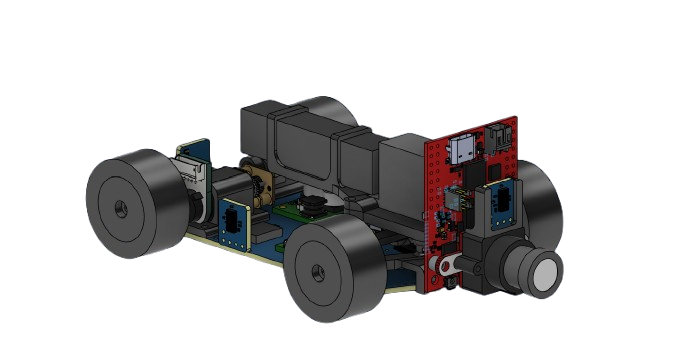
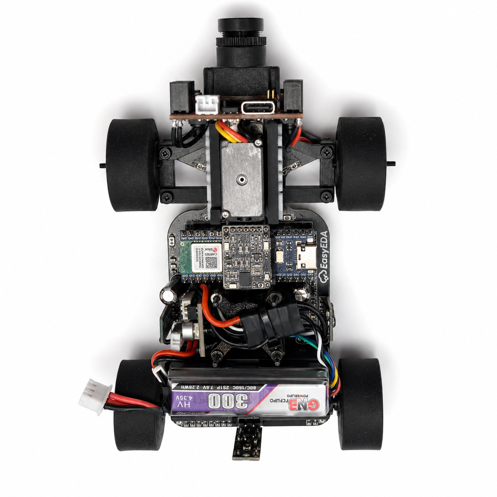
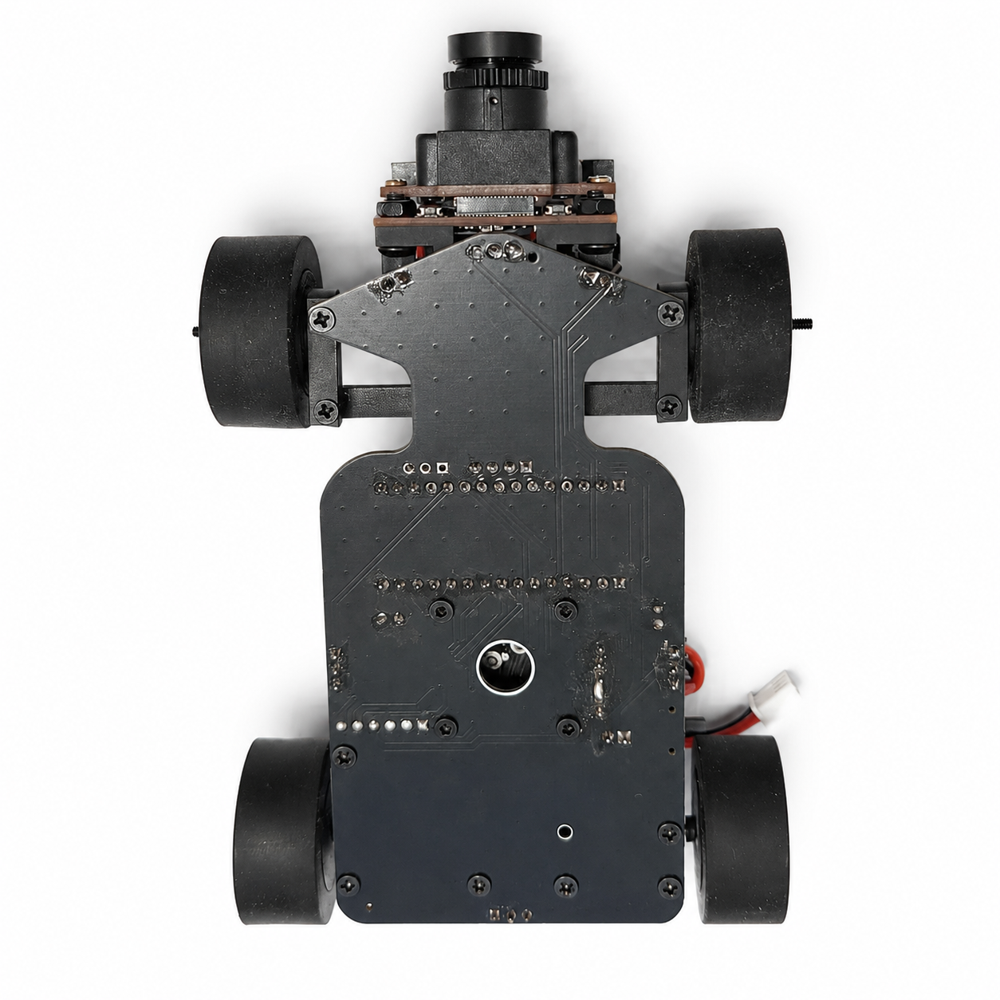
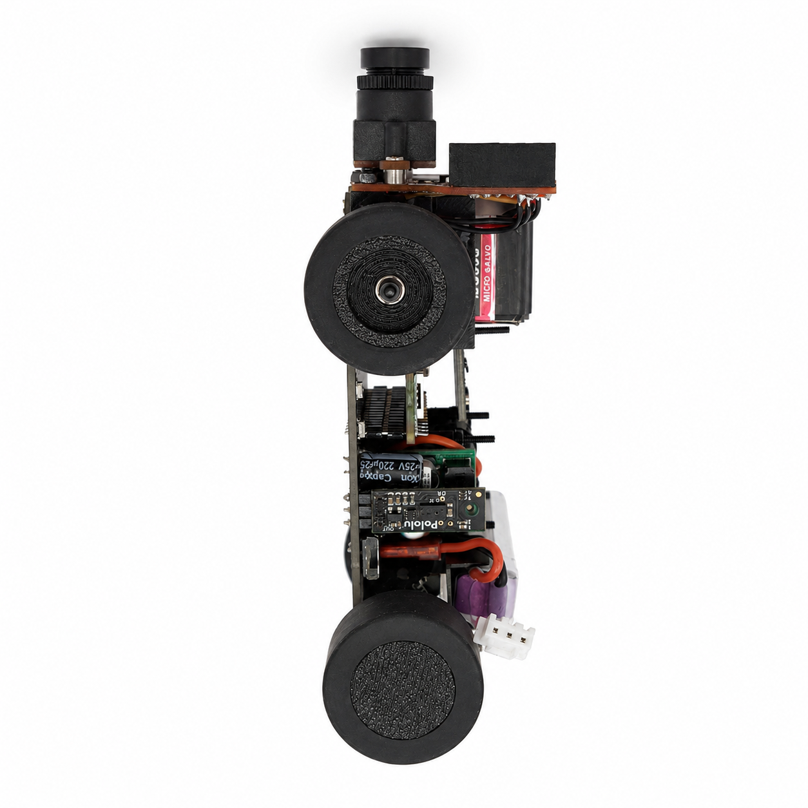
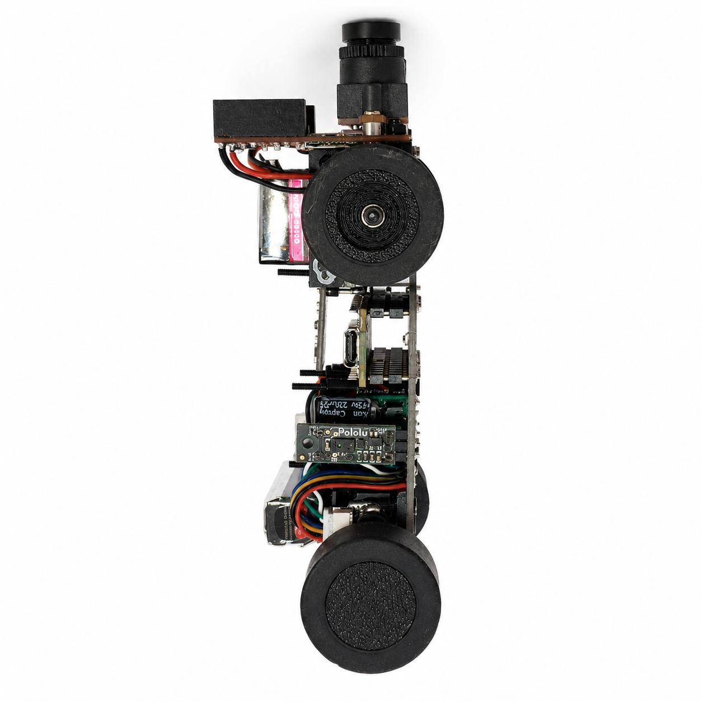
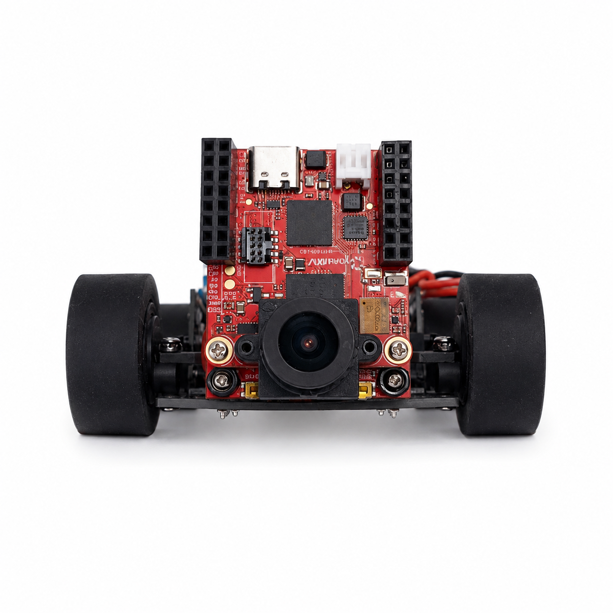
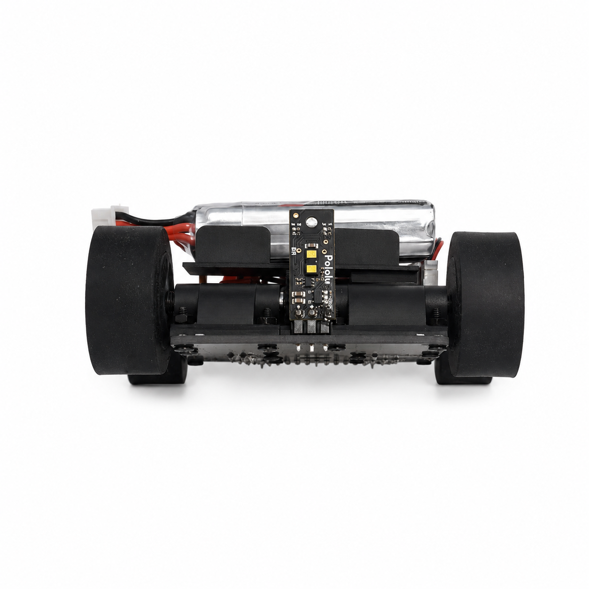
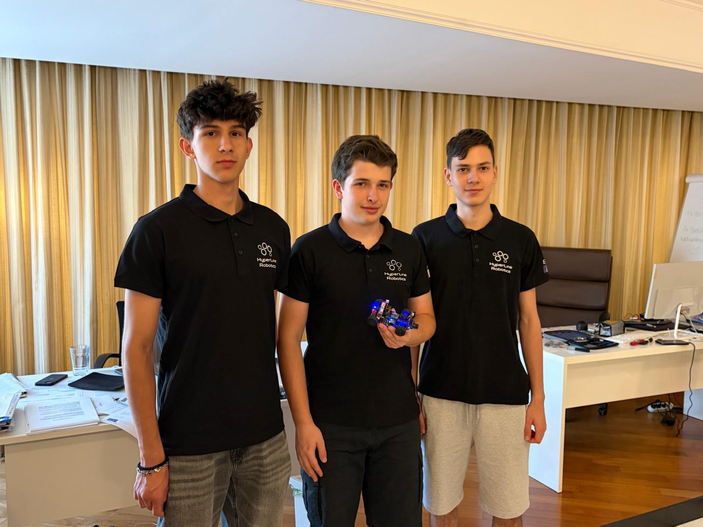

# HyperLine Robotics Team - WRO2026 Future Engineers

### 🔗 Links

<p align="left">
  <a href="https://hyperlinerobotics.com/" target="_blank">
    
  </a>

  <a href="https://www.youtube.com/@HyperLineRobotics_Team" target="_blank">
    
  </a>

  <a href="https://www.instagram.com/hyperlinerobotics_team/" target="_blank">
    
  </a>

  <a href="https://x.com/HLR_Team" target="_blank">
    
  </a>

  <a href="https://www.facebook.com/hyperlineroboticsteam" target="_blank">
    
  </a>

  <a href="https://github.com/andreipopescufilimon" target="_blank">
    
  </a>

  <a href="https://oshwlab.com/bicicleta11/works" target="_blank">
    
  </a>
</p>

Repository of HyperLine Robotics Team competing in the **World Robot Olympiad (WRO) 2026**, Future Engineers category. This repository holds everything behind our fully autonomous robot: the full firmware, electronics, CAD models, the full documentation, and the guide that brings the robot from parts to life.

This engineering journal documents how we designed, built and tested our autonomous vehicle for the World Robot Olympiad 2026 Future Engineers category. The following chapters explain our mechanical design, electronics, software, engineering decisions and the steps needed to reproduce the robot. We apply our technical decisions into our CAD models, circuit designs, code, and test results so another team can inspect our work rather than rely on descriptions alone.

---

## Documentation guide

| WRO documentation area | Chapter | What to find there |
|---|---|---|
| Overview | [01 - Overview](01-overview.md) | Project Overview | 
| Mobility and mechanical design | [02 - Mobility](02-mobility.md) | Chassis, rear differential, drivetrain, wheel design, steering geometry, mechanical calculations |
| Power and sensor management | [03 - Power & sensors](03-power-sensors.md) | Battery, custom PCBs, camera, IMU, ToF sensors, electrical architecture, validation |
| Software and autonomous operation | [04 - Software](04-software.md) | Software used for vision, navigation, control, communication, open challenge, obstacle challenge, parking |
| Engineering process and testing | [05 - Systems](05-systems.md) | V1 to V4.1 decisions, subsystem integration, trade-offs, measurements, test results |
| Reproducibility | [06 - Reproducibility](06-reproducibility.md) | CAD, manufacturing files, wiring, assembly guide, firmware setup, calibration |

---

## The vehicle at a glance

Our robot is a compact **front-steered, rear-wheel-driven autonomous vehicle**. Its main structural element is a custom PCB chassis, which also carries the electrical connections for the controller and sensors. A geared drive motor transfers power through a mechanical drivetrain composed of 2 gears, to the rear differential, while a servo moves the front wheels through a parallel steering linkage. Silicone tyres provide traction on the map surface.

The **Arduino Nano ESP32** handles navigation and motion control. The **OpenMV N6** processes camera images to identify coloured traffic signs and other visuals, then sends its observations to the main controller. A **custom BMI088 IMU** provides rotation and acceleration measurements, while our **custom TOF distance sensors** supply additional information about walls and parking boundaries. The sensors, code and steering mechanism work together to navigate the track autonomously.

### V4.1 CAD model



*Figure 1. CAD view of the V4.1 vehicle*

### National version compared with the current version

V4 served as our **national competition version**. V4.1 is an engineering refinement based on what we learned from that vehicle. We concentrated on three areas: more responsive distance sensing, stronger propulsion and changes to the wheel design, and faster vision processing. We retained the same PCB outline for chassis, front-steering, rear-drive concept instead of redesigning the entire robot.

| System | V4: national version | V4.1: current version | Engineering motivation / trade-off |
|---|---|---|---|
| Distance sensing | Pololu PWM-signal distance sensor | Custom TOF sensors capable of readign distanced up to 4m at a speed of 60Hz | Faster, farther and more reliable distance reading, as well as being able to read a 8 by 8 matrix of distances that can act as a LIDAR |
| Drive motor | Pololu 30:1 HPCB motor | Upgraded to **Pololu 50:1 HPCB** motor, as it gives almost twice as much torque | Higher torque motor, it improves acceleration and low-speed maneuvers |
| Wheel rims | Light 3D printed rims | Changed to heavier custom made 45# Steel rims | Revised wheel rims changes mass distribution on the silicone tire, resulting into higher wheel grip, this makes turning and braking more efficient |
| General layout | PCB-based chassis, front steering, rear differential | Same overall vehicle geometry, with revised components | Preserves the same robot layout as it showed to be very reliable, only upgrading some subsystems to remove found issues during testing |
| Downforce fan / ESC | Used to generate downforce | **Not installed** | Current vehicle no longer depends on artificial generated downforce, as the new wheel rims provide sufficient grip |

### Specifications and where to verify them

| Parameter | V4.1 design | Supporting evidence |
|---|---|---|
| Configuration | Front steering, rear drive with differential | [Mobility](02-mobility.md), [3D models](../3D-models/) |
| Main structure | Custom PCB chassis and printed mounts | [Electrical schematics](../electrical-schematics/), [3D models](../3D-models/) |
| Main controller | Arduino Nano ESP32 | [Power and sensors](03-power-sensors.md), [firmware](../src/) |
| Vision processor | OpenMV N6 | [Camera software](../src/camera.py), [software](04-software.md) |
| Inertial sensing | Custom BMI088 IMU | [Power and sensors](03-power-sensors.md) |
| Distance sensors | Custom VL53L5CXV0GC ToF sensors | [Power and sensors](03-power-sensors.md), [ToF board files](../electrical-schematics/TOF%20sensors/production-files/) |
| Propulsion | Updated higher-torque geared motor driving rear axle | [Mobility](02-mobility.md) |
| Steering | Servo-driven parallel front steering | [Mobility](02-mobility.md), [CAD](../3D-models/) |
| Wheels | Silicone tyres with revised, heavier rims | [Mobility](02-mobility.md), [wheel CAD](../3D-models/wheel%20with%20silicone.step) |
| Power source | 2S Li-Po in documented design; confirm installed pack | [Power and sensors](03-power-sensors.md) |
| Fan / fan ESC | Not installed on V4.1 | Current CAD and wiring |
| Dimensions, mass, speed and power draw | **Re-measure on complete V4.1 assembly** | [Systems and testing](05-systems.md) |

---

## What the robot must do

The **Open Challenge** requires the robot to navigate the course autonomously for 3 laps. The **Obstacle Challenge** adds red and green traffic signs that the vehicle must identify and pass on the correct side, followed by the required exit and park into the parking slot. We designed the vehicle to be reliable, easy to steer, and to have stable electrical power and predictable state transitions.

| Competition task | Our approach | Detailed explanation |
|---|---|---|
| Follow the course and complete laps | Inertial feedback from the IMU and distance sensing with controlled steering | [Software](04-software.md) |
| Recognise red and green obstacles | OpenMV camera colour detection and UART communication | [Software](04-software.md), [camera code](../src/camera.py) |
| Pass obstacles and recover | Separate approach, avoidance and recovery behaviours | [Software](04-software.md) |
| Park accurately | Slow manoeuvres with distance feedback | [Software](04-software.md) |
| Make runs repeatable | Rigid mounts, calibration, controlled tests and logged revisions | [Systems](05-systems.md), [Reproducibility](06-reproducibility.md) |

---

## Repository structure

We organise the repository so someone assessing the project can move directly from the documentation to the hardware and software evidence. The tree below reflects the **folder names shown in our current GitHub repository**. Individual production files and tests are stored inside their respective directories.

```text
WRO2026_Future_Engineers/
├── 3D-models/
│   ├── old-3D-models/
│   ├── README.md
│   └── *.step                   # Printable parts and assembly CAD
├── docs/
│   ├── docs-media/
│   ├── technical-drawings/
│   ├── 01-overview.md
│   ├── 02-mobility.md
│   ├── 03-power-sensors.md
│   ├── 04-software.md
│   ├── 05-systems.md
│   ├── 06-Reproducibility.md
│   └── README.md
├── electrical-schematics/
│   ├── IMU/production-files/
│   ├── Main PCB/production-files/
│   ├── TOF sensors/production-files/
│   └── README.md
├── other/
├── src/
│   ├── HLR_FE/                  # Main robot firmware
│   ├── tests/                   # Subsystem test code
│   ├── README.md
│   └── camera.py               # OpenMV firmware
├── t-photos/
├── v-photos/
├── video/
├── LICENSE
└── README.md
```

### Find the evidence

| Resource | Repository location | Use |
|---|---|---|
| Mechanical CAD | [3D-models](../3D-models/) | Examine or manufacture the steering, wheel and mounting components |
| Mechanical drawings | [docs/technical-drawings](technical-drawings/) | Check geometry and dimensions |
| PCB and manufacturing files | [electrical-schematics](../electrical-schematics/) | Inspect schematics and reproduce boards |
| Robot firmware | [src/HLR_FE](../src/HLR_FE/) | Study the controller and navigation implementation |
| Camera firmware | [src/camera.py](../src/camera.py) | Inspect colour-detection logic |
| Component tests | [src/tests](../src/tests/) | Verify individual subsystems |
| Vehicle photographs | [v-photos](../v-photos/) | Inspect the physical build |
| Team photograph | [t-photos](../t-photos/) | Identify the team |
| Videos | [video](../video/) | See the robot operating |

---

### Vehicle photographs

|          |             |
|----------------------------------|-------------------------------------|
| <p align="center"><b>Top</b></p> | <p align="center"><b>Bottom</b></p> |

|           |            |
|-----------------------------------|------------------------------------|
| <p align="center"><b>Left</b></p> | <p align="center"><b>Right</b></p> |

|            |           |
|------------------------------------|-----------------------------------|
| <p align="center"><b>Front</b></p> | <p align="center"><b>Back</b></p> |

---

## Team

We are **HyperLine Robotics**, a Romanian robotics team competing in WRO, Fast Line Follower, Sumo and Combat competition, we are combining experience in electronic engineering, mechanic engineering, and embedded programming to bring our projects to life. Our project brings together those skills in a single autonomous vehicle.



### **Popescu Filimon Andrei Cosmin** (middle)
**Age:** 18 <br>
**High School:** International Computer High School Bucharest (ICHB) <br>
**View my portofolio**: [https://andreipopescufilimon.com/](https://andreipopescufilimon.com/)

**Description:**
Hi! I’m Andrei from Romania, and this is my sixth WRO season. This is my second season in Future Engineers, as before I competed in the Robomission category. I am passionate about robotics, especially electronics and the latest algorithms and tech. Over the years, I have worked on multiple robotics projects, including line followers, sumo bots, and air quality modules. I am the founder of HyperLine Robotics Team, where I build and develop advanced robotics projects with my team. Apart from robotics, I also enjoy cybersecurity, programming, and cycling.

---

### **Horia Simion** (left)
**Age:** 17 <br>
**High School:** National College "Mihai Viteazul" (CNMV)

**Description:**
Hi! I’m Horia from Romania, and this is my third WRO season competing alongside Andrei. I have participated in RoboMission multiple times, gaining valuable experience in solving various problems that may arise while building a robot. I have a strong interest in technology and robotics and am always eager to learn and experiment with new ideas!

---

### **Eduard Alexandru Vasile** (right)
**Age:** 16 <br>
**High School:** Liceul Teoretic Alexandru Ioan Cuza

**Description:**
Hi! I’m Eduard from Romania. I’m passionate about robotics, especially building and testing competitive robots. I have worked on sumo robots, and recently I started developing line follower robots as well. I also enjoy driving and flight simulators, where I like exploring realistic control, precision, and performance.

Apart from robotics, I love MTB, video games, and cybersecurity. I’m always interested in learning new technologies, improving my skills, and working on projects that challenge me both technically and creatively.

---

## Video demonstrations

| Demonstration | Link |
|---|---|
| Driving demonstration | [Watch the recorded performance](https://www.youtube.com/watch?v=bg92ulHXomw) |
| Assembly demonstration | [Watch the assembly](https://youtu.be/HSzWATB6nWQ) |
