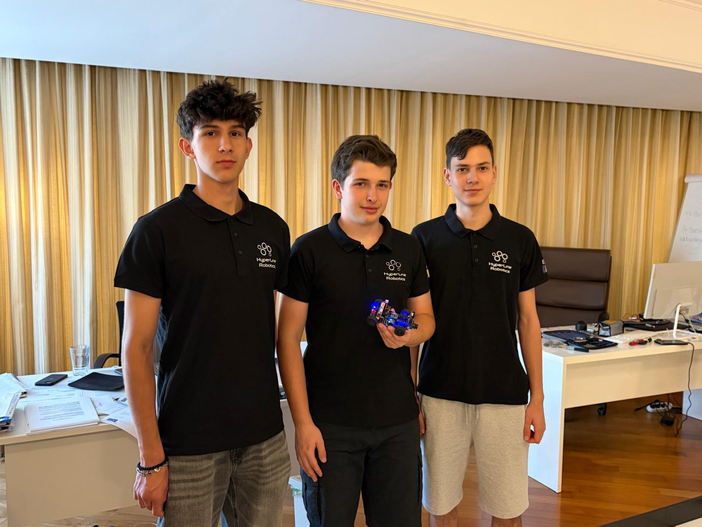
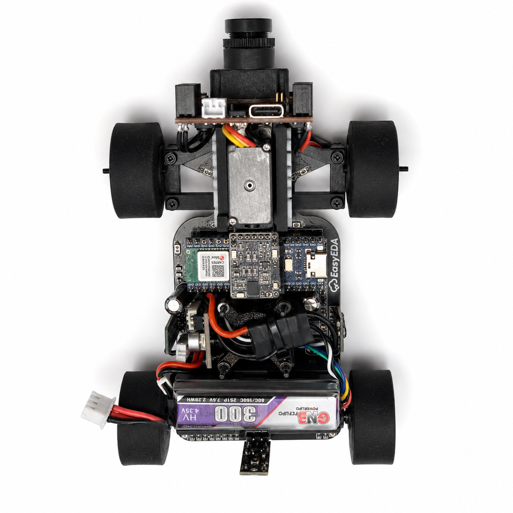
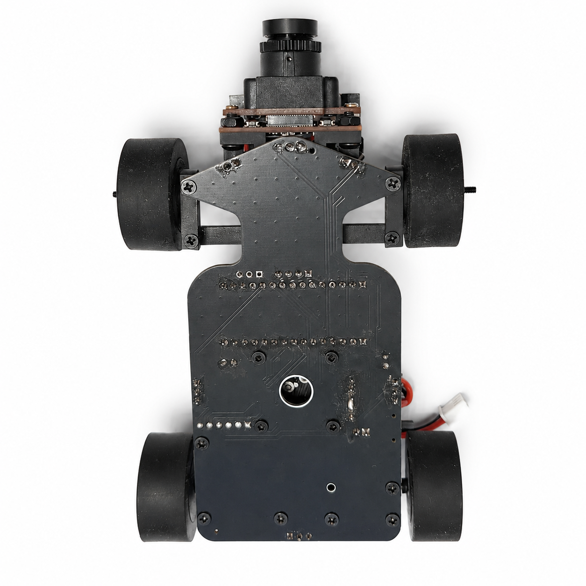
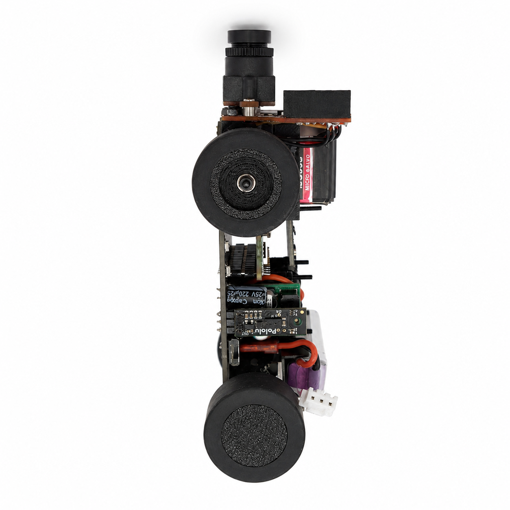
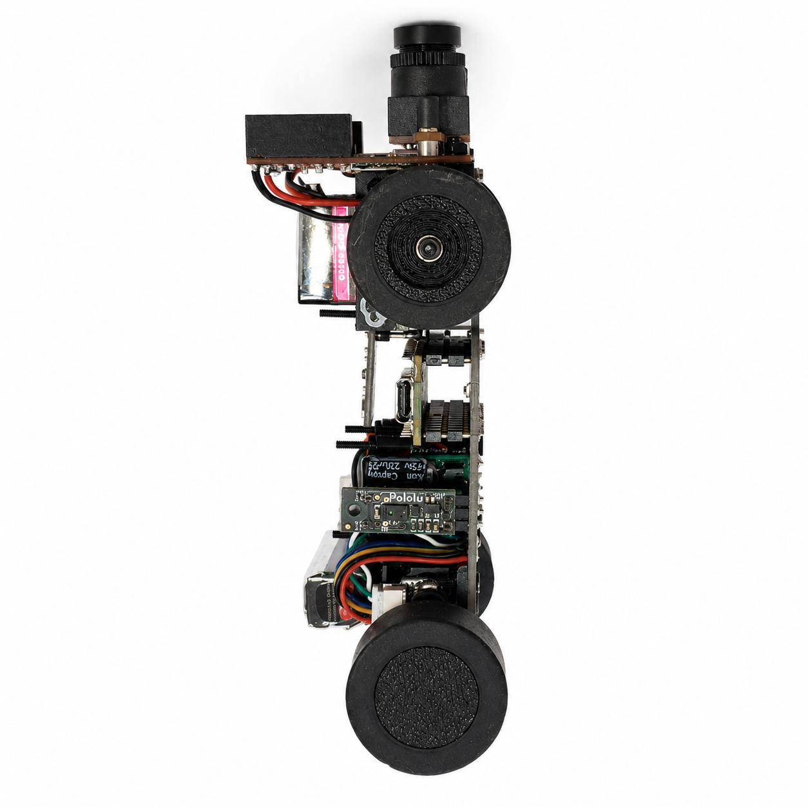
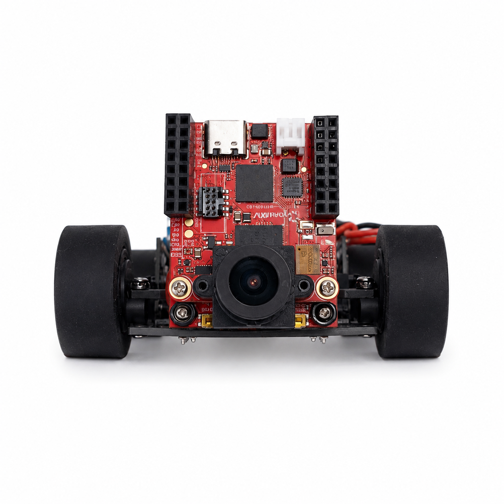
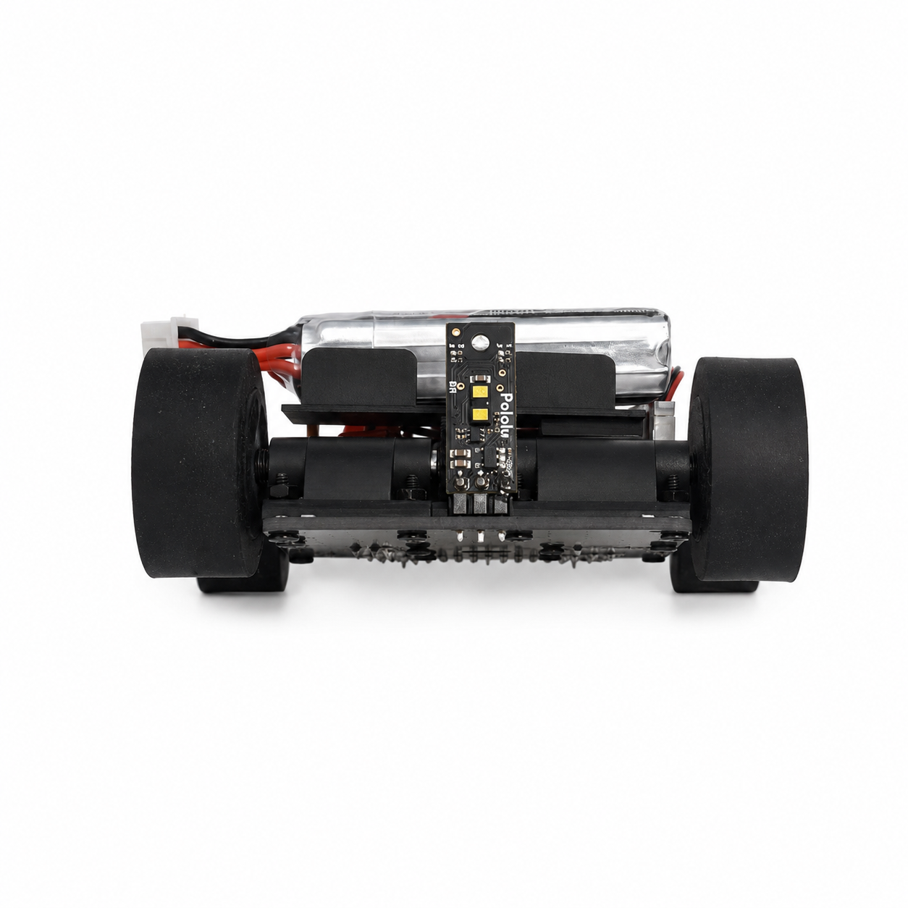

# 01 | Overview

**HyperLine Robotics · WRO 2026 Future Engineers**

This chapter introduces the team, the current autonomous vehicle and the evidence available in the repository.

| Chapter | Topic |
|---|---|
| [01 · Overview](01-overview.md) | Team, robot, challenges, evidence and results |
| [02 · Mobility](02-mobility.md) | Chassis, drivetrain, steering, tires and geometry |
| [03 · Power and sensors](03-power-sensors.md) | Electrical system, PCB, camera, IMU and validation |
| [04 · Software](04-software.md) | Control, perception, state machines and challenge strategy |
| [05 · Systems](05-systems.md) | Engineering trade-offs, iterations, performance and risk |
| [06 · Reproducibility](06-reproducibility.md) | Assembly, firmware, costs and test procedures |

---

> **Current configuration (2026):** The vehicle no longer uses an impeller, BLDC downforce motor or electronic speed controller. Older photos, drawings, demonstration videos and test records may depict previous revisions. Those artifacts are historical evidence, not instructions for the current build.

## 👥 The Team 

### **Popescu Filimon Andrei Cosmin** (middle)
**Age:** 18  
**High School:** International Computer High School Bucharest (ICHB)  
**View my portofolio**: [https://andreipopescufilimon.com/](https://andreipopescufilimon.com/)

**Description:**  
Hi! I’m Andrei from Romania, and this is my sixth WRO season. This is my second season in Future Engineers, as before I competed in the Robomission category. I am passionate about robotics, especially electronics and the latest algorithms and tech. Over the years, I have worked on multiple robotics projects, including line followers, sumo bots, and air quality modules. I am the founder of HyperLine Robotics Team, where I build and develop advanced robotics projects with my team. Apart from robotics, I also enjoy cybersecurity, programming, and cycling.

---

### **Horia Simion** (left)
**Age:** 17  
**High School:** National College "Mihai Viteazul" (CNMV)

**Description:**  
Hi! I’m Horia from Romania, and this is my third WRO season competing alongside Andrei. I have participated in RoboMission multiple times, gaining valuable experience in solving various problems that may arise while building a robot. I have a strong interest in technology and robotics and am always eager to learn and experiment with new ideas!

---

### **Eduard Alexandru Vasile** (right)
**Age:** 16  
**High School:** Liceul Teoretic Alexandru Ioan Cuza

**Description:**  
Hi! I’m Eduard from Romania. I’m passionate about robotics, especially building and testing competitive robots. I have worked on sumo robots, and recently I started developing line follower robots as well. I also enjoy driving and flight simulators, where I like exploring realistic control, precision, and performance.

Apart from robotics, I love MTB, video games, and cybersecurity. I’m always interested in learning new technologies, improving my skills, and working on projects that challenge me both technically and creatively.

---
## 🤖 Our Robot 
|          |             |
|----------------------------------|-------------------------------------|
| 
<b>Top</b>
 | 
<b>Bottom</b>
 |

|           |            |
|-----------------------------------|------------------------------------|
| 
<b>Left</b>
 | 
<b>Right</b>
 |

|            |           |
|------------------------------------|-----------------------------------|
| 
<b>Front</b>
 | 
<b>Back</b>
 |

Robot Specifications:
| Parameter | Value |
|---|---|
| Robot Length | ~145 mm |
| Robot Width | ~65 mm |
| Robot Height | ~55 mm |
| Total Weight | ~200 g |
| Wheelbase | ~65 mm |
| Ground Clearance | ~6 mm |
| Main Controller | Arduino Nano ESP32 |
| Vision System | OpenMV N6 |
| Drive System | Rear differential drive |
| Steering System | Parallel steering |
| Drive Motor | Pololu 50:1 HPCB Gearmotor |
| Steering Servo | MG90S |
| Battery | 2S Li-Po 300mAh |
| Maximum Stable Speed | ~3 m/s |
| Camera Processing Speed | ~40 FPS |
| Maximum Steering Angle | ~85° |
| Peak Current Consumption | ~7 A |
| Communication Protocols | UART, I2C, PWM |
| Chassis Type | Custom PCB chassis |
| Wheel Material | Cast silicone tires |

## Architecture at a glance

| Layer | Current design | Details |
|---|---|---|
| Structure | Custom PCB chassis and printed mounts | [Mobility](02-mobility.md) |
| Propulsion | Single 30:1 gearmotor driving a rear differential | [Mobility](02-mobility.md) |
| Steering | MG90S and parallel front-wheel linkage | [Mobility](02-mobility.md) |
| Main computation | Arduino Nano ESP32 | [Power and sensors](03-power-sensors.md) |
| Vision | OpenMV RT1062 | [Software](04-software.md) |
| Heading | Custom BMI088 board | [Power and sensors](03-power-sensors.md) |
| Range | Pololu PWM distance sensors | [Power and sensors](03-power-sensors.md) |
| Supply | 2S Li-Po and regulated 5 V logic rail | [Power and sensors](03-power-sensors.md) |

## Videos and photographic evidence

| Evidence | Link | What it demonstrates |
|---|---|---|
| Open and obstacle driving demonstration | [Performance video](https://www.youtube.com/watch?v=bg92ulHXomw) | Demonstration from the original README; check whether it shows the latest hardware |
| Mechanical assembly | [Assembly video](https://youtu.be/HSzWATB6nWQ) | Assembly of a documented revision; compare it to current build instructions |
| Robot views | [Robot photo folder](../../v-photos/) | Top, bottom, front, rear, left and right if available in the repository |
| Team photo | [Team media](../../t-photos/) | Team and participation evidence |

## Where to start

Start with the [mobility design](02-mobility.md) and [electrical architecture](03-power-sensors.md), then read the [software strategy](04-software.md). The [systems chapter](05-systems.md) explains design changes and verification, and [reproducibility](06-reproducibility.md) gives the rebuild procedure.
