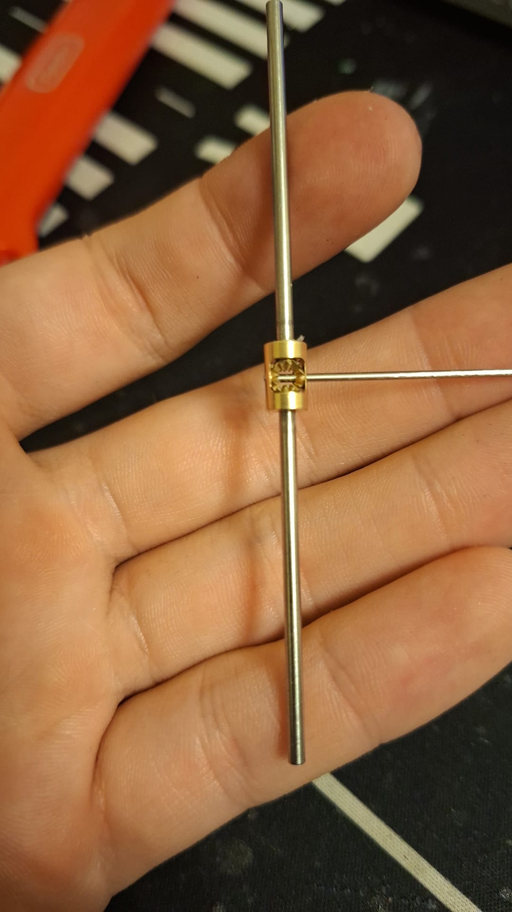
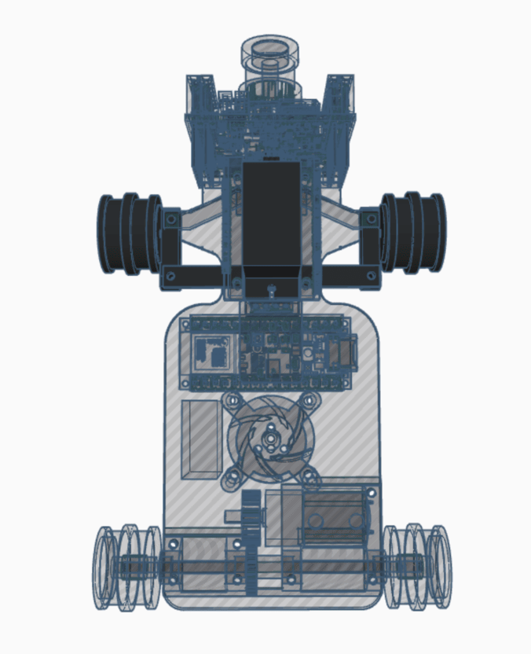
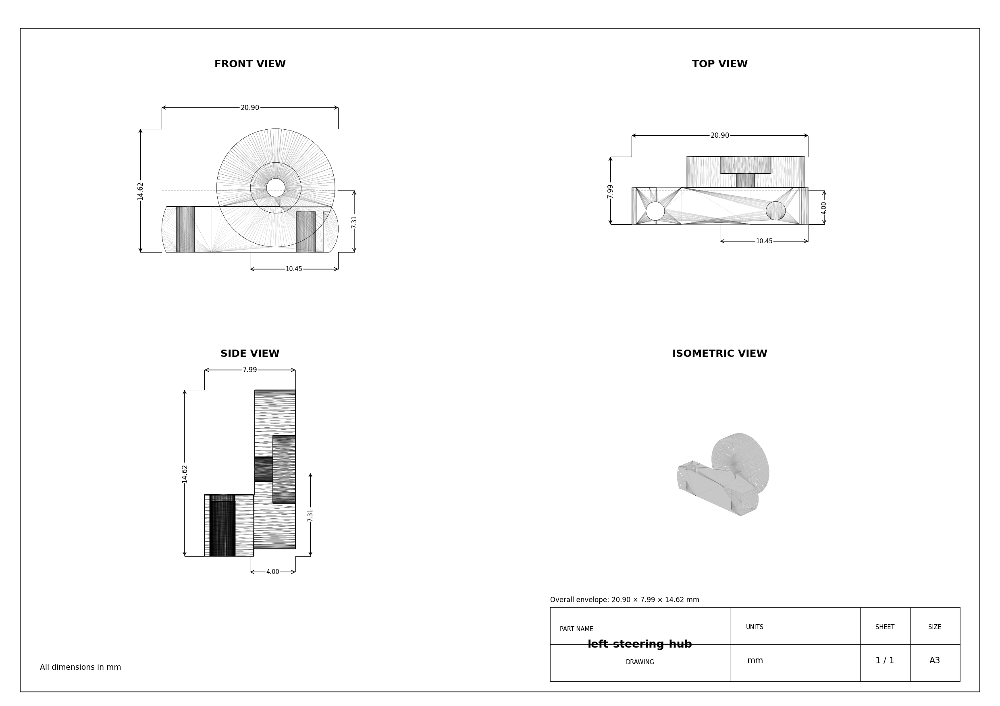
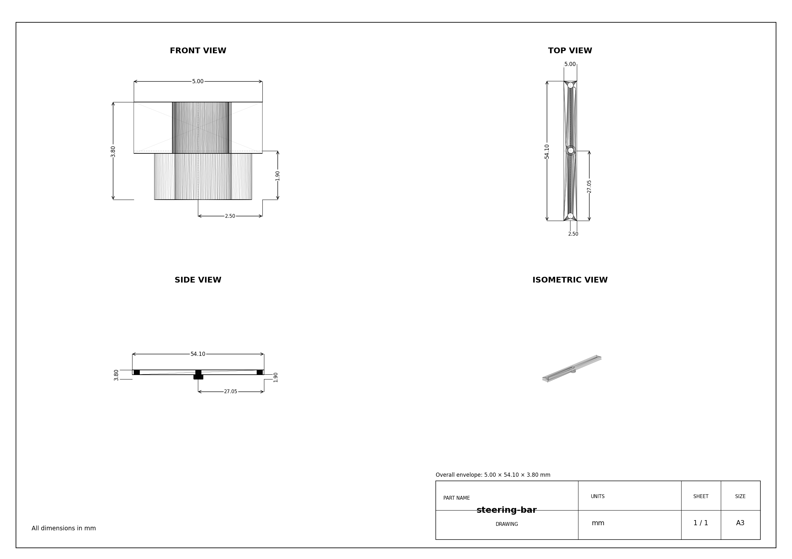
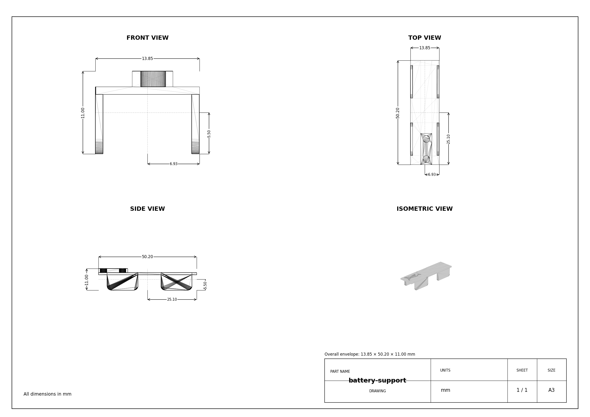

# 02 | Mobility and mechanical design

Mechanical design, load path, traction, kinematics, mounting and assembly evidence.

| Chapter | Topic |
|---|---|
| [01 · Overview](01-overview.md) | Team, robot, challenges, evidence and results |
| [02 · Mobility](02-mobility.md) | Chassis, drivetrain, steering, tires and geometry |
| [03 · Power and sensors](03-power-sensors.md) | Electrical system, PCB, camera, IMU and validation |
| [04 · Software](04-software.md) | Control, perception, state machines and challenge strategy |
| [05 · Systems](05-systems.md) | Engineering trade-offs, iterations, performance and risk |
| [06 · Reproducibility](06-reproducibility.md) | Assembly, firmware, costs and test procedures |

---

## Design intent

The vehicle uses a compact PCB as both the electrical carrier and the primary mechanical frame. The rear motor transmits torque through a printed gear into a differential; a single servo steers both front wheels. The design favors compact packaging, low play and predictable steering at low and high speed. Traction comes from tire contact and load distribution, without an active aerodynamic system.

## Mobility Management 

The robot's mobility is controlled through **a fully PCB chassis, a servo-based steering system, and a drivetrain featuring a custom differential and axes**. These components work together to ensure smooth, **precise movement with optimized traction, stability, and efficient power management**.

## **Drivebase** 

### **Drivetrain** 

The drivetrain uses a custom micro-RC differential at the rear, driven by a **Pololu 30:1 HPCB micro gearmotor** through a **3D printed gear** → **differential input gear**. The motor is held in a 3D-printed support with the battery mounted above, keeping the center of mass centered and low. Rear outputs rotate in bearings seated inside a printed part that contains 4 bearings for the wheel axles, this attachment is mounted using M2 screws to the PCB chassis, minimizing friction and parts count. 
At the front, the wheels are fully 3D-printed and each wheel runs on two bearings (inner + outer) for a rigid, wobble-free hub that steers precisely.

To maximize grip on the track we've made the wheel rims out of 45# steel. The drive motor is controlled by an **IFX9201SG driver (PWM + DIR)** with an active brake pulse for precise stopping, while the encoder on the gearmotor provides odometry for short, accurate moves (e.g., avoidance hops, parking nudges).

### **Motor – 30:1 Micro Metal Pololu Gearmotor HPCB** 

Following past testing, we selected **a high-power 30:1 Micro Metal Gearmotor (6V)** for the drive system. This motor provides an **optimal balance of speed and torque**, allowing the robot to maintain stability while navigating turns.

|  | **Specifications** |
|------------------------------|------------------------------|
| **Model:** 30:1 HPCB | **Voltage:** 6V |
| **No-load Speed:** 1000 RPM | **No-load Current:** 120mA |
| **Stall Torque:** ~0.45 kg·cm | **Stall Current:** 1.6A |
| **[Buy Here](https://www.pololu.com/product/5184)** | **Function:** Drives the robot |

**Why We Chose This Motor?**  
**- Gear ratio provides sufficient torque** without sacrificing efficiency.  
**- Compact and lightweight design**, allowing integration into a lightweight robot.

### Wheels & Tires (Silicone) 

**Why silicone?**
- Grip & consistency: Strong adhesion on smooth surfaces → faster exits and shorter braking distances.
- Low wear on the map: Softer compound grips without scratching.
- Stable handling: Predictable breakaway, so PD/PID steering stays smooth.

**Construction:**
- Rims: 3D-printed hubs with dual bearings (inner + outer) for a rigid, wobble-free wheel.
- Tire: Cast silicone ring fitted onto a mechanical bead on the rim (no harsh solvents needed).
- Fit: Rear wheels mount directly to the diff axle outputs; fronts ride on steering hubs for low friction.

#### **Torque and Speed Reasoning** 

The 30:1 Pololu HPCB gearmotor was selected because it provides a good balance between speed and usable torque. A lower gear ratio would increase the maximum speed, but the robot would lose acceleration and braking control. A higher gear ratio would give more torque, but the robot would become slower on long straight sections.

The goal was not to choose the fastest possible motor, but the fastest motor that could still:
- accelerate smoothly without wheel slip,
- brake before turns and obstacles,
- recover from small steering errors,
- perform short controlled movements during parking,
- be reliable and not burn

| Option Considered | Advantage | Disadvantage | Decision |
|---|---|---|---|
| Lower gear ratio motor | Higher theoretical top speed | Less torque, weaker braking, harder parking control | Rejected |
| Higher gear ratio motor | More torque and easier low-speed control | Lower speed on long straights | Rejected |
| 30:1 HPCB gearmotor | Good speed, enough torque, compact size | Needs careful speed control | Selected |

This choice improved the robot’s consistency because the car could drive fast while still keeping predictable control during turns and obstacle sections.
## **Steering** 

The **steering system** is a critical part of the robot, ensuring precise maneuverability and smooth turns. Our design is based on a **parallelogram steering mechanism**, where both front wheels turn at the same angle through a single servo-controlled linkage. This setup provides predictable and stable steering, making it easy to use for an autonomous vehicle. Instead of using an **Ackermann steering system**, which requires more complex calculations and linkages, we opted for a **simpler and more lightweight solution** that offers consistent control. Our steering system allows for a maximum turning angle of 80 degrees in both the left and right directions. This range provides precise maneuverability, enabling the robot to navigate sharp turns efficiently while maintaining stability.

Our **steering arm is directly connected to the servo**, which moves the two front wheels simultaneously. This ensures that the turning response is immediate and proportional to the servo's motion. The **wheels are mounted on special mounts hubs**, allowing for smooth and precise movement without excessive friction. To ensure **structural integrity and long-term reliability**, the steering system is **assembled using M2 screws on which the hubs can turn**. 

---

### **Steering Servo – MG90S** 

To control the steering system, we use an **MG90S micro servo**, known for its high torque and fast response. This servo enables quick and precise adjustments while maintaining a compact and lightweight design. Featuring **metal gears**, it ensures durability and reliability over extended use. The servo is securely mounted onto the chassis with two screws, and the steering arm is directly attached to its output shaft, providing smooth and efficient motion transfer for accurate steering.

|  | **Specifications** |
|------------------------------|------------------------------|
| **Model:** MG90S | **Voltage:** 5V |
| **Torque:** 2.2kg/cm | **Signal Type:** PWM |
| **Current Draw (Avg):** 120mA | **Peak Current:** 500mA |
| **Weight:** ~13.4g | **Gears:** Plastic |
| **[Buy Here](https://www.optimusdigital.ro/ro/motoare-servomotoare/271-servomotor-mg90s.html?srsltid=AfmBOooTrDsx2UoJ3Px8J26kkCbcuYhlpKYmuIYkivK_5ZSzPJx0ZNo8)** | **Function:** Controls steering |

---
## **Chassis & Component Mounting** 

The chassis of our robot is built around a custom PCB structure, which acts both as the electrical base and as the main mechanical frame. This design helps reduce unnecessary wiring, saves space, improves rigidity, and keeps the robot compact enough for fast movement inside the track.

Instead of using a fully 3D-printed frame, we chose a PCB chassis because it gives better precision for mounting electronic components and keeps the wiring much cleaner. The main controller, motor driver, voltage regulator, connectors, IMU, and sensor connections are all integrated directly into the board. This reduces the risk of loose wires during testing and makes the robot easier to repair or debug.

The battery is mounted close to the center of the robot to keep the center of mass balanced. This helps the robot stay stable when accelerating, braking, or turning. The OpenMV camera is mounted at the front side of the robot via same 3D printed mounting parts used for the steering servo, positioned to clearly detect colored cubes, walls, and track markings. Distance sensors are placed around the robot to assist with wall detection, parking, and starting direction.

Overall, the chassis and mounting system were designed to be lightweight, rigid, compact, and easy to maintain. Every component has a fixed position, making the robot more reliable during repeated tests and competition runs.

---

## Geometry and mounting

The original dimensions and assembly photographs are in [overview](01-overview.md). For a reproducible mechanical record, publish the latest dimensioned drawing, wheel diameter, track width, measured wheelbase, ground clearance, turning radius and steering angle measured at the wheels (not merely servo travel).

### Mechanical verification procedure

1. With motor power disconnected, rotate each wheel and check bearings for binding.
2. Center the servo in firmware before fixing the steering horn; check both front wheels for alignment.
3. Check rear differential gear mesh and backlash throughout one complete axle revolution.
4. Measure steering angle at full left, center and full right and record the output in a small table.
5. Measure turning radius in both directions at the same speed and load.
6. Photograph the actual final hardware from all six sides and label which revision is pictured.

| Mechanical measurement | Original README | Latest verification |
|---|---:|---|
| Wheelbase | approximately 65 mm | **To measure** |
| Ground clearance | approximately 6 mm | **To measure** |
| Robot mass | approximately 200 g | **To reweigh** |
| Steering angular travel | claimed up to approximately 85° | **Measure at wheels** |
| Turning radius, left/right | not given | **To measure** |

## Mechanical iterations

## Testing & Iterations 

During development, multiple robot revisions were designed and tested to improve steering precision, reliability, and overall track performance. The robot was developed through several iterations. Each version was tested on the main tasks required by the WRO Future Engineers challenge: stable driving, obstacle handling, cornering, and parking.

| Version | Main problem found | Change made | Result |
|---|---|---|---|
| V1 | The chassis was too large and the steering response was slow | Reduced the chassis size and changed the mechanical layout | Better turning response |
| V2 | The robot was reliable on straight sections but less stable during parking | Moved the side sensors closer to the PCB and improved rear distance sensing | More stable parking approach |
| V3 | Obstacle handling needed smoother recovery after passing traffic signs | Added clearer software states for cube following, avoidance, and recovery | More consistent obstacle challenge behavior |

## Design limitations

Tire grip, servo backlash, printed gear tolerance and chassis flex can alter the planned motion. The latest design should be checked with the same battery installed and under the same floor conditions used for competition.
