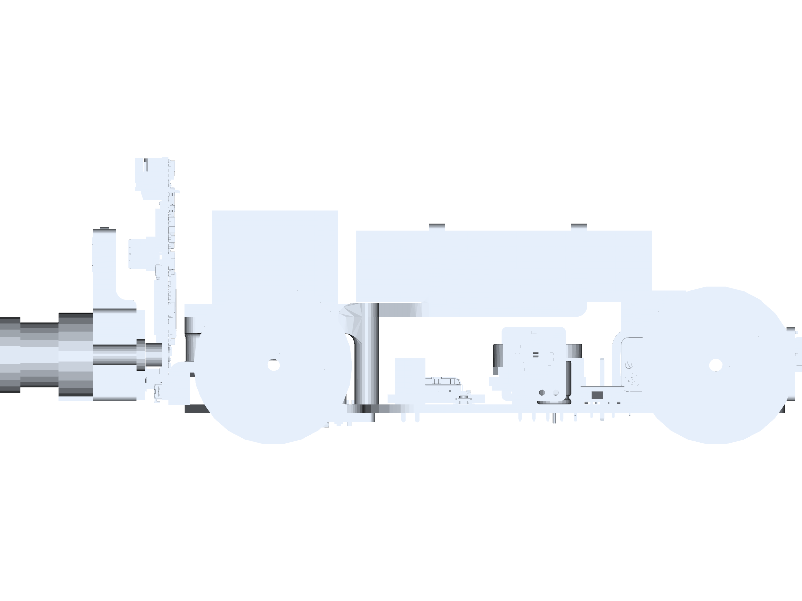
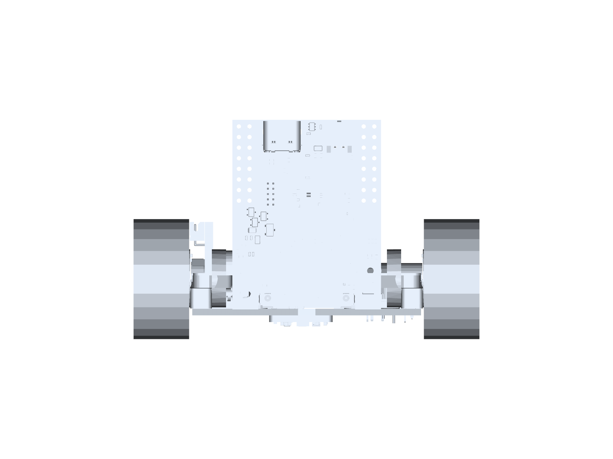
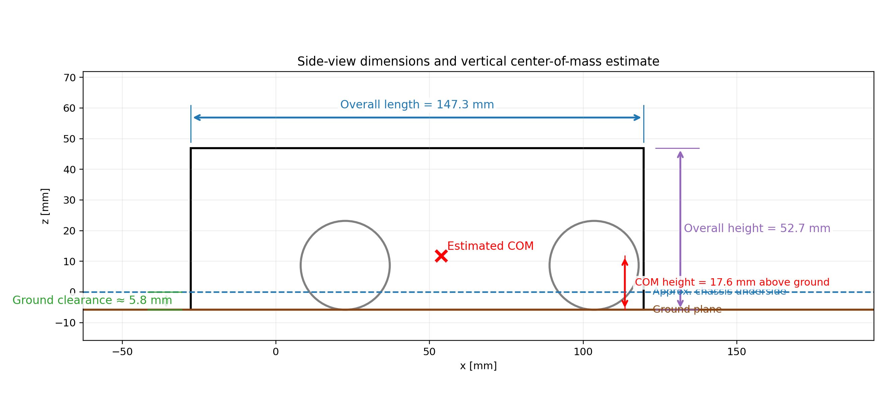
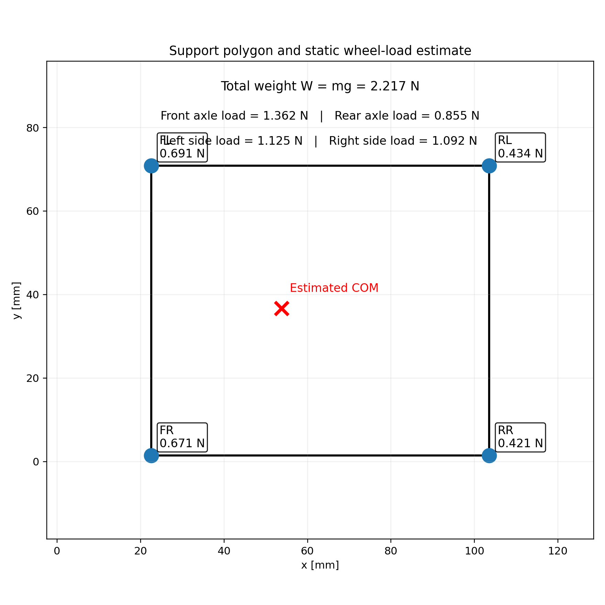

# 02 | Mobility and Mechanical Design

[**01 Overview**](01-overview.md) &nbsp;·&nbsp; **02 Mobility & Mechanical Design** &nbsp;·&nbsp; [**03 Power & Sensors**](03-power-sensors.md) &nbsp;·&nbsp; [**04 Software**](04-software.md) &nbsp;·&nbsp; [**05 Systems**](05-systems.md) &nbsp;·&nbsp; [**06 Reproducibility**](06-reproducibility.md)

---

The **V4.1** vehicle is our current WRO Future Engineers design. We developed its mechanical layout to combine four-wheel stability, parallel front-axle steering and rear-wheel drive in a compact chassis. This chapter presents the design choices, mechanical model, CAD-derived geometry, calculations, and the tests used to assess the vehicle. V4 is mentioned only where its comparison helps explain a V4.1 improvement.

The V4.1 geometry below was extracted from the complete assembly STEP model. The assembled robot has a measured mass of **226 g**. We distinguish **CAD dimensions**, **calculated estimates**, and **physical measurements** so that each result can be checked and repeated. Values still requiring measurement are shown as **[TO COMPLETE]**.

---

## 1. Design objectives

The mobility system was designed to satisfy four main requirements:

- stable four-wheel motion on the WRO field,
- compact packaging inside the WRO size limits,
- steering-based vehicle kinematics rather than differential steering,
- predictable behavior in high-speed autonomous driving and parking.

We use a **front-steered, rear-driven four-wheel chassis**. A single geared motor drives the rear wheels through a mechanical differential. The front steering hubs move through a servo-driven parallel linkage that turns both front wheels through approximately equal angles. A custom PCB serves as the main mounting structure. The layout allows rear wheels to rotate at different speeds in turns while the front wheels control direction without differential steering.

---

## 2. CAD extraction method

The STEP assembly was processed to extract:

- overall bounding box,
- wheel centers,
- wheel diameter and width,
- axle spacing,
- track width,
- overhangs,
- vertical package height,
- a **geometry-based center-of-mass estimate**.

### 2.1 Center-of-mass methodology

The geometry-derived centroid uses **equal density for all imported solid volumes**. This is a useful geometric reference but is **not a verified physical center of mass**: V4.1 contains PCB material, metals, plastics, motors, electronics and battery materials of different densities. We use our measured 226 g total mass to scale force calculations and treat every result that depends on the estimated centroid as provisional until checked through scale measurements.

Our reference method is a four-scale static weighing test, followed by a component-by-component mass model if necessary. The completed test will replace the equal-density estimate with the actual mass distribution.

**Measurements to add:** [TO COMPLETE: front-left wheel force], [TO COMPLETE: front-right wheel force], [TO COMPLETE: rear-left wheel force], [TO COMPLETE: rear-right wheel force], [TO COMPLETE: scale precision] and [TO COMPLETE: test photograph].

---

## 3. CAD renders and extracted geometry

### 3.1 Assembly renders

#### Figure 2.1: Isometric CAD render

  

#### Figure 2.2: Top CAD render

  

#### Figure 2.3: Side CAD render

  

#### Figure 2.4: Front CAD render

  

The longer front overhang supports the sensing and steering assembly, while the driven axle is packaged closer to the rear edge. We define the **front axle** as the axle near the camera and front sensing structure. The CAD coordinate x increases from front toward rear, so the front axle has the smaller x-coordinate.

### 3.2 Dimension diagrams

#### Figure 2.5: Top-view mechanical dimensions extracted from CAD

  

#### Figure 2.6: Side-view dimensions and COM height estimate

  

#### Figure 2.7: Support polygon and static wheel-load estimate

  

---

## 4. V4.1 geometry and dimension verification

The annotated CAD reference below identifies the vehicle envelope, front and rear axles, wheelbase, track width and overhangs directly on the V4.1 assembly. It also defines the wheel and clearance measurements used in the table.

  

*Figure 2.8. Dimension guide drawn over our V4.1 STEP assembly. Dimensions are CAD values, not post-assembly measurements.*

Table 2.1 summarizes the key geometric values extracted from the assembly.

| Parameter | Symbol | Value | Source / comment |
|---|---:|---:|---|
| Overall length | $L_\mathrm{tot}$ | **147.3 mm** | CAD bounding box |
| Overall width | $W_\mathrm{tot}$ | **82.8 mm** | CAD bounding box |
| Overall height | $H_\mathrm{tot}$ | **52.7 mm** | CAD bounding box |
| Front axle x-position | $x_f$ | **22.55 mm** | Wheel centers from STEP |
| Rear axle x-position | $x_r$ | **103.55 mm** | Wheel centers from STEP |
| Wheelbase | $L$ | **81.0 mm** | $x_r-x_f$ |
| Right wheel center y-position | $y_R$ | **1.42 mm** | Wheel centers from STEP |
| Left wheel center y-position | $y_L$ | **70.88 mm** | Wheel centers from STEP |
| Track width | $T$ | **69.47 mm** | $y_L-y_R$ |
| Front overhang | $O_f$ | **50.3 mm** | Distance from front bumper to front axle |
| Rear overhang | $O_r$ | **16.1 mm** | Distance from rear bumper to rear axle |
| Wheel diameter | $D_w$ | **29.0 mm** | Directly extracted from wheel geometry |
| Wheel radius | $r_w$ | **14.5 mm** | $D_w/2$ |
| Wheel width | $b_w$ | **13.3 mm** | Directly extracted from wheel geometry |
| Approximate underbody clearance | $h_c$ | **5.8 mm** | Ground to lowest chassis underside |
| Measured total mass | $m$ | **226 g** | Physical measurement |
| Measured physical length | $L_{\mathrm{actual}}$ | **[TO COMPLETE] mm** | Calipers or ruler, assembled robot |
| Measured physical width | $W_{\mathrm{actual}}$ | **[TO COMPLETE] mm** | Maximum width including tires |
| Measured physical height | $H_{\mathrm{actual}}$ | **[TO COMPLETE] mm** | Maximum height with electronics |
| Physical wheelbase | $L_{\mathrm{actual}}^{\mathrm{WB}}$ | **[TO COMPLETE] mm** | Axle-center spacing |
| Physical track width | $T_{\mathrm{actual}}$ | **[TO COMPLETE] mm** | Tire contact-center spacing |
| Measured ground clearance | $h_{c,\mathrm{actual}}$ | **[TO COMPLETE] mm** | At normal operating mass |

The geometry values are taken directly from the **V4.1 CAD assembly**. Our physical verification is recorded in the additional rows. CAD measurements cannot account for printed shrinkage, assembly tolerances or tire deformation.

### 4.1 Basic dimensional calculations

Wheelbase:

$$
L = x_r - x_f = 103.55 - 22.55 = 81.00\ \text{mm}
$$

Track width:

$$
T = y_L - y_R = 70.88 - 1.42 = 69.47\ \text{mm}
$$

Wheel circumference:

$$
C_w = \pi D_w = \pi \cdot 29.0 = 91.11\ \text{mm}
$$

Overall planform area of the support rectangle:

$$
A_\mathrm{support} = L \cdot T = 81.0 \cdot 69.47 = 5626.9\ \text{mm}^2
$$

These values are important because they affect turning behavior, stability, packaging efficiency, and odometry scaling.

---

## 5. Chassis concept and mechanical structure

The chassis is a compact four-wheel vehicle with:

- a low base structure,
- a front sensing overhang,
- one axle at the front and one axle at the rear,
- large-diameter wheels relative to chassis clearance,
- an arrangement that concentrates most of the mass near the center and front-middle of the robot.

From a mechanical perspective, this layout provides the following advantages:

1. **Wheel diameter much larger than clearance** improves robustness over surface seams and minor field imperfections.
2. **Low center of gravity** helps stability during high-speed turns.
3. **Longer front overhang** provides space for forward sensing without excessively increasing the wheelbase.
4. **Compact rear packaging** helps reduce swept volume while keeping the drivetrain close to the axle.

The overall aspect ratio is:

$$
\frac{L_\mathrm{tot}}{W_\mathrm{tot}} = \frac{147.3}{82.8} \approx 1.78
$$

This means the robot is noticeably longer than it is wide, which is typical for a car-like platform with steering.

---

### 5.1 Technical drawings and manufacturing details

The following production drawings show the dimensions and tolerances of V4.1 mechanical parts. Each drawing is linked to its source file in [`technical-drawings/`](technical-drawings/README.md), alongside the CAD models used for manufacturing. These drawings should be used when checking part orientation, hole patterns, bearing seats and steering fit.

<table>
<tr>
<td width="50%" align="center"><strong>Front wheel</strong> </td>
<td width="50%" align="center"><strong>Rear wheel</strong> </td>
</tr>
<tr>
<td align="center"><strong>Left steering hub</strong> </td>
<td align="center"><strong>Right steering hub</strong> </td>
</tr>
<tr>
<td align="center"><strong>Steering bar</strong> </td>
<td align="center"><strong>Steering and camera mount</strong> </td>
</tr>
<tr>
<td align="center"><strong>Drive hub</strong> </td>
<td align="center"><strong>Motor drive gear</strong> </td>
</tr>
<tr>
<td align="center"><strong>Battery support</strong> </td>
<td align="center"><strong>Full V4.1 geometry</strong> </td>
</tr>
</table>

For assembly, the most important checks are the clearance of each steering hub, the parallel movement of both front wheels, and the alignment of the rear transmission. Measured post-print fit and final assembly tolerances should be recorded here: **[TO COMPLETE: bearing fits, steering linkage play, gear backlash, and critical dimensions].**

---

## 6. Drivetrain and odometry-related mechanical parameters

The wheel diameter extracted from the CAD model is **29 mm**, which matches the value used in the firmware.

### 6.1 Wheel circumference

$$
C_w = \pi D_w = \pi \cdot 29.0 = 91.11\ \text{mm}
$$

So one full wheel revolution corresponds to approximately **91.1 mm** of ideal no-slip travel.

### 6.2 Encoder conversion

For V4.1 encoder modeling, use the following nominal parameters:

- `PPR = 12` pulses per revolution,
- quadrature decoding with `QUAD_EDGES = 48`.

The theoretical travel per encoder tick is therefore:

$$
\text{mm/tick} = \frac{C_w}{48} = \frac{91.11}{48} = 1.898\ \text{mm/tick}
$$

This gives the nominal wheel-displacement scaling for the defined encoder-decoding configuration. If the real robot under-travels or over-travels, the cause is not the wheel diameter alone; it may also include:

- tire deformation,
- wheel slip,
- encoder mounting error,
- backlash,
- floor interaction,
- effective wheel diameter differing from nominal CAD diameter.

### 6.3 Ground clearance to wheel radius ratio

$$
\frac{h_c}{r_w} = \frac{5.8}{14.5} \approx 0.40
$$

So the underbody clearance is approximately **40% of the wheel radius**, which provides a low chassis while preserving space beneath the body. Actual clearance is [TO COMPLETE] mm under load.

---

## 6A. V4.1 drivetrain design and torque calculations

We use a **single Pololu 50:1 HPCB gearmotor** connected to the rear axle through an external gear stage and a mechanical differential. Compared with the V4 30:1 configuration, the higher reduction was selected to increase available gearbox-output torque and improve low-speed control. This is a gear-ratio design comparison; real acceleration and load capacity require measurements.

The mechanical power path is: **motor → internal gearbox → external pinion/ring gear → differential carrier → rear axles → wheels → floor**. The differential enables left and right wheels to travel at different speeds without separate wheel motors.

### 6A.1 Total reduction

Let $z_p$ be the drive-pinion tooth count, $z_d$ the differential driven-gear tooth count and $i_g=50$ the nominal internal gearbox ratio.

$$
i_e=\frac{z_d}{z_p}
$$

$$
i_{\mathrm{total}}=i_gi_e=50\frac{z_d}{z_p}
$$

**V4.1 tooth counts:** pinion **[TO COMPLETE]**, driven gear **[TO COMPLETE]**, combined reduction **[TO COMPLETE]**.

### 6A.2 Torque, tractive force and efficiency

For bare motor shaft torque $T_m$ and total transmission efficiency $\eta$:

$$
T_w=\eta\,i_{\mathrm{total}}T_m
$$

The ideal force at the wheel circumference is:

$$
F_{\mathrm{drive}}=\frac{T_w}{r_w}
$$

With $r_w=0.0145\ \mathrm{m}$:

$$
F_{\mathrm{drive}}=68.97\,T_w
$$

where $T_w$ is expressed in N·m and $F_{\mathrm{drive}}$ in N. This is a torque-to-force conversion, **not** a measured force or a traction guarantee. Available traction limits it further:

$$
F_{\mathrm{usable}}\le\min\left(\frac{T_w}{r_w},\mu N_{\mathrm{driven}}\right)
$$

**V4.1 motor test:** operating voltage **[TO COMPLETE] V**, loaded current **[TO COMPLETE] A**, speed **[TO COMPLETE] rpm**, efficiency assumption **[TO COMPLETE]**, measured tractive force **[TO COMPLETE] N**.

### 6A.3 Ideal vehicle speed and acceleration

For motor-shaft speed $n_m$ in rpm:

$$
n_w=\frac{n_m}{i_{\mathrm{total}}}
$$

$$
v=\frac{\pi D_wn_w}{60}
$$

For the 29 mm wheel:

$$
v=\frac{0.091106\,n_m}{60\,i_{\mathrm{total}}}
$$

A basic straight-line acceleration estimate, ignoring aerodynamic drag, is:

$$
a\approx\frac{F_{\mathrm{drive}}-F_{\mathrm{rolling}}}{m}
$$

with $m=0.226\ \mathrm{kg}$. This must be checked against the floor friction limit and real electrical current constraints.

### 6A.4 Mechanical differential

For an ideal symmetric open differential:

$$
\omega_L+\omega_R=2\omega_c
$$

where $\omega_c$ is the carrier speed and $\omega_L$, $\omega_R$ are the rear-wheel speeds. For a turn of radius $R$ with track width $T$:

$$
\frac{\omega_{\mathrm{outer}}}{\omega_{\mathrm{inner}}}\approx\frac{R+T/2}{R-T/2}
$$

This makes the differential preferable to a locked axle for V4.1 turning: it reduces the need for longitudinal tire scrub as the inner and outer wheels follow different paths. **Measured differential backlash:** [TO COMPLETE] degrees; **gear material:** [TO COMPLETE].

---

## 6B. V4.1 parallel steering mechanism and tolerances

V4.1 uses **parallel steering**, not Ackermann steering. An MG90S servo moves a compact mechanical linkage so the two front road wheels are intended to turn through the **same angle** at any given steering command:

$$
\delta_{\mathrm{left}}\approx\delta_{\mathrm{right}}=\delta
$$

This simplifies the steering linkage, keeps the mechanism compact and provides a repeatable relationship between left and right wheel positions. The servo command angle is not automatically equal to the wheel angle, because the linkage introduces a mechanical conversion:

$$
\delta=f(\theta_s)
$$

where $\theta_s$ is the servo position and $\delta$ is the road-wheel steering angle. We will use **[TO COMPLETE: servo-position versus measured steering-angle table]** to verify the response and measure neutral offset, asymmetry and play.

### 6B.1 Parallel steering and tire scrub

The two front wheels remain parallel to each other, unlike ideal Ackermann steering, where the inner wheel turns through a larger angle. In a turn, the inner and outer wheels follow different circular paths. Therefore, an exactly parallel front-wheel arrangement cannot simultaneously satisfy a zero-lateral-slip rolling condition at both contact patches. Some tire scrub occurs, and the bicycle model remains an approximate, useful reference for turn radius rather than an exact four-wheel no-slip solution.

For the wheelbase $L=81.0\ \mathrm{mm}$ and track width $T=69.47\ \mathrm{mm}$, the bicycle-equivalent reference is:

$$
R\approx\frac{L}{\tan\delta}
$$

For a theoretical equal front-wheel angle of $\delta=20^\circ$:

$$
R\approx\frac{81.0}{\tan20^\circ}=222.5\ \mathrm{mm}
$$

At this reference radius, ideal rolling geometry would require an inner angle of $23.3^\circ$ and an outer angle of $17.5^\circ$. Since V4.1 uses **20° on both front wheels in this illustrative configuration**, these differences represent the angular mismatch responsible for tire scrub, not actual V4.1 wheel-angle measurements.

**Physical measurements to add:** [TO COMPLETE: left and right wheel angles at five servo positions], [TO COMPLETE: steering linkage free play], [TO COMPLETE: measured turn radius in both directions], [TO COMPLETE: tire wear or scrub observations].

### 6B.1 Manufacturing tolerance stack

For worst-case additive dimensional deviations $t_k$:

$$
T_{\mathrm{worst}}=\sum_{k=1}^{n}|t_k|
$$

For statistically independent, approximately centered contributions:

$$
T_{\mathrm{RSS}}=\sqrt{\sum_{k=1}^{n}t_k^2}
$$

The RSS method is an approximation, not a maximum bound. Record **[TO COMPLETE: measured shaft diameters, bearing bores, pivot clearances, gear center distances]**.

---

## 6C. V4 to V4.1 mechanical improvements

The V4.1 design retains the compact vehicle layout while introducing revisions chosen to improve drivetrain behavior, packaging and repeatability. We compare versions only where a meaningful mechanical design change occurred.

| Design area | V4 | V4.1 | V4.1 engineering advantage |
|---|---|---|---|
| Gearmotor reduction | 30:1 | 50:1 HPCB | More nominal torque multiplication and finer low-speed wheel control, assuming comparable motor characteristics |
| Rear wheel rims | Earlier lightweight construction | Heavier steel rims | More robust mass distribution and potentially greater mechanical durability, balanced against higher rotational inertia |
| Sensing integration | Earlier mounting arrangement | Updated sensor placement and mounting | Improved packaging for the current sensing system; quantify field coverage in sensor chapter |
| Overall geometry | Earlier chassis | Current CAD-derived geometry | 147.3 × 82.8 × 52.7 mm envelope; direct comparison requires the V4 CAD dimensions |

V4.1's design improvements should be supported by test results rather than assuming every material change automatically improves traction or speed. **V4 motor test:** [TO COMPLETE]; **V4.1 motor test:** [TO COMPLETE]; **V4/V4.1 turning repeatability:** [TO COMPLETE].

---

## 6C. V4.1 steering visualizations from the real CAD assembly

The figures below use the **actual V4.1 STEP assembly**, including its chassis, camera mount, PCB, motor, differential and wheel geometry. To illustrate steering, the two front tire solids are rotated by identical prescribed angles around their CAD steering centers. The drawings do not simulate mechanical linkage deformation or establish a measured maximum steering angle.

### 6C.1 Actual robot: neutral, left and right steering

  

The wheel shells in the second and third panels are rotated equally. At every shown position:

$$
\delta_{\mathrm{left}}=\delta_{\mathrm{right}}
$$

The **20°** angles are illustrative. The maximum steering angle and the accuracy of the real linkage will be measured on the physical robot.

### 6C.2 Actual robot: turning radius and rear-wheel paths

  

Using the extracted CAD wheelbase and track width, for $\delta=20^\circ$:

$$
R=\frac{L}{\tan\delta}=\frac{81.0}{\tan20^\circ}=222.5\ \mathrm{mm}
$$

The rear wheels trace different path radii under the bicycle-model approximation:

$$
R_{\mathrm{inner}}=R-\frac{T}{2}=222.5-34.7=187.8\ \mathrm{mm}
$$

$$
R_{\mathrm{outer}}=R+\frac{T}{2}=222.5+34.7=257.3\ \mathrm{mm}
$$

The paths show **reference geometry**, not a measured trajectory. The parallel front wheels generate scrub because both are set to the same angle while their ideal rolling directions differ.

For completeness, the front-wheel contact-patch path radii are:

$$
R_{\mathrm{front,inner}}=\sqrt{L^2+\left(R-T/2\right)^2}
$$

$$
R_{\mathrm{front,outer}}=\sqrt{L^2+\left(R+T/2\right)^2}
$$

At the illustrative 20° steering angle, these are approximately 204.5 mm and 269.7 mm, respectively.

### 6C.3 Turn-radius curve for parallel front steering

  

This graph shows how tighter turns require larger equal steering angles. The radius relation is an approximation suitable for initial control and trajectory planning, not a substitute for testing on the competition floor.

### 6C.4 Robot dimensions from the STEP top view

  

**V4.1 measurements to add:** [TO COMPLETE: actual neutral angle], [TO COMPLETE: maximum left and right wheel angles], [TO COMPLETE: measured turn radius at 10°, 20° and full lock], [TO COMPLETE: steering-angle measurement photographs].

---

## 7. Steering geometry and turning model

The robot uses parallel front-wheel steering. For first-order path planning we approximate its motion using the bicycle model, while recognizing that actual wheel scrub and tire slip affect the measured turn radius.

### 7.1 Bicycle model

For approximate turning analysis, the vehicle can be represented using an equivalent single front wheel in the bicycle model:

$$
R = \frac{L}{\tan \delta}
$$

where:

- $R$ is the turning radius measured to the rear axle midpoint,
- $L$ is wheelbase,
- $\delta$ is the equal left and right front road-wheel steering angle. The calculated $R$ is approximate because the actual linkage uses parallel steering.

Using the extracted wheelbase $L=81.0\ \text{mm}$:

For $\delta = 10^\circ$:

$$
R_{10} = \frac{81.0}{\tan 10^\circ} = 459.4\ \text{mm}
$$

For $\delta = 15^\circ$:

$$
R_{15} = \frac{81.0}{\tan 15^\circ} = 302.3\ \text{mm}
$$

For $\delta = 20^\circ$:

$$
R_{20} = \frac{81.0}{\tan 20^\circ} = 222.5\ \text{mm}
$$

For $\delta = 25^\circ$:

$$
R_{25} = \frac{81.0}{\tan 25^\circ} = 173.7\ \text{mm}
$$

For $\delta = 30^\circ$:

$$
R_{30} = \frac{81.0}{\tan 30^\circ} = 140.3\ \text{mm}
$$

These values are theoretical and assume no tire slip.

### 7.2 Curvature

The curvature is:

$$
\kappa = \frac{1}{R} = \frac{\tan \delta}{L}
$$

This means that for a fixed steering angle, a shorter wheelbase increases curvature, while a longer wheelbase reduces curvature and makes the car more directionally stable.

### 7.3 Lateral acceleration during turning

The lateral acceleration is:

$$
a_y = \frac{v^2}{R} = v^2 |\kappa|
$$

This relation is central to the tuning of speed versus steering angle. If the robot enters a small-radius turn too fast, $a_y$ increases rapidly and causes either slip or unstable path following.

For example, if $R = 222.5\ \text{mm} = 0.2225\ \text{m}$ and the speed is $v=1.0\ \text{m/s}$:

$$
a_y = \frac{1.0^2}{0.2225} = 4.49\ \text{m/s}^2 \approx 0.46g
$$

This already shows that even a small robot can demand substantial lateral grip.

---

## 8. Mass distribution and center of mass

The measured robot mass is:

$$
m = 226\ \text{g} = 0.226\ \text{kg}
$$

### 8.1 CAD-based center-of-mass estimate

The STEP-based geometry estimate gives:

- $x_G = 53.78\ \text{mm}$,
- $y_G = 36.67\ \text{mm}$,
- $z_G = 11.77\ \text{mm}$ relative to the CAD coordinate system.

Relative to the ground plane, the COM height is:

$$
h_G = z_G - z_\mathrm{ground} = 11.77 - (-5.83) = 17.60\ \text{mm}
$$

Relative to the axle layout, the COM lies:

behind the front axle by

$$
a = x_G - x_f = 53.78 - 22.55 = 31.23\ \text{mm}
$$

and ahead of the rear axle by

$$
b = x_r - x_G = 103.55 - 53.78 = 49.77\ \text{mm}
$$

Under the equal-density assumption, the estimated centroid is toward the front axle. We will verify the actual distribution before claiming a measured front-biased chassis.

The lateral offset from the centerline is very small:

$$
\Delta y_G = y_G - \frac{y_L+y_R}{2} = 36.67 - 36.15 = 0.52\ \text{mm}
$$

The CAD-volume estimate is almost laterally symmetric. The battery, motor, PCB copper and fastener masses must be accounted for before claiming the same balance on the real robot.

### 8.2 Total weight

The gravitational force is:

$$
W = mg = 0.226 \cdot 9.81 = 2.217\ \text{N}
$$

---

## 9. Static axle loads and wheel loads

For a four-wheel vehicle on a flat floor, the longitudinal axle loads can be estimated from static equilibrium.

### 9.1 Front and rear axle reactions

Using the standard lever equations:

$$
R_f = W \frac{x_r-x_G}{L}
$$

$$
R_r = W \frac{x_G-x_f}{L}
$$

Substituting the extracted values:

$$
R_f = 2.217 \cdot \frac{103.55-53.78}{81.0} = 1.362\ \text{N}
$$

$$
R_r = 2.217 \cdot \frac{53.78-22.55}{81.0} = 0.855\ \text{N}
$$

Therefore the static longitudinal load split is approximately:

- **front axle:** 61.4%
- **rear axle:** 38.6%

### 9.2 Left-right side loads

Similarly, the left and right side reactions are:

$$
R_L = W \frac{y_G-y_R}{T}
$$

$$
R_R = W \frac{y_L-y_G}{T}
$$

Thus:

$$
R_L = 2.217 \cdot \frac{36.67-1.42}{69.47} = 1.125\ \text{N}
$$

$$
R_R = 2.217 \cdot \frac{70.88-36.67}{69.47} = 1.092\ \text{N}
$$

So the left-right distribution is nearly symmetric.

### 9.3 Estimated static load per wheel

The total front/rear and left/right reactions follow from static equilibrium **if the estimated COM is correct**. The four individual contact forces cannot be uniquely determined by rigid-body equilibrium alone. For a preliminary illustration, we apply a **bilinear distribution assumption**, equivalent to one particular load-sharing model. Actual wheel forces depend on compliance, tire contact geometry and assembly tolerances:

- front-left wheel:

$$
R_{FL} = W \left(\frac{x_r-x_G}{L}\right)\left(\frac{y_G-y_R}{T}\right) = 0.691\ \text{N}
$$

- front-right wheel:

$$
R_{FR} = W \left(\frac{x_r-x_G}{L}\right)\left(\frac{y_L-y_G}{T}\right) = 0.671\ \text{N}
$$

- rear-left wheel:

$$
R_{RL} = W \left(\frac{x_G-x_f}{L}\right)\left(\frac{y_G-y_R}{T}\right) = 0.434\ \text{N}
$$

- rear-right wheel:

$$
R_{RR} = W \left(\frac{x_G-x_f}{L}\right)\left(\frac{y_L-y_G}{T}\right) = 0.421\ \text{N}
$$

The estimated front wheel loading is therefore significantly larger than the rear loading. This is not necessarily a disadvantage: it can improve front contact authority for steering and sensing alignment, but it also means the rear driven axle must still provide enough traction.

---

## 10. Static stability analysis

### 10.1 Lateral static rollover threshold

A simple static rollover threshold can be estimated from the half-track and COM height:

$$
\tan \phi_\mathrm{lat} = \frac{T/2}{h_G}
$$

Therefore:

$$
\phi_\mathrm{lat} = \tan^{-1}\left(\frac{69.47/2}{17.60}\right) = 63.1^\circ
$$

If the CAD-internal $z_G$ coordinate is used directly without ground shifting, the equivalent ratio becomes even more conservative, but the physically meaningful value for rollover is the height above ground, so **$63.1^\circ$** is the correct practical static estimate.

The equivalent lateral acceleration threshold is:

$$
\frac{a_{y,\max}}{g} \approx \frac{T/2}{h_G} = \frac{34.74}{17.60} = 1.97
$$

So the theoretical rigid-body rollover threshold is approximately:

$$
a_{y,\max} \approx 1.97g
$$

The value is a geometric static threshold, not a measured driving limit. Sliding may occur first, depending on tire grip and floor properties. We will verify dynamic behavior in controlled cornering tests.

### 10.2 Longitudinal pitch stability

For forward pitch-over:

$$
\phi_\mathrm{front} = \tan^{-1}\left(\frac{a}{h_G}\right)=\tan^{-1}\left(\frac{31.23}{17.60}\right)=60.6^\circ
$$

For rearward pitch-over:

$$
\phi_\mathrm{rear} = \tan^{-1}\left(\frac{b}{h_G}\right)=\tan^{-1}\left(\frac{49.77}{17.60}\right)=70.5^\circ
$$

These theoretical angles suggest a broad static stability margin. Their accuracy depends on the real COM location, so they are not used as guarantees of no rollover or pitch-over.

---

## 11. Tire grip and cornering limit

If the tire-road friction coefficient is $\mu$, then the no-slip lateral acceleration limit is approximately:

$$
a_{y,\text{grip}} \le \mu g
$$

This gives a speed limit in a turn of radius $R$:

$$
v_{\max} \approx \sqrt{\mu g R}
$$

For a **worked example only**, suppose the floor-tire friction coefficient is $\mu = 0.8$ (not measured for this assembly):

At $R = 0.2225\ \text{m}$:

$$
v_{\max} = \sqrt{0.8 \cdot 9.81 \cdot 0.2225} = 1.32\ \text{m/s}
$$

At $R = 0.1403\ \text{m}$:

$$
v_{\max} = \sqrt{0.8 \cdot 9.81 \cdot 0.1403} = 1.05\ \text{m/s}
$$

We therefore use curvature-dependent speed limits as a design principle. The speed limits for the competition floor will be determined from measured grip and completed runs: **[TO COMPLETE: measured friction or slip threshold]** and **[TO COMPLETE: recommended corner speeds]**.

---

## 12. Manufacturing tolerance and fit considerations

A nominal fit does not guarantee a functional assembly after printing. If several tolerances accumulate in the same direction, the worst-case tolerance stack is:

$$
T_{\mathrm{worst}} = \sum_{k=1}^{n} |T_k|
$$

For independent, approximately centered variations, an approximate statistical stack is:

$$
T_{\mathrm{RSS}} = \sqrt{\sum_{k=1}^{n} T_k^2}
$$

These formulas are particularly relevant for:

- bearing seats,
- differential alignment,
- shaft supports,
- wheel hub fits,
- parallelism of steering links,
- center distance between gears or gears and shafts.

In practice, the nominal CAD geometry should always be checked against the printed result, especially for rotational components where a small radial error creates noticeable friction.

---

## 13. Mechanical design evaluation

From the extracted geometry and calculations, the mechanical design has the following strengths:

### 13.1 Strengths

1. **Compact size**: the robot comfortably fits inside the WRO dimension limits.
2. **Large wheels relative to chassis clearance**: improves robustness while maintaining low height.
3. **Low estimated COM**: good for stability.
4. **Nearly symmetric lateral mass distribution**: helps left/right consistency.
5. **Front-biased longitudinal load distribution**: useful for a sensor-heavy front module and stable steering behavior.
6. **Short wheelbase with moderate track width**: enables tight turning while preserving lateral stability.

### 13.2 Engineering implications

- The short wheelbase allows relatively small turning radii.
- The low COM means the robot is far more likely to experience **slip before rollover**, which is the desired failure mode.
- The main mechanical tuning challenge is not static stability, but **repeatable tracking, steering precision, and traction management**.

---

## 14. Physical validation and results to complete

We will record the following checks on the assembled V4.1 robot:

1. **Dimensions:** physical length [TO COMPLETE] mm, width [TO COMPLETE] mm, height [TO COMPLETE] mm; measuring tool [TO COMPLETE].
2. **Parallel steering:** servo neutral [TO COMPLETE], left and right front-wheel angles at neutral [TO COMPLETE] degrees and [TO COMPLETE] degrees, maximum equal-angle steering left [TO COMPLETE] degrees, maximum equal-angle steering right [TO COMPLETE] degrees.
3. **Turning tests:** measured radii at three steering settings [TO COMPLETE] mm, [TO COMPLETE] mm and [TO COMPLETE] mm.
4. **Mass and COM:** total assembled mass **226 g**; each wheel load [TO COMPLETE]; measured x/y COM [TO COMPLETE], [TO COMPLETE] mm; measured COM height [TO COMPLETE] mm.
5. **Grip:** test surface [TO COMPLETE], tire material [TO COMPLETE], slip onset speed [TO COMPLETE] m/s.
6. **Odometry:** commanded travel [TO COMPLETE] mm, measured travel [TO COMPLETE] mm, effective wheel diameter [TO COMPLETE] mm.
7. **Transmission:** pinion teeth [TO COMPLETE], differential ring teeth [TO COMPLETE], measured backlash [TO COMPLETE] degrees.
8. **Reliability:** number of runs [TO COMPLETE], completed runs [TO COMPLETE], mean lap time [TO COMPLETE] s, observed mechanical faults [TO COMPLETE].

For each test, we record the setup, measurement instrument, conditions, raw results and any adjustment made. The tables distinguish between:

- **CAD-derived values**,
- **measured values**, and
- **assumptions used for design calculations**.

---

## 14A. Competition-ready measurement record

We maintain the following table alongside CAD dimensions so that the final mechanical report is independently verifiable.

| Measurement | V4.1 CAD or nominal | V4.1 physical measurement | Instrument / conditions |
|---|---:|---:|---|
| Robot length | 147.3 mm | **[TO COMPLETE]** | [TO COMPLETE] |
| Robot width | 82.8 mm | **[TO COMPLETE]** | [TO COMPLETE] |
| Robot height | 52.7 mm | **[TO COMPLETE]** | [TO COMPLETE] |
| Wheelbase | 81.0 mm | **[TO COMPLETE]** | [TO COMPLETE] |
| Track width | 69.47 mm | **[TO COMPLETE]** | [TO COMPLETE] |
| Wheel diameter, unloaded | 29.0 mm | **[TO COMPLETE]** | [TO COMPLETE] |
| Wheel diameter, under load | Not determined | **[TO COMPLETE]** | [TO COMPLETE] |
| Ground clearance | approx. 5.8 mm | **[TO COMPLETE]** | [TO COMPLETE] |
| Total mass | not assigned by CAD | **226 g** | [TO COMPLETE: scale, tolerance] |
| Actual COM from front axle | geometric estimate 31.23 mm | **[TO COMPLETE]** | [TO COMPLETE] |
| Actual COM height | geometric estimate 17.60 mm | **[TO COMPLETE]** | [TO COMPLETE] |
| Maximum left road-wheel angle | not extracted | **[TO COMPLETE]** | [TO COMPLETE] |
| Maximum right road-wheel angle | not extracted | **[TO COMPLETE]** | [TO COMPLETE] |
| Tightest measured turn radius | not extracted | **[TO COMPLETE]** | [TO COMPLETE] |
| Effective wheel travel per quadrature edge | 1.898 mm (nominal) | **[TO COMPLETE]** | [TO COMPLETE] |

### Figures and photographs to insert

- **[TO COMPLETE: photo of assembled V4.1 from the front, side, top and bottom]**
- **[TO COMPLETE: photograph of chassis on four corner scales]**
- **[TO COMPLETE: image of measured steering wheel angle at servo left limit]**
- **[TO COMPLETE: image or short video still of circular-turn radius measurement]**
- **[TO COMPLETE: drivetrain close-up showing external gearing and differential]**

The CAD figures in this chapter use the real V4.1 STEP geometry. The physical photographs will document the manufactured assembly and experimentally measured steering.

---
## 15. Conclusion

The STEP-based analysis shows that the V4.1 robot has the following key mechanical characteristics:

- **overall dimensions:** 147.3 mm × 82.8 mm × 52.7 mm,
- **wheelbase:** 81.0 mm,
- **track width:** 69.47 mm,
- **wheel diameter:** 29.0 mm,
- **ground clearance:** approximately 5.8 mm,
- **measured total mass:** 226 g,
- **equal-density geometry centroid height above ground:** 17.6 mm (not a measured COM),
- **modeled static load split:** 61.4% front / 38.6% rear, conditional on estimated COM.

The CAD geometry gives V4.1 a compact 81.0 mm wheelbase, a 69.47 mm track width and a nominal 29 mm wheel diameter. The measurements and physical tests listed above will establish how accurately the manufactured robot reproduces this geometry and how it performs on the competition floor. The resulting data supports steering calibration, speed planning, odometry and the engineering decisions documented throughout this project.
