# 02 | Mobility and mechanical design

## Documentation guide

| WRO documentation area | Chapter | What to find there |
|---|---|---|
| Overview | [01 - Overview](01-overview.md) | Project Overview | 
| Mobility and mechanical design | [02 - Mobility](02-mobility.md) | Chassis, rear differential, drivetrain, wheel design, steering geometry, mechanical calculations |
| Power and sensor management | [03 - Power & sensors](03-power-sensors.md) | Battery, custom PCBs, camera, IMU, ToF sensors, electrical architecture, validation |
| Software and autonomous operation | [04 - Software](04-software.md) | Software used for vision, navigation, control, communication, open challenge, obstacle challenge, parking |
| Engineering process and testing | [05 - Systems](05-systems.md) | V1 to V4.1 decisions, subsystem integration, trade-offs, measurements, test results |
| reproducibility | [06 - reproducibility](06-reproducibility.md) | CAD, manufacturing files, wiring, assembly guide, firmware setup, calibration |

---

V4.1 is a compact four-wheel, front-steered and rear-driven autonomous vehicle. Our mechanical priorities are precise steering, sufficient low-speed torque for parking, traction through the corners and easy access to the electronics. The structural base is also the main PCB, reducing the number of separate chassis layers and keeping the drivetrain low.

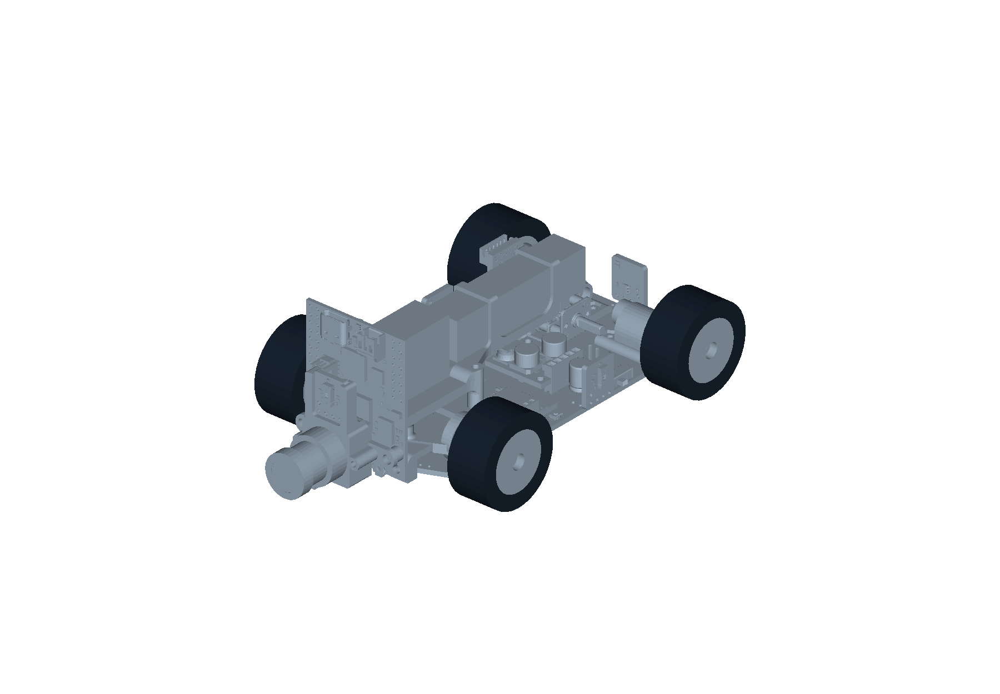

Figure 2.1. V4.1 assembly showing the front camera, parallel steering linkage, PCB chassis and rear drivetrain.

## 1. Mechanical architecture and design objectives

| Requirement | Mechanical response | Engineering reason |
|---|---|---|
| Car-like steering | Servo-driven **parallel** front-wheel steering | A single controlled steering axis gives consistent heading response without wheel-speed steering |
| Traction during corners | Rear drive with a differential | Rear wheels travel different distances through a corner |
| Accurate low-speed movements | 50:1 geared drive motor and wheel encoder | More available torque and repeatable distance primitives for parking |
| Low, compact chassis | Main PCB doubles as the structural deck | Fewer structural parts and low placement of the motor and battery |
| Grip and compliance | Silicone tires on custom steel rims | Tire material supplies grip; rim mass and geometry also change rotational inertia and loading |
| Reproducible construction | STEP parts and dimensioned technical drawings | Wheel hubs, steering parts and mounting points can be inspected and manufactured |

The V4.1 axle configuration is **not Ackermann steering**. The left and right front wheels are commanded to the same mechanical steering angle. This choice simplifies the linkage and the calibration, but the front tires must accommodate some scrub while turning. Any steering graphic and radius formula below uses this parallel-steering model.

### 1.1 Mechanical configuration

The front axle is at the camera end of the vehicle, with the driven axle at the opposite end. The independent front steering hubs are connected through the steering bar and actuated by a single MG90S-type servo. One Pololu 50:1 HPCB geared motor supplies the rear drivetrain through the gear train and differential.

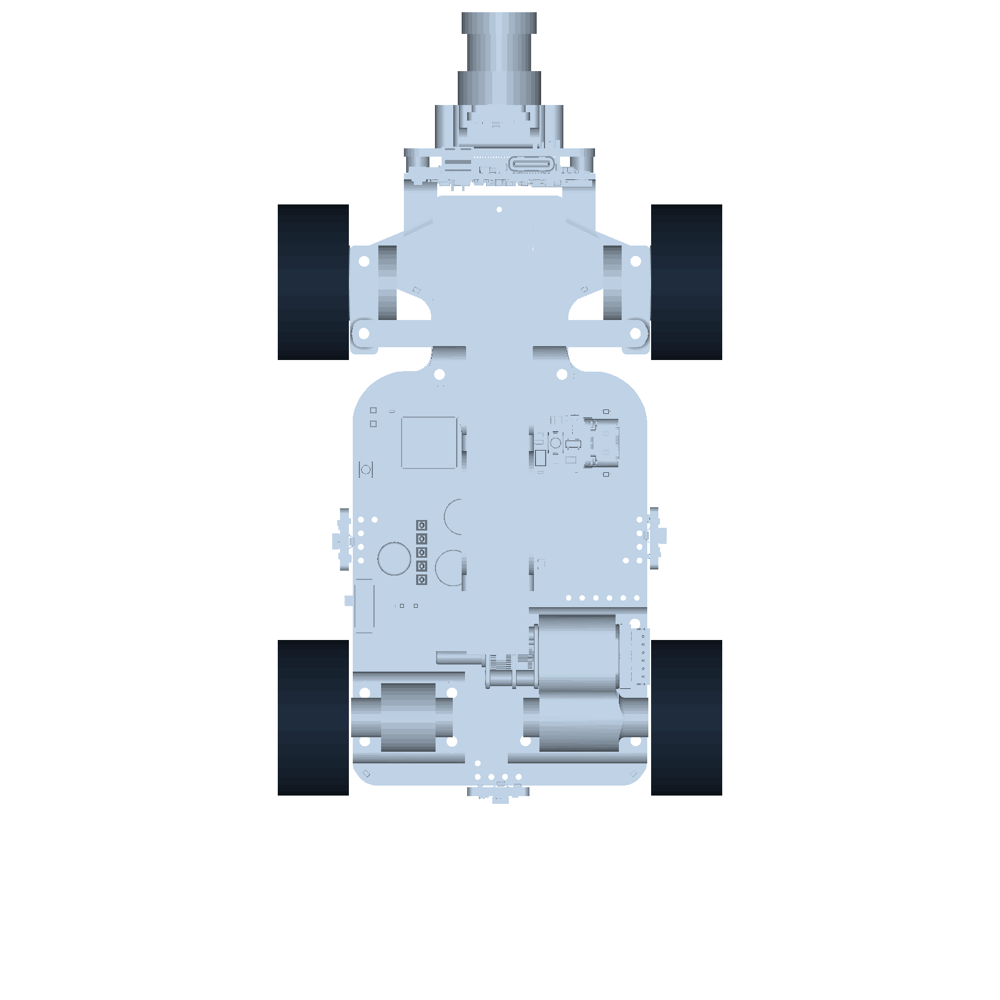

Figure 2.2. Top view of the actual V4.1 assembly, straight steering position.

## 2. Dimensions, wheel geometry and packaging

We describe longitudinal dimensions along the vehicle's $x$ axis and lateral dimensions along its $y$ axis. For the drawing convention, the front axle has coordinate $x_f=22.55$ mm and the rear axle has coordinate $x_r=103.55$ mm. Increasing $x$ therefore points toward the rear of the vehicle.

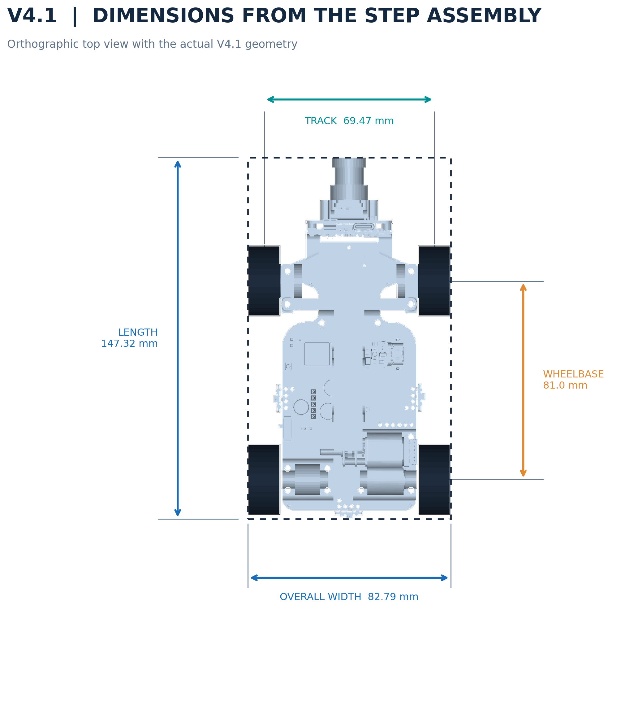

Figure 2.3. Dimensions overlaid on V4.1 geometry. The dimensions describe the assembled robot, not a schematic substitute.

| Geometric quantity | Symbol | CAD value | Physical check |
|---|---|---:|---|
| Overall assembled length | $L_{\mathrm{body}}$ | **147.32 mm** | **147.24 mm** |
| Overall assembled width | $W_{\mathrm{body}}$ | **82.79 mm** | **84.32 mm** |
| Overall assembled height | $H_{\mathrm{body}}$ | **52.71 mm** | **52.12 mm** |
| Wheelbase | $L$ | **81.00 mm** | **79.68 mm** |
| Track width, wheel-center to wheel-center | $T$ | **69.47 mm** | **69.19 mm** |
| Wheel outside diameter | $D$ | **29.0 mm** | **29.11 mm** |
| Tire axial width | $w_t$ | **13.3 mm** | **13.66 mm** |
| Front overhang | $a_f$ | **50.26 mm** | **50.19 mm** |
| Rear overhang | $a_r$ | **16.06 mm** | **15.97 mm** |
| Approximate underbody clearance | $h_c$ | **5.8 mm** | **6.1 mm** |
| Ready-to-run mass | $m$ | **226 g** | **226 g**|

**The CAD model accounts for the camera and all external components. However, silicone compression and minor 3D printing tolerances may affect the final dimensions, so the official competition measurement determines the robot's actual size.*

The wheelbase and track are calculated from the wheel-center coordinates:

$$
L = x_r-x_f=103.55-22.55=81.00\ \mathrm{mm}
$$

$$
T=y_L-y_R=70.8837-1.4163=69.4674\ \mathrm{mm}
$$

The compactness ratio is:

$$
\frac{L_{\mathrm{body}}}{W_{\mathrm{body}}}=\frac{147.32}{82.79}=1.78
$$

Both overall length and width are well below the WRO dimensional limits. More importantly, a small envelope reduces swept area during close obstacle passes and parking.

### 2.1 Overhang and turning clearance

Overhang is measured between an axle centerline and the corresponding vehicle extremity. The larger front overhang accommodates the camera and sensor structure; it also means that the front of the robot sweeps a wider path than the axle itself during tight turns.

For an approximately rigid car body with reference turning radius $R$ at the rear axle midpoint, the farthest point on the front outside corner follows a radius approximately equal to:

$$
R_{\mathrm{front,out}}\approx\sqrt{(R+W_{\mathrm{body}}/2)^2+(L+a_f)^2}
$$

For $R=222.55$ mm (a 20° illustrative steering angle):

$$
R_{\mathrm{front,out}}\approx\sqrt{(222.55+41.40)^2+(81.00+50.26)^2}
\approx294.8\ \mathrm{mm}
$$

This is a conservative geometric check and does not replace a measured swept-path test. The obstacle clearance must be checked against **body edges**, not just the axle centerline.

## 3. The driven axle and differential

The 50:1 motor powers the rear axle through the compact drivetrain. A differential lets the rear wheels turn at different speeds while remaining driven. Without this, a rigid rear axle would force one wheel to slide during a turn, generating steering resistance and unnecessary tire wear.

The difference in path length for rear wheels separated by track $T$ during an ideal circular turn through angle $\theta$ is:

$$
\Delta s=T\theta
$$

For a 90° corner ($\theta=\pi/2$):

$$
\Delta s=0.06947\cdot\frac{\pi}{2}=0.1091\ \mathrm{m}
$$

The outside rear wheel therefore needs to travel approximately **109 mm farther** than the inside rear wheel during this idealized quarter-circle, even though both wheels complete the same turn in time. This is the primary mechanical reason for using a differential.

### 3.1 Gear ratio, wheel torque and tractive force

Let $i_m=50$ denote the nominal motor gearbox ratio, $i_e$ any external gear reduction, $\eta_m$ and $\eta_e$ the gearbox and external transmission efficiencies, and $\tau_{\mathrm{motor}}$ the torque at the motor shaft before reduction.

$$
\tau_{\mathrm{axle}}\approx\tau_{\mathrm{motor}}\,i_m i_e\eta_m\eta_e
$$

For the effective wheel radius $r_w=0.0145$ m, the theoretical wheel-force ceiling before traction losses is:

$$
F_{\mathrm{drive}}=\frac{\tau_{\mathrm{axle}}}{r_w}
$$

The actual forward force is bounded by the driven axle's normal force:

$$
F_{\mathrm{usable}}\le\min\left(F_{\mathrm{drive}},\mu N_{\mathrm{rear}}\right)
$$

where $\mu$ is the silicone tire's measured coefficient of friction on the WRO mat. The motor's nominal stall torque is **not** a continuous operating torque and must not be used as a sustained drive-force rating.

For the same motor family and identical external gearing, changing the motor gearbox from 30:1 on V4 to 50:1 on V4.1 increases ideal torque multiplication by:

$$
\frac{50}{30}=1.667
$$

That is **66.7% greater ideal gearbox torque multiplication**, offset by an ideal no-load output speed factor of $30/50=0.60$. Actual improvement depends on motor model, battery voltage, gear efficiency and tire grip. V4.1 prioritizes usable torque at corner exits and controllable reverse/parking motion.

### 3.2 Wheel speed and linear speed

For a driven wheel rotating at $n_w$ rpm:

$$
v=\frac{\pi D n_w}{60}
$$

For $D=0.029$ m, each 100 rpm of wheel speed corresponds to:

$$
v_{100}=\frac{\pi\cdot0.029\cdot100}{60}=0.1518\ \mathrm{m/s}
$$

The theoretical unloaded wheel speed is $n_w=n_{\mathrm{motor}}/(50i_e)$. A reliable **maximum vehicle speed** cannot be claimed until motor speed under load and actual external gearing are verified. The velocity calibration procedure is specified in Section 9.

### 3.3 Encoder resolution and effective rolling diameter

With a nominal 29 mm wheel diameter, the circumference is:

$$
C=\pi D=\pi\cdot29.0=91.106\ \mathrm{mm}
$$

The encoder hardware and firmware must be treated as a complete system. The controller declares `PPR = 12` and `QUAD_EDGES = 48`, but the active counting routine attaches an interrupt to **channel A rising only** and reads channel B for direction. Therefore the physical tick rate per wheel revolution must be measured instead of assuming that the nominal quadrature constant is the actual decoder resolution.

The ideal conversion for $N$ **actual counted ticks per wheel revolution** is:

$$
k_{\mathrm{mm/tick}}=\frac{C}{N}
$$

For comparison, if $N=48$, the ideal value would be $1.898$ mm/tick; if $N=12$, it would be $7.592$ mm/tick. The controller's current distance scale is `MM_PER_TICK = 1.831`, an **empirical configuration value**, not proof of $N$ or physical wheel circumference. The gear ratio between the sensed encoder shaft and the wheel must also be included when relevant.

To calibrate, command several known distances and measure actual displacement. A correction to the currently configured factor can be calculated as:

$$
k_{\mathrm{new}}=k_{\mathrm{old}}\frac{d_{\mathrm{measured}}}{d_{\mathrm{reported}}}
$$

when the goal is to correct the *reported* distance from a known physical travel. If instead a robot is commanded to drive a distance using a fixed tick threshold and physically under-travels, the correction direction reverses:

$$
k_{\mathrm{new}}=k_{\mathrm{old}}\frac{d_{\mathrm{actual}}}{d_{\mathrm{commanded}}}
$$

This relationship assumes the target tick count is calculated as $d_{\mathrm{commanded}}/k$ and helps avoid applying an adjustment with the wrong sign. For final calibration, log raw tick counts alongside physical distance and fit $d=kN+b$.

## 4. Parallel steering mechanism

The two front wheel knuckles are linked by a steering bar so that the wheels rotate together. The servo controls the linkage through a center position and left/right endpoints. A control value sent to the servo is **not** a direct measurement of wheel angle.

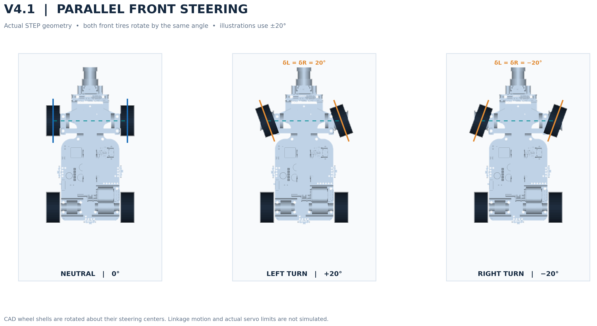

Figure 2.4. The V4.1 front wheel geometry at neutral and illustrative ±20° wheel angles. The tire solids are rotated geometrically; the figure does not claim a measured servo-to-wheel calibration.

Parallel steering is defined by:

$$
\delta_L\approx\delta_R=\delta
$$

Unlike an ideal Ackermann linkage, the inner and outer steering angles do not differ. The benefit is a simple, compact actuation chain and repeatable linkage geometry; the cost is some unavoidable tire scrub in a turn.

### 4.1 Bicycle-model turning radius

For low-slip motion, we use a bicycle approximation with rear-axle-center turning radius:

$$
R\approx\frac{L}{\tan\delta}
$$

This is a **kinematic approximation**, not an exact solution for the four individual rolling constraints of a parallel-steered car.

| Equal front-wheel angle $\delta$ | Nominal $R$ at rear-axle midpoint |
|---:|---:|
| 10° | 459.4 mm |
| 15° | 302.3 mm |
| 20° | 222.5 mm |
| 25° | 173.7 mm |
| 30° | 140.3 mm |

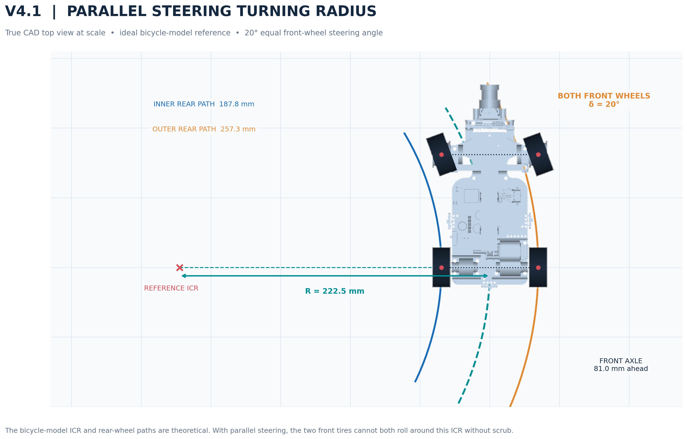

Figure 2.5. Theoretical turn center and wheel paths overlaid on V4.1 geometry. The 20° example is illustrative; real turning radii are to be measured.

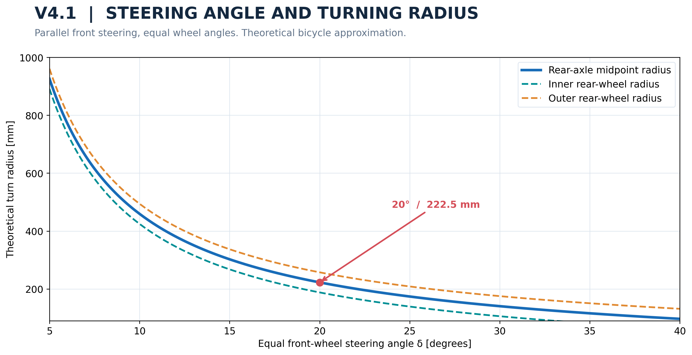

Figure 2.6. Calculated radius sensitivity for the V4.1 wheelbase.

At $\delta=20^\circ$, $R=222.5$ mm, so the idealized rear-wheel path radii are:

$$
R_{\mathrm{rear,in}}=R-\frac{T}{2}=222.5-34.7=187.8\ \mathrm{mm}
$$

$$
R_{\mathrm{rear,out}}=R+\frac{T}{2}=222.5+34.7=257.3\ \mathrm{mm}
$$

The front wheel path radii additionally include the wheelbase:

$$
R_{\mathrm{front,in/out}}=\sqrt{L^2+\left(R\mp\frac{T}{2}\right)^2}
$$

The ideal no-scrub inner and outer wheel angles for the same target rear-axle radius would be different:

$$
\delta_{\mathrm{ideal,in}}=\tan^{-1}\left(\frac{L}{R-T/2}\right),\qquad
\delta_{\mathrm{ideal,out}}=\tan^{-1}\left(\frac{L}{R+T/2}\right)
$$

For $R=222.5$ mm, these are approximately 23.3° and 17.5°. V4.1 instead applies equal angles, with tire compliance and controlled speed absorbing the geometric mismatch. These **are not the angles mechanically commanded** by our robot.

### 4.2 Servo calibration and steering asymmetry

The steering interface maps normalized commands between $-1$ and $+1$ to the configured servo range. The active firmware constants are:

| Parameter | Servo command |
|---|---:|
| Center | 85 |
| Left endpoint | 39 |
| Right endpoint | 131 |
| Parking left endpoint | 40 |
| Parking right endpoint | 138 |

These numbers are **servo command values** used with the Arduino servo API. The real wheel angle must be measured with an angle gauge. Record both front wheels at at least five normalized command positions.

| Normalized command | Left front measured | Right front measured | Average actual wheel angle |
|---:|---:|---:|---:|
| -1.0 | -55.0° | -55.0° | -55.0° |
| -0.5 | -27.5° | -27.5° | -27.5° |
| 0.0 | 0.0° | 0.0° | 0.0° |
| +0.5 | +27.5° | +27.5° | +27.5° |
| +1.0 | +55.0° | +55.0° | +55.0° |

We use these readings to estimate mechanical asymmetry, servo deadband and the true minimum turning radius. Any calibration curve should be stored alongside the test date and mechanical revision.

## 5. Tires, rims, contact and rotational inertia

V4.1 uses silicone tires and custom steel rims. Grip results from the interaction of tire compound, surface finish, normal load and temperature. **Adding rim mass does not by itself increase the coefficient of friction**. It changes total mass, wheel moment of inertia and potentially the consistency of tire contact.

For an approximate wheel ring of mass $m_r$ and radius $r$, rotational inertia is:

$$
I_r\approx m_r r^2
$$

A more accurate annular-rim model with inner and outer radii $r_i$ and $r_o$ is:

$$
I_r=\frac{1}{2}m_r(r_i^2+r_o^2)
$$

Rotational kinetic energy is $E_{\mathrm{rot}}=\tfrac12 I_r\omega^2$. This is why heavier rims can make braking and acceleration less responsive even if the additional mass helps distribute weight. Measured run data, not the material alone, should decide whether the trade-off is worthwhile.

The tire-limited lateral acceleration is approximately:

$$
a_y=\frac{v^2}{R}\le\mu g
$$

and the corresponding theoretical corner-speed limit is:

$$
v_{\max}\approx\sqrt{\mu gR}
$$

For illustration only, at $R=0.2225$ m and $\mu=0.8$, $v_{\max}\approx1.32$ m/s. A measured coefficient of friction for the actual WRO mat is required before using this as a competition speed limit.

## 6. Mass, center of gravity and static balance

The fully assembled V4.1 robot has a measured mass of **226 g**, corresponding to:

$$
W=mg=0.226\cdot9.81=2.217\ \mathrm{N}
$$

A uniform-density **geometric centroid** of the assembled CAD volume is located at approximately $(x,y,z)=(53.78,36.67,11.77)$ mm in the CAD axes. The model ground-plane offset is approximately $z=-5.83$ mm, giving a proxy center-of-mass height of **17.6 mm above ground**. This is not the true measured center of mass because the PCB, battery, steel wheels, motors and printed polymer parts have different densities, and some CAD solids may overlap.

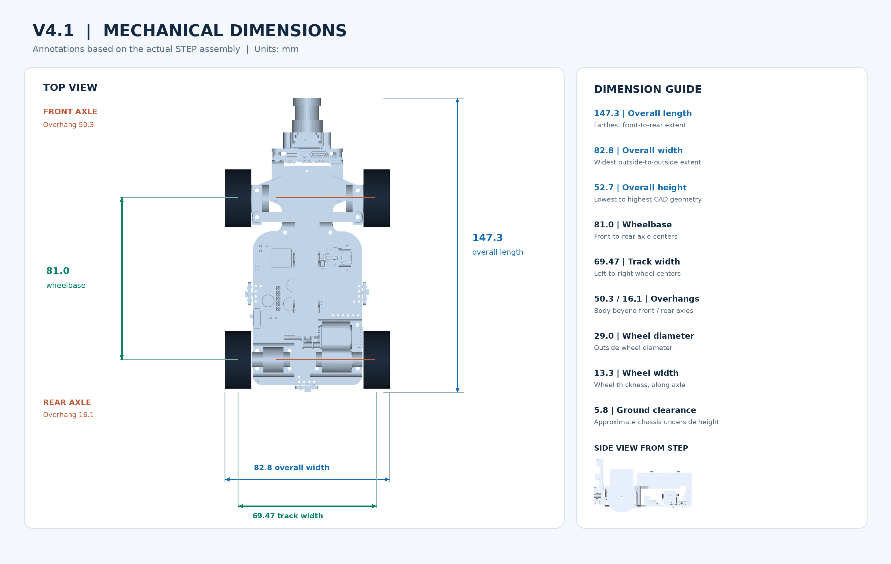

Figure 2.7. V4.1 geometric reference. Center-of-mass location is a geometric estimate awaiting a physical balance test.

If the proxy longitudinal COM (center of mass) position were exact, the front-axle and rear-axle static loads would be:

$$
N_f=W\frac{x_r-x_G}{L}=2.217\frac{103.55-53.78}{81.0}=1.362\ \mathrm{N}
$$

$$
N_r=W\frac{x_G-x_f}{L}=2.217\frac{53.78-22.55}{81.0}=0.855\ \mathrm{N}
$$

That corresponds to a **61.4% / 38.6% front/rear estimated load split**. The side-to-side estimate is approximately 50.7% / 49.3% using the same proxy. These are conditional calculations, not measured corner weights. On four rigid supports, individual wheel loads also depend on frame compliance and contact height, so four corner loads cannot be uniquely determined from planar moment balance alone.

### 6.1 How we verify the center of mass

Place the completed robot on two scales with the wheel axles supported at the same height. Measure $N_f$ and $N_r$ and compute:

$$
x_{G,\mathrm{measured}}=x_f+L\frac{N_r}{N_f+N_r}
$$

Repeat with left and right supports to obtain the lateral position. For the vertical COM, raise one axle through a known angle and repeat the reaction-force measurement, or use a controlled balance-tilt method. Record battery type, battery position, camera mount and any covers, because these can shift the result.

| Balance measurement | Value |
|---|---|
| Front axle support mass | 132 g |
| Rear axle support mass | 94 g |
| Left side support mass | 96 g |
| Right side support mass | 130 g |

### 6.2 Roll and pitch stability

The idealized quasi-static lateral tipping threshold is:

$$
\frac{a_{y,\mathrm{tip}}}{g}\approx\frac{T/2}{h_G}
$$

With the *geometric proxy* $h_G=17.6$ mm, the result is approximately 1.97 g. This is a conditional upper-bound geometry check rather than a measured rollover acceleration. In most normal circumstances the tires are likely to slide before this threshold, but that needs a real grip test.

Longitudinal load transfer under acceleration $a_x$ is approximately:

$$
\Delta N=\frac{m a_x h_G}{L}
$$

This matters for a rear-driven car: acceleration transfers load toward the driven rear axle, while deceleration transfers it toward the steering front axle. The sign and magnitude depend on motion direction and the actual COM height.

## 7. Manufacturing, tolerances and assembly serviceability

Most steering, hub and mounting pieces are custom designed and manufactured separately from the PCB. The steering links need low friction and repeatable hole-center positions, while the rear gears need correct center distance and controlled backlash. Neither can be verified merely because the parts fit in CAD.

For a chain of dimensional tolerances $t_k$, worst-case stack-up is:

$$
t_{\mathrm{worst}}=\sum_k |t_k|
$$

For statistically independent centered tolerances, root-sum-square provides a useful process estimate:

$$
t_{\mathrm{RSS}}=\sqrt{\sum_k t_k^2}
$$

We use worst-case reasoning for interference risks and RSS only when variation is demonstrably independent. Printed bore diameter and mating shaft diameter should be checked separately. Bearing fits must be tested on printed or machined samples before final assembly.

### 7.1 Manufacturing drawings

The complete mechanical drawings are available in the [technical-drawings directory](technical-drawings/). The most important manufacturing interfaces are shown here.

<table><tr><td align="center">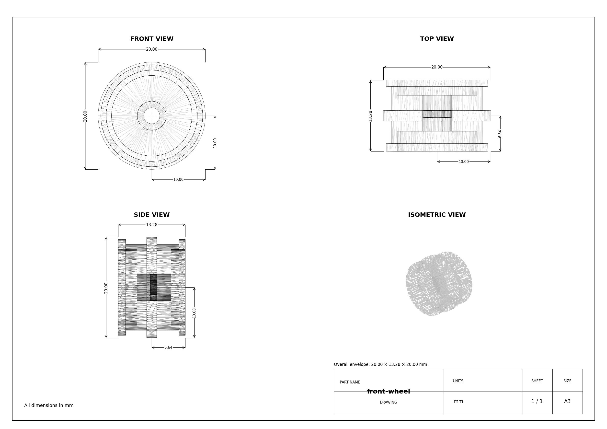 Front wheel</td><td align="center">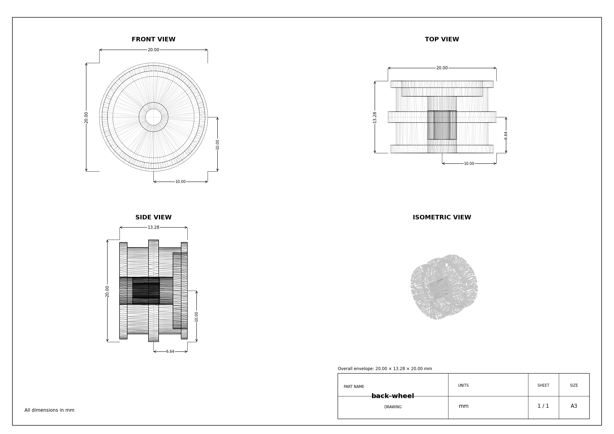 Rear wheel</td></tr><tr><td align="center"> Left steering hub</td><td align="center">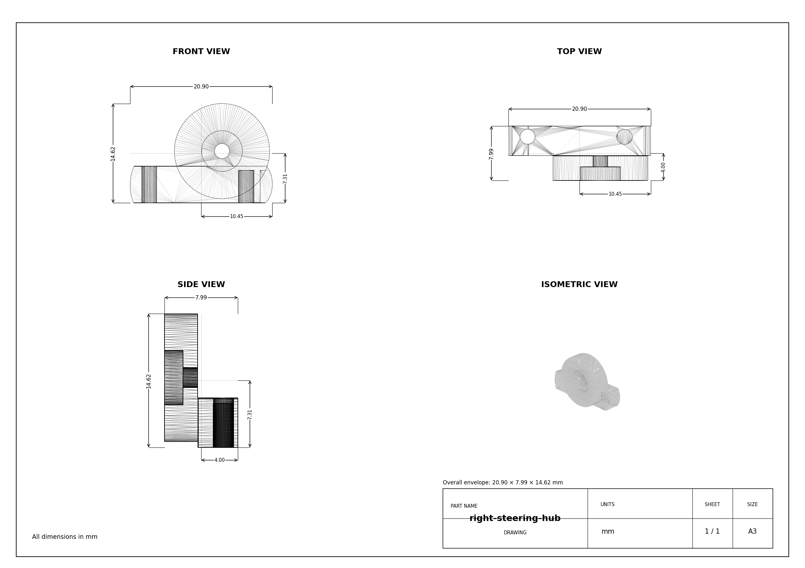 Right steering hub</td></tr><tr><td align="center"> Parallel steering bar</td><td align="center">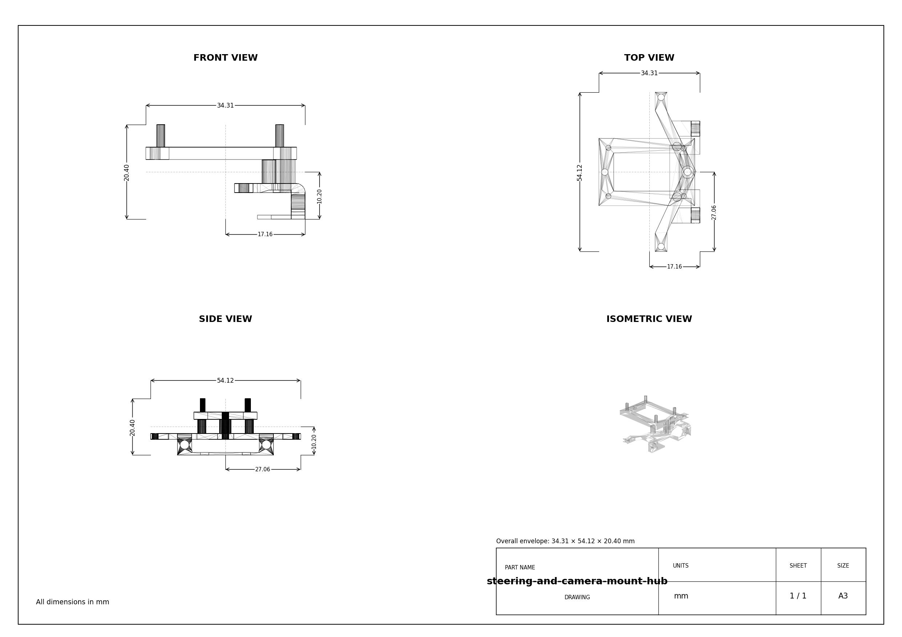 Camera and steering mount</td></tr><tr><td align="center">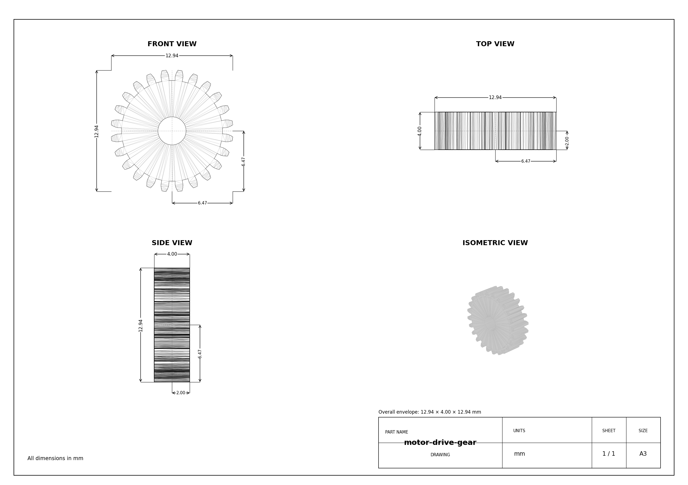 Motor-drive gear</td><td align="center">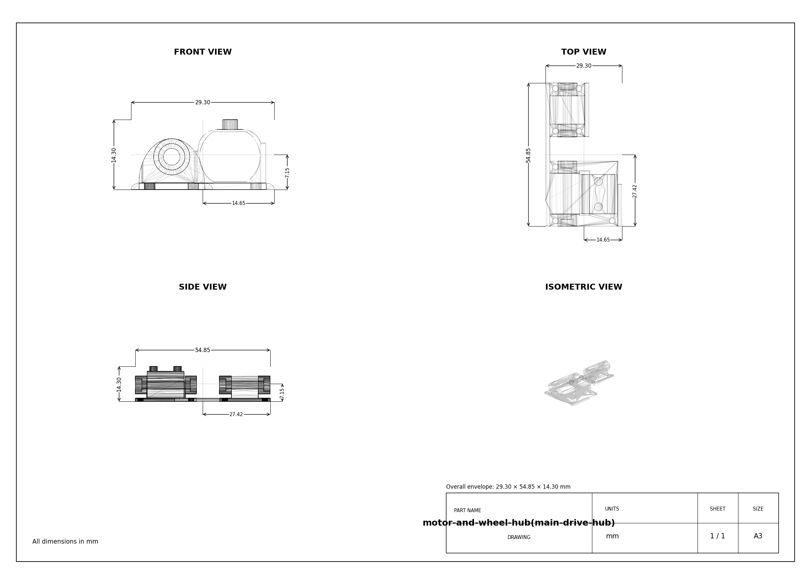 Main drive hub</td></tr><tr><td align="center"> Battery support</td><td align="center"><a href="../3D-models/">Download STEP components</a> Editable CAD and physical interfaces</td></tr></table>

The differential assembly, steering bar and rear drive must move freely throughout their ranges with the electronics installed. Cable routing near steering joints is checked at both end stops, not only at neutral.

## 8. V4 to V4.1: mechanical decisions

V4.1 retains the compact PCB-based vehicle architecture but changes the drivetrain and wheel construction where the previous configuration offered limited margin.

| Design aspect | V4 | V4.1 improvement | validation |
|---|---|---|---|
| Drive gearbox | 30:1 | 50:1 gear ratio prioritizes higher theoretical torque multiplication | Measured acceleration and wheel speed |
| Wheel rims | Lightweight printed rims | Custom steel rims offer a more rigid rim construction with revised tire support | Measured total wheel mass, inertia and grip |
| Sensor integration | Earlier distance-sensor mounts | Dedicated mounts for compact ToF boards | Checked FOV, cable clearance and vibration |
| Structural base | PCB-based chassis | Same proven compact concept with revised components | Inspected PCB bending and mounting stresses |

V4.1 should be judged on its actual recorded performance, not by declaring every material change beneficial by default. The design intent is better low-speed authority, more reliable sensing geometry and repeatable handling.

## 9. Mechanical validation programme and recorded results

The following tests document both performance and the limits of the mechanical model. Each should use a named firmware release, battery state and mat condition.

| Test | Method | Record | Acceptance question |
|---|---|---|---|
| M01 Physical envelope | Calipers, assembled robot, five repeated measurements | Length, width, height, ground clearance | Are we within WRO limits with margin? |
| M02 Steering calibration | Measure both front wheels at five servo commands | $\delta_L$, $\delta_R$, hysteresis | Does parallel steering stay symmetric? |
| M03 Circle tracking | Drive constant commands left and right, three trials each | Measured radius and standard deviation | Does the bicycle approximation predict actual turns? |
| M04 Odometry | Repeat 200, 500 and 1000 mm movements | Raw ticks, actual distance, error | Is the encoder factor calibrated correctly? |
| M05 Differential | Lift rear and rotate one wheel, then drive a circle | Free movement, rubbing, temperature | Is differential action unobstructed? |
| M06 Load distribution | Two-scale or four-scale support test | Front/rear and left/right loads | Where is the actual COM? |
| M07 Traction | Increase speed in a known-radius turn | Speed at first consistent slip | What is the safe cornering envelope? |
| M08 Thermal and wear | Repeated drive and reverse cycles | Motor case temp, gear wear, loose joints | Does the transmission remain repeatable? |

**M03 recording table:**

| Command | Trial 1 radius | Trial 2 radius | Trial 3 radius | Mean | Standard deviation |
|---|---:|---:|---:|---:|---:|
| Left, 20° | 225 mm | 229 mm | 227 mm | 227.0 mm | 2.00 mm |
| Right, 20° | 221 mm | 224 mm | 223 mm | 222.7 mm | 1.53 mm |

The standard deviation of repeat trials is:

$$
s=\sqrt{\frac{1}{n-1}\sum_{j=1}^{n}(R_j-\bar R)^2}
$$

A small radius error without good repeatability is not sufficient: the vehicle must produce consistent paths at both steering directions and across battery levels.

<!-- CODE-DERIVED DATA VIEW -->
### 9.1 Documented steering commands

Parallel steering uses one servo with two command maps. These are **servo API write values**, not independently measured physical left- and right-wheel angles:

| Normalized input | Normal servo write | Parking servo write |
| --- | --- | --- |
| -1 | 39° | 40° |
| -0.5 | 62° | 64° |
| 0 | 85° | 89° |
| 0.5 | 108° | 113° |
| 1 | 131° | 138° |

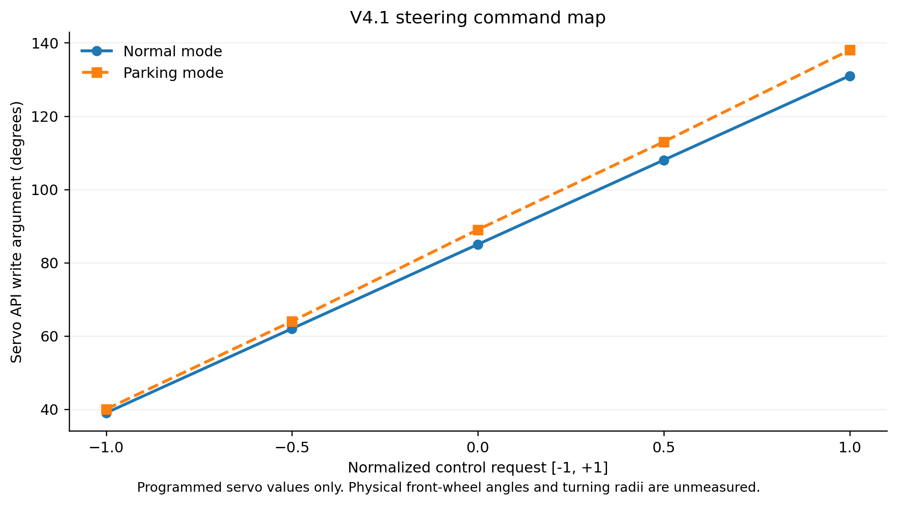

Figure 2.12. Servo command mappings calculated from controller settings; front-wheel deflection and effective turn radius still require physical calibration.

[Full `validation/steering_calibration.csv` dataset](validation/steering_calibration.csv). The corresponding [steering measurement template](validation/measurement_templates/steering_calibration.csv) records actual wheel angle and measured radius, rather than treating the servo command as a wheel angle.

### 9.2 Encoder distance thresholds

The active distance primitive uses `MM_PER_TICK = 1.831` as its configured scale and stops when the reported distance reaches the requested command. The minimum crossing count is:

$$
N_{\mathrm{stop}}=\left\lceil\frac{d_{\mathrm{target}}}{1.831\ \mathrm{mm/tick}}\right\rceil
$$

| Commanded travel | First qualifying encoder count | Controller distance at count |
| --- | --- | --- |
| 40 mm | 22 | 40.282 mm |
| 70 mm | 39 | 71.409 mm |
| 100 mm | 55 | 100.705 mm |
| 100 mm | 55 | 100.705 mm |
| 200 mm | 110 | 201.410 mm |
| 350 mm | 192 | 351.552 mm |
| 600 mm | 328 | 600.568 mm |

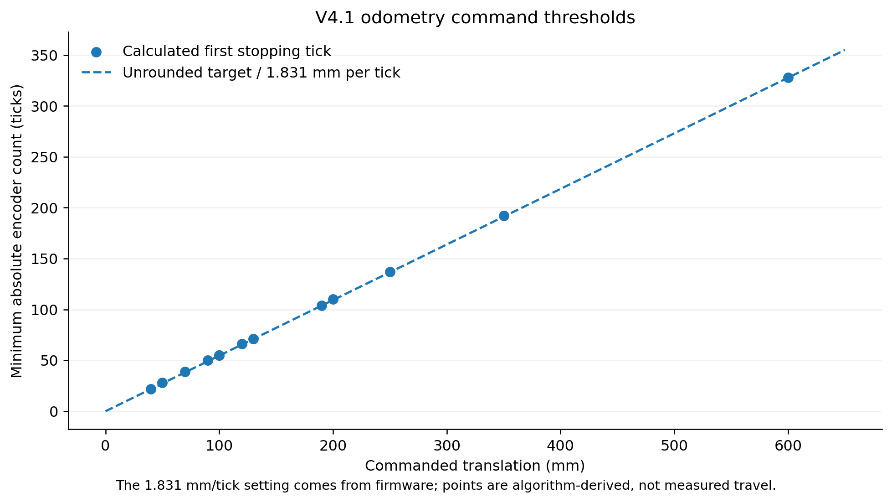

Figure 2.13. Calculated count thresholds in current control logic. This chart is not a plot of actual distance traveled.

[Full `validation/odometry.csv` dataset](validation/odometry.csv). Real calibration uses the [odometry measurement template](validation/measurement_templates/odometry.csv) with encoder counts, ruler distance, repeat trials, wheel surface and battery voltage. The declared 48 quadrature edges must not be used as an actual counted-tick assumption because the interrupt routine counts A-channel rising edges.
<!-- END CODE-DERIVED DATA VIEW -->

## 10. Mechanical risks and mitigations

| Failure mode | Effect on driving | Mitigation or diagnostic |
|---|---|---|
| Uncalibrated servo endpoints | Asymmetric cornering or binding | Record true wheel angles; stop before linkage hard limits |
| Backlash at motor gear or differential | Inconsistent reversals and parking | Inspect tooth engagement, shaft alignment and axial play |
| Oversized tire radius in odometry | Systematic distance error | Use measured under-load rolling circumference |
| Tires slip at high corner speed | Path error and possible obstacle contact | Speed limit by turn severity; collect grip data |
| Loose camera/sensor mounts | Perception and parking drift | Mechanical locking, FOV test and vibration inspection |
| Battery shifted after reassembly | Different steering balance | Mark and repeat battery placement |
| Contact between chassis and floor | Sudden deceleration | Physical ground-clearance measurement and field sweep |
