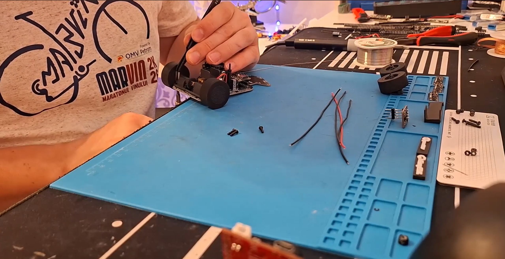

$$x = L\,\frac{m_f}{m_f + m_r}, \qquad z = r + \frac{L\,(m_f' - m_f)}{(m_f + m_r)\tan\theta}$$

# 02 | Mobility and mechanical design

> **HyperLine Robotics · WRO 2026 Future Engineers · V4.1**  
> This chapter describes the current front-steered, rear-driven vehicle, distinguishes historical V4 components, derives its mechanical design equations and defines repeatable experiments for validating the design. **A calculated value is not presented as a measured result.** Parameters not recoverable from the released drawings or firmware are explicitly marked **MEASURE**.

| Chapter | Contents |
|---|---|
| [01 · Overview](01-overview.md) | Vehicle, competition tasks, versions and results |
| **02 · Mobility** | Structure, drivetrain, steering, mechanics, calculations and tests |
| [03 · Power and sensors](03-power-sensors.md) | Power electronics, wiring, sensing and calibration |
| [04 · Software](04-software.md) | Navigation, control and obstacle logic |
| [05 · Systems](05-systems.md) | Iterations, evidence, reliability and integration |
| [06 · Reproducibility](06-reproducibility.md) | Rebuilding, flashing and checking the vehicle |

---

## 1. Mechanical architecture and design requirements

Our vehicle uses a **custom printed circuit board as the main chassis**, one **geared DC motor driving a rear mechanical differential**, **two driven rear wheels**, and **two front wheels steered by one servo and a parallel linkage**. The four wheels use silicone contact surfaces. The V4.1 drivetrain uses the **Pololu 50:1 HPCB gearmotor** stated in [the overview](01-overview.md#national-version-compared-with-the-current-version); the **30:1** motor mentioned in older documentation belongs to **V4**. The fan/downforce assembly shown in older CAD is **not installed on V4.1**.

*Figure 2.1. V4.1 CAD assembly. Always cross-check this rendering against photographs of the assembled revision.*

### 1.1 Requirements and the choices they drove

| Requirement / constraint | Mechanical response | Verification |
|---|---|---|
| WRO vehicle envelope: maximum **300 × 200 × 300 mm** | Compact PCB platform and short wheelbase | Measure full outside envelope, including camera and sensors |
| Autonomous, repeatable turning | Common front steering linkage, servo neutral calibration, rigid hub mounts | Wheel-angle and circular-path tests |
| Propulsion and cornering on smooth track | Rear differential and silicone tires | Wheel-slip and turn tests |
| Controlled low-speed parking | Geared motor, encoder feedback and low-speed steering | Repeated stopping and parking trials |
| Low mass and limited assembly space | PCB chassis doubles as electrical and structural substrate | Weigh parts and measure center of mass |
| Rebuildability | STEP models, dimensioned part drawings, M2-mounted subassemblies | Assembly and service tests |

**Why front steering instead of differential steering?** The vehicle follows car-like trajectories while the mechanical differential permits the rear wheels to roll at different speeds during corners. This avoids relying on two independently commanded drive wheels to create yaw. A parallel linkage is simple and compact but does **not** produce ideal Ackermann steering, so its geometric limitations and tire scrub must be acknowledged.

### 1.2 Symbols, reference frame and units

The rear-axle center is the origin. The **+x** axis points forward, **+y** points to the vehicle's left, and **+z** points up. Positive yaw and steering angle turn left. Use SI units for calculations; CAD drawings may be in millimeters.

| Symbol | Definition | Status for V4.1 |
|---|---|---|
| $L$ | Rear-to-front axle wheelbase | approximately **65 mm**, from earlier README; **MEASURE** |
| $t_f,t_r$ | Front and rear track width, tire center to tire center | **MEASURE** |
| $D$ | Loaded effective rolling diameter of driven wheels | **29 mm** firmware setting, **not yet measured** |
| $r=D/2$ | Effective rolling radius | 14.5 mm for firmware nominal diameter |
| $m$ | Robot mass with competition battery | approximately **0.200 kg** in older README; **REWEIGH V4.1** |
| $h$ | Center-of-mass height above ground | **MEASURE** |
| $x_G,y_G$ | CoM coordinates from rear axle and centerline | **MEASURE** |
| $\delta$ | Equivalent front road-wheel steering angle | **MEASURE**, not servo command angle |
| $i_g$ | Internal motor gearbox reduction, motor revs per output rev | **50:1 stated for V4.1**; confirm SKU |
| $i_e$ | External gear reduction, motor-gearbox output revs per differential-input rev | **MEASURE TOOTH COUNTS** |
| $\eta$ | Combined transmission efficiency | **MEASURE / ESTIMATE RANGE** |
| $\mu$ | Effective tire-floor friction coefficient | **MEASURE** on actual competition mat |
| $v,a_x,a_y$ | Longitudinal speed, acceleration and lateral acceleration | Calculated or measured as labeled |

**Measurement convention:** Record loaded wheel diameter, battery state, track surface, firmware revision and measurement uncertainty. Changing any of these can change the result.

## 2. Chassis, mechanical load path and mounting

### 2.1 Structural concept

Instead of a separate plate plus a separate electronics board, the custom PCB provides both mechanical mounting references and electrical routing. The drivetrain, steering servo, battery, camera and ToF mounts fasten to supports that reference PCB holes. The rear axle and differential are supported by a bearing-bearing assembly and printed holders. The front wheels rotate on bearings in the steering hubs.

*Figure 2.2. Rear transmission and support arrangement.*

The principal load paths are:

1. **Vertical:** floor → silicone tire → wheel/rim → bearing or axle → printed mount → PCB chassis → battery/electronics masses.
2. **Propulsion:** motor shaft → motor gear → differential input → differential side outputs → axle → rear tires → floor.
3. **Steering:** servo output shaft → horn/linkage → left and right knuckles → front contact patches → reaction load through the knuckle pivots into the chassis.
4. **Braking:** rear contact patches → wheel/axle → drivetrain and chassis; front/rear normal-force transfer changes available grip.

PCB material is mechanically convenient, but its stiffness and fastener-hole integrity must be verified. It is **not** assumed equivalent to a metal chassis. Avoid locating high bending loads at unsupported narrow PCB sections or relying on solder joints as structural fasteners.

### 2.2 Bending and deflection calculations

For a simplified chassis section modeled as a simply supported beam of span $\ell$ carrying a central force $F$, the peak bending moment and deflection are

$$M_{\max}=\frac{F\ell}{4},\qquad \Delta_{\max}=\frac{F\ell^3}{48EI}.$$

For a rectangular section of width $b$ and thickness $t$, $I=bt^3/12$, giving

$$\Delta_{\max}=\frac{F\ell^3}{4Ebt^3},\qquad \sigma_{\max}=\frac{M_{\max}(t/2)}{I}=\frac{6M_{\max}}{bt^2}.$$

These are **screening equations**, not a validated PCB structural model. Real PCB geometry includes cut-outs, mounting holes, copper layers, different elastic properties and concentrated loads. Use the actual support geometry and PCB laminate specification for quantitative predictions. A particularly useful result is that doubling local thickness, at the same width, reduces ideal bending deflection by a factor of eight.

**Validation:** Mount the assembled vehicle at its normal support points and apply a known small load at the camera or battery support. Record deflection and any permanent displacement. Check steering alignment again afterwards.

### 2.3 CAD and manufactured parts

| Part | V4.1 source | Function / inspection |
|---|---|---|
| Motor and drivetrain support | [`drive-system-mount.step`](../3D-models/drive-system-mount.step) | Motor location, gear alignment, bearing support |
| Battery mount | [`battery-mount.step`](../3D-models/battery-mount.step) | Keeps battery position repeatable |
| Front steering and camera support | [`steering%20and%20camera%20mounting.step`](../3D-models/steering%20and%20camera%20mounting.step) | Servo and camera references |
| Left and right steering hubs | [`steering-hub-left.step`](../3D-models/steering-hub-left.step), [`steering-right.step`](../3D-models/steering-right.step) | Steering pivots and wheel bearings |
| Steering tie bar | [`steering%20bar.step`](../3D-models/steering%20bar.step) | Couples the two front wheel angles |
| Wheel with silicone | [`wheel%20with%20silicone.step`](../3D-models/wheel%20with%20silicone.step) | Contact geometry and hub design |

See also [technical drawings](technical-drawings/) and [vehicle photographs](../v-photos/). Historical STL models are stored separately in [`old-3D-models/`](../3D-models/old-3D-models/) and should not be mixed with V4.1 parts without checking fit.

 

*Figure 2.3. Manufacturing drawings retained in the repository. Check revision and dimensions against V4.1 STEP models before machining.*

### 2.4 Dimensional tolerances and stack-up

A nominal fit does not guarantee a functional assembly after printing. If several tolerances add in the same direction, a worst-case dimensional stack is

$$T_{\mathrm{worst}}=\sum_{k=1}^{n}|T_k|.$$

For independent, approximately centered variations, an approximate statistical stack is

$$T_{\mathrm{RSS}}=\sqrt{\sum_{k=1}^{n} T_k^2}.$$

The RSS expression is **not** a guaranteed maximum and requires justification from the actual manufacturing process. For the motor pinion, differential gear and rear bearings, check shaft parallelism, center distance, end play and runout after assembly. For each bearing seat, document printed-hole diameter and measured bearing outside diameter rather than assuming nominal CAD values are achieved.

## 3. Mass distribution, center of gravity and static stability

### 3.1 Center of mass from the bill of materials

For component $j$, measure mass $m_j$ and center coordinates $(x_j,y_j,z_j)$. The assembled vehicle center of mass is

$$m=\sum_j m_j,\quad x_G=\frac{\sum_jm_jx_j}{m},\quad y_G=\frac{\sum_jm_jy_j}{m},\quad h=z_G=\frac{\sum_jm_jz_j}{m}.$$

The battery, steel wheel rims and camera mount should be entered individually because moving them shifts the center of mass. Do not claim that heavier rims automatically increase the friction coefficient: added mass can change load distribution and tire deformation, but the ideal Coulomb limit scales with normal load and requires measurement of the actual tire-floor behavior.

### 3.2 Axle-load measurement

Place the front and rear wheels on separate scales of equal height. If front and rear indicated masses are $m_f$ and $m_r$,

$$m=m_f+m_r,\quad N_f=m_fg,\quad N_r=m_rg,\quad x_G=L\frac{m_f}{m_f+m_r}.$$

Here $x_G$ is the distance **forward from the rear axle**, since front-axle normal force acts at $x=L$. A front axle carrying 55% of total weight corresponds to $x_G=0.55L$. That is a **general example**, not a measurement of HyperLine.

### 3.3 Fore-aft load transfer during acceleration and braking

For a flat ground surface, negligible aerodynamic force and small pitch acceleration,

$$N_f=mg\frac{x_G}{L}-ma_x\frac{h}{L},\qquad N_r=mg\left(1-\frac{x_G}{L}\right)+ma_x\frac{h}{L}.$$

Positive $a_x$ is forward acceleration. During acceleration the rear normal force increases; during braking ($a_x<0$) it decreases. The formula highlights why the battery's vertical location matters even if its fore-aft position is unchanged.

### 3.4 Lateral load transfer and rollover check

For track width $t$ and center-of-mass height $h$, the approximate difference between outer and inner wheel-side normal forces under steady cornering is

$$N_{\mathrm{outer}}-N_{\mathrm{inner}}\approx\frac{2ma_yh}{t},$$

assuming a simple rigid vehicle and approximately symmetric left/right load. At the point where the inner side unloads, a simple static rollover threshold is

$$a_{y,\mathrm{tip}}\approx g\frac{t}{2h}.$$

This is an idealized rollover boundary, **not** a tested operating limit. Tire slip, steering dynamics and suspension or chassis compliance often limit cornering earlier.

### 3.5 Wheel-rim inertia and the V4 → V4.1 material change

For a thin ring with mass $m_w$ and radius $r$, $J_w\approx m_wr^2$. For a solid disk of the same mass and radius, $J_w=\tfrac12m_wr^2$. Real steel rims lie between shapes depending on their geometry, so calculate their moment of inertia from the CAD mass properties where possible.

Increasing wheel-rim mass has two competing effects:

- It can alter tire loading, tire deformation and the robot's center of gravity.
- It **increases rotational inertia**, meaning the motor must deliver more torque to achieve the same wheel angular acceleration.

A first-order effective accelerating mass for four rotating wheels is

$$m_{\mathrm{effective}}=m+\sum_{k=1}^{4}\frac{J_{w,k}}{r_k^2}+\frac{J_{\mathrm{drive,eq}}}{r^2}.$$

The final term represents drivetrain inertia reflected to wheel speed. This expression is useful when comparing the printed V4 rims and steel V4.1 rims. **A measured grip improvement has not been established solely by the rim material change.**

## 4. Rear drivetrain and mechanical differential

### 4.1 Transmission layout

The drive uses one DC gearmotor feeding a printed external gear and then the mechanical differential. The differential permits the left and right rear wheels to have different rotational speeds while remaining connected to a single drive motor.

*Figure 2.4. Mechanical rear differential and axle system.*

### 4.2 Gear ratios

Let $z_p$ be the tooth count of the drive pinion and $z_d$ the driven differential-input gear. For an external gear pair,

$$i_e=\frac{z_d}{z_p},\qquad \omega_{\mathrm{diff}}=\omega_{\mathrm{gearbox}}\frac{z_p}{z_d}.$$

The complete reduction between the bare motor shaft and differential input is

$$i_{\mathrm{total}}=i_gi_e.$$

**Current evidence:** Chapter 01 identifies the V4.1 motor as 50:1, but the released Markdown does not contain the verified pinion/differential tooth counts. Enter the actual teeth from the physical gears or CAD and confirm the exact manufacturer gearbox ratio before publishing a numerical total ratio.

| Revision | Gearmotor stated in repository | External ratio | Combined ratio |
|---|---|---|---|
| V4 | 30:1 HPCB | $z_d/z_p$ **MEASURE** | $30(z_d/z_p)$ nominal |
| V4.1 | 50:1 HPCB | $z_d/z_p$ **MEASURE** | $50(z_d/z_p)$ nominal |

The nominal change from 30 to 50 at an unchanged external stage yields

$$\frac{T_{\mathrm{V4.1}}}{T_{\mathrm{V4}}}\approx\frac{50}{30}=1.667,\qquad\frac{\omega_{\mathrm{V4.1}}}{\omega_{\mathrm{V4}}}\approx\frac{30}{50}=0.600.$$

**These are gear-ratio-only comparisons, not measured torque or speed improvements.** They assume the same motor core, applied voltage, current capability, transmission efficiency and external gearing. Motor winding, vendor SKU, internal losses and tire load can change the actual result.

### 4.3 Output torque and traction force

If the motor shaft torque is $T_m$ and combined transmission efficiency is $\eta$,

$$T_{\mathrm{diff,in}}\approx T_m i_{\mathrm{total}}\eta.$$

For a straight, symmetric run, assuming equal left/right torque sharing and ignoring differential losses,

$$T_L\approx T_R\approx\frac{T_{\mathrm{diff,in}}}{2},\qquad F_x\approx\frac{T_L+T_R}{r}=\frac{T_{\mathrm{diff,in}}}{r}.$$

**Important:** Manufacturer stall torque is not a continuous-use output rating. Design around a measured operating current and acceleration, thermal behavior and motor-driver capability. The actual usable force is limited by tire friction:

$$F_{x,\mathrm{usable}}\le\min\!\left(\frac{T_{\mathrm{diff,in}}}{r},\,\mu_xN_{\mathrm{driven}}\right).$$

An open differential can also be traction-limited by the lower-grip driven wheel. For ideal equal wheel torque and individual limits $F_{L,\max}$ and $F_{R,\max}$, the axle's combined available drive force is approximately bounded by $2\min(F_{L,\max},F_{R,\max})$ before other losses.

### 4.4 Theoretical speed

If gearmotor **output-shaft** speed is $n_g$ rpm, the ideal differential input speed and ground speed on a straight are

$$n_{\mathrm{wheel}}=\frac{n_g}{i_e},\qquad v=\frac{\pi D\,n_g}{60i_e}.$$

With the firmware nominal $D=0.029\ \mathrm{m}$,

$$v=0.0015184\,\frac{n_g}{i_e}\ \mathrm{m/s}.$$

**Worked example, not the measured motor specification:** If $n_g=600\ \mathrm{rpm}$ and $i_e=1.0$, then $v=0.911\ \mathrm{m/s}$. For $i_e=2.0$ under the same hypothetical conditions, $v=0.456\ \mathrm{m/s}$. Loaded speed will normally differ from no-load speed, and the tire's rolling diameter must be calibrated.

### 4.5 Acceleration model

Ignoring aerodynamic drag at low speed and taking rolling resistance coefficient $C_{rr}$,

$$m_{\mathrm{effective}}a_x=F_{\mathrm{drive}}-C_{rr}mg-F_{\mathrm{other}},$$

where $F_{\mathrm{other}}$ includes bearing and transmission drag or other measured resistances. In a simplified constant-acceleration model,

$$v^2=v_0^2+2a_xs,\qquad t=\frac{v-v_0}{a_x}.$$

These equations support the decision to use more torque for acceleration and parking rather than maximizing no-load speed. Validation should use encoder distance over time or video tracking; no measured V4/V4.1 acceleration comparison is present in the supplied documentation.

### 4.6 Open differential behavior in a turn

If differential carrier angular speed is $\omega_c$ and left/right rear axle speeds are $\omega_L$ and $\omega_R$, an ideal symmetric bevel differential obeys

$$\omega_L+\omega_R=2\omega_c.$$

For a vehicle turning with centerline radius $R$ and rear track $t_r$, rolling without slip requires

$$R_{\mathrm{inner}}=R-\frac{t_r}{2},\quad R_{\mathrm{outer}}=R+\frac{t_r}{2},$$

$$\frac{\omega_{\mathrm{outer}}}{\omega_{\mathrm{inner}}}=\frac{R+t_r/2}{R-t_r/2}.$$

In an ideal steady turn the inner wheel rotates more slowly, avoiding the tire scrub that would occur with a fully locked rear axle. At small radii, bearing friction, gear backlash and limited traction can make the ideal model inaccurate.

### 4.7 Bearings, backlash and wear

The rear axle is supported on bearings seated in the printed supports. Check shaft runout, axial retention and gear alignment. Backlash near the differential input is important because a reversal or brake pulse must first take up the free play before generating opposite wheel torque.

Measure output backlash by fixing the motor-side gear and gently rotating one wheel through its free angle, without applying enough force to deform the tire. Record total angular play $\beta$ in degrees. Its ideal equivalent circumferential displacement is

$$s_\beta=r\,\beta_{\mathrm{rad}}=r\frac{\pi\beta_{\mathrm{deg}}}{180}.$$

For illustration, $r=14.5\ \mathrm{mm}$ and $\beta=2^\circ$ correspond to $s_\beta\approx0.506\ \mathrm{mm}$. This is a *sensitivity example*, not a measurement.

## 5. Front steering linkage and kinematics

### 5.1 Mechanical arrangement

The MG90S steering servo moves two front knuckles through a **parallel steering linkage**. The steering hubs use small bearings and M2 pivot screws. This compact configuration favors simpler manufacturing and consistent synchronized movement.

*Figure 2.5. Servo-driven front steering. The servo's commanded angle is not automatically the same as the actual wheel angle.*

 

*Figure 2.6. Steering support and connecting bar.*

### 5.2 Servo position versus wheel angle

The released `motors-code.ino` maps normalized steering control $u\in[-1,1]$ to servo commands between `STEERING_LEFT = 135` and `STEERING_RIGHT = 35` (with a separate neutral constant of `85`) in the supplied main sketch. These are **servo command degrees**, **not a measured ±50° road-wheel range**. The original chapter's claim of 80° in each direction is unverified.

Define $\theta_s(u)$ as the servo command and $\delta(u)$ as measured road-wheel angle:

$$\theta_s(u)=\theta_{s,L}+\frac{u+1}{2}(\theta_{s,R}-\theta_{s,L}),$$

$$\delta=f(\theta_s).$$

Here $f$ depends on servo-arm length, tie-bar length, knuckle geometry, link offsets and backlash. It is not generally linear. For a quick first approximation near neutral,

$$\delta\approx k_s(\theta_s-\theta_{s,0}),\quad k_s=\left.\frac{\mathrm d\delta}{\mathrm d\theta_s}\right|_{\theta_{s,0}}.$$

Measure both left and right wheel angles independently at at least five servo commands and use a measured lookup table if precision is needed. **Do not use an assumed servo-to-wheel 1:1 angle mapping in turning-radius calculations.**

### 5.3 Ideal bicycle-model turning geometry

If both front wheels are represented by a single equivalent steer angle $\delta$ and tire sideslip is neglected,

$$\kappa=\frac{1}{R}=\frac{\tan\delta}{L},\qquad R=\frac{L}{\tan\delta},$$

$$\dot\psi=\frac{v}{L}\tan\delta=v\kappa,\quad a_y=v\dot\psi=\frac{v^2}{R}=v^2|\kappa|.$$

$R$ is the path radius of the **rear-axle midpoint** in the bicycle approximation; it is not the smallest outside clearance radius of the robot body. This distinction matters for obstacle and parking trajectories.

**Worked geometry sensitivity example, using *unverified* $L=65$ mm:**

| Equivalent wheel angle | Predicted $R=L/\tan\delta$ | Meaning |
|---:|---:|---|
| $10^\circ$ | 368.6 mm | Gentle curve |
| $20^\circ$ | 178.6 mm | Moderate turn |
| $30^\circ$ | 112.6 mm | Tight turn |
| $40^\circ$ | 77.5 mm | Very tight, where ideal model can be inaccurate |

These values are **calculated**, not measured. Replace the wheelbase and angles with actual measurements, then validate left and right circle trajectories. At very large angles, linkage stops, tire scrub and camera/PCB clearance may dominate.

### 5.4 Ackermann comparison and parallel-linkage scrub

For ideal Ackermann steering, front inner and outer wheel angles satisfy

$$\tan\delta_{\mathrm{in}}=\frac{L}{R-t_f/2},\qquad\tan\delta_{\mathrm{out}}=\frac{L}{R+t_f/2},$$

so

$$\cot\delta_{\mathrm{out}}-\cot\delta_{\mathrm{in}}=\frac{t_f}{L}.$$

The inner wheel must turn more sharply. Our simpler parallel linkage seeks approximately equal wheel angles, $\delta_L\approx\delta_R$, so exact Ackermann geometry is **not** achieved. That can introduce scrub at small radii; the effect must be assessed by measuring rolling resistance, tire marks (if any) and turn-radius repeatability. It should not be described as equivalent to Ackermann.

**Design trade-off:** The chosen steering layout reduces mechanism complexity and weight, while accepting additional tire scrub and a less accurate large-angle bicycle-model prediction. A more complex Ackermann linkage would be justified only if measured cornering reliability or energy use showed a meaningful improvement.

### 5.5 Dynamic steering and yaw response

For a constant speed $v$ and small perturbations about an operating point $\delta_0$,

$$\frac{\partial\dot\psi}{\partial\delta}=\frac{v}{L}\sec^2\delta_0.$$

This explains why a given steering-angle change causes a much larger yaw-rate change near a large steering deflection than near zero. Control gain, mechanical backlash and steering rate therefore affect high-angle turns strongly.

The servo also has finite response time and load-dependent speed. For a measured wheel-angle step from $\delta_1$ to $\delta_2$ taking time $\Delta t$,

$$\overline{\dot\delta}=\frac{\delta_2-\delta_1}{\Delta t}.$$

Measure steering response with the robot on the ground and with the front axle lightly lifted. The difference helps separate servo speed from tire-scrub loading.

### 5.6 Turning footprint and clearance

A robot may have a smaller rear-axle turning radius than its outer camera or wheel corner. For any vehicle point at body coordinates $(x,y)$ relative to the rear-axle midpoint, its ideal turn radius is

$$R_p=\sqrt{x^2+(R-y)^2}$$

for a left turn about an instantaneous center at $(0,R)$. Take the maximum over physical outer points to obtain an approximate swept clearance radius:

$$R_{\mathrm{outer,clear}}=\max_{p\in\mathrm{vehicle}}R_p.$$

Use actual body outline, tire width and camera/ToF projections. This is more useful for wall clearance and parking than quoting a single bicycle-model radius.

## 6. Tires, traction and cornering limits

### 6.1 Silicone contact surface and steel rims

V4 used lighter printed rims; V4.1 moved to heavier custom **45# steel rims** with silicone tire surfaces, while retaining the same general rear differential and steering concept. Silicone was chosen for repeatable contact on the smooth WRO field. The actual friction coefficient depends on compound, contamination, temperature, floor finish and normal load.

 

*Figure 2.7. Wheel drawings. Tire outside diameter must be verified on the final loaded wheel.*

### 6.2 Friction circle and turning speed

For a simple isotropic tire approximation, the resultant tire force is bounded by

$$\sqrt{F_x^2+F_y^2}\le\mu N.$$

If longitudinal acceleration is small and tire adhesion is the dominant limit, the lateral acceleration bound is

$$a_{y,\max}\approx\mu_yg.$$

Therefore the approximate steady-turn maximum speed is

$$v_{\max}(R)\approx\sqrt{\mu_y gR},\qquad v_{\max}(\kappa)\approx\sqrt{\frac{\mu_yg}{|\kappa|}}.$$

**Sensitivity example only:** if $\mu_y=0.5$ and $R=0.15\ \mathrm{m}$, $v_{\max}\approx\sqrt{0.5\cdot9.81\cdot0.15}=0.858\ \mathrm{m/s}$. This does **not** mean the V4.1 tires have $\mu=0.5$ or that the robot can corner at this speed. Actual performance must include steering lag, yaw dynamics, track margin, controller limits and the true floor friction.

The lower of tire-slip and ideal tip-over thresholds is a first-pass physical bound:

$$a_{y,\mathrm{physical}}\lesssim\min\!\left(\mu_yg,\frac{gt}{2h}\right).$$

Use the *relevant effective track* and account for compliance in real testing.

### 6.3 Braking distance

Under constant deceleration magnitude $a_b>0$, the ideal stopping distance is

$$s_b=\frac{v_0^2}{2a_b}.$$

If the controller and drivetrain introduce latency $\tau$, the total distance from decision to rest is approximately

$$s_{\mathrm{total}}\approx v_0\tau+\frac{v_0^2}{2a_b}.$$

For an ideal friction-limited floor, $a_b\le\mu_xg$, but actual braking may also be limited by motor-driver strategy, drivetrain backlash, rear-only driven/braked wheel load and the regulator/battery. The firmware's current `stop_motor()` applies a brief reverse command; **do not assume that this realizes a constant braking force or immediate stop**. Measure it at multiple initial speeds.

### 6.4 Rolling resistance and tire losses

A useful simplified rolling-resistance model is

$$F_{rr}=C_{rr}mg,\qquad P_{rr}=F_{rr}v.$$

The value of $C_{rr}$ is unknown for this robot. To compare tire constructions, coast the robot from a repeatable speed with drive power disabled and measure deceleration, or use a controlled low-speed pull test. This separates claimed grip gains from potentially increased rolling resistance.

## 7. Encoder odometry and real distance calibration

### 7.1 What the released firmware currently does

In `src/HLR_FE/HLR_FE.ino`, the ZIP snapshot defines `PPR = 12`, `QUAD_EDGES = PPR*4`, `GEAR_RATIO = 1.0`, `WHEEL_DIAM = 29.0` mm and `MM_PER_TICK = 1.18` mm. In `motors-code.ino`, the interrupt is attached only to `ENCODER_A` with `RISING`, while `ENCODER_B` determines direction. Thus the implementation uses **one A rising-edge count per A cycle**, **not x4 quadrature**, despite declaring `QUAD_EDGES`. Additionally, `QUAD_EDGES` and `GEAR_RATIO` are not used in the actual `read_cm()` distance calculation; only `MM_PER_TICK` is used.

The 12 pulses may refer to a motor shaft or gearbox output depending on encoder SKU and mounting. **Neither can be assumed without checking the installed encoder.**

### 7.2 Physical conversion

If $N_{\mathrm{wheel}}$ is actual counted encoder ticks per rear wheel revolution,

$$C=\pi D,\qquad k_{\mathrm{mm/tick}}=\frac{\pi D}{N_{\mathrm{wheel}}},\qquad s_{\mathrm{mm}}=k_{\mathrm{mm/tick}}\,n_{\mathrm{ticks}}.$$

For nominal $D=29$ mm, the wheel circumference is

$$C=\pi\cdot29=91.106\ \mathrm{mm}.$$

For illustration, **if** the encoder actually produced 48 ticks per wheel revolution, the conversion would be $91.106/48=1.898\ \mathrm{mm/tick}$. However, that result **must not be substituted directly** until physical ticks per wheel revolution are verified. A motor-mounted encoder combined with a 50:1 gearbox and an external gear pair can produce a radically different count.

If the encoder measures the motor shaft and captures $N_m$ counts per motor revolution,

$$N_{\mathrm{wheel}}=N_mi_gi_e\qquad\text{(ideal ratio, no slip or gear omission)}.$$

If the encoder is on the gearbox output instead, the internal ratio $i_g$ must **not** be multiplied again.

### 7.3 Empirical calibration

Choose a long straight distance $s_{\mathrm{true}}$ measured with a tape, command the robot to travel at several low speeds, and log **raw tick counts** $n$ as well as actual travel. For each trial,

$$k_i=\frac{s_{\mathrm{true},i}}{|n_i|},\qquad \overline{k}=\frac{\sum_i s_{\mathrm{true},i}}{\sum_i|n_i|}.$$

The ratio of sums is a practical estimate for zero-intercept data. With multiple distances and significant start/stop error, fit a line $s=kn+b$ to estimate both scale $k$ and fixed offset $b$.

**Correction rule when raw ticks are unavailable:** If a program using old scale $k_{\mathrm{old}}$ was commanded to travel $s_{\mathrm{cmd}}$, and actually traveled $s_{\mathrm{measured}}$, then the corrected scale for the **same counting method** is

$$k_{\mathrm{new}}=k_{\mathrm{old}}\frac{s_{\mathrm{measured}}}{s_{\mathrm{cmd}}}.$$

For example, a 20 cm commanded move that physically travels 18.5 cm gives $k_{\mathrm{new}}=0.925k_{\mathrm{old}}$, assuming the motion loop truly stops at the requested encoded distance and braking overshoot and missed pulses are negligible. If distance does not change after changing the scale, investigate code path, end conditions, stale firmware, wheel slip or braking distance before applying another correction.

| Trial | Target (mm) | Actual (mm) | Raw ticks | Speed/PWM | Battery V | New $k$ (mm/tick) |
|---|---:|---:|---:|---:|---:|---:|
| 1 | **MEASURE** | **MEASURE** | **MEASURE** | **MEASURE** | **MEASURE** | **CALCULATE** |
| 2 | **MEASURE** | **MEASURE** | **MEASURE** | **MEASURE** | **MEASURE** | **CALCULATE** |
| 3 | **MEASURE** | **MEASURE** | **MEASURE** | **MEASURE** | **MEASURE** | **CALCULATE** |

The difference between odometry and traveled distance is particularly important for stopping, reversing and parking. Encoder readings are not absolute ground-truth position if the tires slip.

## 8. Engineering decisions and V4 → V4.1 changes

| Decision | Alternative / previous version | V4.1 choice | Expected benefit | Cost / risk | Evidence still needed |
|---|---|---|---|---|---|
| Main structure | Separate heavy frame | PCB as structural and electrical carrier | Lower part count and compact packaging | Board flex and mounting-hole stress | Deflection and load-path test |
| Propulsion ratio | V4 30:1 motor | 50:1 motor | Greater theoretical torque multiplication | Reduced theoretical output speed | Same-battery acceleration and speed comparison |
| Rear drive distribution | Locked/common axle alternative | Mechanical differential | Less rear-tire scrub in turns | Added backlash and complexity | Left/right wheel rotation and turn test |
| Front steering | Ackermann linkage alternative | Parallel servo linkage | Simpler and lighter to manufacture | More scrub in tight turns | Wheel-angle, path-radius and wear tests |
| Tire/rim | Printed lightweight rims | Steel rims with silicone | More rigid rim and changed mass distribution | Higher mass and rotational inertia | Friction, coast-down and repeatability tests |
| Downforce device | Fan on V4 | Removed on V4.1 | Less mass, power draw and complexity | No fan-generated normal load | Speed/corner consistency comparison |

**How to make these decisions defensible:** Keep the battery, tires, test mat and controller settings constant where possible. Report average and spread across at least five runs, not only the best result. Record when a change also altered software or sensors so improvements are not falsely attributed to mechanics.

## 9. Validation plan and engineering evidence

The following tests are designed to turn the mechanical reasoning into judge-verifiable evidence. The uploaded repository includes CAD and drawings, but does **not** yet provide complete numerical data for the procedures below. Record the raw measurements instead of presenting the illustrative calculations as results.

| ID | Test | Method | Record and derived metric |
|---|---|---|---|
| M01 | Complete dimensions and mass | Calipers, ruler, scale with race battery | $L,t_f,t_r,D,m$, envelope, clearance |
| M02 | Center of gravity | Axle scales and component mass positions | $x_G,y_G,h$, left/right and front/rear loads |
| M03 | Steering calibration | Fixed camera/printed angle gauge at servo increments | $\theta_s,\delta_L,\delta_R$, neutral offset, hysteresis |
| M04 | Static turning radius | Floor tape, circle path at repeatable low speed | Measured $R_L,R_R$ vs $L/\tan\delta$ |
| M05 | Motor and ratio | Count gear teeth, verify motor SKU, RPM test | $i_e,i_{\mathrm{total}},n_g,n_w$ |
| M06 | Acceleration | Timed straight-line runs at fixed battery | $v(t),a_x(t)$, 10–90% acceleration |
| M07 | Braking | Repeatable approach speed, distance markings | Latency, braking distance and scatter |
| M08 | Encoder calibration | Ground-truth tape and logged tick counts | $k$, offset $b$, absolute and relative error |
| M09 | Tire traction | Progressive constant-radius test or force measurement | Onset of slip, approximate $\mu_y$, condition |
| M10 | Differential and backlash | One wheel rotation and free-play angle | Ratio validation, backlash $\beta$, binding |
| M11 | PCB rigidity | Known load at supports, displacement indicator | Deflection and permanent-set check |
| M12 | Repeated challenge run | Same field layout, multiple trials | Completion rate, corner errors, mechanical failures |

### 9.1 Reporting uncertainty

For measurements $x_1,\ldots,x_n$, use

$$\bar x=\frac{1}{n}\sum_i x_i,\qquad s_x=\sqrt{\frac{\sum_i(x_i-\bar x)^2}{n-1}},\qquad \mathrm{SE}=\frac{s_x}{\sqrt n}.$$

Report the sample size and distinguish **standard deviation** (repeatability) from **standard error** (uncertainty of the mean). For derived radius $R=L/\tan\delta$, a first-order independent-uncertainty propagation is

$$u_R\approx\sqrt{\left(\frac{u_L}{\tan\delta}\right)^2+\left(\frac{L\,u_\delta}{\sin^2\delta}\right)^2},$$

where $u_\delta$ is in **radians**. At small $\delta$, angle uncertainty becomes especially influential. Systematic calibration errors should be reported separately, not hidden in a standard deviation.

### 9.2 Suggested result tables

**Steering:**

| Servo command (deg) | Left wheel angle (deg) | Right wheel angle (deg) | Predicted radius (mm) | Measured radius (mm) |
|---:|---:|---:|---:|---:|
| 35 | | | | |
| 60 | | | | |
| 85 | | | | |
| 110 | | | | |
| 135 | | | | |

**V4 versus V4.1 mechanical comparison:**

| Metric | V4 measured | V4.1 measured | Test conditions |
|---|---|---|---|
| Complete mass (g) | | | Same battery specification |
| Driven wheel effective diameter (mm) | | | Loaded |
| Straight-line speed (m/s) | | | Battery voltage and PWM logged |
| 0–0.5 m travel time (s) | | | Same track, five trials |
| Turn radius left/right (mm) | | | Same measured wheel angle |
| Braking distance from fixed speed (mm) | | | Same starting speed |
| Completed challenge attempts / total | | | Same defined layout or randomized protocol |

Store any future measurements as CSV under `docs/data/mobility/` and put their analysis scripts under `docs/analysis/`, rather than inventing plots without raw sources. Do not claim those paths already exist in this ZIP.

## 10. Assembly and maintenance checks

1. Verify the PCB chassis is flat and inspect mounting holes for cracks or delamination.
2. Install the motor support and rear axle bearing assembly without forcing printed fits.
3. Verify differential gear engagement through one full wheel turn, then through several revolutions.
4. Fit rear wheels; check axle retention, rim concentricity and silicone tire seating.
5. Install left and right front knuckles, bearings, servo horn and linkage; confirm free movement.
6. Center the servo in firmware **before** fastening the horn. The neutral firmware command in this snapshot is 85°, but actual straight-ahead alignment is determined by the linkage.
7. Install the battery in its final mount and recheck steering and drivetrain clearance.
8. Route camera/ToF wiring without crossing gear teeth, steering pivots or the tire swept volume.
9. With wheels off the ground, test forward/reverse drive, steering limits, encoder sign and differential action.
10. With the actual battery installed and the robot on the test surface, repeat clearance, neutral steering and low-speed straight-line checks.

For a rebuild, use the hardware and firmware from a **single matching commit**. Refer to [06 · Reproducibility](06-reproducibility.md) for the complete assembly and programming process.

## 11. Known limitations and remaining measurements

The following are **open validation items**, not proven performance specifications:

- The actual V4.1 **wheelbase, front/rear track, center-of-mass height and full mass** require direct measurement.
- The V4.1 **gearbox exact SKU, external tooth counts, wheel torque, no-load speed and loaded speed** must be verified. Do not reuse V4 30:1 specifications for the 50:1 assembly.
- The **servo-to-wheel angle mapping, measured maximum road-wheel steering angle and turning radius** are not established by the servo command limits alone.
- The **silicone friction coefficient and improvement attributed to steel rims** require comparable floor tests.
- The **encoder counts per physical wheel revolution** have not been unambiguously established; current source constants and actual ISR counting mode must be reconciled.
- The **PCB bending stiffness, wheel runout, gear backlash, maximum braking deceleration and tire slip threshold** have not yet been measured in the supplied files.
- The firmware snapshot still contains impeller functions even though the V4.1 hardware overview says the fan is removed. Hardware installation and historical source functions must be distinguished.

**Chapter completion criterion:** A different team should be able to identify the geometry and all manufactured components, compute theoretical performance from documented inputs, rebuild the assembly, reproduce the measured tests and explain the remaining discrepancy between model and reality.

---

### Source and revision notes

This chapter is derived from the supplied repository snapshot, particularly [`01-overview.md`](01-overview.md), the previous `02-mobility.md`, [`06-reproducibility.md`](06-reproducibility.md), [`motors-code.ino`](../src/HLR_FE/motors-code.ino), [`HLR_FE.ino`](../src/HLR_FE/HLR_FE.ino), CAD files and technical drawings. It uses standard mechanics and robotics models as clearly labeled analytical additions. No fabricated experiments, measured values or test results have been introduced.
