# 03 | Power, electronics and sensor architecture

| Chapter | Topic |
|---|---|
| [01 · Overview](01-overview.md) | Team, robot, challenges, evidence and results |
| [02 · Mobility](02-mobility.md) | Chassis, drivetrain, steering, tires and geometry |
| [03 · Power and sensors](03-power-sensors.md) | Electrical system, PCB, camera, IMU and validation |
| [04 · Software](04-software.md) | Control, perception, state machines and challenge strategy |
| [05 · Systems](05-systems.md) | Engineering trade-offs, iterations, performance and risk |
| [06 · Reproducibility](06-reproducibility.md) | Assembly, firmware, costs and test procedures |

---

The V4.1 electrical design combines propulsion, steering, four multi-zone distance sensors, inertial sensing, floor-color detection and an independent vision processor in a compact PCB-based platform. Our architecture separates high-current motor loads from regulated logic loads and splits perception between the Arduino Nano ESP32 and OpenMV RT1062.

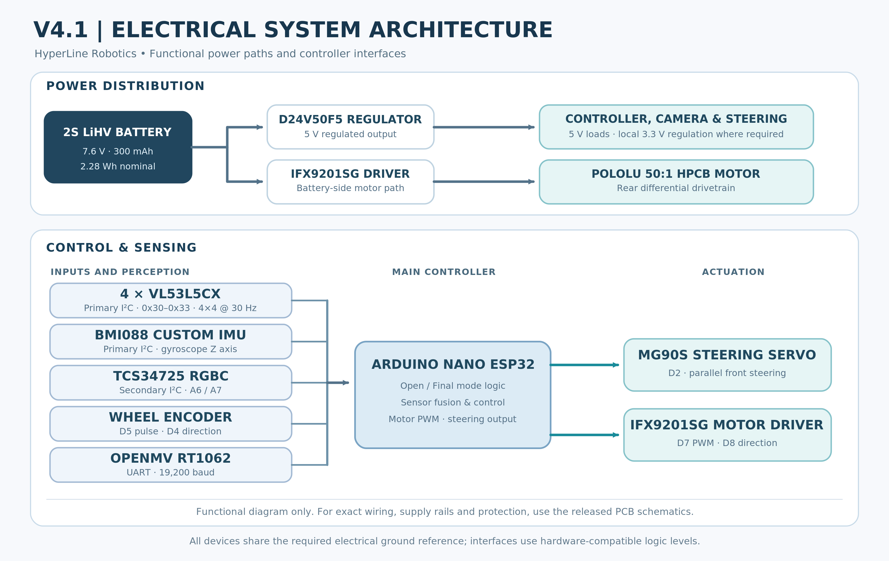

Figure 3.1. Electrical system architecture, showing the implemented interfaces and the regulated-power branches. Exact power wiring is defined by the main PCB design and must be verified before energizing.

## 1. Design goals and system constraints

| Constraint | Engineering choice | Risk addressed |
|---|---|---|
| Limited weight and space | Main PCB carries controller, connectors and motor driver | Excess wiring, tall stacked modules, variable mass distribution |
| Peak drive and steering current | Separate propulsion path and regulated 5 V logic path | Controller brownout and supply noise |
| Four ToF devices with the same factory address | Individual LPn enable pins and sequential address assignment | I²C address conflicts at startup |
| Repeatable turns | BMI088 yaw-rate integration and startup bias calibration | Uncorrected heading drift |
| Fast floor-marker recognition | TCS34725 on a separate I²C controller | Sensor contention during corner identification |
| Colored obstacles | OpenMV RT1062 processes image regions and sends compact UART commands | Image processing blocking the real-time drive loop |
| Reproducible PCB manufacturing | Released Gerber, BOM and Pick-and-Place files | Unclear electrical assembly or missing component identification |

## 2. Main electrical components

| Subsystem | V4.1 component | Function and location |
|---|---|---|
| Primary controller | Arduino Nano ESP32 | Executes motion, sensor polling and round logic |
| Vision processor | OpenMV RT1062 | Recognizes red/green traffic pillars and returns steering/avoidance commands |
| Yaw-rate sensor | Custom BMI088 IMU board | Measures angular rate for heading control |
| Range sensing | Four VL53L5CXV0GC/1 boards | Front, left, right and rear spatial distance data |
| Floor marker sensing | TCS34725 RGBC | Recognizes blue/red-orange floor regions that encode turn direction and corner events |
| Drive electronics | IFX9201SG H-bridge on main PCB | PWM drive and direction to the geared rear axle motor |
| Steering actuator | MG90S servo | Parallel front-wheel steering |
| Motor | Pololu 50:1 HPCB geared drive motor | Rear differential propulsion |
| Energy source | 2S LiHV battery, 300 mAh installed pack | Compact battery source; physical installed pack and chemistry must be confirmed |
| Main logic regulator | D24V50F5 5 V step-down module | Supplies regulated electronics and steering power as wired |

The fan/downforce assembly is **not installed** on V4.1. It is not counted as a mechanical force source or an electrical load. Any unused fan signal definitions in a development build must be treated as inactive.

### 2.1 Component presentation

The following component images identify the electronics selected for V4.1. Photographs of the installed electronics and custom boards appear in the PCB integration section. Component values are separated into **manufacturer specifications**, **firmware configuration**, and **assumptions requiring physical verification**. The distinction is important because maximum ratings do not describe normal operating current.

#### 2.1.1 Battery: Gaoneng GNB 2S LiHV, 300 mAh

|  | **Specifications** |
|------------------------------|------------------------------|
| **Model:** 2S Li-HV | **Capacity:** 300mAh |
| **Nominal Voltage:** 7.6 V | **Discharge Rate:** 60C |
| **Weight:** 12g | **Size:** 13.8 x 12 x 52.5mm |
| **Output Current:** Varies by load | **Connector Type:** JST |
| 🔗 **[Buy Here](https://www.gaoneng.shop/products/gaoneng-gnb-lihv-2s-7.6v-300mah-60c-jst-lipo-battery)** | **Function:** Powers the entire robot |

The battery is mounted alongside the middle axis of the PCB chassis, minimizing the length of its external leads. At a nominal 7.6 V, the label's 60C rating corresponds to $0.300\times60=18$ A as the manufacturer discharge rating. Charging must use a **2S LiHV-compatible** charger and the appropriate cell-voltage limits.

#### 2.1.2 Main controller: Arduino Nano ESP32

|  | **Specifications** |
|------------------------------|------------------------------|
| **Microcontroller:** ESP32 | **Flash Memory:** 4MB |
| **SRAM:** 520KB | **Frequency:** 240MHz |
| **Pins:** 22 | **Input Voltage:** 5V |
| **Active-current budget:** 200 mA | **Peak-current allowance:** 500 mA |
| 🔗 **[Buy Here](https://store.arduino.cc/en-ro/products/nano-esp32)** | **Function:** Controls all robot components |

The Nano ESP32 is the coordinator of the electrical system. It communicates with the BMI088 and range devices, interprets OpenMV results, produces the H-bridge PWM command, and outputs steering commands. The final pin allocation is documented in [04 Software](04-software.md). The **200 mA @ 5 V** value used in the power model is an explicit planning assumption rather than a measured consumption of this assembled board.

#### 2.1.3 Custom inertial sensor: BMI088

| 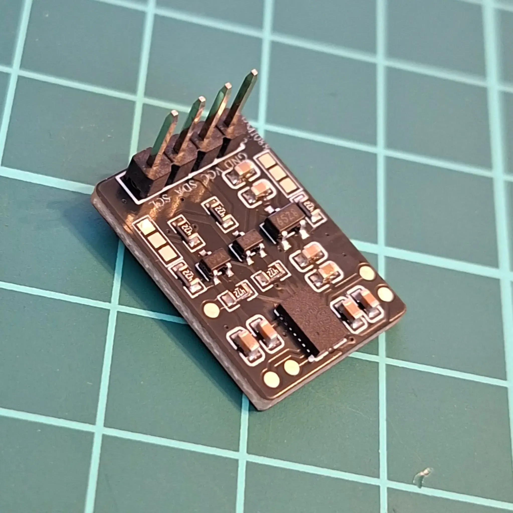 | **Specifications** |
|------------------------------|------------------------------|
| **Gyroscope Range:** ±2000°/s | **Accelerometer Range:** ±24g |
| **Interface:** I2C | **Supply Voltage:** 3.0V – 3.6V |
| **Full-operation chip current:** ~5.15 mA | **Weight:** ~1g |
| 🔗 [View Open Source Project Here](https://oshwlab.com/bicicleta11/bmi088-gyro-module) | **Function:** Tracks orientation & motion |

The custom board reduces the need for an oversized breakout module. V4.1 firmware selects **±2000°/s** for the gyroscope and **±6 g** for the accelerometer. The gyroscope's Z axis is integrated for turning and heading verification. Bosch specifies approximately **5.15 mA full-operation current** for the sensor itself, but the complete assembled board should be measured separately. [BMI088 device specification](https://www.bosch-sensortec.com/en/products/motion-sensors/imus/bmi088).

#### 2.1.4 OpenMV RT1062 vision processor

|  | **Specifications** |
|------------------------------|------------------------------|
| **Processor:** NXP i.MX RT1062 Cortex-M7 | **Frequency:** 600 MHz |
| **RAM:** 32 MB SDRAM + 1 MB SRAM | **Flash Memory:** 16 MB QSPI Flash |
| **Camera Sensor:** OV5640 | **Resolution:** 2592 × 1944, 5 MP |
| **Typical Vision Speed:** ~40 FPS at QVGA | **Interfaces:** UART, I2C, SPI, CAN, USB-C |
| **Connectivity:** Wi-Fi, Bluetooth 5.1, Ethernet | **I/O Voltage:** 3.3 V only |
| 🔗 **[Buy Here](https://openmv.io/collections/cameras/products/openmv-cam-rt?variant=42269003743326)** | **Function:** Detects red and green traffic pillars |

The front placement provides an unobstructed forward view without relying on the Arduino for pixel processing. The camera transmits decisions over **19,200 baud UART** in the configured V4.1 interface. This division keeps expensive image operations separate from the deterministic motion-control loop. [OpenMV RT1062 specification](https://openmv.io/products/openmv-cam-rt).

#### 2.1.5 Geared drive motor and encoder

|  | **Specifications** |
|------------------------------|------------------------------|
| **Model:** 50:1 HPCB | **Voltage:** 6V |
| **No-load Speed:** 650 RPM | **No-load Current:** 150mA |
| **Stall Torque:** ~0.74 kg·cm | **Stall Current:** 1.5A |
| 🔗 **[Buy Here](https://www.pololu.com/product/5184)** | **Function:** Drives the robot |

The gearbox provides output torque for acceleration and controlled parking. The encoder measures incremental motor rotation for odometry and distance-limited maneuvers. We **intentionally overvoltage the nominal 6 V motor** using the 2S LiHV battery through the IFX9201SG motor driver. The battery is 7.6 V nominal and may reach 8.7 V fully charged; the motor does not receive a separate regulated 6 V supply. Its applied voltage is controlled through PWM according to the driving state, including an Open Cruise request of 250/255 (98.04%). This is an intentional performance trade-off, not a claim that the motor is operating within its 6 V rating. PWM duty does not impose a hard voltage or current limit: prolonged high-load operation, stalls and winding heating can damage an overvolted motor. The IFX9201SG includes driver-side fault protections, but these do not establish a safe motor winding temperature. Exact encoder connector orientation and the installed motor part number should match the mechanical BOM. [Pololu 50:1 HPCB encoder family](https://www.pololu.com/product/5187/specs).

#### 2.1.6 Motor driver: IFX9201SG

|  | **Specifications** |
|------------------------------|------------------------------|
| **Model:** IFX9201SG | **Operating Voltage:** 5.5V – 45V |
| **Logic Voltage:** 3.3V / 5V compatible | **PWM Frequency:** Up to 20 kHz |
| **Max Continuous Current:** 5A | **Max Peak Current:** 8A per channel |
| **Control Interface:** PWM + Direction pins | **Built-in Protections:** Overtemperature, Overcurrent, Undervoltage, Short-to-GND/Battery |
| 🔗 **[Buy Here](https://www.lcsc.com/product-image/C112633.html)** | **Function:** Controls drive motors |

The integration of the motor driver IC eliminates an external motor-driver breakout and reduces power-wire length. The motor power must be checked at the H-bridge supply, not inferred from PWM percentage alone. Driver dissipation is estimated as $P_{\mathrm{driver}}=I_m^2R_{\mathrm{path}}+P_{\mathrm{switch}}$; both terms depend on operating current and device conditions. Monitor thermal rise and verify fault handling under stall or blocked-wheel conditions.

#### 2.1.7 Steering actuator: MG90S

|  | **Specifications** |
|------------------------------|------------------------------|
| **Model:** MG90S | **Voltage:** 5V |
| **Torque:** 2.2kg/cm | **Signal Type:** PWM |
| **Moving-current allowance:** 120 mA | **Peak-current allowance:** 500 mA |
| **Weight:** ~13.4g | **Gears:** Metal |
| 🔗 **[Buy Here](https://www.optimusdigital.ro/ro/motoare-servomotoare/271-servomotor-mg90s.html?srsltid=AfmBOooTrDsx2UoJ3Px8J26kkCbcuYhlpKYmuIYkivK_5ZSzPJx0ZNo8)** | **Function:** Controls steering |

The steering servo is a pulsed, highly variable load. Servo current under active steering cannot be calculated from the command pulse width. The **120 mA active-current assumption** used in the engineering budget is for calculation only; fast direction changes and a jammed linkage can cause much larger current draws.

#### 2.1.8 Four custom VL53L5CX distance sensors

|  | **Specifications** |
|------------------------------|------------------------------|
| **Detection Range:** 400 cm (depends on surface) | **Type:** I2C,  8x8 or 4x4 matrix |
| **Board supply:** 5 V with onboard 3.3 V regulation | **Chip power:** 313 mW typical continuous-ranging example |
| **Ranging zones:** 4×4 or 8×8 | **V4.1 update rate:** 30 Hz (4×4) |
| 🔗 [View open sourced project](https://oshwlab.com/bicicleta11/project_mhqqebyu) | **Use Case:** Read distances to walls |

Unlike single-point distance sensors, each VL53L5CX returns a 16-zone spatial matrix at 4×4 resolution. The four sensors monitor front, left, right and rear. Each begins with the factory address `0x29` and is assigned a different address (`0x30` to `0x33`) during initialization. The manufacturer's **continuous-ranging typical power example** at 3.3 V/3.3 V is **313 mW per sensor chip**, corresponding to **1.252 W for four chips** before breakout-board overhead. [VL53L5CX datasheet](https://www.st.com/resource/en/datasheet/vl53l5cx.pdf), electrical characteristics §6.4.

#### 2.1.9 D24V50F5 voltage regulator

|   | **Specifications** |
|------------------------------|------------------------------|
| **Model:** D24V50F5 | **Input Voltage:** 6V – 38V |
| **Output Voltage:** 5V | **Output Current:** 5A |
| **Efficiency:** Buck Converter (Step-down) | **Dropout Voltage:** ~2V |
| **Protection:** Short-circuit & thermal shutdown | **Mounting Type:** Pins |
| 🔗 **[Buy Here](https://www.pololu.com/product/2851)** | **Function:** Converts battery voltage to 5V |

The D24V50F5 converts the battery rail to the logic and actuator supply and is rated for up to 5 A under its specified operating conditions. [D24V50F5 technical reference](https://www.pololu.com/product/2851).

#### 2.1.10 Floor-color sensor: TCS34725

|  | **Specifications** |
|------------------------------|------------------------------|
| **Model:** TCS34725 | **Input Voltage:** 3V – 5V (Adafruit breakout) |
| **Sensor Type:** RGBC Color Sensor | **Interface:** I²C |
| **Color Channels:** Red, Green, Blue, Clear | **I²C Address:** 0x29 |
| **Resolution:** 16-bit per channel | **I²C Speed:** Up to 400 kHz |
| **Gain:** 1×, 4×, 16×, 60× | **Integration Time:** 2.4 – 614.4 ms |
| **Features:** IR-blocking filter, white LED | **Mounting Type:** Through-hole pins |
| 🔗 **[Buy Here](https://www.adafruit.com/product/1334)** | **Function:** Detects colored floor markings for corner and direction recognition |

The floor sensor complements the camera by sampling the field directly beneath the vehicle. The software uses normalized RGB ratios, an illumination guard and event rearming.

### 2.2 Main PCB and physical integration

The custom main board integrates connectors, the motor driver, controller footprint, switching and power entry. Its mechanical role makes layout decisions important beyond electrical connectivity. Connector locations must not obstruct the differential, steering travel or the battery mount; motor-current traces and component mounting should not concentrate flexural loads near small SMD joints.

The manufacturing package contains the board's BOM, fabrication files and component placements:

- [Main PCB production files](../electrical-schematics/Main%20PCB/production-files/)
- [BMI088 production files](../electrical-schematics/IMU/production-files/)
- [VL53L5CX production files](../electrical-schematics/TOF%20sensors/production-files/)

The main PCB assembly specifies an **IFX9201SGAUMA1 motor-driver footprint**, a **220 µF / 35 V bulk capacitor**, dedicated Arduino, encoder, gyro, camera and servo connectors, and a header for the 5 V regulator. These are useful inspection points when checking assembly consistency. The presence of a component in the BOM is not a substitute for checking its actual net connections and polarity.

### 2.3 Electrical schematic, PCB traces and assembled board

V4.1 uses a compact custom PCB to integrate the motor driver, distribution paths, Nano ESP32 and system connectors. The three complementary views below show the **circuit design**, the **copper/layout implementation**, and the **installed PCB chassis**.

| Electrical schematic | Copper layout (Top) | Copper layout (Inner 1) | Copper layout (Inner 2) | Copper layout (Bottom) | Populated robot chassis |
|:---:|:---:|:---:|:---:|:---:|:---:|
| <a href="docs-media/v41-pcb-schematic-export.png">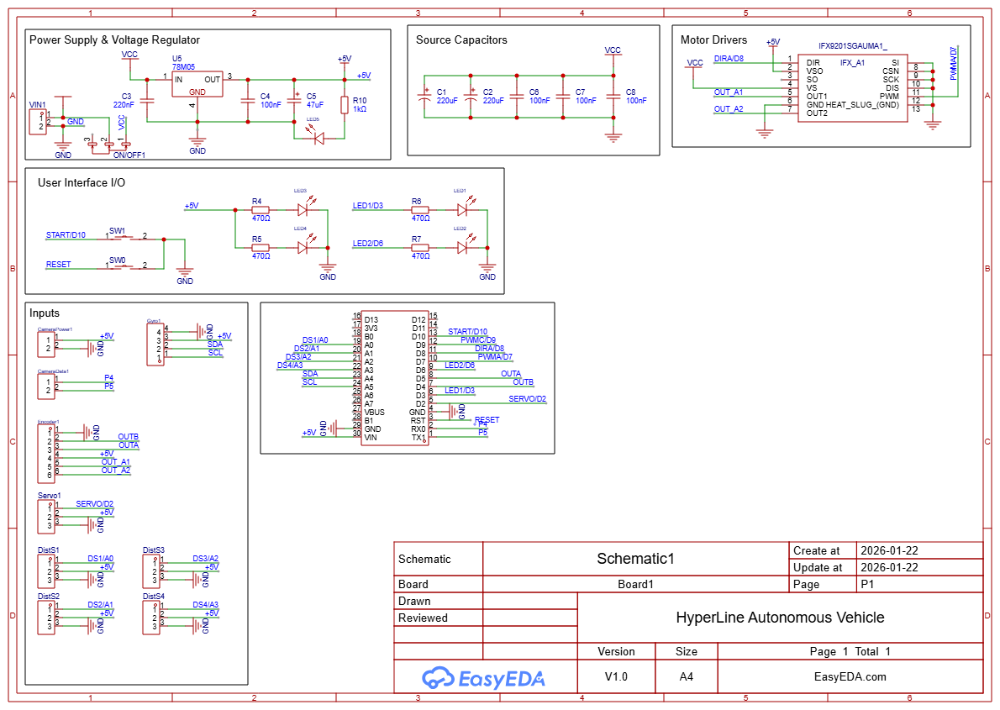</a> | <a href="docs-media/v41-pcb-layout-top-copper.png">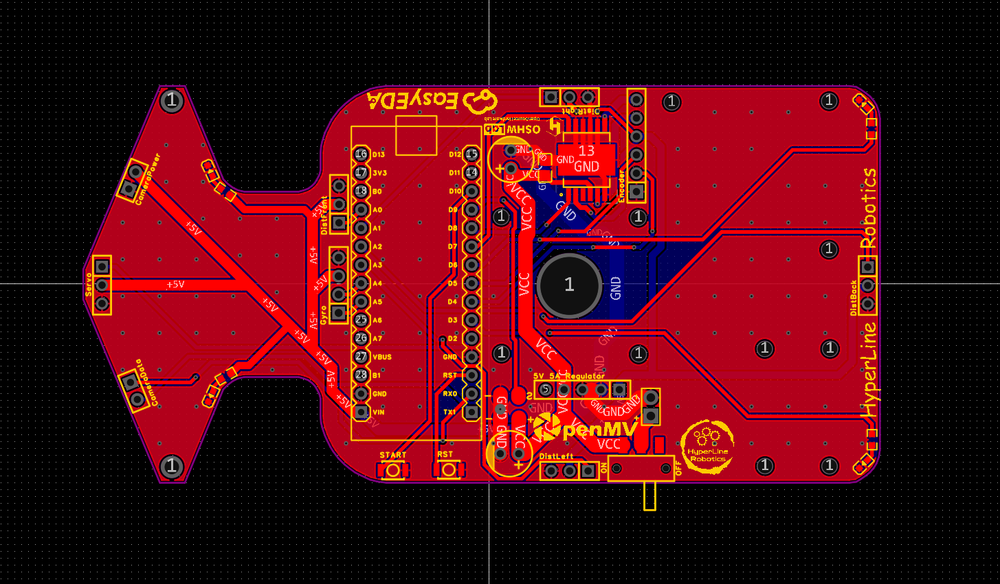</a> | <a href="docs-media/v41-pcb-layout-inner-layer-1.png">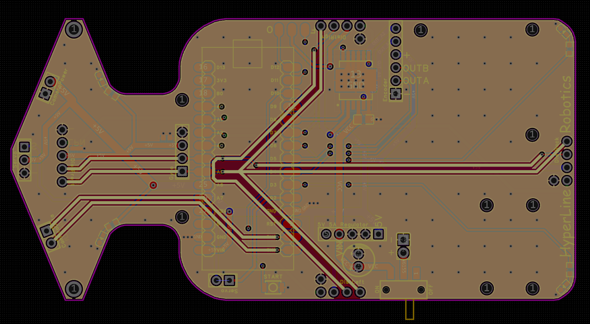</a> | <a href="docs-media/v41-pcb-layout-inner-layer-2.png">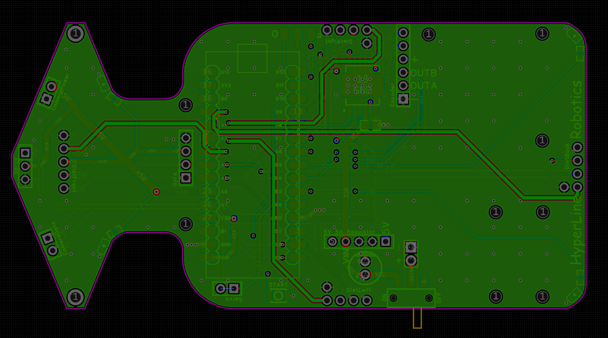</a> | <a href="docs-media/v41-pcb-layout-bottom-copper.png">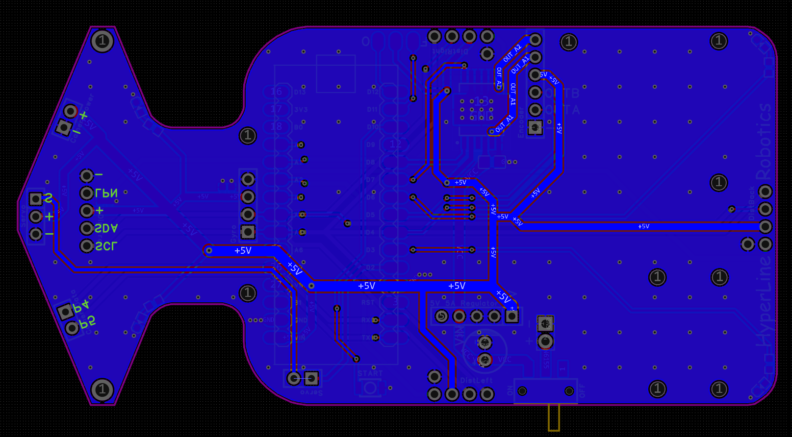</a> | <a href="docs-media/v41-photo-assembled-robot-top.png">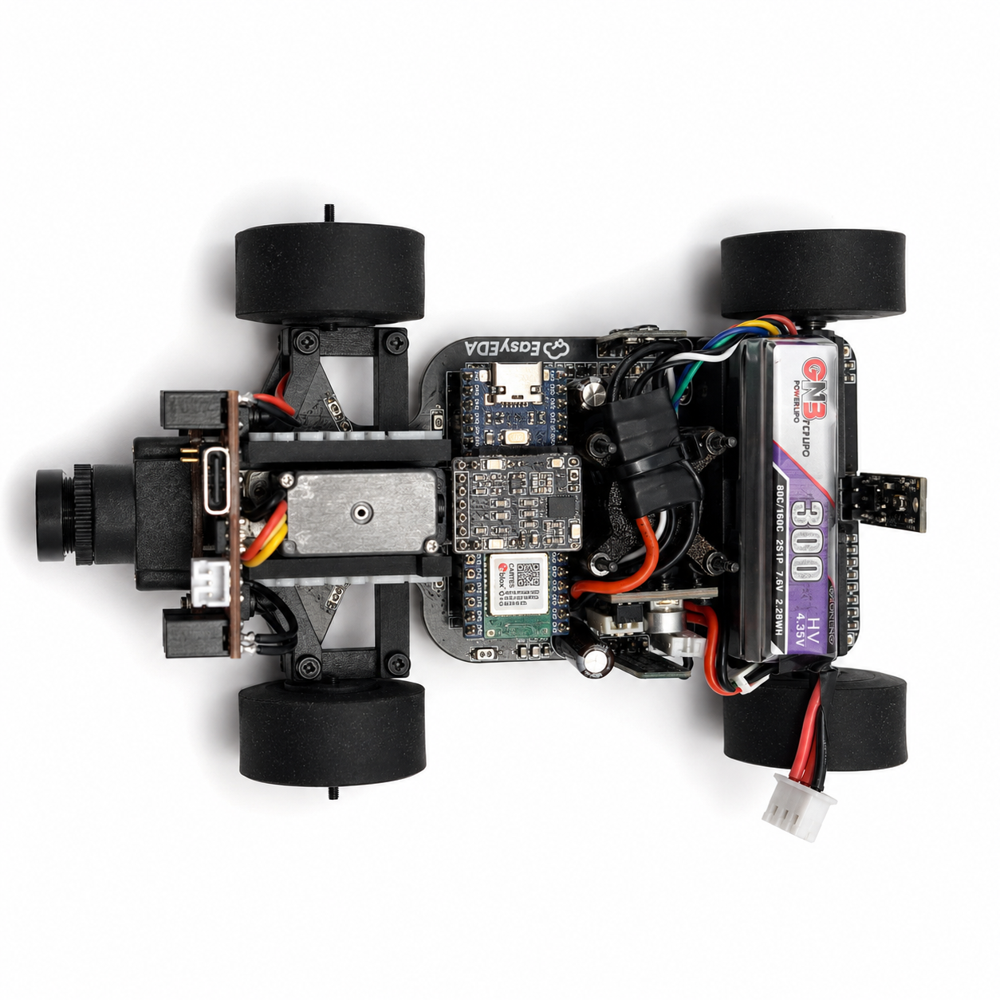</a> |
| EasyEDA drawing export | Main PCB routing and copper planes on top layer |  Main PCB routing and copper planes on first inner layer |  Main PCB routing and copper planes on second inner layer | Main PCB routing and copper planes on bottom layer | Actual packaging of the motor, battery and electronics |

#### Functional power distribution

<a href="docs-media/v41-diagram-power-distribution.svg">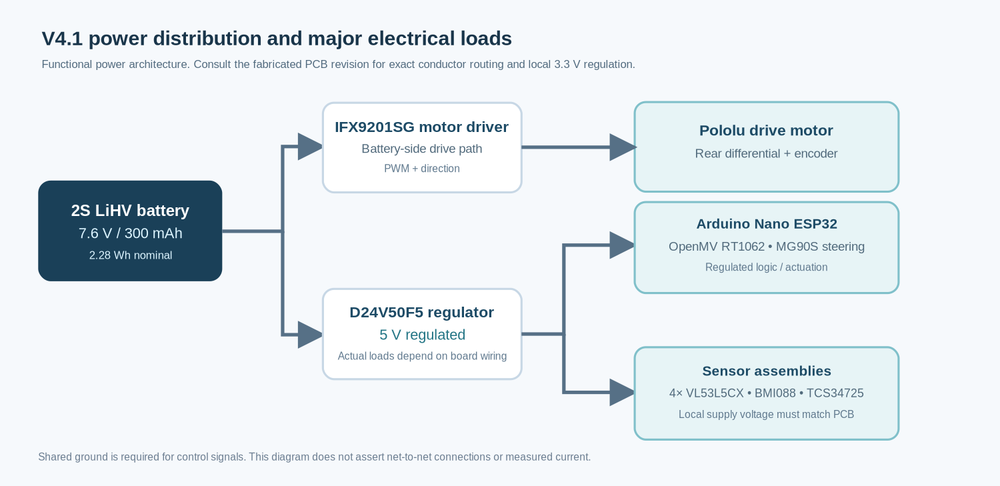</a>

Functional power domains. This is a system-level explanation, not a substitute for the board's exact netlist.

The direct battery path and the regulated electronics path share a ground reference for communication. High-current paths should avoid routing under sensitive measurement circuitry. The camera, servo and controller require a stable regulator output during drive load changes. The ToF, BMI088 and floor-color circuits must receive voltages consistent with their particular custom-board regulators and logic levels.

#### Custom IMU and sensor placement

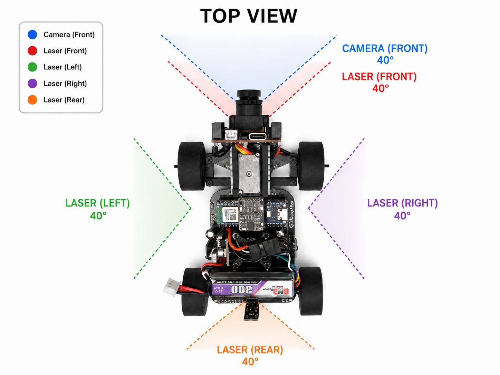

Custom BMI088 board at left and a mounting/viewing reference at right. Field-of-view lines illustrate the design intention; the optical orientation and blocked zones are checked on the assembled robot.

## 3. Power architecture and calculations

### 3.1 Battery and energy storage

The robot's installed pack is labeled **GNB 2S LiHV, 7.6 V nominal, 300 mAh, 60C and 2.28 Wh**. Lithium-high-voltage chemistry uses a **4.35 V/cell charging limit**, so the maximum fully charged pack voltage is $2\times4.35=8.70$ V. A charger configured only for standard 4.20 V/cell Li-Po is not equivalent to LiHV charging.

The nominal battery energy is:

$$
E_{\mathrm{nom}}=V_{\mathrm{nom}}C=7.6\cdot0.300=2.28\ \mathrm{Wh}
$$

The battery's 60C label corresponds to a nominal discharge-rating calculation of:

$$
I_{\mathrm{label}}=C_{\mathrm{Ah}}\cdot60=0.300\cdot60=18\ \mathrm{A}
$$

The battery label specifies a maximum discharge rating of 18 A. Actual usable energy depends on voltage sag, pack temperature, age and cutoff.

### 3.2 Regulated logic rail

The D24V50F5 is a 5 V buck regulator. For the 5 V loads,

$$
P_{5V}=5\sum_j I_{5V,j}
$$

and approximate battery-side power drawn by those loads is:

$$
P_{\mathrm{battery,logic}}=\frac{P_{5V}}{\eta_{\mathrm{buck}}}
$$

where $\eta_{\mathrm{buck}}$ is the regulator's efficiency at the actual operating point. We cannot simply add the motor's battery-side current to each 5 V device's rail current, because they are measured at different voltages.

For example, a hypothetical 5 V rail current of $I_{5V}=0.85$ A represents $4.25$ W at the output. At an *assumed* 90% efficiency, it would draw $4.72$ W from the pack, or $0.621$ A at 7.6 V. The actual value belongs in the measurement table below.

The electrical load of the robot is expressed as:

$$
P_{\mathrm{in}}\approx V_{\mathrm{bat}} I_{\mathrm{motor}}+\frac{5I_{5V}}{\eta_{\mathrm{buck}}}+P_{\mathrm{other}}
$$

This form is useful for evaluating acceleration transients and establishing an energy budget without double-counting rail loads.

#### Low-voltage supply and logic domains

The battery feeds the D24V50F5, which produces the main 5 V rail. The ToF chip and BMI088 use 3.3 V-class supplies, but the chip supply, a module input supply and the I²C pull-up voltage are **three different connections**. They must not be treated as interchangeable.

| Component | Documented board/module supply | 3.3 V conversion path | Interface voltage / note |
|---|---|---|---|
| Four custom VL53L5CX boards | 5 V at the custom-board supply input, as documented in §2.1.8 | Local 3.3 V regulation on each ToF board | VL53L5CX signal and I²C nets must use levels permitted by the actual board design; the precise pull-up/level-shifting topology is defined by the ToF PCB schematic |
| Custom BMI088 board | BMI088 chip supply requirement: 3.0 to 3.6 V | Exact regulator/source net for the assembled custom IMU board is not identified in the supplied chapter | Sensor communication must remain within the voltage limits of both the BMI088 and Nano ESP32 |
| TCS34725 floor sensor | 3 to 5 V for the specified Adafruit-style breakout, not necessarily the bare IC | Check the installed breakout circuit for its onboard regulator | The actual SDA/SCL pull-up rail on A6/A7 must be checked against the installed breakout |
| Arduino Nano ESP32 | Regulated 5 V system feed | Internal board voltage regulation | ESP32 GPIO operates at 3.3 V logic |
| OpenMV RT1062 | Regulated 5 V system feed | Camera-board internal conversion | UART interface is 3.3 V logic |
| MG90S servo | Regulated 5 V system feed | Not applicable | The command input is driven by the Nano ESP32 |

Consult the [main PCB](../electrical-schematics/Main%20PCB/production-files/), [IMU board](../electrical-schematics/IMU/production-files/) and [ToF board](../electrical-schematics/TOF%20sensors/production-files/) production designs for the electrical net arrangement.

### 3.3 Electrical load and power measurement

To characterize the electrical system, measure battery voltage and current upstream of the power split and the 5 V rail at its load connector. Check stationary operation, straight driving, steering reversals and simultaneous camera/ToF activity. An oscilloscope captures transient voltage dips during motor and servo operation.

Battery energy can be calculated from time-stamped voltage and current samples using trapezoidal integration:

$$
E \approx \sum_{k=1}^{n-1} \frac{P_k+P_{k+1}}{2}(t_{k+1}-t_k), \qquad P_k=V_{\mathrm{bat},k}I_{\mathrm{bat},k}.
$$

### 3.3.1 Calculated consumption budget

The following calculated power budget combines manufacturer specifications with engineering allowances for the regulated loads.

| Component | Assumed operation | Electrical basis | Modeled power |
|---|---|---|---:|
| Arduino Nano ESP32 | 200 mA at 5 V | Engineering allowance | 1.000 W |
| OpenMV RT1062 | 150 mA at 5 V | Conservative design allowance; published active current is approximately 130 mA at 5 V | 0.750 W |
| MG90S steering servo | 120 mA at 5 V | Assumed moving-average current; peak can be higher | 0.600 W |
| Four VL53L5CX chips | 4× continuous ranging, 3.3 V/3.3 V | ST example: 313 mW per chip | 1.252 W |
| BMI088 chip | 5.15 mA at 3.3 V | Bosch full-operation specification | 0.017 W |
| TCS34725 module | Allowance | Engineering allowance | 0.020 W |
| **Total regulated loads, before conversion losses** | | | **3.639 W** |

The estimated regulated-load total is 3.639 W, before conversion losses. Support electronics, copper losses and servo transients affect the supply requirement.

<a href="docs-media/v41-calculated-regulated-load-budget.svg">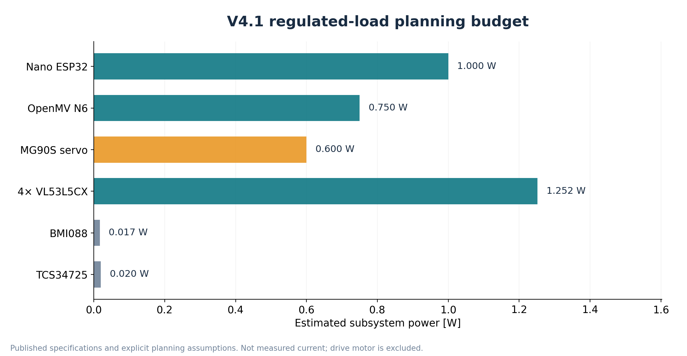</a>

Modeled component consumption from manufacturer values and explicit assumptions. Motor power is excluded from the regulated-load model.

[Power budget assumptions (CSV)](validation/power_model_assumptions.csv).

#### From component demand to battery input

For a first-order sensitivity model, assume that the regulated loads are delivered through conversion stages with an overall effective efficiency of $\eta=0.90$. Then:

$$
P_{\mathrm{regulated,input}}\approx\frac{3.639}{0.90}=4.04\ \mathrm{W}
$$

We add direct battery-side motor consumption, plus a **10 mA H-bridge quiescent assumption**:

$$
P_{\mathrm{battery}}(I_m,\eta)=\frac{3.639}{\eta}+7.6(I_m+0.010)
$$

where $I_m$ is the **assumed motor input current**, not the 8-bit PWM duty value. For a worked example of $I_m=0.80$ A:

$$
P_{\mathrm{battery}}\approx\frac{3.639}{0.90}+7.6(0.80+0.010)=10.20\ \mathrm{W}
$$

<table><tr><td align="center" width="50%"><a href="docs-media/v41-calculated-motor-power-sensitivity.svg">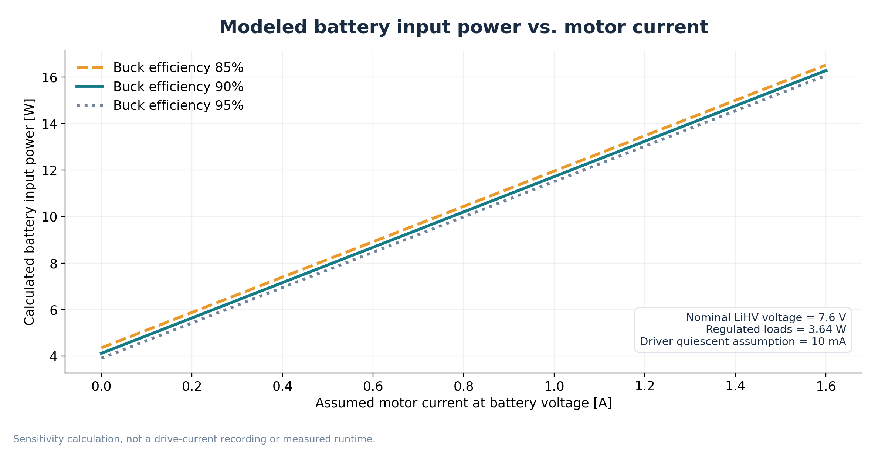</a></td><td align="center" width="50%"><a href="docs-media/v41-calculated-ideal-battery-runtime.svg">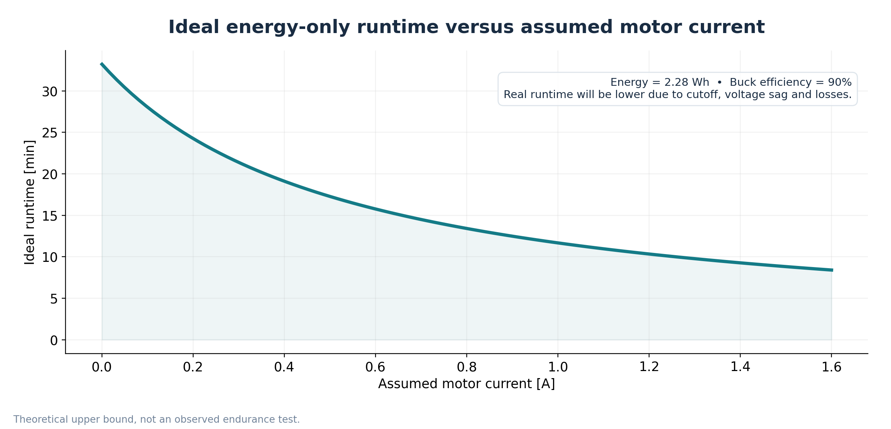</a></td></tr><tr><td align="center">Battery power depends strongly on direct motor current.</td><td align="center">Ideal runtime, before reserve, sag, thermal losses or cutoff.</td></tr></table>

| Assumed motor current | Estimated pack input power | Ideal energy-only runtime |
|---:|---:|---:|
| 0.00 A | 4.12 W | 33.2 min |
| 0.25 A | 6.02 W | 22.7 min |
| 0.50 A | 7.92 W | 17.3 min |
| 0.80 A | 10.20 W | 13.4 min |
| 1.20 A | 13.24 W | 10.3 min |
| 1.60 A | 16.28 W | 8.4 min |

These are ideal energy-only runtime calculations using the nominal battery energy. The usable runtime depends on load, cutoff, conversion efficiency and battery condition.

[Calculated power scenarios (CSV)](validation/power_model_scenarios.csv).

### 3.3.2 Configured PWM operating points

The drive controller uses 1 kHz, 8-bit PWM. The nominal duty request is $D=100|u|/255$ percent.

| Operating condition | PWM command | Nominal duty |
|---|---:|---:|
| Start wait | 0 | 0.00% |
| Open initial and corner | 80 | 31.37% |
| Open cruise | 250 | 98.04% |
| Final cruise | 50 | 19.61% |
| Parking approach, turns and search | 35 | 13.73% |
| Final parking arcs | 32 | 12.55% |
| Bounded parking correction | 38 | 14.90% |

#### Intentional motor overvoltage

The Pololu 50:1 drive motor is rated for 6 V. Our IFX9201SG motor-power path is supplied directly from the 2S LiHV battery (7.6 V nominal, up to 8.7 V fully charged). The Open cruise duty request is 98.04%. This configuration prioritizes response during short maneuvers but increases winding heating and current under heavy loads. The motor driver protects its own output stage; monitor motor temperature and avoid prolonged stalls.

### 3.4 Expected runtime

An energy-based runtime estimate is:

$$
t_{\mathrm{run}}\approx\frac{E_{\mathrm{usable}}}{\overline{P}_{\mathrm{in}}}
$$

or, for a rough constant-current estimate on the battery side:

$$
t_{\mathrm{run,minutes}}\approx60\frac{C_{\mathrm{Ah}}f_{\mathrm{usable}}}{I_{\mathrm{bat,avg}}}
$$

The usable fraction $f_{\mathrm{usable}}$ is dependent on cutoff and the actual battery under load. Account for starting voltage, pack recovery and repeated attempts when choosing the battery capacity.

### 3.5 Protection and power failure modes

The major electrical hazards are a reverse-connected battery, motor inrush, servo peaks, regulator overheating, unstable connectors and shared-ground interference. Our power architecture therefore requires inspection of the input polarity, power path, common ground and regulated voltage before connecting sensitive components. The 220 µF bulk capacitor on the main PCB helps decouple supply transients, but it is not a replacement for a correctly sized regulator or a suitable wiring topology.

| Failure | Observable symptom | Diagnostic | Mitigation |
|---|---|---|---|
| 5 V rail sag | Nano or camera resets during acceleration | Capture voltage at the connector during motor transients | Verify regulator, wiring and separation of peak loads |
| Servo current spike | Steering chatter or regulator droop | Measure peak servo current at hard lock | Avoid mechanical binding; preserve power margin |
| Weak ground connection | UART errors, unstable sensor values | Check continuity and voltage offsets under load | Short, secure return path and common reference |
| Incorrect ToF sequencing | Only one sensor found at startup | Record I²C addresses after each enable | Hold all LPn low, enable sequentially |
| Low battery voltage | Loss of torque or incomplete run | Measure pack voltage during a complete lap | Use a suitable cutoff and charged known-good battery |
| Main-board flex | Intermittent component joints | Inspect support points and connectors | Rework mount spacing and limit unsupported spans |

## 4. Sensor buses and actual controller connections

### 4.1 Pin allocation

The V4.1 controller assigns the following pins in the modular firmware:

| Signal | Arduino Nano ESP32 pin | Role |
|---|---|---|
| Motor PWM | D7 | H-bridge speed signal; 1 kHz, 8-bit PWM |
| Motor direction | D8 | H-bridge direction |
| Steering servo | D2 | Servo command |
| Encoder A | D5 | Rising-edge interrupt |
| Encoder B | D4 | Direction read during A edge |
| Start button | D10 | Starts run after setup and calibration |
| Mode select: Final | D11 | HIGH at boot selects obstacle/Final mode |
| Mode select: Open | D12 | HIGH at boot selects Open mode |
| ToF front LPn | A3 | Power-state/address sequencing |
| ToF left LPn | A2 | Power-state/address sequencing |
| ToF right LPn | A1 | Power-state/address sequencing |
| ToF back LPn | A0 | Power-state/address sequencing |
| TCS34725 SDA/SCL | A6 / A7 | Secondary I²C bus (`TwoWire(1)`) |
| Camera UART | D0 / D1 | Serial interface at 19,200 baud; check exact TX/RX crossing |
| Diagnostic LEDs | D6 / D3 | Status indication |

The BMI088 and four VL53L5CX devices share the primary I²C bus. The floor-color sensor uses a separate bus at 400 kHz. The primary bus is also configured at 400 kHz in the firmware. Electrical pull-up voltage and strength must be confirmed against the released PCB assembly before attaching third-party modules.

### 4.2 Four VL53L5CX matrices

The four ToF boards are addressed individually after startup:

| Orientation | 7-bit I²C address | LPn pin | Use |
|---|---|---|---|
| Front | `0x30` | A3 | Wall distance, corner event and deceleration |
| Left | `0x31` | A2 | Side clearance, departure and parking |
| Right | `0x32` | A1 | Side clearance and parking |
| Back | `0x33` | A0 | Rear clearance and parking |

The driver holds LPn low for all four sensors before initialization. It then releases them one at a time, communicates at the default address `0x29`, assigns each new address and starts ranging. This prevents two unconfigured devices from answering the same I²C request.

Each sensor is configured to **4 × 4 zones at 30 Hz**. The data age is checked against a **150 ms freshness limit**. Invalid or unavailable measurements return `-1` rather than a fabricated distance. Open generic distance queries use the closest valid central 2 × 2 zone; Final generic queries require both R2C3 and R3C3 and average them.

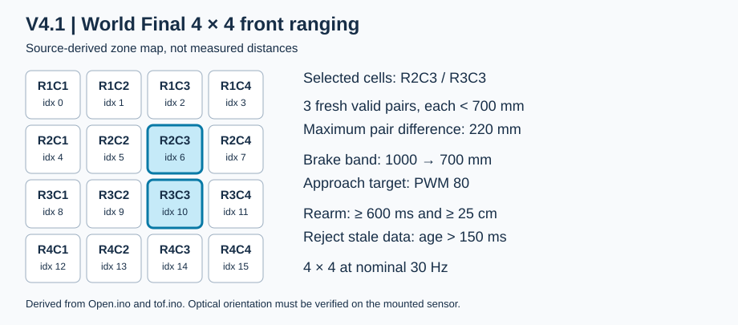

Figure 3.2. Current source-derived 4 × 4 zone diagram and Open decision thresholds. The physical sensor orientation must be checked to confirm the indexed cells correspond to the intended side of the image.

For Open Challenge, the controller uses **front row 2, column 3** and **front row 3, column 3**. Three consecutive fresh valid pairs below 700 mm, differing by no more than 220 mm, confirm a corner. Speed is reduced from 1000 mm toward PWM 80 at 700 mm; rearming requires 600 ms and 25 cm of straight travel after the turn. The earlier 600/800 mm diagram is preserved in the media index for revision history.

The nominal 30 Hz frame period is:

$$
T_{\mathrm{frame}}=\frac{1}{30}=33.3\ \mathrm{ms}
$$

This is the device configuration target, **not** a measurement of full-loop latency. Bus transfers, polling workload, blocking turns and communication may increase the age of data available to navigation. Log the actual inter-frame interval to validate the control timing.

### World Final ToF matrix evidence

The VL53L5CX measures range independently across a spatial array. Row and column are 1-based in the journal; row-major buffer index is `(row - 1) * width + (column - 1)`. A range is in millimetres along the corresponding optical region, not a pixel color or direct Cartesian coordinate. The firmware configures four modules at 4×4 and nominally 30 Hz (16 zones per device); the separate diagnostic interface can also inspect 8×8 at nominally 15 Hz (64 zones). Higher spatial resolution helps inspect edge transitions but increases transfer size and reduces the nominal update rate. The driving controller uses 4×4; the diagnostic interface supports both resolutions.

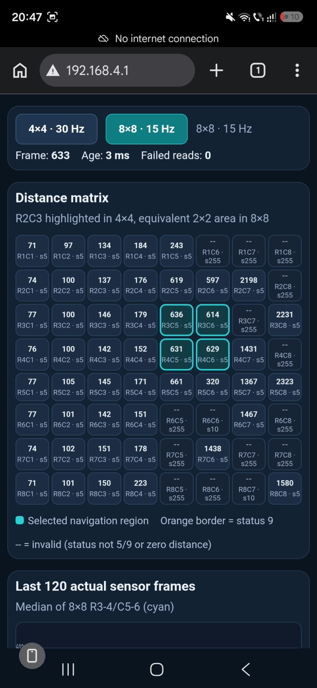

V4.1 diagnostic screenshot: frame 633, age 3 ms, zero failed reads displayed, 8×8 / 15 Hz selected.

| Feature in the captured frame | Reading / interpretation |
|---|---|
| Leftmost column | 71–77 mm, status 5; nearby surface in that optical region |
| Highlighted R3C5, R3C6, R4C5, R4C6 | 636, 614, 631, 629 mm; median **630 mm** |
| Farther valid returns | Up to 2323 mm in the shown frame; multiple depth regions are visible |
| Invalid returns | `--`, including status 255 and status 10; invalid range |
| Capture counters | Frame 633, 3 ms age, zero failed reads displayed |

The [64-zone observation file](validation/physical/tof_diagnostic_frame_633.csv) records 49 valid and 15 invalid zones. It preserves the individual target status values and selected navigation region.

A 4×4 cell R2C3 corresponds spatially to the 8×8 block R3–R4/C5–C6; R3C3 corresponds to R5–R6/C5–C6. The highlighted block is the first of those regions. The median above is calculated from the four visible valid values, using the displayed frame. Different zone widths and ranging settings can yield different readings, so do not assume that averaging 8×8 cells reproduces the actual 4×4 sensor output.

In the current [`Telemetry.ino`](../src/HLR_FE_World_Final/Telemetry.ino), each module's JSON contains `online`, `age`, `r2c3`, `r3c3`, `matrix` and `status`. All sixteen cached distances and statuses are displayed as a 4×4 grid; selected cells are outlined, and stale grids are visually dimmed. Navigation rejects data older than 150 ms. The telemetry cache may retain the last range so the age must be checked before interpreting a display. Status 5 or 9 and positive distance are required by the range filter. See [software telemetry](04-software.md#world-final-read-only-telemetry) for the capture and export process.

For optical alignment, place a flat target at a known distance and move a narrow target across the sensor field. Inspect zone orientation and range status.

#### Placement and field geometry

The placement objective is to see wall surfaces without the chassis, wheel or tire blocking the selected matrix zones. The front sensor must detect a wall early enough to slow down from the current speed before the desired corner entry location. If the travel speed is $v$ and response delay is $\tau$, the distance traveled before a new command can take effect is:

$$
d_{\mathrm{latency}}=v\tau
$$

At an illustrative $v=0.8$ m/s and $\tau=0.05$ s, this distance is 40 mm, before any braking distance. A more complete stopping margin is:

$$
d_{\mathrm{margin}}\ge v\tau+\frac{v^2}{2a_b}+d_{\mathrm{geometry}}
$$

where $a_b$ is the measured deceleration magnitude and $d_{\mathrm{geometry}}$ covers front overhang and required clearance. This explains why range thresholds cannot be chosen independently of speed and mechanics.

#### Physical mounting and optical clearance

The front, left, right and rear VL53L5CX boards face their corresponding field boundaries. Their optical axes are illustrated alongside the measured vehicle envelope and CAD wheelbase in the placement drawing below.

| Sensor | Optical-axis orientation | Installed optical-center height | View clearance relevant to operation |
|---|---|---|---|
| Front | Forward, toward approaching walls | Refer to the corresponding CAD mounting face | Front structure and camera mount must not block the central ranging zones used for corner detection |
| Left | Left, toward the side wall | Refer to CAD sensor mount | Wheel and side bodywork must clear the wall-facing view |
| Right | Right, toward the side wall | Refer to CAD sensor mount | Wheel and side bodywork must clear the wall-facing view |
| Rear | Backward, toward the rear boundary | Refer to CAD sensor mount | Rear bodywork, axle and wiring must clear the rear field of view |

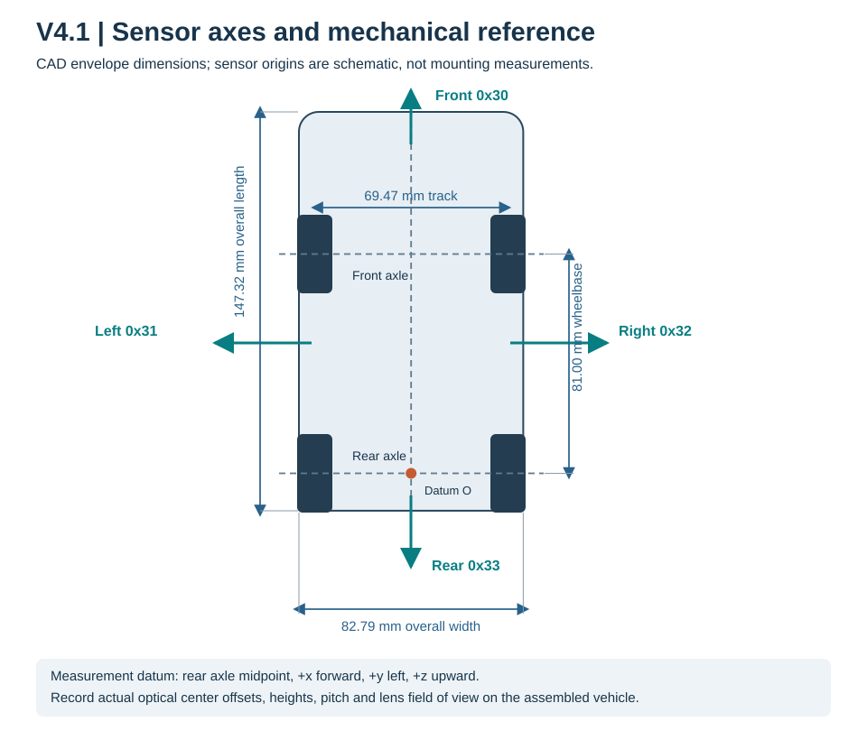

*Figure: CAD envelope and wheelbase with schematic sensor axes. Optical center locations and mounting heights are recorded using the [placement measurement worksheet](validation/physical/sensor_placement.csv). The drawing uses a rear-axle midpoint datum.*

Front sensing controls corner approach and braking. The lateral modules provide independent clearance measurements and allow the parking routine to distinguish two side boundaries. Rear ranging supports reverse clearance checks. This arrangement avoids treating a single scalar reading as a complete description of the field.

### 4.3 BMI088 inertial measurement

The custom BMI088 board provides angular velocity for heading estimation. The firmware initializes the gyro with a ±2000°/s range and an output data rate setting of 400 Hz; the accelerometer is configured for ±6 g and 200 Hz. The control law primarily uses the **Z-axis gyroscope rate** and does not require a magnetic heading reference.

At startup, the robot remains stationary for 10 seconds while samples are averaged to estimate bias:

$$
\hat b_z=\frac{1}{N}\sum_{k=1}^{N}\omega_{z,k}
$$

The corrected yaw angle is then integrated:

$$
\psi(t)=\psi(0)+\int_0^t[\omega_z(\tau)-\hat b_z]\,d\tau
$$

The discrete implementation uses microsecond timestamps and rejects unusually long update intervals over 50 ms to avoid integrating a stale rate over a blocked loop. This improves integration behavior but means a long blocked interval is not reconstructed retroactively. Drift depends on temperature and bias changes, so repeat the stationary test after warm-up.

### 4.4 TCS34725 floor-marker sensor

The TCS34725 returns clear, red, green and blue values. The firmware normalizes RGB by the sum of channels, so classification uses relative color proportions rather than only raw brightness:

$$
r_n=\frac{R}{R+G+B},\quad g_n=\frac{G}{R+G+B},\quad b_n=\frac{B}{R+G+B}
$$

A clear-channel threshold rejects extremely dark readings. The classifier distinguishes white, blue, red, orange and green classes. White observations re-arm marker detection, while marker lockout prevents an immediate double-count. The sensor uses a separate I²C bus, helping the floor marker remain responsive even while the primary bus polls the ToF matrices.

Color thresholds must be checked using actual samples on the competition mat under the event lighting. The RGB ratios alone do not remove every effect of shadows and spectral changes.

### 4.5 OpenMV RT1062 vision processor

The OpenMV RT1062 runs the obstacle perception task independently of the drive controller. The vision interface is a newline-delimited UART protocol at **19,200 baud**. The drive controller recognizes red and green obstacle messages and `S...` normalized steering overrides. The [World Final camera script](../src/camera.py) uses separate full-image height classification and lower-image steering regions, with fixed exposure, gain and white balance. It translates 50/100/150 mm sign classes into effective passing colours. Sensor orientation, thresholds and camera settings are recorded in [Chapter 04](04-software.md).

This division is deliberate: image operations have variable processing time, while steering and motor control should respond quickly to gyro and distance data. A camera message is a request to the control state machine, not a direct, unfiltered command to the motor driver.

#### Actual OpenMV RT1062 image and detection output

The frame below is captured from the robot camera's vision interface, including the **green and red detection boxes**, their estimated distances and the selected cube-processing region.

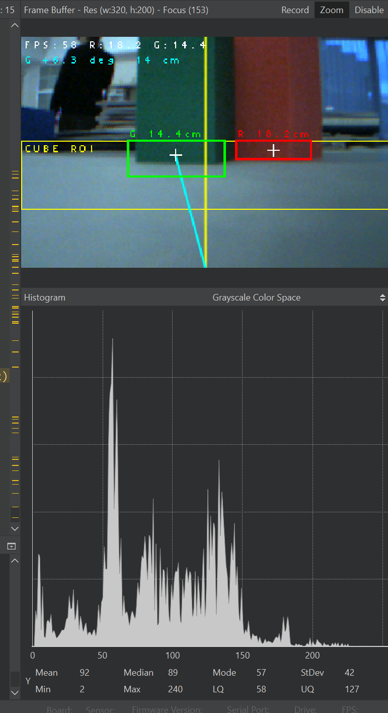

Camera frame crop from the actual OpenMV output. Click to view the full diagnostic screenshot, including its intensity histogram.

The purpose of this view is to make perception behavior inspectable, rather than to claim a particular success rate from a single frame. The two boxes demonstrate the color-segmentation stage. A valid object needs to satisfy the configured region, size, color and position conditions before its message influences the Obstacle Challenge state machine. Test sequences with lighting changes and the camera initially facing a nearby wall are documented in [04 Software](04-software.md).

## 5. Sensor calibration and validation

### 5.1 Distance-sensor calibration matrix

To measure ranging accuracy, test the front, left, right and rear sensors at multiple known wall distances using a flat wall and a ruler aligned with each sensor's optical center. The observed bias at a given position is:

$$
e_d=d_{\mathrm{ToF}}-d_{\mathrm{reference}}
$$

and over $N$ samples:

$$
\mathrm{RMSE}=\sqrt{\frac{1}{N}\sum_{j=1}^N e_{d,j}^2}
$$

#### Distance-sensor setup

For each sensor, place a flat target at 200, 400, 600 and 1000 mm from its optical center. Inspect the 4×4 distances, valid status codes and frame age. Move a narrow object across the field to check the zone orientation and optical clearance. The [8×8 diagnostic capture](#world-final-tof-matrix-evidence) shows the spatial depth information used during development.

### 5.1.1 Open-mode ToF corner decisions

The World Final controller uses the front sensor's R2C3 and R3C3 cells. It accepts a corner when three fresh pairs agree, both distances are below 700 mm and the difference is at most 220 mm. It decelerates through the 1000–700 mm approach band and re-arms after 600 ms and 25 cm of straight travel. See [Open Challenge software](04-software.md#5-open-challenge-front-wall-navigation).

### 5.2 Gyroscope stability

The gyroscope validation procedure records at least 60 seconds at rest after startup calibration, followed by 12 successive 90° rotations. Compare integrated heading to the known final orientation. Track bias (°/s), final heading error (°), and whether the error grows systematically with time.

#### Gyroscope checks

Keep the robot stationary during the ten-second boot calibration. Rotate the chassis in both directions to check the sign of integrated yaw. Repeat with the drivetrain running to inspect vibration effects. The [recorded yaw history](04-software.md#captured-v41-dashboard-and-data-interpretation) shows actual and commanded heading during a driving sequence.

### 5.3 Camera and color verification

For camera calibration, record images of red and green pillars at representative close, middle and far distances. For each image, capture the detected color, centroid, bounding-box width and height, predicted height, clipping state, effective colour and the UART command sent. Repeat under different lighting conditions and with the camera facing a nearby wall at startup. This checks the startup behavior of the fixed camera settings when the initial field of view is unusual. Record the reference height and actual classification in [sign_height_trials.csv](validation/physical/sign_height_trials.csv).

#### Camera diagnostic frame

The [RT1062 diagnostic image](docs-media/v41-screenshot-openmv-color-detection.png) shows the red and green segmentation output. The frame buffer is used to inspect blob selection, thresholds and the region of interest as the target moves through the image.

### 5.4 Power and bus stress test

With all sensors running, cycle the steering servo and drive motor. Record (a) minimum 5 V voltage, (b) ToF frame age, (c) UART errors and (d) IMU sample gaps. A test passes only when no brownout occurs and sensor data remains within the required freshness window.

During the combined test, observe whether the controller continues to acquire fresh range frames and responds to steering commands. If a reset occurs, isolate the affected supply or communication path and repeat the load sequence.

### From schematic to a reproducible electrical board

The three custom board packages are published as matching **Gerber, BOM and Pick-and-Place** exports: the four-layer main chassis PCB, the BMI088 IMU and the four identical VL53L5CX ToF modules. Their exact filenames, JLCPCB ordering procedure, orientation checks and first-power safety steps are in [Chapter 06](06-reproducibility.md#ordering-custom-pcbs-and-assembly-with-jlcpcb).

Inspect the copper, drill and component previews before ordering. During assembly, check for reversed connectors, solder bridges and incorrect polarity, then check supply voltage before attaching the controller and camera.

## 6. Iterations and engineering decisions

| Subsystem | Earlier implementation (V4) | V4.1 decision | Engineering trade-off |
|---|---|---|---|
| Wall sensing | Single-zone PWM distance sensors | Four multi-zone VL53L5CX sensors | More spatial information and distance context, at the cost of I²C traffic and address sequencing |
| Inertial sensing | Larger or less integrated modules | Dedicated BMI088 PCB | More compact integration, with additional custom PCB effort |
| Drive | 30:1 HPCB ratio | 50:1 HPCB ratio | Higher nominal torque multiplication, lower theoretical no-load speed |
| Vision | Camera-only recognition cues | RT1062 color-blob processor complemented by TCS floor sensing | Different sensors handle different geometric tasks, with extra calibration and communication complexity |
| Structure | Existing PCB chassis concept | Revised routing, sensor boards and connectors | Compact integration demands careful mechanical and electrical verification |

The central systems trade-off is between **sensor richness and deterministic control timing**. Four matrix sensors and a camera improve the information available, but increase data-transfer and calibration work. We therefore use small, purpose-specific signals in the main controller: validated distance zones, marker events, integrated heading and camera commands.

### Engineering progression

The most directly documented outcomes are the change in physical hardware and the demonstrated operation of the robot. The V4.1 [assembled board photograph](docs-media/v41-photo-assembled-robot-top.png) shows the integrated electronics, and the [real driving video](https://www.youtube.com/watch?v=bg92ulHXomw) documents autonomous runs. These records document the assembled vehicle and its autonomous operation.

| V4 limitation / design constraint | V4.1 change | Outcome supported by existing evidence |
|---|---|---|
| Single-zone distance data gives no spatial matrix around an obstacle | Four 4×4 VL53L5CX boards with sequential addressing | The V4.1 design and firmware expose sixteen zones per sensor, including the specific front cells used for corner detection |
| Previous 30:1 gearing prioritizes output speed over torque multiplication | 50:1 gearbox installed | Greater nominal reduction is documented; the assembled V4.1 drivetrain and autonomous vehicle operation are shown, as documented in the assembly photographs |
| Separate sensor and wiring integration consumes limited chassis space | Revised main PCB, IMU board and ToF boards | PCB design files and the real assembled electronics photograph document the integrated arrangement |
| Camera processing alone cannot measure the floor marker directly | RT1062 obstacle recognition plus TCS34725 floor sensing | The RT1062 detection screenshot shows color segmentation, and the firmware contains a separate floor-marker sensing path |

### 6.1 V4.1 development records

- [Populated structural PCB](docs-media/v41-photo-assembly-populated-chassis-pcb.png) and [assembled vehicle](docs-media/v41-photo-assembled-robot-top.png).
- [8×8 ToF diagnostic frame](docs-media/v41-screenshot-tof-8x8-diagnostic.png), with actual per-zone range and status values.
- [Camera detection frame](docs-media/v41-screenshot-openmv-color-detection.png) and [yaw history](docs-media/v41-screenshot-telemetry-yaw-history.png).
- [PCB manufacturing files](../electrical-schematics/) and [autonomous driving demonstration](https://www.youtube.com/watch?v=bg92ulHXomw).
