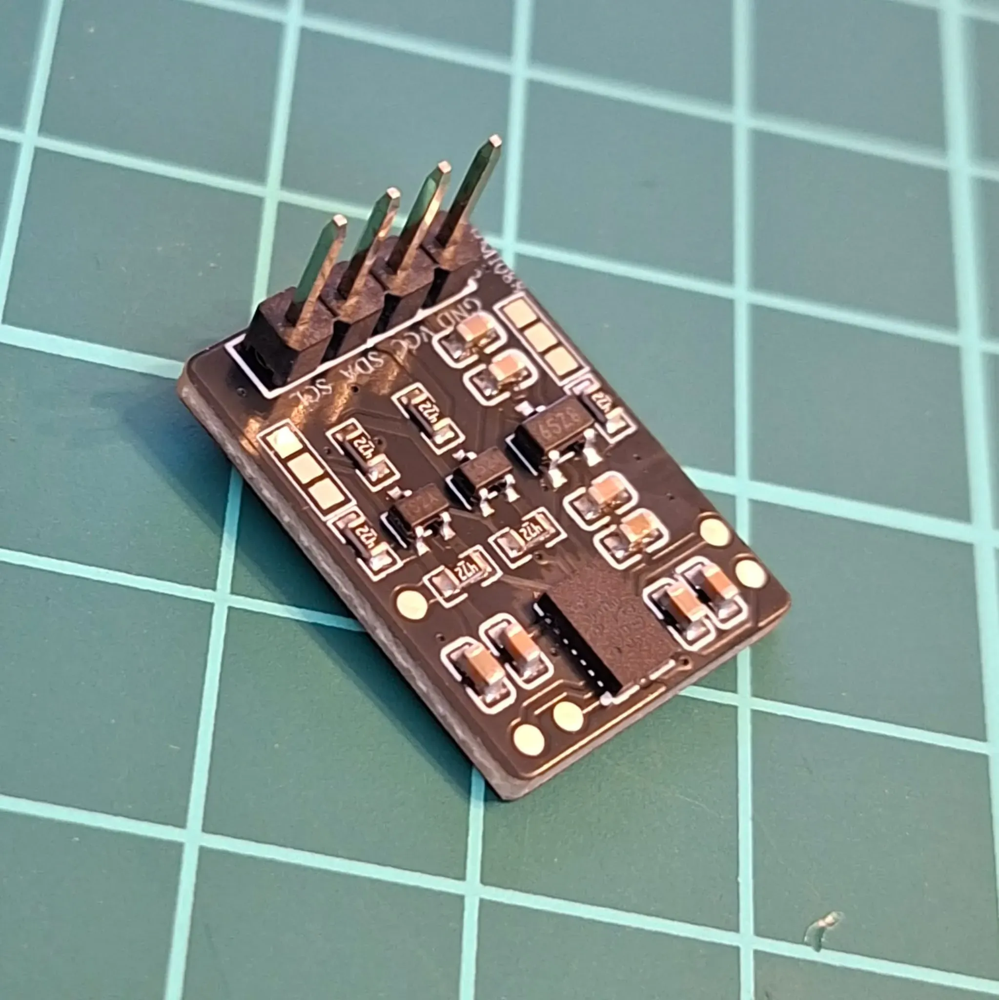
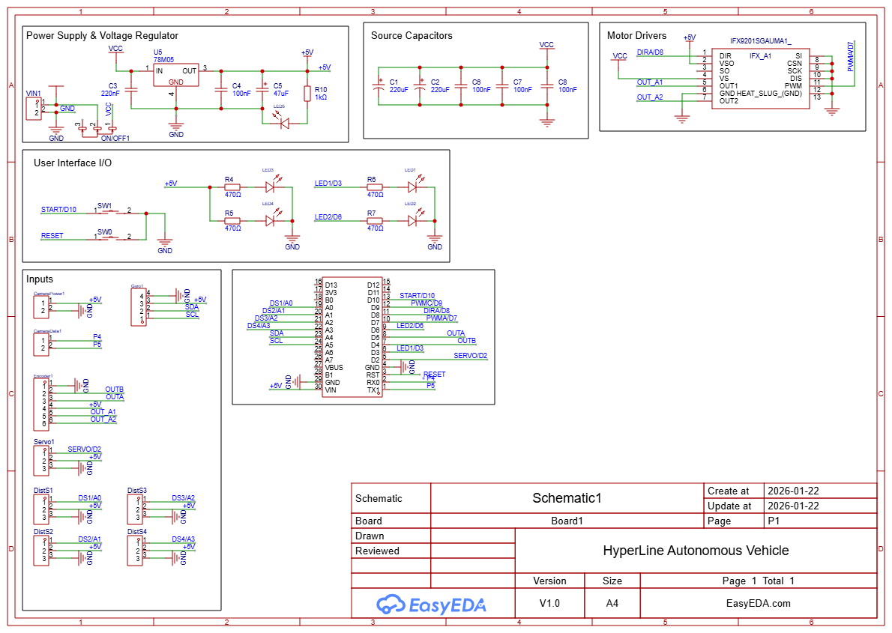
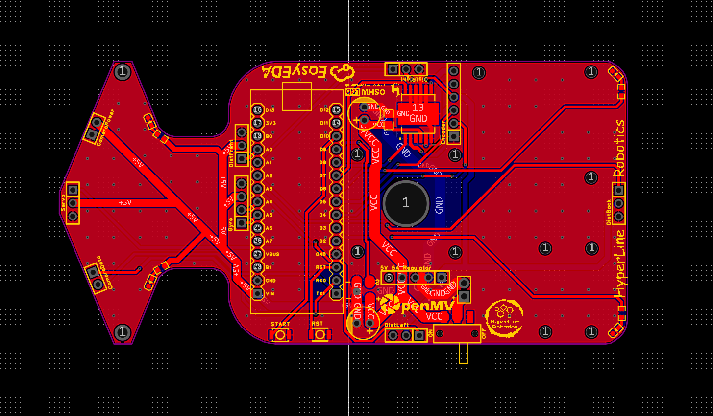
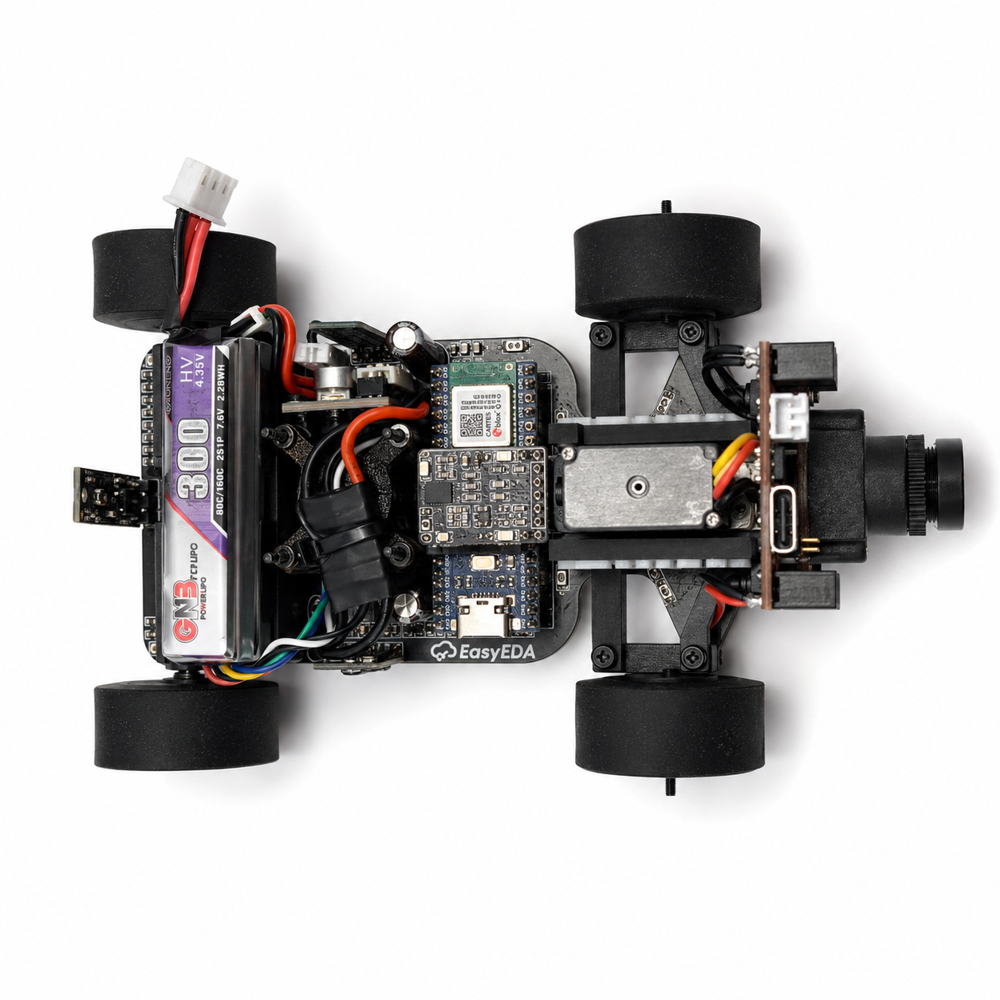
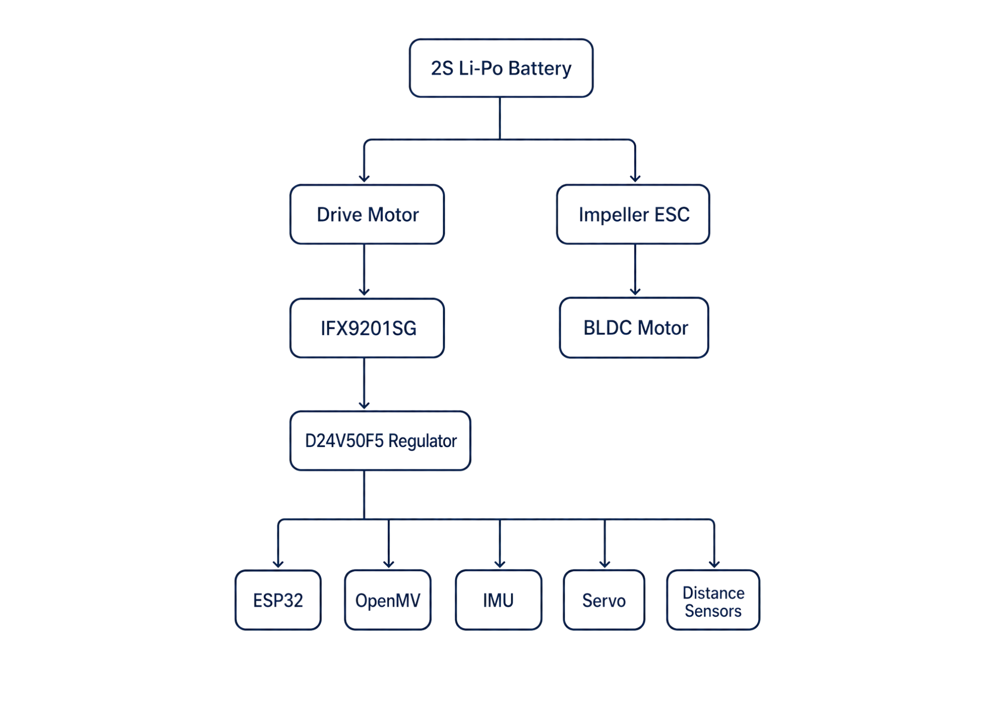

## 02 | Power and Sense Management 

Electrical design, load path, sensor specifications, power consumption and PCB layout.

| Chapter | Topic |
|---|---|
| [01 · Overview](01-overview.md) | Team, robot, challenges, evidence and results |
| [02 · Mobility](02-mobility.md) | Chassis, drivetrain, steering, tires and geometry |
| [03 · Power and sensors](03-power-sensors.md) | Electrical system, PCB, camera, IMU and validation |
| [04 · Software](04-software.md) | Control, perception, state machines and challenge strategy |
| [05 · Systems](05-systems.md) | Engineering trade-offs, iterations, performance and risk |
| [06 · Reproducibility](06-reproducibility.md) | Assembly, firmware, costs and test procedures |

---

The robot's **power and sensing system** is designed for **efficiency, precision, and adaptability**. It consists of an **Arduino Nano ESP32, a Li-Po battery, custom BMI088 IMU, OpenMV RT1062 Camera, motors(drive motor and servo motor), and a voltage regulator**, all working together to ensure **stable operation and accurate navigation**.

Each component has been carefully selected to provide **optimal performance**, minimize power consumption, and ensure **reliability in competition environments**.

---

### ** Li-Po Battery – 2S 300mAh** 

The **Li-Po battery** provides a **compact, lightweight, and high-discharge** power source, making it ideal for our robot. The **7.4V output** is suitable for running our **motors and voltage regulator**, ensuring stable power delivery.

|  | **Specifications** |
|------------------------------|------------------------------|
| **Model:** 2S Li-Po | **Capacity:** 300mAh |
| **Voltage:** 7.4V | **Discharge Rate:** 60C |
| **Weight:** 12g | **Size:** 13.8 x 12 x 52.5mm |
| **Output Current:** Varies by load | **Connector Type:** JST |
|  **[Buy Here](https://www.gaoneng.shop/products/gaoneng-gnb-lihv-2s-7.6v-300mah-60c-jst-lipo-battery)** | **Function:** Powers the entire robot |

---

### ** Arduino Nano ESP32 – Main Controller** <a id="arduino-nano-esp32">

The **Arduino Nano ESP32** provides **high-speed processing, built-in Wi-Fi and Bluetooth, and extensive GPIO capabilities** in a **compact form**. This allows it to handle **sensor data, motor control, and vision processing efficiently**.

|  | **Specifications** |
|------------------------------|------------------------------|
| **Microcontroller:** ESP32 | **Flash Memory:** 4MB |
| **SRAM:** 520KB | **Frequency:** 240MHz |
| **Pins:** 22 | **Input Voltage:** 5V |
| **Current Draw (Avg):** 200mA | **Peak Current:** 500mA |
|  **[Buy Here](https://store.arduino.cc/en-ro/products/nano-esp32)** | **Function:** Controls all robot components |

---

### Custom IMU Sensor – BMI088 

The **Custom BMI088 IMU** is used to **measure the robot's angular velocity and acceleration**, helping it maintain **stability and precise movement control**. It is essential for **calculating turns and avoiding drift**. We decided to customize it to be able to make it more compact.

|  | **Specifications** |
|------------------------------|------------------------------|
| **Gyroscope Range:** ±2000°/s | **Accelerometer Range:** ±24g |
| **Interface:** I2C | **Supply Voltage:** 3.0V – 3.6V |
| **Current Draw:** ~3.2mA | **Weight:** ~1g |
|  [View Open Source Project Here](https://oshwlab.com/bicicleta11/bmi088-gyro-module) | **Function:** Tracks orientation & motion |

---

### ** OpenMV RT1062 Camera – Vision Processing** <a id="openmv-rt1062-camera">

The **OpenMV Cam RT1062** handles **traffic sign recognition, lane detection, color tracking, and other visual cues** in real time. It includes its own high-performance microcontroller, so the Arduino can focus mainly on movement control while the camera processes images independently.

|  | **Specifications** |
|------------------------------|------------------------------|
| **Processor:** NXP i.MX RT1062 Cortex-M7 | **Frequency:** 600 MHz |
| **RAM:** 32 MB SDRAM + 1 MB SRAM | **Flash Memory:** 16 MB QSPI Flash |
| **Camera Sensor:** OV5640 | **Resolution:** 2592 × 1944, 5 MP |
| **Typical Vision Speed:** ~40 FPS at QVGA | **Interfaces:** UART, I2C, SPI, CAN, USB-C |
| **Connectivity:** Wi-Fi, Bluetooth 5.1, Ethernet | **I/O Voltage:** 3.3 V only |
|  **[Buy Here](https://openmv.io/collections/cameras/products/openmv-cam-rt?variant=42269003743326)** | **Function:** Detects traffic signs, lanes, and visual markers |

---

### ** Drive Motor – 30:1 Micro Metal Gearmotor HPCB 6V with Encoder** <a id="drive-motor">

The **drive motor is responsible for propelling the robot forward**. The **30:1 gearbox** provides an excellent **balance of speed and torque**, while the **built-in encoder** allows for **precise speed control**.

|  | **Specifications** |
|------------------------------|------------------------------|
| **Model:** 30:1 HPCB | **Voltage:** 6V |
| **No-load Speed:** 1000 RPM | **No-load Current:** 120mA |
| **Stall Torque:** ~0.45 kg·cm | **Stall Current:** 1.6A |
|  **[Buy Here](https://www.pololu.com/product/5184)** | **Function:** Drives the robot |

---

### ** IFX9201SG Motor Driver** 

The **IFX9201SG** motor driver is used to control the robot’s high-performance drive motor with precision and efficiency. It supports PWM-based speed control and direction control while integrating advanced protection features, making it ideal for demanding robotics applications. The IFX9201SG is directly integrated into our PCB, ensuring compact design and reliable communication with the Arduino Nano ESP32.

|  | **Specifications** |
|------------------------------|------------------------------|
| **Model:** IFX9201SG | **Operating Voltage:** 5.5V – 45V |
| **Logic Voltage:** 3.3V / 5V compatible | **PWM Frequency:** Up to 20 kHz |
| **Max Continuous Current:** 5A | **Max Peak Current:** 8A per channel |
| **Control Interface:** PWM + Direction pins | **Built-in Protections:** Overtemperature, Overcurrent, Undervoltage, Short-to-GND/Battery |
|  **[Buy Here](https://www.lcsc.com/product-image/C112633.html)** | **Function:** Controls drive motors |

---

### ** Steering Servo – MG90S** <a id="steering-servo">

The **MG90S servo is used for precise steering control**, enabling the robot to **navigate turns with accuracy**. It provides **high torque output in a compact size**.

|  | **Specifications** |
|------------------------------|------------------------------|
| **Model:** MG90S | **Voltage:** 5V |
| **Torque:** 2.2kg/cm | **Signal Type:** PWM |
| **Current Draw (Avg):** 120mA | **Peak Current:** 500mA |
| **Weight:** ~13.4g | **Gears:** Plastic |
|  **[Buy Here](https://www.optimusdigital.ro/ro/motoare-servomotoare/271-servomotor-mg90s.html?srsltid=AfmBOooTrDsx2UoJ3Px8J26kkCbcuYhlpKYmuIYkivK_5ZSzPJx0ZNo8)** | **Function:** Controls steering |

---

### Distance Sensor – Custom Distance Sensor based on the new ST TOF sensors 

The **VL53L5CXV0GC/1 (aprox 400cm range)** uses a short-range lidar module and reports distance using the I2C protocol. It’s ideal for reliable, fast obstacle detection and gives you an actual distance reading (1 mm resolution), perfect for lap direction detection at start and for close-range wall sensing.

|  | **Specifications** |
|------------------------------|------------------------------|
| **Detection Range:** 400 cm (depends on surface) | **Type:** I2C comunication with unique adresses |
| **Voltage Supply:** 3.0V – 5.5V | **Current Draw:** ~30 mA enabled, ~0.4 mA disabled (EN low) |
| **Resolution:** 1 mm	 | **Update Rate:** ~50–110 Hz (period ~20–9 ms) |
| **Dimensions:** 21.6mm × 8.9mm × 3.1mm | **Weight:** 1g |
|  | **Use Case:** Start-line lap direction & close-range obstacle sensing for parking |

Here is the positioning and viewing angle of the sensors.

---

### ** D24V50F5 Voltage Regulator – Power Management** <a id="voltage-regulator">

The **D24V50F5** regulates the **7.4V Li-Po battery output** to a **stable 5V**, ensuring **safe power delivery** to the **Arduino, sensors, and camera**. It prevents **overvoltage damage** and includes **thermal & short-circuit protection** for reliability.

|   | **Specifications** |
|------------------------------|------------------------------|
| **Model:** D24V50F5 | **Input Voltage:** 6V – 38V |
| **Output Voltage:** 5V | **Output Current:** 5A |
| **Efficiency:** Buck Converter (Step-down) | **Dropout Voltage:** ~2V |
| **Protection:** Short-circuit & thermal shutdown | **Mounting Type:** Pins |
|  **[Buy Here](https://www.pololu.com/product/2851)** | **Function:** Converts battery voltage to 5V |

---

### ** PCB Design & Electrical Architecture** 

| **Electrical Schematics** | **PCB Copper Traces** | **Final PCB Chassis** |
|---------------------------|---------------------------|---------------------------|
|  |  |  |

The robot uses a fully custom PCB chassis designed to combine both the electrical system and the structural frame into a single compact platform. This approach reduced weight, improved rigidity, and increased overall reliability during high-speed autonomous runs.

### **Advantages of the Custom PCB Chassis**
- Cleaner construction with fewer wires and connectors
- More stable power delivery for motors and sensors
- Better reliability during high-speed runs
- Compact design with improved weight distribution
- Reduced electrical interference on communication lines
- Stronger and more rigid compared to multi-part printed structures

### ** Engineering Decisions**
The PCB was designed with separated high-current and logic-power areas to reduce electrical noise generated by the motors. Large copper pours were also used to improve current handling and passive heat dissipation.

Several PCB revisions were tested before the final version, improving:
- Motor power routing
- Sensor stability
- Weight distribution
- Connector accessibility
- Mechanical resistance

---

### ** Power Consumption Summary** 

| Item / Designators | Part | Supply | Typical Current | Peak Current | Notes |
|------------------------------------|-------------------------------|----------------|------------------|----------------|---------------------------------------------|
| Main Controller | Arduino Nano ESP32 | 5V | ~200mA | ~500mA | Main processing unit |
| Vision Processing | OpenMV Cam RT1062 | 5V | ~300mA | ~500mA | Traffic sign & lane detection |
| Gyroscope / IMU | Custom BMI088 Module | 3.3V | ~3.2mA | ~5mA | Orientation and angular velocity |
| Drive Motor | Pololu 30:1 HPCB Gearmotor | 6V | ~120mA | ~1.6A | Peak occurs during acceleration/stall |
| Steering System | MG90S Servo | 5V | ~120mA | ~500mA | High peaks during fast steering |
| Distance Sensor #1 | Pololu PWM Distance Sensor | 5V | ~30mA | ~35mA | Front obstacle detection |
| Distance Sensor #2 | Pololu PWM Distance Sensor | 5V | ~30mA | ~35mA | Side obstacle detection |
| Motor Driver | IFX9201SG | 5V Logic / VBAT | ~10mA | ~20mA | Logic current only |
| Voltage Regulator | D24V50F5 | 7.4V → 5V | Depends on load | Depends on load | Powers 5V electronics |
| Total Estimated Consumption | Entire Robot | 7.4V Battery | ~2.3A | ~7A | Worst-case peaks during acceleration |

The robot was designed with power efficiency and peak-current stability in mind. High-current systems such as the drive motor are electrically separated from sensitive logic components to reduce electrical noise and voltage drops during acceleration. Large copper pours and short power paths on the PCB help improve current handling and thermal dissipation.

---

## Power and Sensor Validation  

To make sure that the robot is reliable during a full run, we tested the complete power system under several operating conditions. The robot uses a 2S Li-Po battery as the main power source. The drive motor is powered from the battery side, while the logic electronics are powered through the D24V50F5 5V regulator.

The goal of this architecture is to separate high-current discharge loads from sensitive logic components such as the ESP32, OpenMV camera, IMU, and distance sensors. This reduces the risk of voltage drops, camera resets, IMU instability, and wrong sensor readings during acceleration or steering corrections.

| Test condition | 5V rail measured value | Result |
|---|---:|---|
| Robot idle, electronics only | 5.03V | Stable |
| Servo moving left/right continuously | 4.96V | No ESP32 reset |
| Camera running with UART active | 5.00V | Stable image processing |
| Drive motor accelerating | 4.92V | No brownout |
| Full system active during driving | 4.87V to 5.05V | Stable |

The lowest measured voltage on the 5V rail was above the safe operating range for the ESP32, OpenMV, IMU, and sensors. During testing, no controller reset was observed. This confirms that the regulator has enough current margin for the logic side of the robot.

### Power failure points and mitigation 

| Possible failure | Cause | Mitigation |
|---|---|---|
| ESP32 reset | 5V voltage drop during motor acceleration | Logic powered through D24V50F5 regulator |
| Camera frame instability | Electrical noise or unstable supply | Separate regulated 5V line and common ground |
| Servo jitter | Current peaks during steering | Short power path and stable regulator output |
| Wrong distance readings | Voltage fluctuation or sensor noise | Sensor filtering and repeated readings |

This testing showed that the power architecture is reliable under realistic competition loads.

---

⋮⋮⋮⋮⋮⋮⋮⋮
