# 03 | Power, electronics and sensor architecture

Electrical design, load path, sensor specifications, power consumption and PCB layout.

| Chapter | Topic |
|---|---|
| [01 · Overview](01-overview.md) | Team, robot, challenges, evidence and results |
| [02 · Mobility](02-mobility.md) | Chassis, drivetrain, steering, tires and geometry |
| [03 · Power and sensors](03-power-sensors.md) | Electrical system, PCB, camera, IMU and validation |
| [04 · Software](04-software.md) | Control, perception, state machines and challenge strategy |
| [05 · Systems](05-systems.md) | Engineering trade-offs, iterations, performance and risk |
| [06 · Reproducibility](06-reproducibility.md) | Assembly, firmware, costs and test procedures |

---

The V4.1 electrical design combines propulsion, steering, four multi-zone distance sensors, inertial sensing, floor-color detection and an independent vision processor in a compact PCB-based platform. Our architecture separates high-current motor loads from regulated logic loads and splits perception between the Arduino Nano ESP32 and OpenMV RT1062.

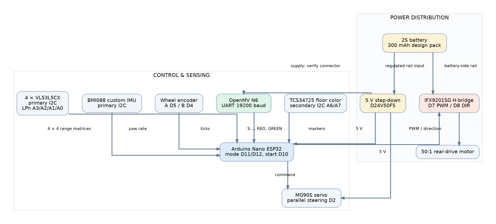

Figure 3.1. Electrical system architecture, showing the implemented interfaces and the regulated-power branches. Exact power wiring is defined by the main PCB design and must be verified before energizing.

## 1. Design goals and system constraints

| Constraint | Engineering choice | Risk addressed |
|---|---|---|
| Limited weight and space | Main PCB carries controller, connectors and motor driver | Excess wiring, tall stacked modules, variable mass distribution |
| Peak drive and steering current | Separate propulsion path and regulated 5 V logic path | Controller brownout and supply noise |
| Four ToF devices with the same factory address | Individual LPn enable pins and sequential address assignment | I²C address conflicts at startup |
| Repeatable turns | BMI088 yaw-rate integration and startup bias calibration | Uncorrected heading drift |
| Fast floor-marker recognition | TCS34725 on a separate I²C controller | Sensor contention during corner identification |
| Colored obstacles | OpenMV RT1062 processes image regions and sends compact UART commands | Image processing blocking the real-time drive loop |
| Reproducible PCB manufacturing | Released Gerber, BOM and Pick-and-Place files | Unclear electrical assembly or missing component identification |

## 2. Main electrical components

| Subsystem | V4.1 component | Function and location |
|---|---|---|
| Primary controller | Arduino Nano ESP32 | Executes motion, sensor polling and round logic |
| Vision processor | OpenMV RT1062 | Recognizes red/green traffic pillars and returns steering/avoidance commands |
| Yaw-rate sensor | Custom BMI088 IMU board | Measures angular rate for heading control |
| Range sensing | Four VL53L5CXV0GC/1 boards | Front, left, right and rear spatial distance data |
| Floor marker sensing | TCS34725 RGBC | Recognizes blue/red-orange floor regions that encode turn direction and corner events |
| Drive electronics | IFX9201SG H-bridge on main PCB | PWM drive and direction to the geared rear axle motor |
| Steering actuator | MG90S servo | Parallel front-wheel steering |
| Motor | Pololu 50:1 HPCB geared drive motor | Rear differential propulsion |
| Energy source | 2S LiHV battery, 300 mAh installed pack | Compact battery source; physical installed pack and chemistry must be confirmed |
| Main logic regulator | D24V50F5 5 V step-down module | Supplies regulated electronics and steering power as wired |

The fan/downforce assembly is **not installed** on V4.1. It is not counted as a mechanical force source or an electrical load. Any unused fan signal definitions in a development build must be treated as inactive.

### 2.1 Component presentation

The following component images identify the electronics selected for V4.1. Photographs of the installed electronics and custom boards appear in the PCB integration section. Component values are separated into **manufacturer specifications**, **firmware configuration**, and **assumptions requiring physical verification**. The distinction is important because maximum ratings do not describe normal operating current.

#### 2.1.1 Battery: Gaoneng GNB 2S LiHV, 300 mAh

|  | **Specifications** |
|------------------------------|------------------------------|
| **Model:** 2S Li-HV | **Capacity:** 300mAh |
| **Nominal Voltage:** 7.6 V | **Discharge Rate:** 60C |
| **Weight:** 12g | **Size:** 13.8 x 12 x 52.5mm |
| **Output Current:** Varies by load | **Connector Type:** JST |
| 🔗 **[Buy Here](https://www.gaoneng.shop/products/gaoneng-gnb-lihv-2s-7.6v-300mah-60c-jst-lipo-battery)** | **Function:** Powers the entire robot |

The battery is mounted alongside the middle axis of the PCB chassis, minimizing the length of its external leads. At a nominal 7.6 V, the label's 60C rating corresponds to $0.300\times60=18$ A **as a manufacturer discharge rating**, not a measured robot current or a safe target for the PCB. Charging must use a **2S LiHV-compatible** charger and the appropriate cell-voltage limits.

#### 2.1.2 Main controller: Arduino Nano ESP32

|  | **Specifications** |
|------------------------------|------------------------------|
| **Microcontroller:** ESP32 | **Flash Memory:** 4MB |
| **SRAM:** 520KB | **Frequency:** 240MHz |
| **Pins:** 22 | **Input Voltage:** 5V |
| **Active-current budget:** 200 mA | **Peak-current allowance:** 500 mA |
| 🔗 **[Buy Here](https://store.arduino.cc/en-ro/products/nano-esp32)** | **Function:** Controls all robot components |

The Nano ESP32 is the coordinator of the electrical system. It communicates with the BMI088 and range devices, interprets OpenMV results, produces the H-bridge PWM command, and outputs steering commands. The final pin allocation is documented in [04 Software](04-software.md). The **200 mA @ 5 V** value used in the power model is an explicit planning assumption rather than a measured consumption of this assembled board.

#### 2.1.3 Custom inertial sensor: BMI088

|  | **Specifications** |
|------------------------------|------------------------------|
| **Gyroscope Range:** ±2000°/s | **Accelerometer Range:** ±24g |
| **Interface:** I2C | **Supply Voltage:** 3.0V – 3.6V |
| **Full-operation chip current:** ~5.15 mA | **Weight:** ~1g |
| 🔗 [View Open Source Project Here](https://oshwlab.com/bicicleta11/bmi088-gyro-module) | **Function:** Tracks orientation & motion |

The custom board reduces the need for an oversized breakout module. V4.1 firmware selects **±2000°/s** for the gyroscope and **±6 g** for the accelerometer. The gyroscope's Z axis is integrated for turning and heading verification. Bosch specifies approximately **5.15 mA full-operation current** for the sensor itself, but the complete assembled board should be measured separately. [BMI088 device specification](https://www.bosch-sensortec.com/en/products/motion-sensors/imus/bmi088).

#### 2.1.4 OpenMV RT1062 vision processor

|  | **Specifications** |
|------------------------------|------------------------------|
| **Processor:** NXP i.MX RT1062 Cortex-M7 | **Frequency:** 600 MHz |
| **RAM:** 32 MB SDRAM + 1 MB SRAM | **Flash Memory:** 16 MB QSPI Flash |
| **Camera Sensor:** OV5640 | **Resolution:** 2592 × 1944, 5 MP |
| **Typical Vision Speed:** ~40 FPS at QVGA | **Interfaces:** UART, I2C, SPI, CAN, USB-C |
| **Connectivity:** Wi-Fi, Bluetooth 5.1, Ethernet | **I/O Voltage:** 3.3 V only |
| 🔗 **[Buy Here](https://openmv.io/collections/cameras/products/openmv-cam-rt?variant=42269003743326)** | **Function:** Detects red and green traffic pillars |

The front placement provides an unobstructed forward view without relying on the Arduino for pixel processing. The camera transmits decisions over **19,200 baud UART** in the configured V4.1 interface. This division keeps expensive image operations separate from the deterministic motion-control loop. [OpenMV RT1062 specification](https://openmv.io/products/openmv-cam-rt).

#### 2.1.5 Geared drive motor and encoder

|  | **Specifications** |
|------------------------------|------------------------------|
| **Model:** 50:1 HPCB | **Voltage:** 6V |
| **No-load Speed:** 650 RPM | **No-load Current:** 150mA |
| **Stall Torque:** ~0.74 kg·cm | **Stall Current:** 1.5A |
| 🔗 **[Buy Here](https://www.pololu.com/product/5184)** | **Function:** Drives the robot |

The gearbox provides output torque for acceleration and controlled parking. The encoder measures incremental motor rotation for odometry and distance-limited maneuvers. We **intentionally overvoltage the nominal 6 V motor** using the 2S LiHV battery through the IFX9201SG motor driver. The battery is 7.6 V nominal and may reach 8.7 V fully charged; the motor does not receive a separate regulated 6 V supply. Its applied voltage is controlled through PWM according to the driving state, including an Open Cruise request of 250/255 (98.04%). This is an intentional performance trade-off, not a claim that the motor is operating within its 6 V rating. PWM duty does not impose a hard voltage or current limit: prolonged high-load operation, stalls and winding heating can damage an overvolted motor. The IFX9201SG includes driver-side fault protections, but these do not establish a safe motor winding temperature. Exact encoder connector orientation and the installed motor part number should match the mechanical BOM. [Pololu 50:1 HPCB encoder family](https://www.pololu.com/product/5187/specs).

#### 2.1.6 Motor driver: IFX9201SG

|  | **Specifications** |
|------------------------------|------------------------------|
| **Model:** IFX9201SG | **Operating Voltage:** 5.5V – 45V |
| **Logic Voltage:** 3.3V / 5V compatible | **PWM Frequency:** Up to 20 kHz |
| **Max Continuous Current:** 5A | **Max Peak Current:** 8A per channel |
| **Control Interface:** PWM + Direction pins | **Built-in Protections:** Overtemperature, Overcurrent, Undervoltage, Short-to-GND/Battery |
| 🔗 **[Buy Here](https://www.lcsc.com/product-image/C112633.html)** | **Function:** Controls drive motors |

The integration of the motor driver IC eliminates an external motor-driver breakout and reduces power-wire length. The motor power must be checked at the H-bridge supply, not inferred from PWM percentage alone. Driver dissipation is estimated as $P_{\mathrm{driver}}=I_m^2R_{\mathrm{path}}+P_{\mathrm{switch}}$; both terms depend on operating current and device conditions. Monitor thermal rise and verify fault handling under stall or blocked-wheel conditions.

#### 2.1.7 Steering actuator: MG90S

|  | **Specifications** |
|------------------------------|------------------------------|
| **Model:** MG90S | **Voltage:** 5V |
| **Torque:** 2.2kg/cm | **Signal Type:** PWM |
| **Moving-current allowance:** 120 mA | **Peak-current allowance:** 500 mA |
| **Weight:** ~13.4g | **Gears:** Metal |
| 🔗 **[Buy Here](https://www.optimusdigital.ro/ro/motoare-servomotoare/271-servomotor-mg90s.html?srsltid=AfmBOooTrDsx2UoJ3Px8J26kkCbcuYhlpKYmuIYkivK_5ZSzPJx0ZNo8)** | **Function:** Controls steering |

The steering servo is a pulsed, highly variable load. Servo current under active steering cannot be calculated from the command pulse width. The **120 mA active-current assumption** used in the engineering budget is for calculation only; fast direction changes and a jammed linkage can cause much larger current draws.

#### 2.1.8 Four custom VL53L5CX distance sensors

|  | **Specifications** |
|------------------------------|------------------------------|
| **Detection Range:** 400 cm (depends on surface) | **Type:** I2C,  8x8 or 4x4 matrix |
| **Board supply:** 5 V with onboard 3.3 V regulation | **Chip power:** 313 mW typical continuous-ranging example |
| **Ranging zones:** 4×4 or 8×8 | **V4.1 update rate:** 30 Hz (4×4) |
| 🔗 [View open sourced project](https://oshwlab.com/bicicleta11/project_mhqqebyu) | **Use Case:** Read distances to walls |

Unlike single-point distance sensors, each VL53L5CX returns a 16-zone spatial matrix at 4×4 resolution. The four sensors monitor front, left, right and rear. Each begins with the factory address `0x29` and is assigned a different address (`0x30` to `0x33`) during initialization. The manufacturer's **continuous-ranging typical power example** at 3.3 V/3.3 V is **313 mW per sensor chip**, corresponding to **1.252 W for four chips** before breakout-board overhead. [VL53L5CX datasheet](https://www.st.com/resource/en/datasheet/vl53l5cx.pdf), electrical characteristics §6.4.

#### 2.1.9 D24V50F5 voltage regulator

|   | **Specifications** |
|------------------------------|------------------------------|
| **Model:** D24V50F5 | **Input Voltage:** 6V – 38V |
| **Output Voltage:** 5V | **Output Current:** 5A |
| **Efficiency:** Buck Converter (Step-down) | **Dropout Voltage:** ~2V |
| **Protection:** Short-circuit & thermal shutdown | **Mounting Type:** Pins |
| 🔗 **[Buy Here](https://www.pololu.com/product/2851)** | **Function:** Converts battery voltage to 5V |

The regulator converts the battery rail to the logic and actuator supply. The regulator is rated for up to 5 A output under its specified operating conditions. This rating does not establish the robot’s actual peak demand or guarantee that the supply remains at 5 V during every transient. Servo activity coinciding with camera and ToF operation is a useful condition to check. [D24V50F5 technical specification](https://www.pololu.com/product/2851).

#### 2.1.10 Floor-color sensor: TCS34725

|  | **Specifications** |
|------------------------------|------------------------------|
| **Model:** TCS34725 | **Input Voltage:** 3V – 5V (Adafruit breakout) |
| **Sensor Type:** RGBC Color Sensor | **Interface:** I²C |
| **Color Channels:** Red, Green, Blue, Clear | **I²C Address:** 0x29 |
| **Resolution:** 16-bit per channel | **I²C Speed:** Up to 400 kHz |
| **Gain:** 1×, 4×, 16×, 60× | **Integration Time:** 2.4 – 614.4 ms |
| **Features:** IR-blocking filter, white LED | **Mounting Type:** Through-hole pins |
| 🔗 **[Buy Here](https://www.adafruit.com/product/1334)** | **Function:** Detects colored floor markings for corner and direction recognition |

The floor sensor complements, rather than duplicates, the camera. It samples the field directly beneath the vehicle so line-color changes can be recognized while the camera follows traffic pillars. The software uses normalized RGB ratios with an illumination guard and event rearming. The **20 mW budget allowance** used below is a placeholder, not a measured TCS34725 current.

### 2.2 Main PCB and physical integration

The custom main board integrates connectors, the motor driver, controller footprint, switching and power entry. Its mechanical role makes layout decisions important beyond electrical connectivity. Connector locations must not obstruct the differential, steering travel or the battery mount; motor-current traces and component mounting should not concentrate flexural loads near small SMD joints.

The manufacturing package contains the board's BOM, fabrication files and component placements:

- [Main PCB production files](../electrical-schematics/Main%20PCB/production-files/)
- [BMI088 production files](../electrical-schematics/IMU/production-files/)
- [VL53L5CX production files](../electrical-schematics/TOF%20sensors/production-files/)

The main PCB assembly specifies an **IFX9201SGAUMA1 motor-driver footprint**, a **220 µF / 35 V bulk capacitor**, dedicated Arduino, encoder, gyro, camera and servo connectors, and a header for the 5 V regulator. These are useful inspection points when checking assembly consistency. The presence of a component in the BOM is not a substitute for checking its actual net connections and polarity.

### 2.3 Electrical schematic, PCB traces and assembled board

V4.1 uses a compact custom PCB to integrate the motor driver, distribution paths, Nano ESP32 and system connectors. The three complementary views below show the **circuit design**, the **copper/layout implementation**, and the **installed PCB chassis**.

| Electrical schematic | Copper layout (Top) | Copper layout (Inner 1) | Copper layout (Inner 2) | Copper layout (Bottom) | Populated robot chassis |
|:---:|:---:|:---:|:---:|:---:|:---:|
| <a href="docs-media/v41-schematic-design-export.png">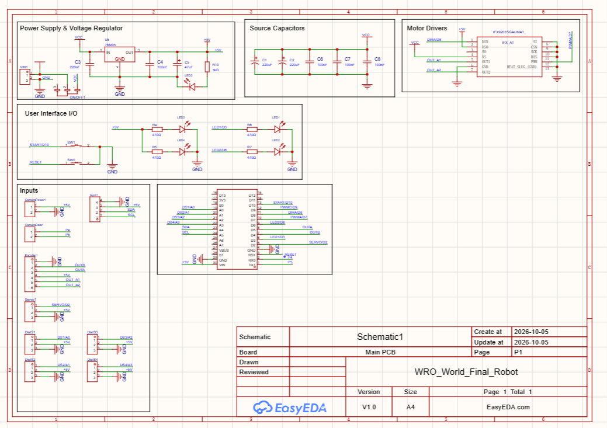</a> | <a href="docs-media/v41-pcb-copper-view.png">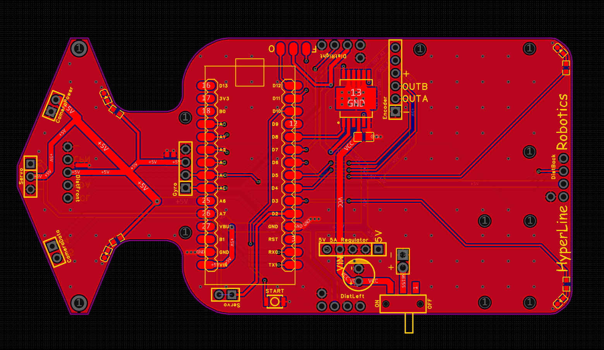</a> | <a href="docs-media/v41-inner1-layer.png">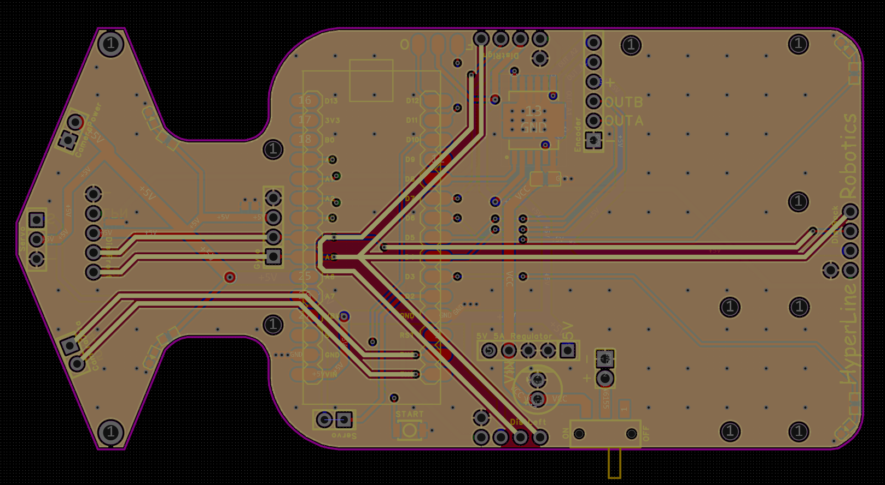</a> | <a href="docs-media/v41-inner2-layer.png">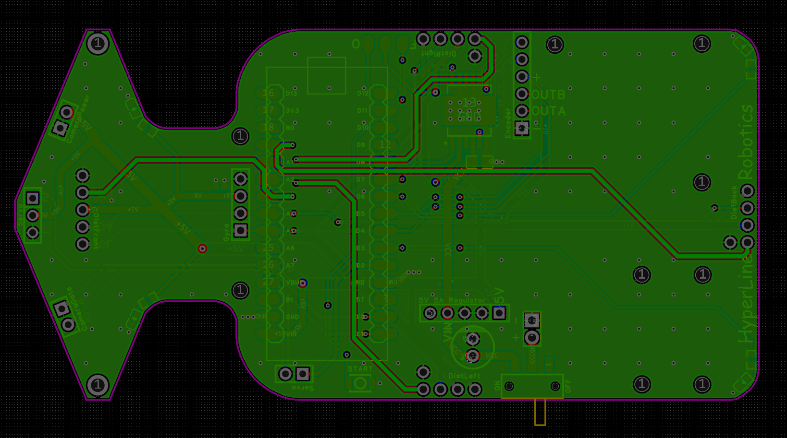</a> | <a href="docs-media/v41-bottom-layer.png">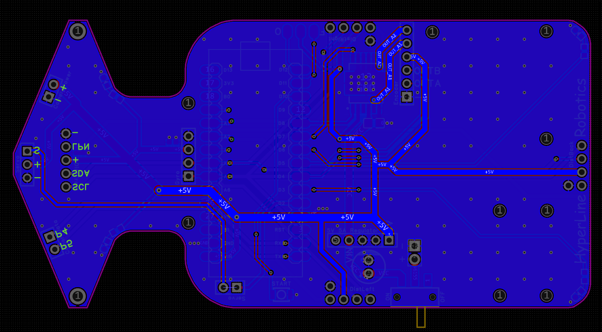</a> | <a href="docs-media/v41-assembled-robot-top.png">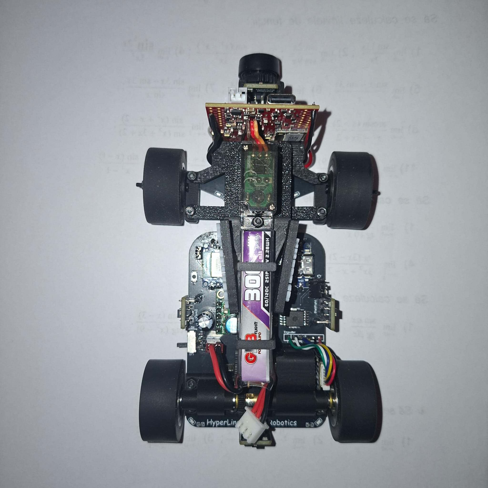</a> |
| EasyEDA drawing export | Main PCB routing and copper planes on top layer |  Main PCB routing and copper planes on first inner layer |  Main PCB routing and copper planes on second inner layer | Main PCB routing and copper planes on bottom layer | Actual packaging of the motor, battery and electronics |

#### Functional power distribution

<a href="docs-media/v41-functional-power-diagram.svg">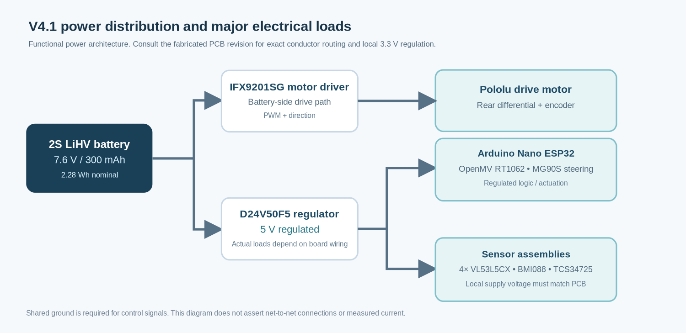</a>

Functional power domains. This is a system-level explanation, not a substitute for the board's exact netlist.

The direct battery path and the regulated electronics path share a ground reference for communication. High-current paths should avoid routing under sensitive measurement circuitry. The camera, servo and controller require a stable regulator output during drive load changes. The ToF, BMI088 and floor-color circuits must receive voltages consistent with their particular custom-board regulators and logic levels.

#### Custom IMU and sensor placement

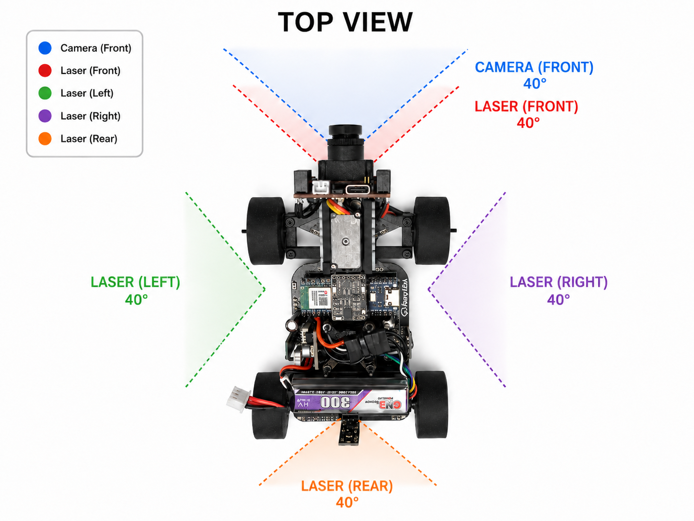

Custom BMI088 board at left and a mounting/viewing reference at right. Field-of-view lines illustrate the design intention; the optical orientation and blocked zones are checked on the assembled robot.

## 3. Power architecture and calculations

### 3.1 Battery and energy storage

The robot's installed pack is labeled **GNB 2S LiHV, 7.6 V nominal, 300 mAh, 60C and 2.28 Wh**. Lithium-high-voltage chemistry uses a **4.35 V/cell charging limit**, so the maximum fully charged pack voltage is $2\times4.35=8.70$ V. A charger configured only for standard 4.20 V/cell Li-Po is not equivalent to LiHV charging.

The nominal battery energy is:

$$
E_{\mathrm{nom}}=V_{\mathrm{nom}}C=7.6\cdot0.300=2.28\ \mathrm{Wh}
$$

The battery's 60C label corresponds to a nominal discharge-rating calculation of:

$$
I_{\mathrm{label}}=C_{\mathrm{Ah}}\cdot60=0.300\cdot60=18\ \mathrm{A}
$$

This number is a **label rating**, not a measured current draw or proof that the connector, wiring, traces or motor driver can safely carry 18 A. Actual usable energy depends on load-induced voltage sag, pack temperature, age and low-voltage cutoff. Voltage, current and energy should be characterized at the battery input during real challenge runs.

### 3.2 Regulated logic rail

The D24V50F5 is a 5 V buck regulator. For the 5 V loads,

$$
P_{5V}=5\sum_j I_{5V,j}
$$

and approximate battery-side power drawn by those loads is:

$$
P_{\mathrm{battery,logic}}=\frac{P_{5V}}{\eta_{\mathrm{buck}}}
$$

where $\eta_{\mathrm{buck}}$ is the regulator's efficiency at the actual operating point. We cannot simply add the motor's battery-side current to each 5 V device's rail current, because they are measured at different voltages.

For example, a hypothetical 5 V rail current of $I_{5V}=0.85$ A represents $4.25$ W at the output. At an *assumed* 90% efficiency, it would draw $4.72$ W from the pack, or $0.621$ A at 7.6 V. The actual value belongs in the measurement table below.

The electrical load of the robot is expressed as:

$$
P_{\mathrm{in}}\approx V_{\mathrm{bat}} I_{\mathrm{motor}}+\frac{5I_{5V}}{\eta_{\mathrm{buck}}}+P_{\mathrm{other}}
$$

This form is useful for evaluating acceleration transients and establishing an energy budget without double-counting rail loads.

#### Low-voltage supply and logic domains

The battery feeds the D24V50F5, which produces the main 5 V rail. The ToF chip and BMI088 use 3.3 V-class supplies, but the chip supply, a module input supply and the I²C pull-up voltage are **three different connections**. They must not be treated as interchangeable.

| Component | Documented board/module supply | 3.3 V conversion path | Interface voltage / note |
|---|---|---|---|
| Four custom VL53L5CX boards | 5 V at the custom-board supply input, as documented in §2.1.8 | Local 3.3 V regulation on each ToF board | VL53L5CX signal and I²C nets must use levels permitted by the actual board design; the precise pull-up/level-shifting topology is defined by the ToF PCB schematic |
| Custom BMI088 board | BMI088 chip supply requirement: 3.0 to 3.6 V | Exact regulator/source net for the assembled custom IMU board is not identified in the supplied chapter | Sensor communication must remain within the voltage limits of both the BMI088 and Nano ESP32 |
| TCS34725 floor sensor | 3 to 5 V for the specified Adafruit-style breakout, not necessarily the bare IC | Onboard regulator if the installed breakout is that version; exact installed module and input net are not established here | The actual SDA/SCL pull-up rail on A6/A7 must be checked against the installed breakout |
| Arduino Nano ESP32 | Regulated 5 V system feed | Internal board voltage regulation | ESP32 GPIO operates at 3.3 V logic |
| OpenMV RT1062 | Regulated 5 V system feed | Camera-board internal conversion | UART interface is 3.3 V logic |
| MG90S servo | Regulated 5 V system feed | Not applicable | The command input is driven by the Nano ESP32 |

The regulator and signal-net details that cannot be recovered from this chapter are not inferred from the sensor datasheets. The source of truth for those nets is the [main PCB](../electrical-schematics/Main%20PCB/production-files/), [IMU board](../electrical-schematics/IMU/production-files/) and [ToF board](../electrical-schematics/TOF%20sensors/production-files/) design. This table describes the documented arrangement without inventing a 3.3 V regulator that has not been identified in the released wiring.

### 3.3 Physical power measurement plan

The test protocol covers three operating regimes: idle, normal driving and brief peaks. A peak-only budget cannot predict battery runtime, and an idle-only budget cannot reveal brownouts. The table below gives planning values, not measurements from a completed test.

| Load | Estimated idle current | Estimated active current | Estimated peak | Supply rail |
|---|---:|---:|---:|---|
| Arduino Nano ESP32 | 120 mA | 200 mA | 350 mA | 5 V |
| OpenMV RT1062 | 100 mA | 150 mA | 200 mA | 5 V |
| MG90S steering servo | 20 mA | 120 mA | 1,000 mA | 5 V |
| Four VL53L5CX sensors | 20 mA | 380 mA | 600 mA | 3.3 V |
| BMI088 board | 4 mA | 5.15 mA | 10 mA | 3.3 V |
| TCS34725 module | 2 mA | 6 mA | 25 mA | 3.3 V |
| Pololu 50:1 HPCB drive motor | 0 A | 0.80 A | 1.50 A | Direct 2S LiHV motor path; motor rated 6 V |
| Complete battery input | 0.19 A | 1.34 A | ~3.1 A | 2S LiHV, 7.6 V nominal |

**Measurement procedure:** monitor the battery with a suitable current meter and the 5 V rail with a separate voltage probe. Capture the minimum regulator voltage during abrupt acceleration and steering reversals, then repeat with camera processing active. Record battery charge level, firmware mode and measurement bandwidth. A slow multimeter can miss short voltage dips; use an oscilloscope to inspect transient ripple and voltage sag on the 5 V rail.

<!-- CODE-DERIVED DATA VIEW -->

### 3.3.1 Electrical measurements and power-path verification

The component budget above is useful for selecting the regulator and anticipating peak loads. To evaluate the *assembled* V4.1 board, the measured quantities are battery input voltage and current, regulated 5 V voltage and current, and the minimum 5 V level during a drive or steering transient. A current value quoted on the 3.3 V rail is not added directly to a 5 V rail current. Power is calculated separately for each rail, then referred to the battery through its converter efficiency.

| Operating state | Battery current | 5 V output | Most important check | Evidence record |
|---|---|---|---|---|
| Start-up and stationary idle | Physical logger required | Minimum and average voltage | Boot stability with four ToF devices initializing | [`power_runs.csv`](validation/physical/power_runs.csv) |
| Straight driving | Physical logger required | Output voltage during motor load | Drive-current demand and controller restarts | Same dataset |
| Rapid alternating steering | Peak-capable logging required | Minimum transient voltage | Servo spikes, rail dip and steering jitter | Same dataset |
| Camera and all four ToFs active | Physical logger required | Loaded output voltage | Regulator stability with perception running | Same dataset |
| Combined steering, driving and vision | Continuous capture required | Worst recorded dip | Coupled load, battery sag and reset behavior | Same dataset |

**Measurement definition:** put the battery-current sensor upstream of the power split, measure the 5 V rail at the load connector, and record timestamps together with battery condition, firmware revision, operating mode and instrument bandwidth. A slow multimeter can capture average current but generally cannot establish the minimum voltage during fast servo activity. Record scope screenshots separately when short dips are important.

The analysis script integrates actual sampled electrical power rather than substituting nominal battery energy for a measured discharge curve:

$$
E_{\mathrm{measured}} \approx \sum_{k=1}^{n-1} \frac{P_k+P_{k+1}}{2}(t_{k+1}-t_k), \qquad P_k=V_{\mathrm{bat},k}I_{\mathrm{bat},k}.
$$

The reproducible output, including mean/peak current, minimum measured 5 V and integrated energy, is collected in the [physical validation summary](validation/physical/SUMMARY.md). The currently published component specifications and scenario calculations do **not** by themselves establish a measured brownout margin or battery endurance. These results are reported only when a raw recording is available.

### 3.3.2 Model-based consumption budget

A useful power budget must distinguish **manufacturer-specified electrical values** from assumptions that have not yet been verified on the completed robot. The following table is a transparent calculation model for planning load and thermal tests. It is **not** a log of measured current.

| Component | Assumed operation | Electrical basis | Modeled power |
|---|---|---|---:|
| Arduino Nano ESP32 | 200 mA at 5 V | Engineering allowance | 1.000 W |
| OpenMV RT1062 | 150 mA at 5 V | Conservative design allowance; published active current is approximately 130 mA at 5 V | 0.750 W |
| MG90S steering servo | 120 mA at 5 V | Assumed moving-average current; peak can be higher | 0.600 W |
| Four VL53L5CX chips | 4× continuous ranging, 3.3 V/3.3 V | ST example: 313 mW per chip | 1.252 W |
| BMI088 chip | 5.15 mA at 3.3 V | Bosch full-operation specification | 0.017 W |
| TCS34725 module | Allowance | Preliminary estimate, pending measurement | 0.020 W |
| **Total regulated loads, before conversion losses** | | | **3.639 W** |

The 3.639 W total includes a design margin for the RT1062 and is the sum of modeled powers at each module's voltage. It is **not** the actual measured current drawn from the 5 V regulator. Sensor-board support electronics, voltage conversion between the 5 V bus and any local 3.3 V rails, copper losses and servo-current transients can increase consumption. The actual PCB rail map determines how the load is distributed.

<a href="docs-media/v41-power-components.svg">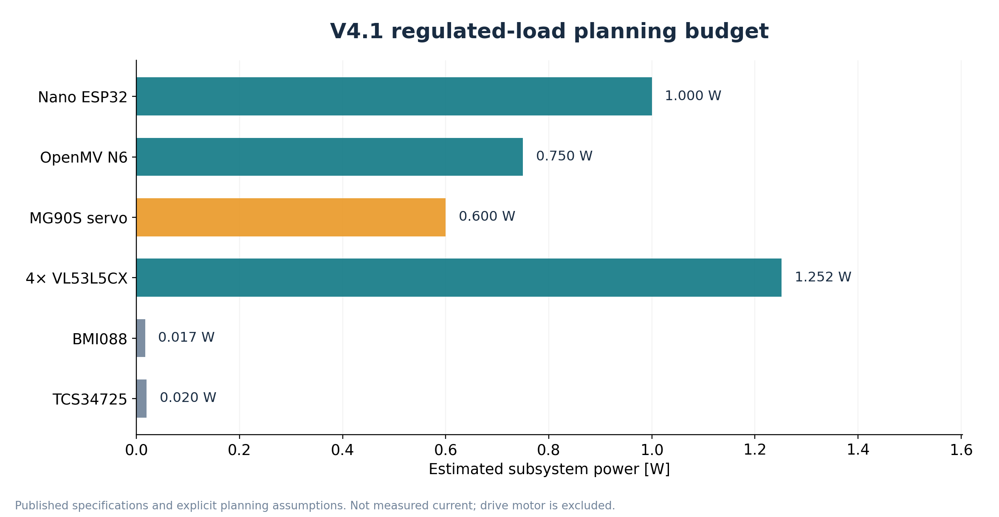</a>

Modeled component consumption from manufacturer values and explicit assumptions. Motor power is excluded; no measurement is implied.

[Power budget assumptions (CSV)](validation/power_model_assumptions.csv).

#### From component demand to battery input

For a first-order sensitivity model, assume that the regulated loads are delivered through conversion stages with an overall effective efficiency of $\eta=0.90$. Then:

$$
P_{\mathrm{regulated,input}}\approx\frac{3.639}{0.90}=4.04\ \mathrm{W}
$$

We add direct battery-side motor consumption, plus a **10 mA H-bridge quiescent assumption**:

$$
P_{\mathrm{battery}}(I_m,\eta)=\frac{3.639}{\eta}+7.6(I_m+0.010)
$$

where $I_m$ is the **assumed motor input current**, not the 8-bit PWM duty value. For a worked example of $I_m=0.80$ A:

$$
P_{\mathrm{battery}}\approx\frac{3.639}{0.90}+7.6(0.80+0.010)=10.20\ \mathrm{W}
$$

<table><tr><td align="center" width="50%"><a href="docs-media/v41-power-motor-sensitivity.svg">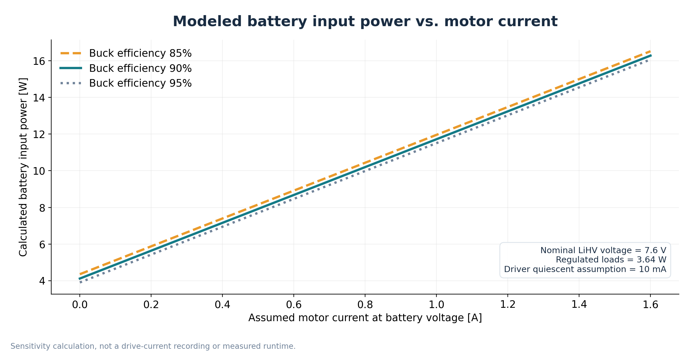</a></td><td align="center" width="50%"><a href="docs-media/v41-ideal-runtime.svg">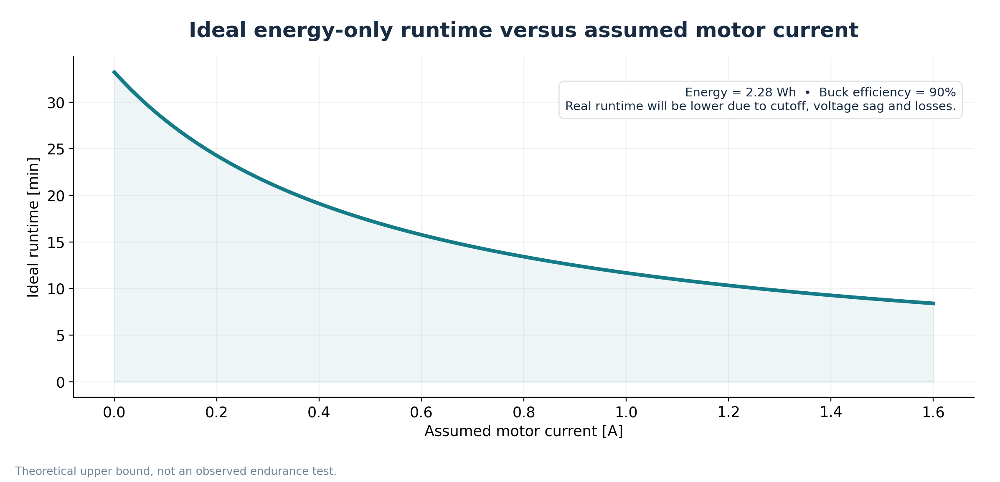</a></td></tr><tr><td align="center">Battery power depends strongly on direct motor current.</td><td align="center">Ideal runtime, before reserve, sag, thermal losses or cutoff.</td></tr></table>

| Assumed motor current | Estimated pack input power | Ideal energy-only runtime |
|---:|---:|---:|
| 0.00 A | 4.12 W | 33.2 min |
| 0.25 A | 6.02 W | 22.7 min |
| 0.50 A | 7.92 W | 17.3 min |
| 0.80 A | 10.20 W | 13.4 min |
| 1.20 A | 13.24 W | 10.3 min |
| 1.60 A | 16.28 W | 8.4 min |

These durations are **upper bounds using nominal pack energy**, not predictions of how long the robot will actually run. The real test is a continuous capture of $V_{\mathrm{bat}}(t)$ and $I_{\mathrm{bat}}(t)$ during the complete challenge.

[Model scenarios (CSV)](validation/power_model_scenarios.csv) · [Blank physical power measurements](validation/measurement_templates/power_budget.csv).

### 3.3.3 Configured PWM operating points

The drive controller uses 1 kHz, 8-bit PWM. Its nominal duty request is calculated by:

$$
D_{\mathrm{PWM}}=100\frac{|u|}{255}\ \%.
$$

This is useful for preparing reproducible electrical tests. **PWM duty does not measure motor current, battery power, voltage at the motor terminals, or actual speed.**

| Operating condition | Signed PWM command | Nominal duty |
| --- | --- | --- |
| Start Wait | 0 | 0.00% |
| Open Cruise | 250 | 98.04% |
| Open Corner | 80 | 31.37% |
| Final Cruise | 100 | 39.22% |
| Final Parking | 45 | 17.65% |
| Final Fine Move | 30 | 11.76% |

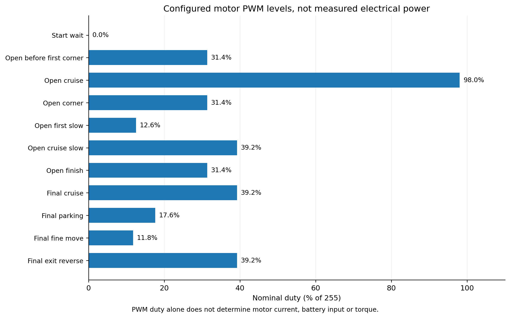

Figure 3.3. Configured PWM fractions across driving and parking phases. Not a measured power budget.

[Full `validation/power_budget.csv` dataset](validation/power_budget.csv). Use the [physical electrical measurement template](validation/measurement_templates/power_budget.csv) to record battery input current, regulator output current and voltage minima under real motor and servo load.
<!-- END CODE-DERIVED DATA VIEW -->

#### Intentional motor overvoltage

The Pololu 50:1 drive motor is rated for 6 V, but our configuration **deliberately operates it above its nominal voltage**. The IFX9201SG's motor-power path is supplied from the 2S LiHV battery (7.6 V nominal, up to 8.7 V fully charged), not from the regulated 5 V electronics rail or a dedicated 6 V regulator. Speed requests are adjusted in software using the operating-state PWM values shown above. In Open Cruise, the requested 98.04% duty leaves the motor exposed to nearly the full battery voltage for much of the PWM cycle.

The purpose of this decision is to prioritize motor speed and response during short challenge maneuvers. It also increases the risk of excessive current and winding temperature, particularly under heavy load or stalled conditions. The motor driver's protection functions provide driver protection, **not a guarantee that a nominal 6 V motor will remain thermally safe**. No measured motor temperature, winding-current limit or thermal qualification is asserted here.

### 3.4 Expected runtime

An energy-based runtime estimate is:

$$
t_{\mathrm{run}}\approx\frac{E_{\mathrm{usable}}}{\overline{P}_{\mathrm{in}}}
$$

or, for a rough constant-current estimate on the battery side:

$$
t_{\mathrm{run,minutes}}\approx60\frac{C_{\mathrm{Ah}}f_{\mathrm{usable}}}{I_{\mathrm{bat,avg}}}
$$

The usable fraction $f_{\mathrm{usable}}$ is dependent on cutoff and the actual battery under load. A 3-minute WRO run is not proof of battery margin: starting voltage, pack recovery and repeated attempts must be considered.

### 3.5 Protection and power failure modes

The major electrical hazards are a reverse-connected battery, motor inrush, servo peaks, regulator overheating, unstable connectors and shared-ground interference. Our power architecture therefore requires inspection of the input polarity, power path, common ground and regulated voltage before connecting sensitive components. The 220 µF bulk capacitor on the main PCB helps decouple supply transients, but it is not a replacement for a correctly sized regulator or a suitable wiring topology.

| Failure | Observable symptom | Diagnostic | Mitigation |
|---|---|---|---|
| 5 V rail sag | Nano or camera resets during acceleration | Capture voltage at the connector during motor transients | Verify regulator, wiring and separation of peak loads |
| Servo current spike | Steering chatter or regulator droop | Measure peak servo current at hard lock | Avoid mechanical binding; preserve power margin |
| Weak ground connection | UART errors, unstable sensor values | Check continuity and voltage offsets under load | Short, secure return path and common reference |
| Incorrect ToF sequencing | Only one sensor found at startup | Record I²C addresses after each enable | Hold all LPn low, enable sequentially |
| Low battery voltage | Loss of torque or incomplete run | Measure pack voltage during a complete lap | Use a suitable cutoff and charged known-good battery |
| Main-board flex | Intermittent component joints | Inspect support points and connectors | Rework mount spacing and limit unsupported spans |

## 4. Sensor buses and actual controller connections

### 4.1 Pin allocation

The V4.1 controller assigns the following pins in the modular firmware:

| Signal | Arduino Nano ESP32 pin | Role |
|---|---|---|
| Motor PWM | D7 | H-bridge speed signal; 1 kHz, 8-bit PWM |
| Motor direction | D8 | H-bridge direction |
| Steering servo | D2 | Servo command |
| Encoder A | D5 | Rising-edge interrupt |
| Encoder B | D4 | Direction read during A edge |
| Start button | D10 | Starts run after setup and calibration |
| Mode select: Final | D11 | HIGH at boot selects obstacle/Final mode |
| Mode select: Open | D12 | HIGH at boot selects Open mode |
| ToF front LPn | A3 | Power-state/address sequencing |
| ToF left LPn | A2 | Power-state/address sequencing |
| ToF right LPn | A1 | Power-state/address sequencing |
| ToF back LPn | A0 | Power-state/address sequencing |
| TCS34725 SDA/SCL | A6 / A7 | Secondary I²C bus (`TwoWire(1)`) |
| Camera UART | D0 / D1 | Serial interface at 19,200 baud; check exact TX/RX crossing |
| Diagnostic LEDs | D6 / D3 | Status indication |

The BMI088 and four VL53L5CX devices share the primary I²C bus. The floor-color sensor uses a separate bus at 400 kHz. The primary bus is also configured at 400 kHz in the firmware. Electrical pull-up voltage and strength must be confirmed against the released PCB assembly before attaching third-party modules.

### 4.2 Four VL53L5CX matrices

The four ToF boards are addressed individually after startup:

| Orientation | 7-bit I²C address | LPn pin | Use |
|---|---|---|---|
| Front | `0x30` | A3 | Wall distance, corner event and deceleration |
| Left | `0x31` | A2 | Side clearance, departure and parking |
| Right | `0x32` | A1 | Side clearance and parking |
| Back | `0x33` | A0 | Rear clearance and parking |

The driver holds LPn low for all four sensors before initialization. It then releases them one at a time, communicates at the default address `0x29`, assigns each new address and starts ranging. This prevents two unconfigured devices from answering the same I²C request.

Each sensor is configured to **4 × 4 zones at 30 Hz**. The data age is checked against a **150 ms freshness limit**. Invalid or unavailable measurements return `-1` rather than a fabricated distance. General distance queries use the closest valid zone in the central 2 × 2 area.

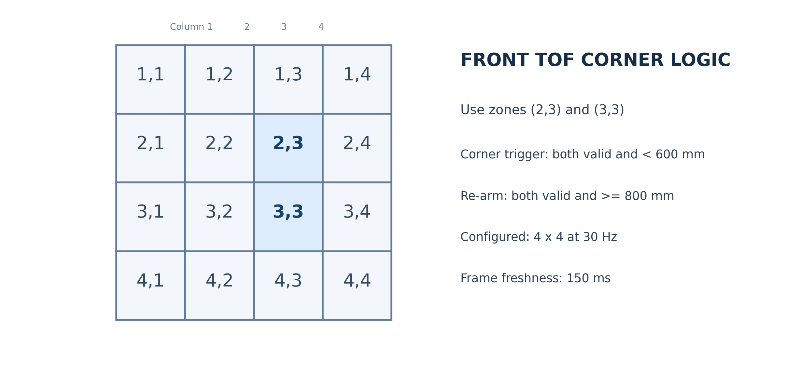

Figure 3.2. ToF 4 × 4 zoning and the specific front readings used for Open Challenge corner detection. The physical sensor orientation must be checked to confirm the indexed cells correspond to the intended side of the image.

For Open Challenge, the controller uses **front row 2, column 3** and **front row 3, column 3**. Both values must be valid and below 600 mm to generate a corner request. Both must recover to at least 800 mm before the next corner is armed. This 200 mm hysteresis separates successive corner events and prevents repeated triggers while the wall remains close.

The nominal 30 Hz frame period is:

$$
T_{\mathrm{frame}}=\frac{1}{30}=33.3\ \mathrm{ms}
$$

This is the device configuration target, **not** a measurement of full-loop latency. Bus transfers, polling workload, blocking turns and communication may increase the age of data available to navigation. Log the actual inter-frame interval to validate the control timing.

#### Placement and field geometry

The placement objective is to see wall surfaces without the chassis, wheel or tire blocking the selected matrix zones. The front sensor must detect a wall early enough to slow down from the current speed before the desired corner entry location. If the travel speed is $v$ and response delay is $\tau$, the distance traveled before a new command can take effect is:

$$
d_{\mathrm{latency}}=v\tau
$$

At an illustrative $v=0.8$ m/s and $\tau=0.05$ s, this distance is 40 mm, before any braking distance. A more complete stopping margin is:

$$
d_{\mathrm{margin}}\ge v\tau+\frac{v^2}{2a_b}+d_{\mathrm{geometry}}
$$

where $a_b$ is the measured deceleration magnitude and $d_{\mathrm{geometry}}$ covers front overhang and required clearance. This explains why range thresholds cannot be chosen independently of speed and mechanics.

#### Physical mounting and optical clearance

The front, left, right and rear VL53L5CX boards are mounted to face their corresponding field boundaries. The image below and the [mechanical CAD](../3D-models/) show the installation context. **Mounting height cannot be read reliably from a schematic illustration**, and the supplied chapter does not specify numeric optical-center heights.

| Sensor | Optical-axis orientation | Installed optical-center height | View clearance relevant to operation |
|---|---|---|---|
| Front | Forward, toward approaching walls | Refer to the corresponding CAD mounting face | Front structure and camera mount must not block the central ranging zones used for corner detection |
| Left | Left, toward the side wall | Refer to CAD sensor mount | Wheel and side bodywork must clear the wall-facing view |
| Right | Right, toward the side wall | Refer to CAD sensor mount | Wheel and side bodywork must clear the wall-facing view |
| Rear | Backward, toward the rear boundary | Refer to CAD sensor mount | Rear bodywork, axle and wiring must clear the rear field of view |

The table records direction and installation constraints without inventing millimetre values. A dimensioned drawing or measurements from the assembled chassis are needed to specify the four optical-center heights numerically.

### 4.3 BMI088 inertial measurement

The custom BMI088 board provides angular velocity for heading estimation. The firmware initializes the gyro with a ±2000°/s range and an output data rate setting of 400 Hz; the accelerometer is configured for ±6 g and 200 Hz. The control law primarily uses the **Z-axis gyroscope rate** and does not require a magnetic heading reference.

At startup, the robot remains stationary for 10 seconds while samples are averaged to estimate bias:

$$
\hat b_z=\frac{1}{N}\sum_{k=1}^{N}\omega_{z,k}
$$

The corrected yaw angle is then integrated:

$$
\psi(t)=\psi(0)+\int_0^t[\omega_z(\tau)-\hat b_z]\,d\tau
$$

The discrete implementation uses microsecond timestamps and rejects unusually long update intervals over 50 ms to avoid integrating a stale rate over a blocked loop. This improves integration behavior but means a long blocked interval is not reconstructed retroactively. Drift depends on temperature and bias changes, so repeat the stationary test after warm-up.

### 4.4 TCS34725 floor-marker sensor

The TCS34725 returns clear, red, green and blue values. The firmware normalizes RGB by the sum of channels, so classification uses relative color proportions rather than only raw brightness:

$$
r_n=\frac{R}{R+G+B},\quad g_n=\frac{G}{R+G+B},\quad b_n=\frac{B}{R+G+B}
$$

A clear-channel threshold rejects extremely dark readings. The classifier distinguishes white, blue, red, orange and green classes. White observations re-arm marker detection, while marker lockout prevents an immediate double-count. The sensor uses a separate I²C bus, helping the floor marker remain responsive even while the primary bus polls the ToF matrices.

Color thresholds must be checked using actual samples on the competition mat under the event lighting. The RGB ratios alone do not remove every effect of shadows and spectral changes.

### 4.5 OpenMV RT1062 vision processor

The OpenMV RT1062 runs the obstacle perception task independently of the drive controller. The vision interface is a newline-delimited UART protocol at **19,200 baud**. The drive controller recognizes red and green obstacle messages and `S...` normalized steering overrides. The camera script should be published at the same revision as the competition firmware, with sensor orientation, color thresholds and exposure settings recorded in [Chapter 04](04-software.md).

This division is deliberate: image operations have variable processing time, while steering and motor control should respond quickly to gyro and distance data. A camera message is a request to the control state machine, not a direct, unfiltered command to the motor driver.

#### Actual OpenMV RT1062 image and detection output

The frame below is captured from the robot camera's vision interface, including the **green and red detection boxes**, their estimated distances and the selected cube-processing region.

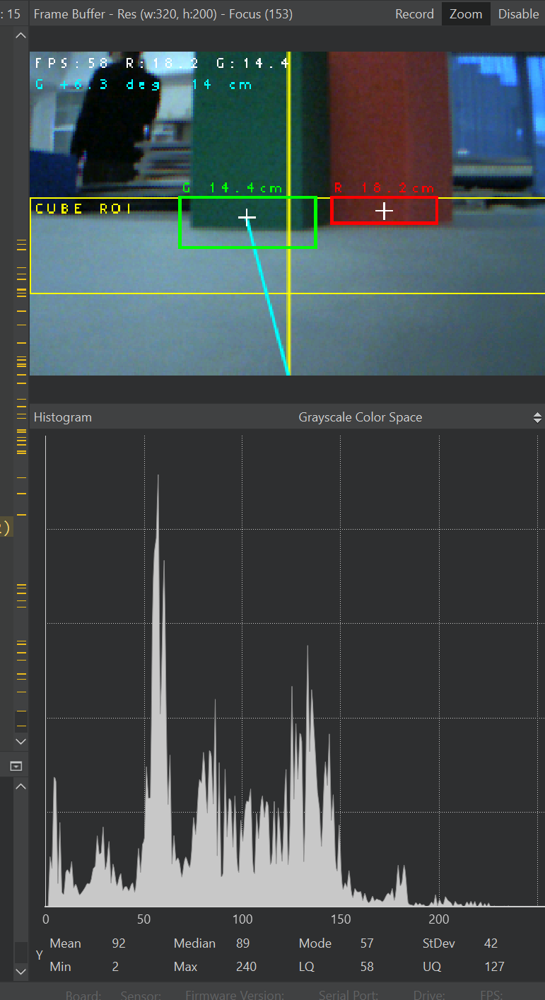

Camera frame crop from the actual OpenMV output. Click to view the full diagnostic screenshot, including its intensity histogram.

The purpose of this view is to make perception behavior inspectable, rather than to claim a particular success rate from a single frame. The two boxes demonstrate the color-segmentation stage. A valid object needs to satisfy the configured region, size, color and position conditions before its message influences the Obstacle Challenge state machine. Test sequences with lighting changes and the camera initially facing a nearby wall are documented in [04 Software](04-software.md).

## 5. Sensor calibration and validation

### 5.1 Distance-sensor calibration matrix

To measure ranging accuracy, test the front, left, right and rear sensors at multiple known wall distances using a flat wall and a ruler aligned with each sensor's optical center. The observed bias at a given position is:

$$
e_d=d_{\mathrm{ToF}}-d_{\mathrm{reference}}
$$

and over $N$ samples:

$$
\mathrm{RMSE}=\sqrt{\frac{1}{N}\sum_{j=1}^N e_{d,j}^2}
$$

#### Physical distance-calibration evidence

For V4.1, each of the four installed VL53L5CX boards is measured at **200, 400, 600 and 1000 mm**, using the same flat reference surface and measuring from the optical center. Preserve every returned reading and invalid frame, not only a mean value. The calibration dataset is [`validation/physical/tof_samples.csv`](validation/physical/tof_samples.csv); the [analysis script](../scripts/summarize_validation.py) calculates mean bias, RMSE over *individual valid samples*, invalid-frame count, and achieved frame rate from frame timestamps.

| Sensor | Reference distances | Required physical evidence | Analysis result |
|---|---|---|---|
| Front | 200 / 400 / 600 / 1000 mm | Range samples, status and timestamps | [Physical results](validation/physical/SUMMARY.md#distance-sensor-accuracy) |
| Left | 200 / 400 / 600 / 1000 mm | Range samples, status and timestamps | [Physical results](validation/physical/SUMMARY.md#distance-sensor-accuracy) |
| Right | 200 / 400 / 600 / 1000 mm | Range samples, status and timestamps | [Physical results](validation/physical/SUMMARY.md#distance-sensor-accuracy) |
| Back | 200 / 400 / 600 / 1000 mm | Range samples, status and timestamps | [Physical results](validation/physical/SUMMARY.md#distance-sensor-accuracy) |

A second run with the motor enabled isolates vibration and electrical effects. The nominal **30 Hz** setting is a software configuration, not the observed delivered sample rate. The existing illustrative table below is retained to demonstrate the method and is deliberately **not** counted as experimental results.

The following values are an **illustrative calculation example**, not measurements from V4.1. Their RMSE figures are calculated from the four example mean errors; a physical accuracy report must compute RMSE across all valid captured frames and separately count invalid frames.

| Sensor | Reference positions | Illustrative mean ToF range | RMSE of example means | Illustrative invalid frames |
|---|---|---|---:|---:|
| Front | 200 / 400 / 600 / 1000 mm | 202 / 397 / 605 / 988 mm | 6.75 mm | 0/400 |
| Left | 200 / 400 / 600 / 1000 mm | 196 / 407 / 592 / 1015 mm | 9.41 mm | 2/400 |
| Right | 200 / 400 / 600 / 1000 mm | 203 / 394 / 609 / 989 mm | 7.86 mm | 1/400 |
| Back | 200 / 400 / 600 / 1000 mm | 198 / 404 / 594 / 1018 mm | 9.75 mm | 4/400 |

Repeat the physical test with the drive motor running and the chassis tilted slightly, because reflections from the floor and sensor mounting geometry can alter individual zones.

<!-- CODE-DERIVED DATA VIEW -->
### 5.1.1 Open-mode ToF decision boundaries

The controller uses both front matrix zones `(2,3)` and `(3,3)`. In the current logic, 600 mm is the corner-event boundary, 800 mm initiates reduced drive PWM, and a frame older than 150 ms is rejected by the relevant freshness guard. The examples below are **deterministic synthetic inputs**, useful for regression testing, not wall measurements.

| Synthetic case | Zone 2:3 / 3:3 | Frame age | Base → expected PWM | Turn accepted |
| --- | --- | --- | --- | --- |
| clear 800 threshold | 800 / 800 mm | 100 ms | 250 → 250 | No |
| slow 799 900 | 799 / 900 mm | 100 ms | 250 → 100 | No |
| turn 599 599 | 599 / 599 mm | 100 ms | 250 → 100 | Yes |
| turn 599 599 unarmed | 599 / 599 mm | 100 ms | 250 → 100 | No |
| one close 599 800 | 599 / 800 mm | 100 ms | 250 → 100 | No |
| stale 151ms | 599 / 599 mm | 151 ms | 250 → 250 | No |
| missing zone2 | 0 / 500 mm | 100 ms | 250 → 250 | No |
| clear rearm | 800 / 800 mm | 100 ms | 250 → 250 | No |

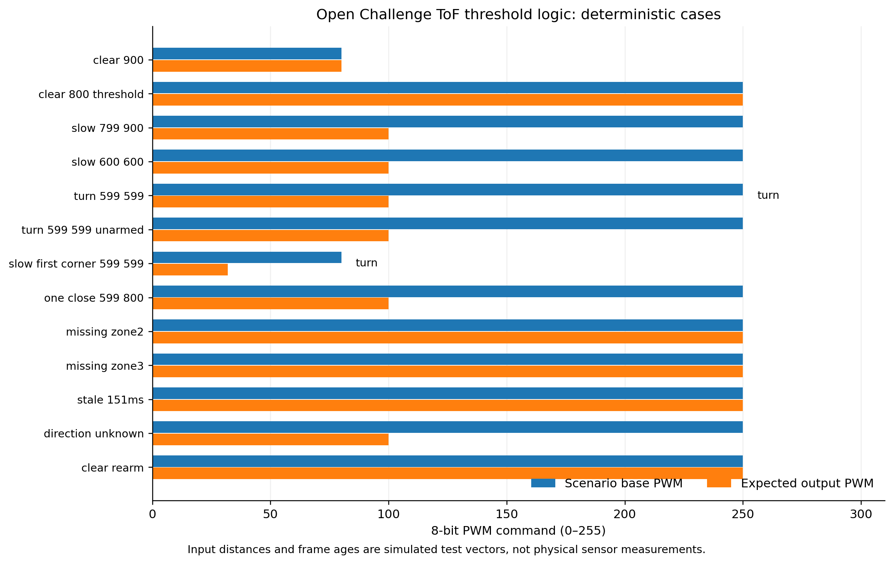

Figure 3.6. Reproducible code logic for valid, missing, stale, slow and corner-event cases. No physical sensor accuracy is inferred.

[Full `validation/tof_corners.csv` dataset](validation/tof_corners.csv). Physical range bias and false/missed event rates are recorded independently with the [ToF measurement template](validation/measurement_templates/tof_corners.csv). A successful synthetic threshold test is not evidence that the modules can see an actual wall at that distance.
<!-- END CODE-DERIVED DATA VIEW -->

### 5.2 Gyroscope stability

The gyroscope validation procedure records at least 60 seconds at rest after startup calibration, followed by 12 successive 90° rotations. Compare integrated heading to the known final orientation. Track bias (°/s), final heading error (°), and whether the error grows systematically with time.

#### Stationary drift and vibration verification

The stationary measurement must include a quiet condition with the drive off and an equivalent condition with the drivetrain running. Both use the same calibration procedure and time base. The two conditions allow us to distinguish gyroscope offset drift from additional vibration or electrical disturbance. For repeated 90° turns, log the commanded and independently observed angle, not only the gyro-integrated value.

| Condition | Samples to record | Derived quantity | Source |
|---|---|---|---|
| Stationary, motor off | At least 60 s of gyro Z rate and heading | Mean rate bias, heading drift in °/min | [`imu_samples.csv`](validation/physical/imu_samples.csv) |
| Stationary, motor on | Same duration, same mounting | Difference in bias and vibration-related variation | Same dataset |
| 12 measured 90° rotations | Integrated and reference heading at each trial | Mean absolute and signed turn error | Same dataset |

The [physical validation summary](validation/physical/SUMMARY.md#bmi088-drift-and-heading-accuracy) calculates drift and error directly from supplied time-stamped observations. An algorithmic 90° command or a bias-calibration routine is not a measurement of 90° turning accuracy.

### 5.3 Camera and color verification

The camera validation procedure records images of red and green pillars at representative close, middle and far distances. For each image, capture the detected color, centroid, blob area, candidate count and the UART command sent. Repeat under different lighting conditions and with the camera facing a nearby wall at startup. This last condition is important because it tests whether automatic camera settings are stable when the initial field of view is unusual.

#### Recorded detection performance

The [RT1062 diagnostic image](docs-media/v41-openmv-RT1062-camera-view.png) documents the color-segmentation output on a real camera frame. It demonstrates that red and green candidates were identified in that frame; it is not a repeated-trial accuracy measurement. The evaluation is repeated at near, medium and far positions under normal and difficult lighting, including startup facing a nearby wall.

| Observation | Required record | Calculation |
|---|---|---|
| Red pillar | Reference color, reported color, image and processing time | Detection proportion, incorrect classification |
| Green pillar | Reference color, reported color, image and processing time | Detection proportion, incorrect classification |
| No pillar / different lighting | Reported result and frame | False-positive rate |
| Close wall at startup | Initial frame and subsequent detection | Recovery after camera initialization |

The raw observations belong in [`camera_trials.csv`](validation/physical/camera_trials.csv). The [physical validation summary](validation/physical/SUMMARY.md#openmv-rt1062-classification) reports trial totals, correct detections, misses, wrong-color classifications and measured processing times. If a threshold or exposure change is compared, both conditions must use the same targets, lighting and counting method.

### 5.4 Power and bus stress test

With all sensors running, cycle the steering servo and drive motor. Record (a) minimum 5 V voltage, (b) ToF frame age, (c) UART errors and (d) IMU sample gaps. A test passes only when no brownout occurs and sensor data remains within the required freshness window.

The combined test is useful as a **failure reproduction** rather than a generic checklist. Keep one test ID for the load waveform, controller diagnostic log, camera UART log and ToF timestamp trace. If a reset, missed sensor frame or unstable steering event occurs, document the exact test, change one electrical or software condition, and repeat the identical load sequence. A successful corrected run should point to both the failure record and the retest rather than replacing the original observation.

[Measured electrical summary](validation/physical/SUMMARY.md#electrical-load-and-5-v-stability) · [Raw electrical captures](validation/physical/power_runs.csv) · [Reproducibility checks](06-reproducibility.md#v41-functional-verification-results).

## 6. Iterations and engineering decisions

| Subsystem | Earlier implementation (V4) | V4.1 decision | Engineering trade-off |
|---|---|---|---|
| Wall sensing | Single-zone PWM distance sensors | Four multi-zone VL53L5CX sensors | More spatial information and distance context, at the cost of I²C traffic and address sequencing |
| Inertial sensing | Larger or less integrated modules | Dedicated BMI088 PCB | More compact integration, with additional custom PCB effort |
| Drive | 30:1 HPCB ratio | 50:1 HPCB ratio | Higher nominal torque multiplication, lower theoretical no-load speed |
| Vision | Camera-only recognition cues | RT1062 color-blob processor complemented by TCS floor sensing | Different sensors handle different geometric tasks, with extra calibration and communication complexity |
| Structure | Existing PCB chassis concept | Revised routing, sensor boards and connectors | Compact integration demands careful mechanical and electrical verification |

The central systems trade-off is between **sensor richness and deterministic control timing**. Four matrix sensors and a camera improve the information available, but increase data-transfer and calibration work. We therefore use small, purpose-specific signals in the main controller: validated distance zones, marker events, integrated heading and camera commands.

### Observed engineering progression

The most directly documented outcomes are the change in physical hardware and the demonstrated operation of the robot. The V4.1 [assembled board photograph](docs-media/v41-assembled-robot-top.png) shows the integrated electronics, and the [real driving video](https://www.youtube.com/watch?v=bg92ulHXomw) documents autonomous runs. Those records establish an assembled, functioning vehicle, but do not quantify the individual contribution of each design change.

| V4 limitation / design constraint | V4.1 change | Outcome supported by existing evidence |
|---|---|---|
| Single-zone distance data gives no spatial matrix around an obstacle | Four 4×4 VL53L5CX boards with sequential addressing | The V4.1 design and firmware expose sixteen zones per sensor, including the specific front cells used for corner detection |
| Previous 30:1 gearing prioritizes output speed over torque multiplication | 50:1 gearbox installed | Greater nominal reduction is documented; the assembled V4.1 drivetrain and autonomous vehicle operation are shown, without a paired acceleration measurement |
| Separate sensor and wiring integration consumes limited chassis space | Revised main PCB, IMU board and ToF boards | PCB design files and the real assembled electronics photograph document the integrated arrangement |
| Camera processing alone cannot measure the floor marker directly | RT1062 obstacle recognition plus TCS34725 floor sensing | The RT1062 detection screenshot shows color segmentation, and the firmware contains a separate floor-marker sensing path |

### 6.1 Comparison evidence and retesting

The V4.1 changes address specific engineering limitations, but the **choice of component is not itself proof of an observed performance gain**. To evaluate a change, compare V4 and V4.1 under the same target geometry and measured metric. Keep failures and corrective retests in the same record.

| Design change | Matched comparison | Evidence to preserve | Status of quantitative conclusion |
|---|---|---|---|
| Single-zone ranging → four VL53L5CX matrices | Missed corners and distance errors at matched wall positions | Raw ToF samples and full-field run outcomes | Requires paired physical trials |
| 30:1 → 50:1 gearbox | Start acceleration, drive current, turn entry and parking distance | Current trace, encoder logs and video | Torque-ratio calculation is available; dynamic improvement requires measurements |
| Sensor modules → custom PCB integration | Mounting stability, bus faults and controller restarts | Board revision, wiring/scope captures, retests | PCB manufacturing evidence available; reliability improvement requires logs |
| Camera threshold/exposure revisions | Red/green detection across the same target and lighting conditions | Frame captures, trial-level classification results | One camera screenshot available; comparative accuracy requires repeated trials |

The shared [`revision_comparisons.csv`](validation/physical/revision_comparisons.csv) records matched V4/V4.1 results, while [`SUMMARY.md`](validation/physical/SUMMARY.md#v4-v41-engineering-comparison) displays numerical changes only when paired measurements exist. Negative outcomes remain in the experiment history. This allows a judge to trace an engineering decision through a test, a change and a retest without relying on selected screenshots or inferred percentages.

### 6.2 Evidence available for this chapter

| Evidence | Demonstrates | Link |
|---|---|---|
| Main PCB design, copper views and production files | Reproducible electrical topology and fabrication | [Section 2.3](#23-electrical-schematic-pcb-traces-and-assembled-board) |
| Actual RT1062 detection image | One captured frame with color-segmentation output | [Section 4.5](#45-openmv-rt1062-vision-processor) |
| ToF, motor PWM and camera firmware cases | Deterministic thresholds, modes and command paths | [Software-derived cases](validation/README.md) |
| Static source and dataset checks | Reproducible file-integrity and analysis-script tests | [Source preflight](validation/evidence/static-preflight-results.md) |
| Physical power, range, IMU and camera observations | Real measurement outcomes once recorded | [Physical results](validation/physical/SUMMARY.md) |

The firmware-based scenarios and manufacturer ratings are retained because they explain design intent and make experiments reproducible. They are not substituted for test-bench measurements.
