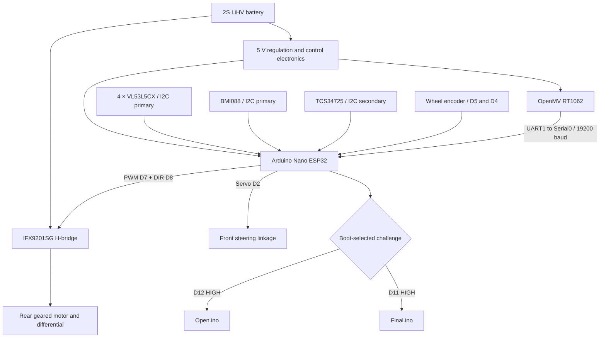
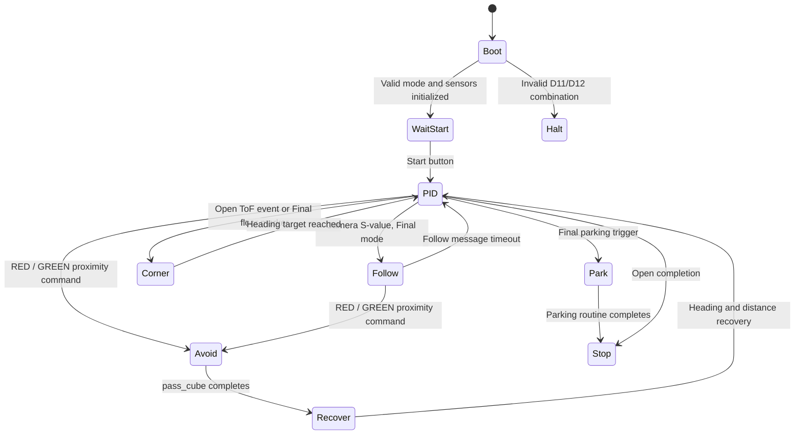
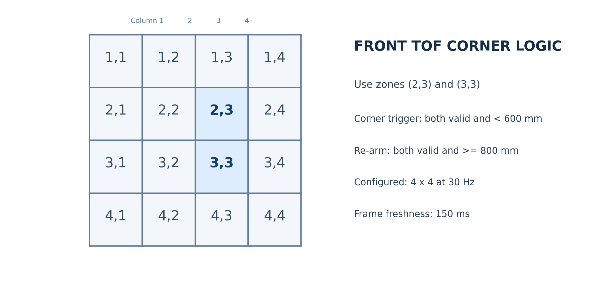
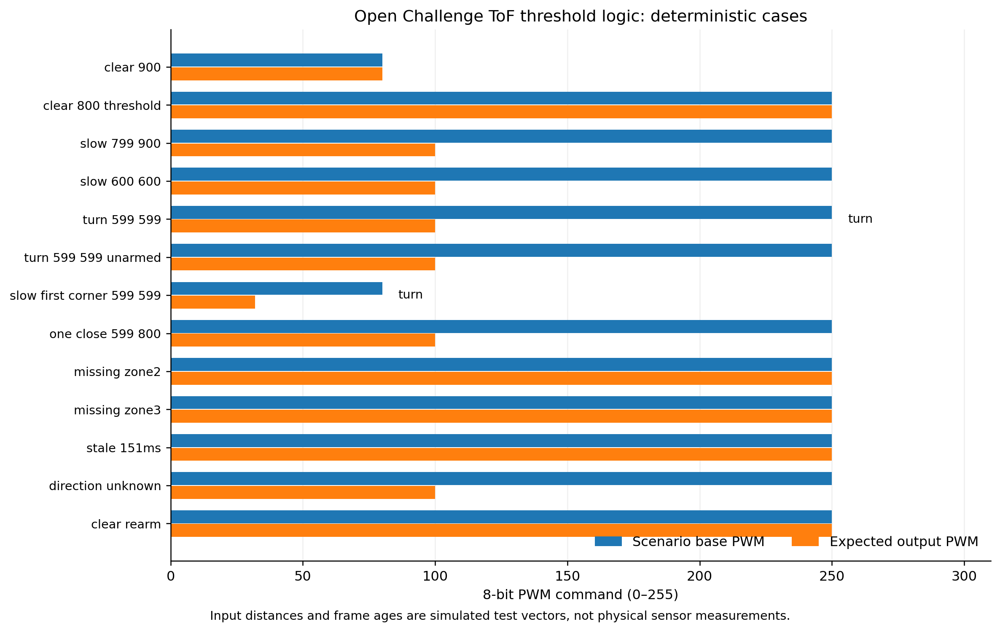
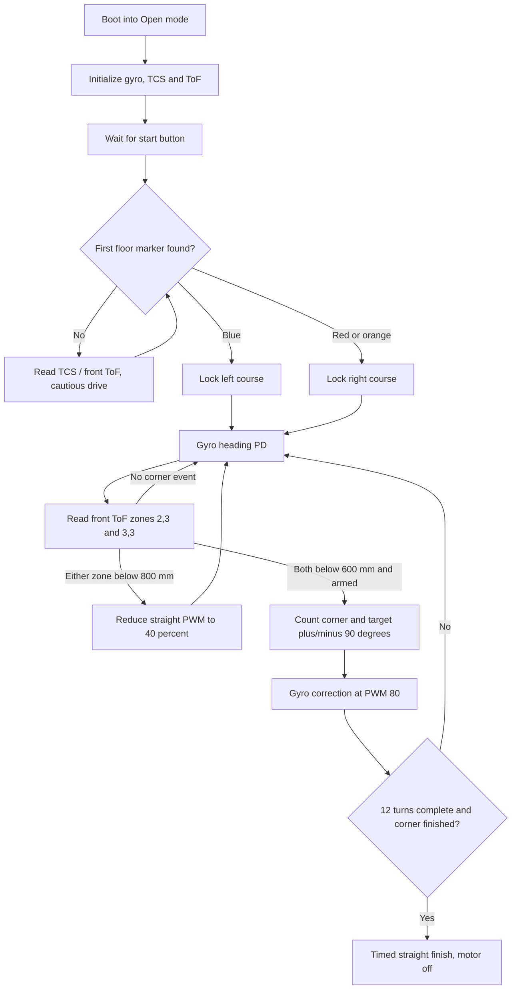
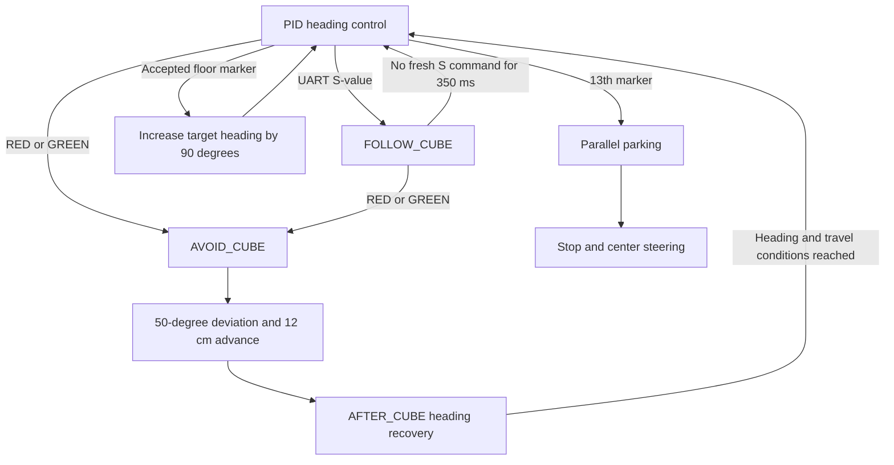
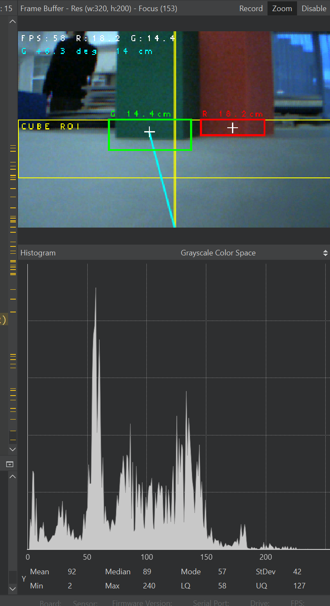

# 04. Software architecture and autonomous navigation

HyperLine Robotics | WRO 2026 Future Engineers | V4.1 controller and OpenMV RT1062

| Chapter | Topic |
|---|---|
| [01 · Overview](01-overview.md) | Team, robot, challenges, evidence and results |
| [02 · Mobility](02-mobility.md) | Chassis, drivetrain, steering, tires and geometry |
| [03 · Power and sensors](03-power-sensors.md) | Electrical system, PCB, camera, IMU and validation |
| [04 · Software](04-software.md) | Control, perception, state machines and challenge strategy |
| [05 · Systems](05-systems.md) | Engineering trade-offs, iterations, performance and risk |
| [06 · Reproducibility](06-reproducibility.md) | Assembly, firmware, costs and test procedures |

---

Our software has two main responsibilities: **continuous motion control** and **event-based navigation**. The Arduino Nano ESP32 reads the BMI088, the four VL53L5CX distance matrices, the TCS34725 floor sensor and the wheel encoder. It drives the rear motor through the IFX9201SG and steers the front wheels through the MG90S. The OpenMV RT1062 processes camera images independently and sends short UART commands for obstacle following and avoidance.

The earlier vehicle used a camera-driven corner/line interpretation and single-value PWM distance sensors. V4.1 replaces those ranging inputs with **four 4 × 4 VL53L5CX ToF matrices**. The **new Open Challenge code** obtains its turning direction from the floor-color sensor, triggers corners from two selected front ToF zones and uses gyro feedback to complete each 90° change of heading. The Obstacle Challenge retains its separate cube-following, avoidance, recovery and parking behavior, updated to read the ToF modules.

## 1. Source code and software revisions

### 1.1 Controller organization

The V4.1 Arduino sketch is split into tabs that compile together as one program. This arrangement separates the two challenge strategies without duplicating the low-level hardware drivers.

| File | Main responsibility |
|---|---|
| [`HLR_FE_Separated.ino`](../src/HLR_FE_Separated/HLR_FE_Separated.ino) | Pin definitions, shared constants, robot states, mode selection, initialization and main dispatch |
| [`Open.ino`](../src/HLR_FE_Separated/Open.ino) | First-marker direction lock, ToF corner events, Open-round heading control and finish |
| [`Final.ino`](../src/HLR_FE_Separated/Final.ino) | Obstacle Challenge states, floor-marker events, parking exit and final parking |
| [`tof.ino`](../src/HLR_FE_Separated/tof.ino) | Four VL53L5CX devices, unique I²C addresses, 4 × 4 frame acquisition, range filtering and front-corner logic |
| [`gyro.ino`](../src/HLR_FE_Separated/gyro.ino) | BMI088 setup, stationary-rate calibration and integrated yaw |
| [`motors.ino`](../src/HLR_FE_Separated/motors.ino) | IFX9201SG PWM/direction output, MG90S steering, encoder, movement and positioning routines |
| [`functions.ino`](../src/HLR_FE_Separated/functions.ino) | TCS34725 I²C acquisition/classification, shared cube-avoidance movement and communication helpers |
| [`camera.py`](../src/camera.py) | OpenMV RT1062 red/green detection, object following, optional sign-height classification and UART messages |

The seven `.ino` files remain inside one `src/HLR_FE_Separated/` directory. Arduino IDE compiles these tabs together. The OpenMV Python code is flashed separately to the camera; it is **not** executed on the Arduino.

### 1.2 Historical source and the recorded driving demonstration

The team identifies commit [`de34faf039a70443361197de540879f212e3de81`](https://github.com/andreipopescufilimon/WRO2026_Future_Engineers/commit/de34faf039a70443361197de540879f212e3de81) as the software used for the [published Open and Obstacle driving video](https://www.youtube.com/watch?v=bg92ulHXomw). Its Arduino entry point is the older [`src/HLR_FE/HLR_FE.ino`](https://github.com/andreipopescufilimon/WRO2026_Future_Engineers/blob/de34faf039a70443361197de540879f212e3de81/src/HLR_FE/HLR_FE.ino).

The later V4.1 implementation under [`src/HLR_FE_Separated/`](../src/HLR_FE_Separated/) has a different architecture and new ToF-based Open navigation. The video documents the physical robot and the identified historical code; it should not be interpreted as a test of every change in the newer separated sketch. This chapter describes **the newer code as written**, using the supplied camera script with height-detection logic.

## 2. System architecture and execution flow

### 2.1 Sensor-to-actuator pipeline



The controller uses **I²C** for close-range sensing, **UART** for vision decisions, **interrupt counting** for wheel movement, **PWM/direction** for propulsion and **servo pulses** for steering. The architecture lets camera processing vary in execution time without requiring image processing inside the Arduino's motion-control functions.

### 2.2 Pin allocation and communication

| Subsystem | Nano ESP32 pin or interface | Firmware purpose |
|---|---|---|
| IFX9201SG PWM / direction | D7 / D8 | Signed drive command |
| MG90S steering | D2 | Servo angle |
| Encoder A / B | D5 / D4 | A rising-edge interrupt; B read for direction |
| Start button | D10 | Pre-run wait, `INPUT_PULLUP` |
| Final / Open selection | D11 / D12 | Read once at boot using 3.3 V logic |
| ToF front / left / right / rear LPn | A3 / A2 / A1 / A0 | Sequential enable and address assignment |
| TCS34725 SDA / SCL | A6 / A7 | Independent `TwoWire(1)` bus at 400 kHz |
| Four ToFs and BMI088 | Primary `Wire` bus | Shared I²C bus, configured at 400 kHz |
| RT1062 camera communication | D0 / D1 (`Serial0`) | 19,200 baud newline-delimited messages |
| USB diagnostics | `Serial` | 115,200 baud |
| Status LEDs | D6 / D3 and built-in LED | Start-up and diagnostic signaling |

The OpenMV camera uses `UART(1, 19200)`, with **P4 as TX and P5 as RX** in the documented RT1062 connection. Camera TX connects to Nano RX, with shared ground and 3.3 V signal levels. The primary ToF devices all start with the factory I²C address `0x29`; the floor-color sensor also uses `0x29` but runs on the separate bus, avoiding that address conflict.

### 2.3 Boot, mode selection and start sequence

A challenge is selected **before the board starts**:

| D11 | D12 | Behavior |
|---|---|---|
| HIGH | LOW | Obstacle / Final mode |
| LOW | HIGH | Open mode |
| LOW | LOW | Initialization stops; built-in LED blinks |
| HIGH | HIGH | Initialization stops; built-in LED blinks |

Both inputs are configured as `INPUT_PULLDOWN`. A valid selection calls exactly one of `open_configure()` or `final_configure()`. The sketch then initializes the servo and motor driver, encoder, both serial ports, BMI088, TCS34725 and ToF sensors. The BMI088 calibrates while stationary for **10 seconds**. The start button on D10 keeps the motor at zero until pressed. After the start delay, Final mode performs `final_exit_parking()` before entering normal navigation; Open mode enters `open_execute()`.

```cpp
// HLR_FE_Separated.ino, simplified directly from the mode dispatch
bool finalSelected = digitalRead(MODE_FINAL_PIN) == HIGH;
bool openSelected  = digitalRead(MODE_OPEN_PIN) == HIGH;
if (finalSelected == openSelected) {
  // Invalid selection: halt initialization and blink LED.
  while (true) {
    digitalWrite(LED_BUILTIN, !digitalRead(LED_BUILTIN));
    delay(250);
  }
}
activeMode = finalSelected ? MODE_FINAL : MODE_OPEN;
if (activeMode == MODE_FINAL) final_configure();
else open_configure();

// The actual setup initializes hardware and waits for START_BTN here.
void loop() {
  if (activeMode == MODE_OPEN) open_execute();
  else if (activeMode == MODE_FINAL) final_execute();
}
```

The selection is **latched at startup**. Changing D11 or D12 while driving does not switch modes until the controller restarts. Historical code referred to `RUN_MODE`; V4.1 uses `RoundMode activeMode` and separate `execute` functions.

### 2.4 Robot states versus movement phases

The shared controller declares these states:

| `RobotState` | Behavior | Main input | Main effect |
|---|---|---|---|
| `PID` | Maintain the current gyro heading | BMI088 and challenge events | Steering PD and drive PWM |
| `FOLLOW_CUBE` | Track a visible obstacle | OpenMV `S...` steering message | Camera-directed steering; fall back after message timeout |
| `AVOID_CUBE` | Perform obstacle passing maneuver | `RED` or `GREEN` command | Turn and encoder-based clearance movement |
| `AFTER_CUBE` | Recover heading after the obstacle | BMI088 and encoder | Rejoin the planned course |
| `PARK` | Final positioning at the end of Obstacle mode | Final floor-marker count | Parking routine and stop |

`WAIT_START`, corner turning and finishing are **control phases**, not separate members of this enum. The actual code uses blocking movement functions for some maneuvers, alongside the normal `loop()` state dispatch. This distinction matters when tracing timing and message processing.



The diagram shows the intended high-level navigation sequence; `Corner`, `WaitStart`, `Recover` and `Stop` are descriptive phases, not additional C++ enum values.

## 3. Motion control and heading estimation

### 3.1 IFX9201SG drive output

The rear motor driver is controlled by two Nano pins. D7 is a **1 kHz, 8-bit PWM output**; D8 determines the sign of the commanded drive. The firmware's `move(int speed)` expects a signed motor command in approximately `-255...+255` and uses its magnitude for PWM duty.

```cpp
void motor_driver_setup() {
  pinMode(PWMA, OUTPUT);
  pinMode(DIRA, OUTPUT);
  ledcSetup(PWM_MOTOR_CHANNEL, PWM_MOTOR_FREQ, PWM_MOTOR_RESOLUTION);
  ledcAttachPin(PWMA, PWM_MOTOR_CHANNEL);
  move(0);
}

void move(int speed) {
  ledcWrite(PWM_MOTOR_CHANNEL, abs(speed));
  digitalWrite(DIRA, speed > 0 ? LOW : HIGH);
}
```

The nominal duty fraction is $D=|u|/255$. For example, a command of `250` requests approximately 98% duty and `80` requests approximately 31%. These are **electrical PWM commands**, not measured speed, motor-terminal voltage or current. As explained in [Chapter 03](03-power-sensors.md), the nominal 6 V drive motor is intentionally operated from the 2S LiHV supply, so winding temperature, mechanical load and overcurrent protection remain important.

The shared `stop_motor()` routine briefly requests reverse PWM (`-3` for 100 ms) before setting zero. In other places the software uses `move(0)` directly. Neither should be described as a guaranteed instantaneous physical stop.

The V4.1 assembly does **not** include a working impeller or ESC. The sketch retains some old `PWM_IMPELLER` definitions and a setup function for code compatibility, but `impeller_speed` is initialized to zero and this subsystem is not part of active propulsion or downforce.

### 3.2 Steering servo and normalized commands

The front MG90S servo uses the `ESP32Servo` interface. The current source defines:

| Reference | Command passed to `Servo.write()` |
|---|---:|
| `STEERING_LEFT` | 39 |
| `STEERING_CENTER` | 85 |
| `STEERING_RIGHT` | 131 |
| `STEERING_LEFT_PARK` | 40 |
| `STEERING_RIGHT_PARK` | 138 |

These values are **servo commands**, not measured steering angles at the wheels. The normalized control function clamps $s$ to $[-1,1]$ and maps it linearly from the left command to the right command:

$$
\theta_{\mathrm{servo}}=39+\frac{s+1}{2}(131-39)
$$

```cpp
void steering_servo_setup() {
  steeringServo.attach(STEERING_SERVO);
  delay(100);
  steeringServo.write(STEERING_CENTER);
  delay(300);
}

void steer(double steering_angle) {
  steering_angle = constrain(steering_angle, -1.0, 1.0);
  steering_angle = map_double(steering_angle, -1, 1,
                              STEERING_LEFT, STEERING_RIGHT);
  steeringServo.write(steering_angle);
}
```

There is a second `steer_parking()` mapping using the parking-specific limits. This preserves a wider steering command range for short parking arcs without changing the straight-driving calibration. The actual tire angle depends on the linkage dimensions documented in [Chapter 02](02-mobility.md).

### 3.3 Wheel encoder and controlled travel

The motor encoder is read by an interrupt on **D5, rising edge of channel A**, while D4 supplies direction information. This is a **single-edge A-channel counter**, even though the source also retains constants describing quadrature edges. The firmware converts the absolute count to distance using its calibrated value:

$$
 d_{\mathrm{mm}}=|N_{\mathrm{ticks}}|\times 1.831,
 \qquad d_{\mathrm{cm}}=\frac{d_{\mathrm{mm}}}{10}.
$$

```cpp
void IRAM_ATTR encoderISR() {
  if (digitalRead(ENCODER_B)) encoder_ticks++;
  else encoder_ticks--;
}

float read_cm() {
  noInterrupts();
  int32_t t = encoder_ticks;
  interrupts();
  return abs(t) * MM_PER_TICK / 10.0f;
}
```

The current firmware sets `MM_PER_TICK = 1.831f`. This is the **software calibration constant** and should be distinguished from a measurement of physical wheel travel. Both `move_cm()` and `move_cm_gyro()` reset encoder ticks at the beginning of a distance-limited movement. The latter combines that distance target with a gyro-held steering correction.

### 3.4 BMI088 startup calibration and gyro integration

The BMI088 provides the Z-axis angular rate used as the heading reference. On startup, the Arduino initializes it with a **±2000°/s gyroscope range**, a **400 Hz gyro output setting with 47 Hz bandwidth**, and an accelerometer configured to **±6 g at 200 Hz**. The robot remains stationary for ten seconds while `gyro_setup()` estimates the mean gyro offset:

$$
\hat b_z=\frac{1}{N}\sum_{k=1}^{N}\omega_{z,k}.
$$

Each subsequent reading is corrected and integrated:

$$
\omega_z^{\mathrm{corrected}}=\omega_z-\hat b_z,\qquad
\psi_k=\psi_{k-1}+\omega_z^{\mathrm{corrected}}\Delta t.
$$

The code obtains $\Delta t$ from microsecond timestamps and **does not integrate intervals longer than 50 ms** as if they were fresh gyroscope samples. `gz` is the measured integrated heading, and `current_angle_gyro` is the target heading used by navigation. `recalibrate_gyro_angle()` can reset the integrated heading against a known target.

### 3.5 PD heading correction and motion primitives

In the standard `PID` state the controller computes heading error

$$
 e_k=\psi_{\mathrm{target}}-\psi_{\mathrm{gyro}}
$$

and applies a discrete PD command:

$$
 u_k=K_P e_k+K_D(e_k-e_{k-1}).
$$

Although the source names some variables `pid_error`, the current straight-driving expression uses **proportional and difference terms**, with no active integral term (`ki = 0`). The error difference is not divided by elapsed time, so the tuned gains depend on how frequently the function runs.

| Motion primitive | Purpose | Main feedback |
|---|---|---|
| `move_until_angle()` | Steer until a gyro target is approached | BMI088 yaw |
| `move_until_angle_max()` | Strong steering while changing heading | BMI088 yaw |
| `move_until_angle_max_no_flush()` | Parking arc, including startup kick | BMI088 yaw |
| `move_cm()` | Drive a programmed distance with gyro correction | Encoder ticks and BMI088 |
| `move_cm_gyro()` | Move a distance while holding a specified heading | Encoder ticks and BMI088 |
| `move_to_distance()` | Approach a range target using the selected front/back ToF direction | Central ToF zones and BMI088 |
| `move_to_front_distance()` | Filtered approach with slow/correction region | Front ToF and BMI088 |
| `move_straight_until_distance()` | Stop or transition at a left/right wall-distance threshold | Side ToF and BMI088 |
| `move_gyro_until_side_detect_cycle()` | Detect side-wall present/absent/present transitions | Side ToF and BMI088 |

The movement functions are implemented in [`motors.ino`](../src/HLR_FE_Separated/motors.ino). Some are **blocking loops** and some do not have an explicit timeout when a required distance never becomes valid. This is an implementation limitation, not an independently verified safety feature. For example, `move_to_distance()` searches forward at a low PWM when its ToF reading is invalid; an unplugged sensor is not equivalent to a valid clear path.

## 4. Sensor processing

### 4.1 Replacing PWM ranging with four VL53L5CX matrices

The older software used Pololu PWM distance outputs and converted pulse width into millimeters using `pulseIn()`. That logic is not the V4.1 ranging implementation. The new [`tof.ino`](../src/HLR_FE_Separated/tof.ino) uses **I²C matrix frames**, and all movement routines consume distances through the same `readDistanceMM(DistanceDir)` interface. This reduces the number of changes needed in the obstacle and parking code when the sensor hardware changes.

| ToF unit | LPn pin | Assigned 7-bit address | Navigation use |
|---|---|---|---|
| Front | A3 | `0x30` | Open corners, wall approach and parking alignment |
| Left | A2 | `0x31` | Parking exit and side-wall distance |
| Right | A1 | `0x32` | Parking exit and side-wall distance |
| Rear | A0 | `0x33` | Rear-oriented distance queries |

At initialization the firmware drives all LPn pins low, then enables each board separately at its factory address `0x29`, assigns the new address and starts ranging. Each board is configured for **4 × 4 zones at 30 Hz**. The ToF bus uses 400 kHz I²C and shares that bus with the BMI088. The TCS34725 is connected to a separate controller I²C peripheral.

```cpp
// From tof.ino: assigned on each boot
ToFUnit tofUnits[4] = {
  { &tofFront, TOF_LPN_FRONT, 0x30, false, { 0 }, 0 },
  { &tofLeft,  TOF_LPN_LEFT,  0x31, false, { 0 }, 0 },
  { &tofRight, TOF_LPN_RIGHT, 0x32, false, { 0 }, 0 },
  { &tofBack,  TOF_LPN_BACK,  0x33, false, { 0 }, 0 }
};
```

### 4.2 Invalid measurements, age and common distance interface

A 4 × 4 frame is stored in row-major order. The firmware accepts zones with ST `target_status` values **5 or 9**, provided the reported distance is positive. All other zones are stored as zero. A zone query returns **`-1`** if the sensor is offline, its sample is older than **150 ms**, the indices are outside the 1...4 range or the zone has no accepted range.

For a generic direction query, `readDistanceMM()` chooses the **nearest valid zone in the central 2 × 2 region** (rows 2–3, columns 2–3):

$$
 d_{\mathrm{direction}}=\min\{d_{r,c}>0\mid r,c\in\{2,3\}\}.
$$

If there is no valid zone, the function returns `-1`. The actual optical orientation of row/column indices must agree with the physical sensor mounts, since a rotated or mirrored breakout changes which part of the scene a numbered cell represents.

<p align="center"></p>
<p align="center"><sub>Figure 4.1. Four-by-four distance cells used by the V4.1 ranging code. The two front-corner cells are row 2/column 3 and row 3/column 3.</sub></p>

```cpp
// Read a specific zone from a 4x4 VL53L5CX matrix.
// Rows and columns are numbered from 1 to 4.
int tof_zone_mm(DistanceDir dir, uint8_t row, uint8_t col) {
  if (row < 1 || row > 4 || col < 1 || col > 4) return -1;

  ToFUnit &u = tofUnits[(uint8_t)dir];

  // Reject offline sensors and frames older than 150 ms.
  if (!u.online || !u.lastFrameMs ||
      millis() - u.lastFrameMs > TOF_FRESH_MS) return -1;

  uint16_t v = u.mm[(row - 1) * 4 + (col - 1)];

  return v == 0 ? -1 : (int)v;
}

// Convert the 4x4 matrix into one distance measurement.
// Select the closest valid reading from the central 2x2 zones.
float readDistanceMM(DistanceDir dir) {
  tof_poll();

  int nearest = 32767;

  for (uint8_t row = 2; row <= 3; row++) {
    for (uint8_t col = 2; col <= 3; col++) {
      int d = tof_zone_mm(dir, row, col);

      if (d > 0 && d < nearest) nearest = d;
    }
  }

  return (nearest == 32767) ? -1.0f : (float)nearest;
}
```

The tof_zone_mm() function accesses an individual cell of the 4 × 4 distance matrix and rejects unavailable, invalid or outdated readings. The readDistanceMM() function provides a common distance interface for the navigation and parking algorithms by selecting the closest valid measurement from the central four zones. This allows the movement functions to use the new VL53L5CX sensors without depending on the older PWM-based distance measurement system.

### 4.3 Reading frequency by challenge mode

`tof_poll()` checks the device data-ready flag before obtaining a frame. In **Open mode**, it polls only the **front ToF** for the corner-control loop. The other three boards are still initialized, but they are not transferred continuously by this function while Open navigation is active. In **Final mode**, all four devices are considered. The 30 Hz device configuration corresponds to a nominal 33.3 ms per frame; it is not proof that the complete main loop runs at that frequency.

### 4.4 TCS34725 floor-color sensor

The TCS34725 is accessed through `TwoWire(1)` on **A6/A7**, with a 400 kHz clock. The software uses a fast RGBC integration setting (`TCS_ATIME_FAST = 0xFF`) and **16× gain**. Reads only proceed when the sensor STATUS register indicates fresh color data.

For classification, the raw channels are normalized by their RGB sum:

$$
 r_n=\frac{R}{R+G+B},\quad
 g_n=\frac{G}{R+G+B},\quad
 b_n=\frac{B}{R+G+B}.
$$

The implementation uses ratios scaled by 1000 instead of floating-point division for each threshold comparison. A clear-channel guard (`TCS_MIN_CLEAR = 10`) suppresses very dark readings. Supported classes are `WHITE`, `BLUE`, `ORANGE`, `RED`, `GREEN`, `UNKNOWN` and `NONE`.

**Blue** establishes a left-turn course (`turn_direction = -1`); **red or orange** establish a right-turn course (`turn_direction = +1`) during initial direction selection. In Final mode the first valid marker establishes direction, later markers are checked against that selected course, and white observations help re-arm marker detection. The source defines `TCS_MARKER_LOCK_MS = 10` and `TCS_REARM_WHITE_MS = 2`; Final mode also applies its own corner lockout.

## 5. Open Challenge: new floor-marker and front-ToF navigation

This is the largest change from the earlier Open software. **The camera does not need to recognize black walls or blue/orange image blobs for normal Open corners.** Instead, the floor sensor establishes the course direction once, and the front VL53L5CX matrix supplies the subsequent wall-approach events. The gyro controls the actual heading.

### 5.1 Open configuration

`open_configure()` sets the following operating values:

| Parameter | Source value | Use |
|---|---:|---|
| `max_turns` | 12 | Three-lap corner count |
| Initial `robot_speed` | 250 | Configuration value before per-loop speed assignment |
| `kp` | 0.034 | Heading proportional gain |
| `ki` | 0 | Integral action disabled |
| `kd` | 0.082 | Heading difference gain |
| `delayTurns` | 1000 ms | Retained round setting; **not** the ToF re-arm mechanism |
| `OPEN_CORNER_SPEED` | 80 PWM | Drive during heading change |
| `OPEN_CORNER_DONE_ANGLE_DEG` | 1.0° | Heading-completion threshold |
| `OPEN_FINISH_SPEED` | 80 PWM | End-of-run straight movement |
| `OPEN_FINISH_DURATION_MS` | 1200 ms | End-of-run timed movement |

In `open_execute()`, the source explicitly sets **PWM 80 before the first corner** (`turn_count == 0`) and **PWM 250 afterward** in straight-driving phases. This takes precedence over any older comment stating 200 PWM after the first turn.

### 5.2 Direction detection on the first colored marker

Until `turn_direction` is known, `open_color_poll()` reads the TCS34725 and locks the first valid floor marker:

```cpp
void open_color_poll() {
  if (turn_direction != 0) return;
  if (!tcs_read_raw_fast()) return;
  tcsCurrentColor = tcs_detect_color_fast();

  if (tcsCurrentColor == TCS_BLUE) {
    turn_direction = -1;
  } else if (tcsCurrentColor == TCS_ORANGE ||
             tcsCurrentColor == TCS_RED) {
    turn_direction = 1;
  }
}
```

The direction is then kept for the round; Open does not reselect it from every later colored marker. This avoids changes in turning direction caused by transient detections later in the course.

### 5.3 How two front ToF zones detect a corner

The Open code uses the readings at **(row 2, column 3)** and **(row 3, column 3)** from the front matrix, with row and column numbered 1 through 4. The corner event is generated only when **both** are valid and **both are below 600 mm**. To arm the next corner, both must be valid and return to at least **800 mm**.

| Condition | Effect |
|---|---|
| Both zones valid and below 600 mm | Generate one pending corner event if armed |
| Both zones valid and at least 800 mm | Re-arm; clear an unconsumed prior event |
| One zone below 800 mm, both valid | Reduce normal straight speed to 40% |
| Any required zone missing or older than 150 ms | No new valid corner decision; do not change speed from that reading |
| No floor-marker direction yet and front wall is close | Request zero drive in the normal Open `PID` branch |

```cpp
// tof.ino: event trigger and hysteresis
const int row2 = tof_zone_mm(FRONT_DIR, 2, 3);
const int row3 = tof_zone_mm(FRONT_DIR, 3, 3);
const bool bothValid = row2 > 0 && row3 > 0;
const bool close = bothValid && row2 < 600 && row3 < 600;
const bool clear = bothValid && row2 >= 800 && row3 >= 800;

if (clear) {
  tofTurnArmed = true;
  tofTurnPending = false;
}
if (close && tofTurnArmed) {
  tofTurnPending = true;
  tofTurnArmed = false;
}
```

This **600/800 mm hysteresis** means that the same close wall should not generate several corner counts while the robot is still alongside it. `tof_consume_front_turn()` also waits until the initial floor-marker direction has been established. No fixed time delay is required to re-arm the front-ToF event.

<p align="center"></p>
<p align="center"><sub>Figure 4.2. Deterministic software input cases illustrating the front-zone corner and slowing thresholds; these are not measurements of physical ToF accuracy.</sub></p>

### 5.4 The 90-degree turn as a heading target

When the ToF event is consumed, `open_execute_command("TOF_FRONT")` increments the turn counter. With the current heading already reasonably aligned, it first advances **10 cm at the corner speed** using `move_cm_gyro()`. In the `AFTER_CUBE` branch it uses the existing recovery-dependent maneuver instead. It then updates the expected heading:

$$
\psi_{\mathrm{target,new}}=\psi_{\mathrm{target,old}}+
\mathrm{turn\_direction}\times90^\circ.
$$

The variable `openCornerActive` activates a stronger heading-correction phase. While the turn is active, steering is requested as

$$
 s=\mathrm{clip}\bigl(0.055(\psi_{\mathrm{target}}-\psi_{\mathrm{gyro}}),-1,1\bigr)
$$

and motor command is held at **PWM 80**. The corner phase finishes when the remaining heading error is at most **1°**, or its sign indicates the target was crossed relative to the chosen turning direction. Normal heading PD and ToF-based speed adaptation then resume.

The source's `PID` straight-driving branch is maintained from the previous Open control approach; the key change is **what generates and re-arms the corner event**.

### 5.5 Open navigation sequence



### 5.6 Completing three laps and stopping

`max_turns = 12` represents 12 corners. After the last active corner finishes, the robot drives straight for `OPEN_FINISH_DURATION_MS = 1200` at `OPEN_FINISH_SPEED = 80`, sets motor PWM to zero and centers the steering servo. The source then remains in a deliberate stopped loop.

**Important source detail:** `Open.ino` retains older `FOLLOW_CUBE`, `AVOID_CUBE` and `AFTER_CUBE` handlers and a UART color parser. Those paths are **not the source of normal Open turns**. However, an actual incoming `RED` or `GREEN` camera command can still enter the avoidance state; the current code does not completely disable those handlers in Open mode. For an Open-only reproduction, ensure the chosen camera behavior does not unintentionally trigger obstacle avoidance.

## 6. Obstacle Challenge: cube navigation and parking

### 6.1 Final configuration and startup from parking

With **D11 HIGH and D12 LOW**, the controller selects `final_configure()`, setting `max_turns = 13`, `robot_speed = 100`, `kp = 0.044`, `kd = 0.082` and `delayTurns = 1500` ms. Final mode runs `final_exit_parking()` as part of startup before normal `final_execute()` processing.

**Actual configuration in `Final.ino`:**

```cpp
void final_configure() {
  max_turns = 13;
  robot_speed = 100;
  kp = 0.044;
  ki = 0;
  kd = 0.082;
  delayTurns = 1500;
}
```

The parking-exit algorithm compares left and right distances through the new ToF interface, not PWM pulse widths. It chooses the side with more clearance and performs a side-dependent maneuver:

| Initial comparison | Exit direction | Initial target heading | Initial travel | Further alignment |
|---|---|---:|---|---|
| Left range less than right range | Right (`turn_direction = +1`) | +75° | Forward 25 cm | Return to 0°, center steering, reverse 35 cm |
| Otherwise | Left (`turn_direction = -1`) | -70° | Forward 25 cm | Return to 0°, center steering, reverse 60 cm |

```cpp
void final_exit_parking() {
  // Start from parking
    if (readDistanceMM(LEFT_DIR) < readDistanceMM(RIGHT_DIR)) {  // exit right/.
      move_until_angle_max(100, 75);

      move_cm_gyro(25, 100, 75);

      turn_direction = 1;
      move_until_angle_max(exit_speed, 0);
      steeringServo.write(STEERING_CENTER);

      move_cm_gyro(35, -100, current_angle_gyro);
      current_angle_gyro = 0.0;
    } else {  // exit left
      move_until_angle_max(100, -70);

      move_cm_gyro(25, 100, -70);

      turn_direction = -1;

      move_until_angle_max(exit_speed, 0);
      steeringServo.write(STEERING_CENTER);

      move_cm_gyro(60, -100, current_angle_gyro);
      current_angle_gyro = -0.0;
    }
}
```

The sequence is based on [`final_exit_parking()`](../src/HLR_FE_Separated/Final.ino). It is a **programmed movement sequence**, not a path-planning solver. The distance comparison assumes that the central-zone ToF readings are valid and oriented toward the relevant clearance.

### 6.2 Driving and navigation states

`final_execute()` processes the floor sensor, integrates gyro heading, polls the four ToFs and dispatches the current state. The main states follow the original obstacle strategy, now separated from Open mode:



The **`PID` state** maintains a requested heading using gyro PD while moving at `robot_speed`. A camera message beginning with `S`, such as `S+0.120`, sets `FOLLOW_CUBE` and updates the requested normalized steering. If no new following message arrives for **350 ms** (`FOLLOW_CUBE_DEAD_TIME`), it returns to `PID`.

A close-object message `RED` is mapped to avoiding to the **left** and `GREEN` to avoiding to the **right**. This mapping is applied to the **effective passing color** transmitted by the camera. In the optional height-based rule, that effective color can be inverted from the visible color.

**State execution excerpt from `Final.ino`:**

```cpp
case PID: {
  double err = current_angle_gyro - gz;
  pid_error = (err)*kp + (err - pid_last_error) * kd;
  pid_last_error = err;
  int commandSpeed = robot_speed;
  double steeringCommand = pid_error;
  steer(steeringCommand);
  move(commandSpeed);
  break;
}
case FOLLOW_CUBE: {
  if (millis() - last_follow_cube > FOLLOW_CUBE_DEAD_TIME) currentState = PID;
  steer(follow_cube_angle);
  move(robot_speed);
  break;
}
case AVOID_CUBE: {
  pass_cube(cube_avoid_direction);
  break;
}
```

These cases are taken from the `switch (currentState)` block in `final_execute()`.

### 6.3 Passing a cube and recovering the lane

The avoidance routine `pass_cube()` in `functions.ino` keeps the original basic maneuver structure. It reads the current gyro angle, converts the avoidance direction into a sign, turns away by **50°** (`AVOIDANCE_ANGLE = 50`), advances **12 cm** while holding that heading, sets `currentState = AFTER_CUBE` and flushes old camera messages.

After avoidance, the `AFTER_CUBE` state uses a **35° correction offset** (`CORRECTION_ANGLE`) relative to the navigation target. When its heading error is within **10°**, the source performs a further **19 cm** gyro-assisted movement and returns to `PID`. Otherwise it applies steering correction while moving. These are the values in the current separated firmware, replacing the older README's historical 37° and 8 cm explanation.

**Actual avoidance function from `functions.ino`:**

```cpp
void pass_cube(char cube_direction) {
  double angle_addition = (cube_direction == 'R') ? 0 : 0;

  read_gyro_data();
  // translate 'R' → +1, 'L' → -1
  cube_last = (cube_direction == 'R') ? 1 : -1;

  double start_angle = gz;
  move_until_angle(robot_speed, start_angle - cube_last * (AVOIDANCE_ANGLE + angle_addition));
  move_cm_gyro(12, robot_speed, start_angle - cube_last * (AVOIDANCE_ANGLE + angle_addition));

  last_cube_time = millis();
  currentState = AFTER_CUBE;
  flush_messages();
}
```

### 6.4 Floor-marker handling and the 13th turn

The TCS34725 reads colored floor regions independently of the camera. Final mode uses `tcs_update_fast()` and `tcs_process_marker()` for this purpose. A first blue or red/orange marker determines the course direction if it was not already set during parking exit. Further markers are constrained to the selected direction, with re-arming on white and a **1500 ms** Final turn lockout. In the current Final implementation, an orange reading can establish rightward direction, but the later expected-marker check accepts `TCS_RED` for that direction. This distinction matters when configuring floor-color thresholds.

On an accepted marker, `final_execute_command("TCS_MARKER")` increments the turn count and normally updates the target gyro heading by $\pm90^\circ$. When the count reaches **13**, the code calls `final_park()` rather than beginning another standard lap segment. This gives the software a distinct parking trigger after the normal sequence of track corners.

The current code still contains older debug strings referring to a `BLACK` command, but **the Final marker event is sourced from the TCS34725**, not from a new camera black-wall classification.

**Floor-marker acceptance in `Final.ino`:**

```cpp
bool tcs_is_expected_marker_detected() {
  // Unknown direction: accept first BLUE or ORANGE
  if (turn_direction == 0) {
    return tcsCurrentColor == TCS_BLUE || tcsCurrentColor == TCS_RED;
  }

  // Direction already known
  if (turn_direction == -1) {
    return tcsCurrentColor == TCS_BLUE;
  }

  if (turn_direction == 1) {
    return tcsCurrentColor == TCS_RED;
  }

  return false;
}
```

This is the current function as written, including the difference between its comment and the actual initial color condition.

### 6.5 Final parking with front and side ToF measurements

The parking routine operates differently for the two course directions. It combines gyro-targeted turns, encoder movements and thresholds obtained through `readDistanceMM()`. A short stop and steering center precede the approach, and parking temporarily uses gains `kp = 0.087`, `kd = 0.130`.

| Maneuver element | Left course (`turn_direction = -1`) | Right course (`turn_direction = +1`) |
|---|---|---|
| Initial forward gyro-straight time | 230 ms | 250 ms |
| First course-specific heading turn | +90° | -90° |
| Short encoder alignment movements | 9 cm forward, 9 cm reverse, 9 cm forward | 7 cm forward, 9 cm reverse, 7 cm forward |
| Front ToF positioning target | 275 mm, 5 mm tolerance | 280 mm, 5 mm tolerance |
| Next gyro heading adjustment | +88° | -91.5° |
| Side wall used for staged movement | Left | Right |
| Side ToF threshold | 175 mm | 175 mm |
| Final reverse arcs | +75° and +2° target offsets | -75° and -2° target offsets |
| Finish | Center, stop, 20 s delay | Center, stop, 20 s delay |

The underlying code includes several additional short encoder advances between these stages. For the complete order and movement parameters, see [`final_park()` in `Final.ino`](../src/HLR_FE_Separated/Final.ino), and for the distance-control implementation see [`motors.ino`](../src/HLR_FE_Separated/motors.ino). The table is a readable summary, not a replacement for the source.

Older README figures describing 470/460 mm wall targets, PWM pulse sensors and the earlier three-arc sequence belong to the historical firmware and are **not the V4.1 parking implementation**.

**Front and side ToF stages from the left-course branch of `final_park()` in `Final.ino`:**

```cpp
move_to_front_distance(275.0f, 5.0f, 45, current_angle_gyro, false);
move_until_angle_no_flush(47, (current_angle_gyro) + 88);

current_angle_gyro = current_angle_gyro + 88;
move_cm_gyro(5, 37, current_angle_gyro);
move_straight_until_distance('L', 37, 175, false, false);
move_cm_gyro(10, 30, current_angle_gyro);
move_straight_until_distance('L', 30, 175, false, true);
```

The calls use the VL53L5CX-backed distance routines, rather than the old PWM range sensor interface.

## 7. OpenMV RT1062 camera and new sign-height logic

The new attached Python code runs on the **OpenMV RT1062**, with the Nano receiving its output through newline-delimited UART. In V4.1, the camera is primarily responsible for **red/green obstacle interpretation**, while floor-marker and ToF-based wall decisions are handled by the Arduino. The camera no longer emits the older README's `BLACK`, `BLUE`, `ORANGE` or numeric `1`/`2` course-direction messages.

### 7.1 Capture configuration and region of interest

| Setting | Value in attached camera script |
|---|---|
| Camera processor | OpenMV RT1062 |
| Image format | RGB565 |
| Image size | QVGA, 320 × 240 pixels |
| Vertical flip and horizontal mirror | Both enabled |
| Sensor warm-up | 3000 ms |
| Auto white balance | Disabled, gains `(60.2, 61.2, 67.7)` |
| Auto exposure | Disabled, `exposure_us = 40000` |
| Auto gain | Disabled, `gain_db = 27` |
| UART | `UART(1, 19200)` |
| Blob search ROI | `(0, 45% of image height, full width, 30% height)` |
| Minimum candidate area / pixels | 500 |
| Minimum candidate width / height | 6 px / 6 px |
| Minimum blob density | 0.1 |

Fixed exposure and gains keep segmentation behavior more consistent than continuously changing auto parameters. They are **camera calibration settings**, not proof of performance under every venue's illumination. The active LAB threshold tuples are:

```python
red_threshold = [(0, 61, 16, 52, -2, 50)]
green_threshold = [(0, 65, -45, -9, -2, 35)]
```

The ROI restricts the primary detection search to the region in which nearby traffic signs are expected. The camera filters candidate blobs by area, width, height and density; it also rejects a lower-ROI blob with an extreme height/width ratio above 3.2 to reduce thin reflection artifacts.

**Actual OpenMV image setup and detection region:**

```python
sensor.reset()
sensor.set_pixformat(sensor.RGB565)
sensor.set_framesize(sensor.QVGA)

sensor.set_vflip(True)
sensor.set_hmirror(True)

sensor.skip_frames(time=3000)

rgb_gain_db = sensor.get_rgb_gain_db()
print(rgb_gain_db)

sensor.set_auto_whitebal(False, rgb_gain_db=(60.2, 61.2, 67.7))
sensor.set_auto_exposure(False, exposure_us=40000)
sensor.set_auto_gain(False, gain_db=27)

img_h = sensor.height()
img_w = sensor.width()
cubes_roi = (0, int(img_h * 0.45), img_w, int(img_h * 0.30))
```

The excerpt reproduces the active settings from the attached RT1062 script.

### 7.2 Choosing the object and following it

The camera finds red and green blobs separately. It normally chooses the larger valid candidate as the primary target, using a **15% area difference** as the preference margin. If red and green blobs have similar areas, it chooses the lower one in the image, which is often closer in the camera perspective.

The horizontal error is normalized relative to the image center:

$$
 e_x=\frac{x_{\mathrm{cube}}-W/2}{W/2}.
$$

The camera computes a PD steering value using `kp_cube = 0.80`, `kd_cube = 3.20`, with its frame-to-frame error difference clamped to $\pm0.35$. This value is transmitted as `S{:+.3f}` followed by a newline, for example `S-0.120\n`. The Arduino parses the numeric portion into the normalized steering request for `FOLLOW_CUBE`.

Unlike the historical README camera implementation, the new script **does not decide proximity by blob area**. It detects a close obstacle using the **bottom Y coordinate** of the detected ROI blob.

**Cube-follow PD calculation from the camera loop:**

```python
error = (cube.cx() - target_x) / float(target_x)

derivative = error - pid_last_error
derivative = clamp(derivative, -max_cube_derivative, max_cube_derivative)

pid_output = kp_cube * error + kd_cube * derivative
pid_last_error = error
```

The resulting normalized command is sent over UART while the sign is still outside the close threshold.

### 7.3 Close detection based on cube-bottom position

The source sets:

```python
CLOSE_BOTTOM_Y = 148
CLOSE_CONFIRM_FRAMES = 1
```

The condition is `cube.y() + cube.h() >= 148` at QVGA resolution. Before this threshold, the camera sends `S...` follow messages. Once it reaches the line, the camera sends an effective `RED` or `GREEN` avoidance command. A single frame is currently sufficient (`CLOSE_CONFIRM_FRAMES = 1`).

This is a **perspective-based image rule**, not a calibrated camera-to-target distance in millimeters. It avoids the problem in which a tall obstacle has a large visible area while still being relatively far from the robot.

**Exact bottom-coordinate detection function from the RT1062 code:**

```python
def get_cube_distance_data(cube):
    cube_bottom = cube.y() + cube.h()
    distance_to_bottom = img_h - cube_bottom

    # Only close condition.
    # No area, no width, no score.
    raw_close = cube_bottom >= CLOSE_BOTTOM_Y

    return cube_bottom, distance_to_bottom, raw_close
```

A threshold reached by the lower edge triggers the passing command; a larger blob area by itself does not.

### 7.4 Height-sensitive Surprise Rule: 50, 100 and 150 mm signs

The attached script also includes `SURPRISE_RULE = True`. The signs are described as **50 mm wide**, with nominal heights of **50, 100 and 150 mm**. The program uses the measured pixel height relative to the lower-ROI blob width to estimate the class, rather than using apparent area alone. This matters because a small nearby object can look larger in the frame than a tall distant object.

| Estimated sign height | Aspect-ratio decision in source | Passing-color behavior |
|---|---|---|
| 50 mm | Full-height ratio roughly 0.40 to 1.30 | Invert visible red/green |
| 100 mm | Full-height ratio 1.43 to 2.02 | Keep visible color |
| 150 mm | Full-height ratio 2.12 to 4.50 | Invert visible red/green |
| Ambiguous or unmeasurable | Gap between classes, clipped image or insufficient coverage | Default to visible color under `UNKNOWN_CUBE_ACTION = "VISIBLE"` |

The threshold intervals deliberately leave small gaps; an ambiguous image is not forced into a class. The **actual lower ROI width** is retained, but the algorithm looks for colored pixels along a **narrow full-height central strip**, about 36% of that width. It begins from a piece of the same color near the detected object's base and joins vertically adjacent fragments. This reduces the risk of mistaking a nearby colored arm or background region for the traffic sign's full height.

```python
# Attached camera code: meaning of the classification decision
if height == 50 or height == 150:
    passing_color = "G" if visible_color == "R" else "R"
elif height == 100:
    passing_color = visible_color
else:
    passing_color = visible_color  # UNKNOWN_CUBE_ACTION = "VISIBLE"
```

This is a compact description of `get_passing_color()`; the published source also supports the alternative `UNKNOWN` response if the fallback setting is changed. **The UART still carries RED/GREEN decisions**, so the Arduino avoidance routine does not need separate commands for all three physical heights.

**Exact height-to-passing-color mapping from the attached script:**

```python
def get_passing_color(color_char, track):
    if not SURPRISE_RULE:
        return color_char

    height = get_cube_height(track)
    if height == 50 or height == 150:
        return "G" if color_char == "R" else "R"
    if height == 100:
        return color_char

    return "?" if UNKNOWN_CUBE_ACTION == "UNKNOWN" else color_char
```

The camera sends the chosen action using the existing `RED` and `GREEN` UART messages.

### 7.5 Keeping a sign's initial identity during approach

A close sign may fill most of the frame or lose its top edge. Measuring the visible outline again in that condition can make a 150 mm sign look like a 100 or 50 mm one. To prevent that misidentification, the new code tracks individual same-color detections using their image center, bottom and width, with a track held for up to **six missed frames**.

The script takes action on the **first reliable height candidate** and uses a second consistent measurement to confirm the lock (`HEIGHT_CONFIRM_FRAMES = 2`). A locked height remains stable during approach; before the close trigger, a change is accepted only after **two clean, complete, consistent contradictory measurements**. Once a tracked object's bottom reaches `CLOSE_BOTTOM_Y`, the established height is frozen for that close decision.

There are additional guards for cropped tops, image edges, very large near-field widths (greater than 52% of frame width), insufficient strip coverage and unstable height ratios. A top-cropped image is not treated as proof of a shorter sign. These rules reduce ambiguity, but they do not guarantee perfect classification when a sign is first seen only at very close range.

**Height-lock behavior inside `update_cube_height()` in the attached script:**

```python
# Once the sign approaches the close line, freeze the final height.
cube_bottom = cube.y() + cube.h()

if track["height"] is not None and cube_bottom >= CLOSE_BOTTOM_Y:
    track["reason"] = "LOCKED CLOSE"
    track["full_rect"] = None
    return
```

This excerpt is from inside the tracking function. It shows why a previously locked sign does not get reclassified once the camera has reached its close-decision threshold.

### 7.6 UART protocol between camera and robot

| Camera transmission | Meaning | Arduino response in Final mode |
|---|---|---|
| `S+0.120\n` or `S-0.120\n` | Target visible, follow it | Update `follow_cube_angle`, enter `FOLLOW_CUBE` |
| `RED\n` | Effective passing color is red | Set avoidance direction left, enter `AVOID_CUBE` |
| `GREEN\n` | Effective passing color is green | Set avoidance direction right, enter `AVOID_CUBE` |
| `UNKNOWN\n` | Only if the camera fallback option is changed | Not a recognized avoidance command in the current Final parser |
| No message for more than 350 ms while following | Detection absent or camera message interrupted | Return from `FOLLOW_CUBE` to `PID` |

The camera sends one short message per selected-frame decision. The Arduino reads characters from `Serial0` until `\n`, uppercases the command and passes it to `final_execute_command()`. The numeric steering override is applied in the Final handler, and `RED/GREEN` map to an avoidance side.

<p align="center"></p>
<p align="center"><sub>Figure 4.3. Camera diagnostic reference from the actual RT1062 interface. The script included with this chapter adds height classification and debug overlays; the existing screenshot is a visual example, not a measured classification accuracy report.</sub></p>

## 8. Failure cases, recovery and software limits

Different sensor faults have different effects. The table below distinguishes an implemented software response from conditions that still depend on the robot and testing environment.

| Condition | Implemented handling | Practical consequence or limitation |
|---|---|---|
| Both challenge-select pins HIGH, or both LOW | Boot stops in LED-blinking loop | Prevents accidental selection of two challenge modes |
| Several ToFs begin at factory `0x29` | LPn low at boot, then sequential enable/address assignment | Prevents normal I²C address collision when sensors initialize successfully |
| ToF range invalid or older than 150 ms | `tof_zone_mm()` returns `-1` | Open turn requires two recent valid readings; some parking routines continue searching or driving on invalid data |
| One front Open zone detects a close wall | Both zones required for a corner event | Reduces single-zone false corners, but a missing zone can also prevent the turn |
| Repeated observation of the same Open wall | 600 mm trigger / 800 mm clear-rearm hysteresis | Avoids repeatedly counting one wall while it remains close |
| Direction not yet determined | TCS first-marker polling; Open stops if a valid front-close condition is seen | Prevents using an arbitrary turning sign without a selected course |
| Cube momentarily disappears | `FOLLOW_CUBE_DEAD_TIME = 350` ms | Falls back to heading control; too many missed camera messages can interrupt following |
| Very close / top-cropped cube | Height track is retained where available | Prevents one cropped frame from overwriting a known class; unknown cases still use default visible-color action |
| Color or lighting changes | Fixed exposure/gains, LAB thresholds, ROI and blob filters | Must be checked against the competition environment; no universal lighting guarantee |
| Gyro update stalled longer than 50 ms | Reject stale interval during integration | Avoids integrating one old rate over a long blocking period, but cannot reconstruct missed rotation |
| Long blocked movement or failed range target | Some motion helpers contain no explicit timeout | A bad range or encoder input can prevent a routine from completing; verify these before full-speed runs |
| Legacy camera messages in Open mode | Open still contains color-command handling | Camera `RED/GREEN` can enter avoidance even though normal Open corners come from ToF |
| Fan/impeller legacy code | `impeller_speed` initialized to zero; physical fan removed | Not part of V4.1 traction, motor control or power budget |

## 9. Calibration, parameters and field verification

The software depends on the mechanical setup described in [Chapter 02](02-mobility.md), electrical connections and calibration principles in [Chapter 03](03-power-sensors.md), and the reproduction sequence in [Chapter 06](06-reproducibility.md). The table gives the **actual source settings** used to reproduce the control logic, without claiming that every parameter has been independently measured on the latest hardware.

| Setting or check | Source value / method | Why it matters |
|---|---|---|
| Steering left/center/right | 39 / 85 / 131 servo commands | Center and travel limits depend on assembled linkage |
| Parking steering extremes | 40 / 138 | Wider steering mapping used in parking |
| Encoder | 1.831 mm per counted A-rising tick | Short distance and parking maneuvers |
| BMI088 initialization | 10 s stationary bias; ±2000°/s, 400 Hz gyro | Reduces initial heading offset |
| ToF addresses | Front `0x30`, left `0x31`, right `0x32`, rear `0x33` | Four independent devices on one bus |
| ToF resolution / target rate | 4 × 4 / 30 Hz | Spatial ranging and corner timing |
| ToF data freshness | 150 ms | Rejects stale zone data |
| Open turn / rearm | Both selected cells below 600 / at least 800 mm | Counts a wall once and arms next one |
| Open initial / cruise / corner PWM | 80 / 250 / 80 | Speed profile used by `Open.ino` |
| Open heading gains | `kp=0.034`, `kd=0.082` | Gyro straight-driving correction |
| Final heading gains | `kp=0.044`, `kd=0.082` | Obstacle-mode heading correction |
| Final parking gains | `kp=0.087`, `kd=0.130` | Precision parking control |
| Camera format | QVGA RGB565, both flips on | ROI geometry and color processing |
| Camera UART | 19,200 baud, `UART(1)` | Matches Nano `Serial0` |
| Camera close threshold | Image bottom Y at least 148 | Obstacle proximity event |
| Camera height thresholds | 50 / 100 / 150 mm classes with ambiguity gaps | Surprise-rule passing-color mapping |

A practical integrated check begins with motor and steering direction while wheels are lifted, followed by gyro startup and known-angle turns, each ToF address and its intended field of view, floor-marker detection, camera UART reception, short encoder movements and finally complete Open/Obstacle runs on a matching field. The individual test sketches and build instructions are linked in [Chapter 06](06-reproducibility.md). Real measurements and outcome records, where available, are separate from the source configurations above.
