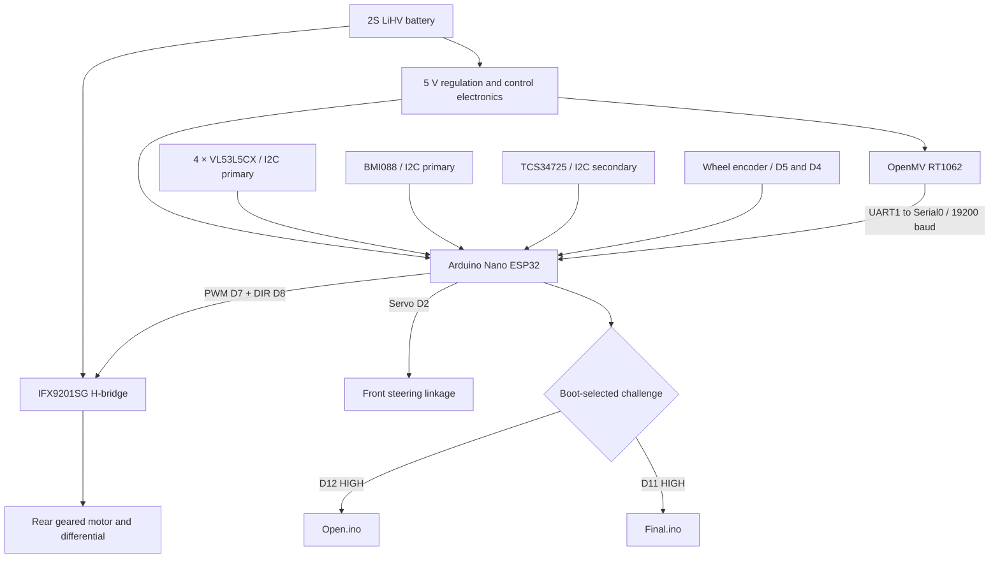
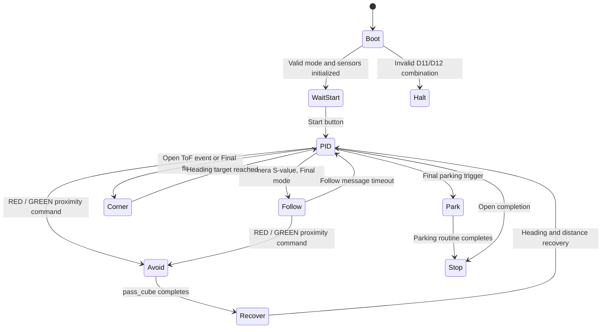
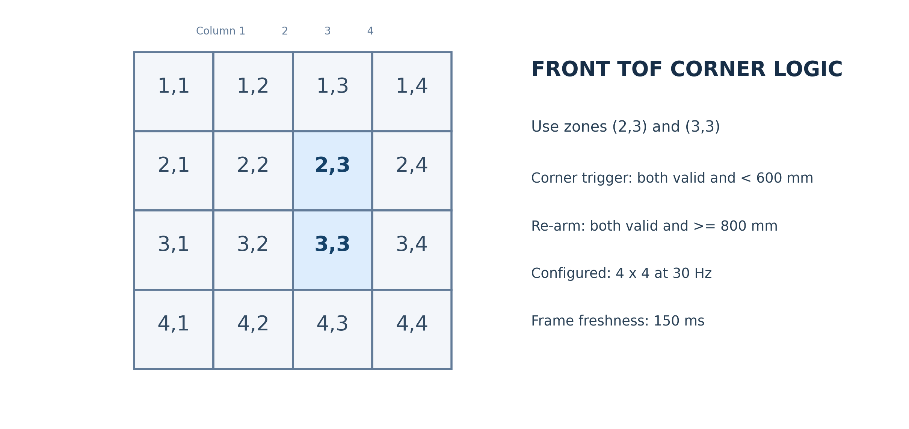
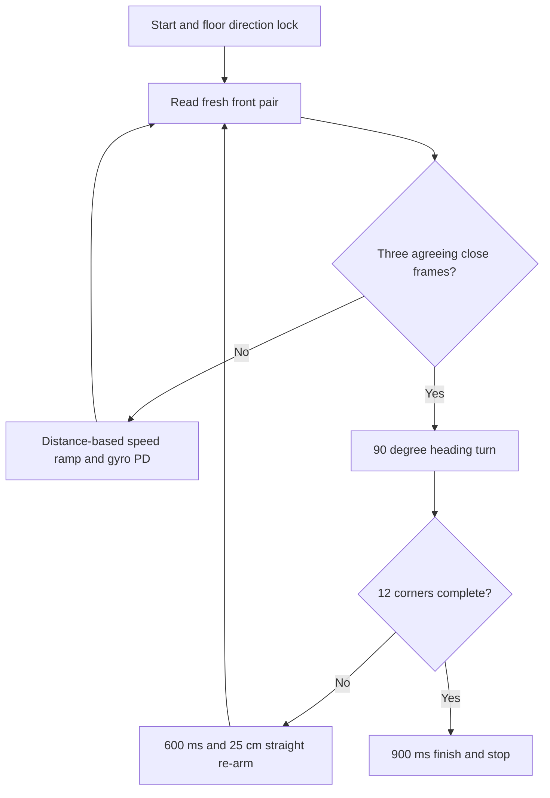
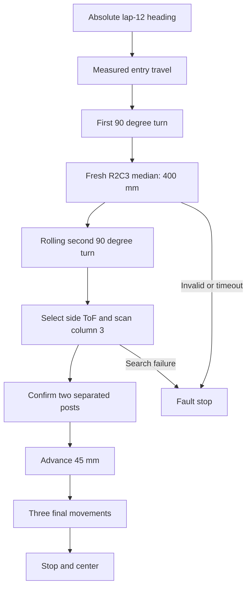
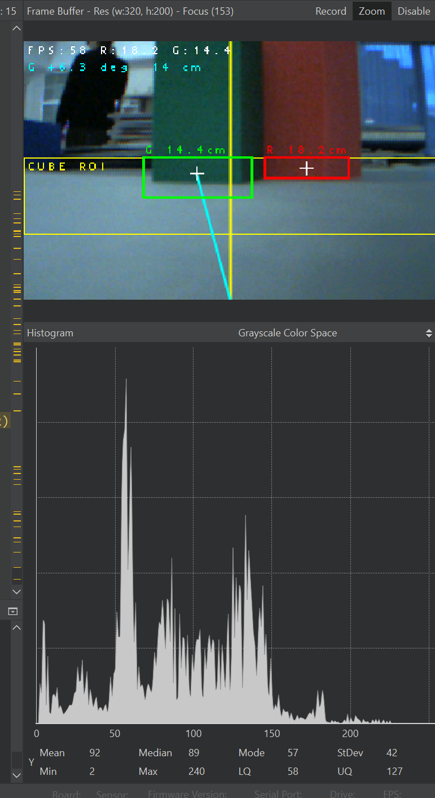

# 04. Software architecture and autonomous navigation

HyperLine Robotics | WRO 2026 Future Engineers | World Final rolling-parking controller and bundled camera source

| Chapter | Topic |
|---|---|
| [01 · Overview](01-overview.md) | Team, robot, challenges, evidence and results |
| [02 · Mobility](02-mobility.md) | Chassis, drivetrain, steering, tires and geometry |
| [03 · Power and sensors](03-power-sensors.md) | Electrical system, PCB, camera, IMU and validation |
| [04 · Software](04-software.md) | Control, perception, state machines and challenge strategy |
| [05 · Systems](05-systems.md) | Engineering trade-offs, iterations, performance and risk |
| [06 · Reproducibility](06-reproducibility.md) | Assembly, firmware, costs and test procedures |

---

Our software has two main responsibilities: **continuous motion control** and **event-based navigation**. The Arduino Nano ESP32 reads the BMI088, the four VL53L5CX distance matrices, the TCS34725 floor sensor and the wheel encoder. It drives the rear motor through the IFX9201SG and steers the front wheels through the MG90S. The OpenMV RT1062 processes camera images independently and sends short UART commands for obstacle following and avoidance.

The earlier vehicle used a camera-driven corner/line interpretation and single-value PWM distance sensors. V4.1 replaces those ranging inputs with **four 4 × 4 VL53L5CX ToF matrices**. The **new Open Challenge code** obtains its turning direction from the floor-color sensor, triggers corners from two selected front ToF zones and uses gyro feedback to complete each 90° change of heading. The Obstacle Challenge retains its separate cube-following, avoidance, recovery and parking behavior, updated to read the ToF modules.

## 1. Source code and software revisions

### 1.1 Controller organization

The World Final Arduino sketch is split into tabs that compile together as one program. This arrangement separates the two challenge strategies without duplicating the low-level hardware drivers.

| File | Main responsibility |
|---|---|
| [`HLR_FE_World_Final.ino`](../src/HLR_FE_World_Final/HLR_FE_World_Final.ino) | Pin definitions, shared constants, robot states, mode selection, initialization and main dispatch |
| [`Open.ino`](../src/HLR_FE_World_Final/Open.ino) | First-marker direction lock, ToF corner events, Open-round heading control and finish |
| [`Final.ino`](../src/HLR_FE_World_Final/Final.ino) | Obstacle Challenge states, floor-marker events, parking exit and final parking |
| [`tof.ino`](../src/HLR_FE_World_Final/tof.ino) | Four VL53L5CX devices, unique I²C addresses, 4 × 4 frame acquisition, range filtering and front-corner logic |
| [`gyro.ino`](../src/HLR_FE_World_Final/gyro.ino) | BMI088 setup, stationary-rate calibration and integrated yaw |
| [`motors.ino`](../src/HLR_FE_World_Final/motors.ino) | IFX9201SG PWM/direction output, MG90S steering, encoder, movement and positioning routines |
| [`functions.ino`](../src/HLR_FE_World_Final/functions.ino) | TCS34725 I²C acquisition/classification, shared cube-avoidance movement and communication helpers |
| [`Telemetry.ino`](../src/HLR_FE_World_Final/Telemetry.ino) | Read-only dashboard, yaw history and parking/color CSV diagnostics |
| [`camera.py`](../src/camera.py) | OpenMV RT1062 red/green detection, object following, optional sign-height classification and UART messages |

The eight `.ino` files remain inside one `src/HLR_FE_World_Final/` directory. Arduino IDE compiles these tabs together. The OpenMV Python code is flashed separately to the camera; it is **not** executed on the Arduino.

### 1.2 Historical source and the recorded driving demonstration

The team identifies commit [`de34faf039a70443361197de540879f212e3de81`](https://github.com/andreipopescufilimon/WRO2026_Future_Engineers/commit/de34faf039a70443361197de540879f212e3de81) as the software used for the [published Open and Obstacle driving video](https://www.youtube.com/watch?v=bg92ulHXomw). Its Arduino entry point is the older [`src/HLR_FE/HLR_FE.ino`](https://github.com/andreipopescufilimon/WRO2026_Future_Engineers/blob/de34faf039a70443361197de540879f212e3de81/src/HLR_FE/HLR_FE.ino).

The later modular implementation under [`src/HLR_FE_World_Final/`](../src/HLR_FE_World_Final/) has a different architecture and new ToF-based Open navigation. The video documents the physical robot and the identified historical code; it should not be interpreted as a test of every change in the newer separated sketch. This chapter describes **the newer code as written**, using the bundled camera script, whose height-rule limitations are described below.

## 2. System architecture and execution flow

### 2.1 Sensor-to-actuator pipeline



The controller uses **I²C** for close-range sensing, **UART** for vision decisions, **interrupt counting** for wheel movement, **PWM/direction** for propulsion and **servo pulses** for steering. The architecture lets camera processing vary in execution time without requiring image processing inside the Arduino's motion-control functions.

### 2.2 Pin allocation and communication

| Subsystem | Nano ESP32 pin or interface | Firmware purpose |
|---|---|---|
| IFX9201SG PWM / direction | D7 / D8 | Signed drive command |
| MG90S steering | D2 | Servo angle |
| Encoder A / B | D5 / D4 | A rising-edge interrupt; B read for direction |
| Start button | D10 | Pre-run wait, `INPUT_PULLUP` |
| Final / Open selection | D11 / D12 | Read once at boot using 3.3 V logic |
| ToF front / left / right / rear LPn | A3 / A2 / A1 / A0 | Sequential enable and address assignment |
| TCS34725 SDA / SCL | A6 / A7 | Independent `TwoWire(1)` bus at 400 kHz |
| Four ToFs and BMI088 | Primary `Wire` bus | Shared I²C bus, configured at 400 kHz |
| RT1062 camera communication | D0 / D1 (`Serial0`) | 19,200 baud newline-delimited messages |
| USB diagnostics | `Serial` | 115,200 baud |
| Status LEDs | D6 / D3 and built-in LED | Start-up and diagnostic signaling |

The OpenMV camera uses `UART(1, 19200)`, with **P4 as TX and P5 as RX** in the documented RT1062 connection. Camera TX connects to Nano RX, with shared ground and 3.3 V signal levels. The primary ToF devices all start with the factory I²C address `0x29`; the floor-color sensor also uses `0x29` but runs on the separate bus, avoiding that address conflict.

### 2.3 Boot, mode selection and start sequence

A challenge is selected **before the board starts**:

| D11 | D12 | Behavior |
|---|---|---|
| HIGH | LOW | Obstacle / Final mode |
| LOW | HIGH | Open mode |
| LOW | LOW | Initialization stops; built-in LED blinks |
| HIGH | HIGH | Initialization stops; built-in LED blinks |

Both inputs are configured as `INPUT_PULLDOWN`. A valid selection calls exactly one of `open_configure()` or `final_configure()`. The sketch then initializes the servo and motor driver, encoder, both serial ports, BMI088, TCS34725 and ToF sensors. The BMI088 calibrates while stationary for **10 seconds**. The start button on D10 keeps the motor at zero until pressed. After the start delay, Final mode performs `final_exit_parking()` before entering normal navigation; Open mode enters `open_execute()`.

```cpp
// HLR_FE_World_Final.ino, simplified directly from the mode dispatch
bool finalSelected = digitalRead(MODE_FINAL_PIN) == HIGH;
bool openSelected  = digitalRead(MODE_OPEN_PIN) == HIGH;
if (finalSelected == openSelected) {
  // Invalid selection: halt initialization and blink LED.
  while (true) {
    digitalWrite(LED_BUILTIN, !digitalRead(LED_BUILTIN));
    delay(250);
  }
}
activeMode = finalSelected ? MODE_FINAL : MODE_OPEN;
if (activeMode == MODE_FINAL) final_configure();
else open_configure();

// The actual setup initializes hardware and waits for START_BTN here.
void loop() {
  if (activeMode == MODE_OPEN) open_execute();
  else if (activeMode == MODE_FINAL) final_execute();
}
```

The selection is **latched at startup**. Changing D11 or D12 while driving does not switch modes until the controller restarts. Historical code referred to `RUN_MODE`; V4.1 uses `RoundMode activeMode` and separate `execute` functions.

### 2.4 Robot states versus movement phases

The shared controller declares these states:

| `RobotState` | Behavior | Main input | Main effect |
|---|---|---|---|
| `PID` | Maintain the current gyro heading | BMI088 and challenge events | Steering PD and drive PWM |
| `FOLLOW_CUBE` | Track a visible obstacle | OpenMV `S...` steering message | Camera-directed steering; fall back after message timeout |
| `AVOID_CUBE` | Perform obstacle passing maneuver | `RED` or `GREEN` command | Turn and encoder-based clearance movement |
| `AFTER_CUBE` | Recover heading after the obstacle | BMI088 and encoder | Rejoin the planned course |
| `PARK` | Final positioning at the end of Obstacle mode | Final floor-marker count | Parking routine and stop |

`WAIT_START`, corner turning and finishing are **control phases**, not separate members of this enum. The actual code uses blocking movement functions for some maneuvers, alongside the normal `loop()` state dispatch. This distinction matters when tracing timing and message processing.



The diagram shows the intended high-level navigation sequence; `Corner`, `WaitStart`, `Recover` and `Stop` are descriptive phases, not additional C++ enum values.

## 3. Motion control and heading estimation

### 3.1 IFX9201SG drive output

The rear motor driver is controlled by two Nano pins. D7 is a **1 kHz, 8-bit PWM output**; D8 determines the sign of the commanded drive. The firmware's `move(int speed)` expects a signed motor command in approximately `-255...+255` and uses its magnitude for PWM duty.

```cpp
void motor_driver_setup() {
  pinMode(PWMA, OUTPUT);
  pinMode(DIRA, OUTPUT);
  ledcSetup(PWM_MOTOR_CHANNEL, PWM_MOTOR_FREQ, PWM_MOTOR_RESOLUTION);
  ledcAttachPin(PWMA, PWM_MOTOR_CHANNEL);
  move(0);
}

void move(int speed) {
  ledcWrite(PWM_MOTOR_CHANNEL, abs(speed));
  digitalWrite(DIRA, speed > 0 ? LOW : HIGH);
}
```

The nominal duty fraction is $D=|u|/255$. For example, a command of `250` requests approximately 98% duty and `80` requests approximately 31%. These are **electrical PWM commands**, not measured speed, motor-terminal voltage or current. As explained in [Chapter 03](03-power-sensors.md), the nominal 6 V drive motor is intentionally operated from the 2S LiHV supply, so winding temperature, mechanical load and overcurrent protection remain important.

The shared `stop_motor()` routine briefly requests reverse PWM (`-3` for 100 ms) before setting zero. In other places the software uses `move(0)` directly. Neither should be described as a guaranteed instantaneous physical stop.

The V4.1 assembly does **not** include a working impeller or ESC. The sketch retains some old `PWM_IMPELLER` definitions and a setup function for code compatibility, but `impeller_speed` is initialized to zero and this subsystem is not part of active propulsion or downforce.

### 3.2 Steering servo and normalized commands

The front MG90S servo uses the `ESP32Servo` interface. The current source defines:

| Reference | Command passed to `Servo.write()` |
|---|---:|
| `STEERING_LEFT` | 39 |
| `STEERING_CENTER` | 85 |
| `STEERING_RIGHT` | 131 |
| `STEERING_LEFT_PARK` | 40 |
| `STEERING_RIGHT_PARK` | 138 |

These values are **servo commands**, not measured steering angles at the wheels. The normalized control function clamps $s$ to $[-1,1]$ and maps it linearly from the left command to the right command:

$$
\theta_{\mathrm{servo}}=39+\frac{s+1}{2}(131-39)
$$

```cpp
void steering_servo_setup() {
  steeringServo.attach(STEERING_SERVO);
  delay(100);
  steeringServo.write(STEERING_CENTER);
  delay(300);
}

void steer(double steering_angle) {
  steering_angle = constrain(steering_angle, -1.0, 1.0);
  steering_angle = map_double(steering_angle, -1, 1,
                              STEERING_LEFT, STEERING_RIGHT);
  steeringServo.write(steering_angle);
}
```

There is a second `steer_parking()` mapping using the parking-specific limits. This preserves a wider steering command range for short parking arcs without changing the straight-driving calibration. The actual tire angle depends on the linkage dimensions documented in [Chapter 02](02-mobility.md).

### 3.3 Wheel encoder and controlled travel

The motor encoder is read by an interrupt on **D5, rising edge of channel A**, while D4 supplies direction information. This is a **single-edge A-channel counter**, even though the source also retains constants describing quadrature edges. The firmware converts the absolute count to distance using its calibrated value:

$$
 d_{\mathrm{mm}}=|N_{\mathrm{ticks}}|\times 1.831,
 \qquad d_{\mathrm{cm}}=\frac{d_{\mathrm{mm}}}{10}.
$$

```cpp
void IRAM_ATTR encoderISR() {
  if (digitalRead(ENCODER_B)) encoder_ticks++;
  else encoder_ticks--;
}

float read_cm() {
  noInterrupts();
  int32_t t = encoder_ticks;
  interrupts();
  return abs(t) * MM_PER_TICK / 10.0f;
}
```

The current firmware sets `MM_PER_TICK = 1.831f`. This is the **software calibration constant** and should be distinguished from a measurement of physical wheel travel. Both `move_cm()` and `move_cm_gyro()` reset encoder ticks at the beginning of a distance-limited movement. The latter combines that distance target with a gyro-held steering correction.

### 3.4 BMI088 startup calibration and gyro integration

The BMI088 provides the Z-axis angular rate used as the heading reference. On startup, the Arduino initializes it with a **±2000°/s gyroscope range**, a **400 Hz gyro output setting with 47 Hz bandwidth**, and an accelerometer configured to **±6 g at 200 Hz**. The robot remains stationary for ten seconds while `gyro_setup()` estimates the mean gyro offset:

$$
\hat b_z=\frac{1}{N}\sum_{k=1}^{N}\omega_{z,k}.
$$

Each subsequent reading is corrected and integrated:

$$
\omega_z^{\mathrm{corrected}}=\omega_z-\hat b_z,\qquad
\psi_k=\psi_{k-1}+\omega_z^{\mathrm{corrected}}\Delta t.
$$

The code obtains $\Delta t$ from microsecond timestamps and **does not integrate intervals longer than 50 ms** as if they were fresh gyroscope samples. `gz` is the measured integrated heading, and `current_angle_gyro` is the target heading used by navigation. `recalibrate_gyro_angle()` can reset the integrated heading against a known target.

### 3.5 PD heading correction and motion primitives

In the standard `PID` state the controller computes heading error

$$
 e_k=\psi_{\mathrm{target}}-\psi_{\mathrm{gyro}}
$$

and applies a discrete PD command:

$$
 u_k=K_P e_k+K_D(e_k-e_{k-1}).
$$

Although the source names some variables `pid_error`, the current straight-driving expression uses **proportional and difference terms**, with no active integral term (`ki = 0`). The error difference is not divided by elapsed time, so the tuned gains depend on how frequently the function runs.

| Motion primitive | Purpose | Main feedback |
|---|---|---|
| `move_until_angle()` | Steer until a gyro target is approached | BMI088 yaw |
| `move_until_angle_max()` | Strong steering while changing heading | BMI088 yaw |
| `move_until_angle_max_no_flush()` | Parking arc, including startup kick | BMI088 yaw |
| `move_cm()` | Drive a programmed distance with gyro correction | Encoder ticks and BMI088 |
| `move_cm_gyro()` | Move a distance while holding a specified heading | Encoder ticks and BMI088 |
| `move_to_distance()` | Approach a range target using the selected front/back ToF direction | Central ToF zones and BMI088 |
| `move_to_front_distance()` | Filtered approach with slow/correction region | Front ToF and BMI088 |
| `move_straight_until_distance()` | Stop or transition at a left/right wall-distance threshold | Side ToF and BMI088 |
| `move_gyro_until_side_detect_cycle()` | Detect side-wall present/absent/present transitions | Side ToF and BMI088 |

The movement functions are implemented in [`motors.ino`](../src/HLR_FE_World_Final/motors.ino). Some are **blocking loops** and some do not have an explicit timeout when a required distance never becomes valid. This is an implementation limitation, not an independently verified safety feature. For example, `move_to_distance()` searches forward at a low PWM when its ToF reading is invalid; an unplugged sensor is not equivalent to a valid clear path.

## 4. Sensor processing

### 4.1 Replacing PWM ranging with four VL53L5CX matrices

The older software used Pololu PWM distance outputs and converted pulse width into millimeters using `pulseIn()`. That logic is not the V4.1 ranging implementation. The new [`tof.ino`](../src/HLR_FE_World_Final/tof.ino) uses **I²C matrix frames**, and all movement routines consume distances through the same `readDistanceMM(DistanceDir)` interface. This reduces the number of changes needed in the obstacle and parking code when the sensor hardware changes.

| ToF unit | LPn pin | Assigned 7-bit address | Navigation use |
|---|---|---|---|
| Front | A3 | `0x30` | Open corners, wall approach and parking alignment |
| Left | A2 | `0x31` | Parking exit and side-wall distance |
| Right | A1 | `0x32` | Parking exit and side-wall distance |
| Rear | A0 | `0x33` | Rear-oriented distance queries |

At initialization the firmware drives all LPn pins low, then enables each board separately at its factory address `0x29`, assigns the new address and starts ranging. Each board is configured for **4 × 4 zones at 30 Hz**. The ToF bus uses 400 kHz I²C and shares that bus with the BMI088. The TCS34725 is connected to a separate controller I²C peripheral.

```cpp
// From tof.ino: assigned on each boot
ToFUnit tofUnits[4] = {
  { &tofFront, TOF_LPN_FRONT, 0x30, false, { 0 }, 0 },
  { &tofLeft,  TOF_LPN_LEFT,  0x31, false, { 0 }, 0 },
  { &tofRight, TOF_LPN_RIGHT, 0x32, false, { 0 }, 0 },
  { &tofBack,  TOF_LPN_BACK,  0x33, false, { 0 }, 0 }
};
```

### 4.2 Invalid measurements, age and common distance interface

A 4 × 4 frame is stored in row-major order. The firmware accepts zones with ST `target_status` values **5 or 9**, provided the reported distance is positive. All other zones are stored as zero. A zone query returns **`-1`** if the sensor is offline, its sample is older than **150 ms**, the indices are outside the 1...4 range or the zone has no accepted range.

For a generic direction query, `readDistanceMM()` chooses the **nearest valid zone in the central 2 × 2 region** (rows 2–3, columns 2–3):

$$
 d_{\mathrm{direction}}=\min\{d_{r,c}>0\mid r,c\in\{2,3\}\}.
$$

If there is no valid zone, the function returns `-1`. The actual optical orientation of row/column indices must agree with the physical sensor mounts, since a rotated or mirrored breakout changes which part of the scene a numbered cell represents.

<p align="center"></p>
<p align="center"><sub>Figure 4.1. Four-by-four distance cells used by the V4.1 ranging code. The two front-corner cells are row 2/column 3 and row 3/column 3.</sub></p>

```cpp
// Read a specific zone from a 4x4 VL53L5CX matrix.
// Rows and columns are numbered from 1 to 4.
int tof_zone_mm(DistanceDir dir, uint8_t row, uint8_t col) {
  if (row < 1 || row > 4 || col < 1 || col > 4) return -1;

  ToFUnit &u = tofUnits[(uint8_t)dir];

  // Reject offline sensors and frames older than 150 ms.
  if (!u.online || !u.lastFrameMs ||
      millis() - u.lastFrameMs > TOF_FRESH_MS) return -1;

  uint16_t v = u.mm[(row - 1) * 4 + (col - 1)];

  return v == 0 ? -1 : (int)v;
}

// Convert the 4x4 matrix into one distance measurement.
// Select the closest valid reading from the central 2x2 zones.
float readDistanceMM(DistanceDir dir) {
  tof_poll();

  int nearest = 32767;

  for (uint8_t row = 2; row <= 3; row++) {
    for (uint8_t col = 2; col <= 3; col++) {
      int d = tof_zone_mm(dir, row, col);

      if (d > 0 && d < nearest) nearest = d;
    }
  }

  return (nearest == 32767) ? -1.0f : (float)nearest;
}
```

The tof_zone_mm() function accesses an individual cell of the 4 × 4 distance matrix and rejects unavailable, invalid or outdated readings. The readDistanceMM() function provides a common distance interface for the navigation and parking algorithms by selecting the closest valid measurement from the central four zones. This allows the movement functions to use the new VL53L5CX sensors without depending on the older PWM-based distance measurement system.

### 4.3 Reading frequency by challenge mode

`tof_poll()` checks the device data-ready flag before obtaining a frame. In **Open mode**, it polls only the **front ToF** for the corner-control loop. The other three boards are still initialized, but they are not transferred continuously by this function while Open navigation is active. In **Final mode**, all four devices are considered. The 30 Hz device configuration corresponds to a nominal 33.3 ms per frame; it is not proof that the complete main loop runs at that frequency.

### 4.4 TCS34725 floor-color sensor

The TCS34725 is accessed through `TwoWire(1)` on **A6/A7**, with a 400 kHz clock. The software uses a fast RGBC integration setting (`TCS_ATIME_FAST = 0xFF`) and **16× gain**. Reads only proceed when the sensor STATUS register indicates fresh color data.

For classification, the raw channels are normalized by their RGB sum:

$$
 r_n=\frac{R}{R+G+B},\quad
 g_n=\frac{G}{R+G+B},\quad
 b_n=\frac{B}{R+G+B}.
$$

The implementation uses ratios scaled by 1000 instead of floating-point division for each threshold comparison. A clear-channel guard (`TCS_MIN_CLEAR = 10`) suppresses very dark readings. Supported classes are `WHITE`, `BLUE`, `ORANGE`, `RED`, `GREEN`, `UNKNOWN` and `NONE`.

**Blue** establishes a left-turn course (`turn_direction = -1`); **red or orange** establish a right-turn course (`turn_direction = +1`) during initial direction selection. In Final mode the first valid marker establishes direction, later markers are checked against that selected course, and white observations help re-arm marker detection. The source defines `TCS_MARKER_LOCK_MS = 10` and `TCS_REARM_WHITE_MS = 2`; Final mode also applies its own corner lockout.

## 5. Open Challenge: validated front-wall navigation

The floor sensor establishes the direction; the front ToF and integrated gyro govern subsequent corners. The camera is not required for the normal wall-triggered turn sequence.

| Parameter | Current source value |
|---|---|
| Corners | 12 |
| Initial / straight cruise / corner PWM | 80 / 250 / 80 |
| Heading gains | Kp 0.028, Ki 0, Kd 0.080 |
| Front cells | R2C3 and R3C3 |
| Corner confirmation | 3 fresh valid pairs, both below 700 mm, difference at most 220 mm |
| Re-arm | At least 600 ms and 25 cm of straight travel after corner |
| Speed ramp | 300 PWM/s acceleration; 1900 PWM/s braking |
| Braking band | 1000 to 700 mm, interpolated to PWM 80 |
| Finish | 900 ms at PWM 80, then stop |

A missing or inconsistent pair cannot authorize acceleration. The controller falls back to a cautious speed if its verified front distance is unavailable or older than 150 ms. The pre-turn advance is zero; the corner updates the heading by 90 degrees rather than executing an extra 10 cm approach.



Source: [Open.ino](../src/HLR_FE_World_Final/Open.ino). Older 600/800 mm illustrations and threshold datasets are historical, not current acceptance tests.

## 6. Obstacle Challenge: camera-aware navigation and rolling parking

### 6.1 Startup and exit

Final mode selects 13 turns, PWM 50 cruise, PWM 60 exit, Kp 0.038, Ki 0, Kd 0.070 and a 1500 ms marker interval. Side ToF frames are cached before Start, with no motor commands during the cache operation. The exit decision uses fresh confirmed readings, with a 350 ms age limit and a bounded 220 ms retry if the cache is inconclusive. An ambiguous decision stops the robot instead of guessing.

| Exit direction | Initial heading | Forward | Return heading | Reverse |
|---|---:|---:|---:|---:|
| Right | +100 degrees | 10 cm | 0 degrees | 25 cm |
| Left | -100 degrees | 10 cm | 0 degrees | 60 cm |

### 6.2 Cube navigation and recovery

The Final controller uses `FC_TURN_OUT`, `FC_DRIVE_OUT`, `FC_RECOVER_TURN` and `FC_RECOVER_FORWARD` rather than relying on the legacy blocking `pass_cube()` helper. UART follow commands supply steering; RED and GREEN select avoidance direction. The outward target is 50 degrees from the current yaw, followed by a 13 cm bypass. The recovery target is offset by 35 degrees from the nominal lane heading, followed by 19 cm of forward travel. Turning phases accept a 9-degree error. A confirmed second cube can take over during recovery; repeated close commands are filtered. Gyro loss, phase timeout (12 s), lack of yaw progress (2.7 s) or lack of encoder progress (2.5 s) stops the maneuver.

### 6.3 Post-cube dead reckoning

Encoder increments and the difference between measured yaw and nominal lane heading estimate lateral displacement:

`lateral_mm += abs(delta_ticks) * 0.858 * sin((yaw - lane_heading) * pi / 180)`

Positive displacement means left of the lane reference. The return controller requests the opposite yaw bias, limited to +/-12 degrees with a maximum change of 0.75 degrees per update. The estimate is not absolute localization: slip, encoder calibration and gyro drift affect accuracy. The post-cube return does not require side ToF measurements. It terminates after five settled updates (estimated lateral error below 25 mm, heading error below 2.5 degrees and bias below 2 degrees), or the 8 s / 1000 mm budget. Floor markers and confirmed new cubes retain priority. Ordinary corner centering uses side ToF instead.

### 6.4 Markers and the final turn

Floor-marker events update the lane heading and turn count. The controller distinguishes navigation corners from the parking entry and defers a marker when necessary during a cube maneuver. See `final_execute_command()` and `final_execute()` for exact arbitration.

### 6.5 Rolling parking with front and side ToF measurements

The parking sequence uses fixed absolute heading targets derived from the twelve navigation corners, not from the measured arrival yaw. Successful intermediate stages hand off while rolling; safety stops and reversal pauses remain possible.

| Stage | Direction -1 | Direction +1 |
|---|---|---|
| Entry target | -1080 degrees | +1080 degrees |
| Entry travel | 25 cm | 15 cm |
| First turn target | -990 degrees | +990 degrees |
| Front alignment | R2C3, 400 mm target, 8 mm tolerance | Same |
| Second turn target | -900 degrees | +900 degrees |
| Side post nominal encoder separation | 220 +/-145 mm | 255 +/-80 mm |
| Advance after second post | 45 mm | 45 mm |
| Final reverse entry arc | +80 degrees | -80 degrees |
| Final two targets relative to lane | +5, -5 degrees | -5, +5 degrees |

Parking entry, front alignment, turns and post search use PWM 35; the final three movements use PWM 32. Front alignment uses a rolling median of three fresh valid R2C3 readings, with bounded recovery for invalid data, overshoot or reversal. The second turn follows the verified target without a deliberate stationary settle. Both side sensors are assessed before choosing the post-search side; the selected 4x4 sensor attempts 60 Hz and falls back to 30 Hz if necessary. The detector observes column 3 (all four rows), validates two distinct close pulses using encoder travel and then advances 45 mm before the final reverse/reverse/forward sequence. Completion stops the motor and centers steering. The initial 150 ms settle and fault stops are intentional.



Source: [Final.ino](../src/HLR_FE_World_Final/Final.ino). Capture the real stage trace and side CSV after a run; the above values are configuration, not proof of parking accuracy.

## 7. Camera source audit: what the uploaded OpenMV RT1062 program actually implements

**Source of truth:** [`src/camera.py`](../src/camera.py). This chapter was checked against the program present in this repository snapshot. Unlike the earlier draft of this journal, we do not attribute features from an unprovided camera revision to this file. The accompanying [source-to-claim audit](validation/EVIDENCE_AUDIT.md) and [implementation gaps](validation/IMPLEMENTATION_GAPS.md) disclose the difference.

### 7.1 Current camera settings and runtime

| Item | Actual bundled configuration | Engineering consequence |
|---|---|---|
| Camera | OpenMV RT1062 using `sensor` API | This is the camera targeted by the included source; confirm the actual installed camera before flashing |
| Frame | RGB565 QVGA, 320×240 | Image-coordinate thresholds depend on this resolution |
| Orientation | `vflip(True)`, `hmirror(True)` | Ensures the expected camera coordinate convention |
| Exposure | Auto disabled, **16,000 microseconds** | Fixed exposure supports repeatable segmentation but needs venue calibration |
| Auto gain / AWB | Both disabled | White-balance / threshold behavior still depends on illumination |
| Colour thresholds | Multiple LAB red/green tuples, plus line/wall thresholds | See the literal tuples in `src/camera.py`; the thresholds are not universal calibration evidence |
| Obstacle ROI | Bottom 60% of image, starting at 40% height | Large signs can enter ROI at different distances |
| Follow gain | `kp_cube=0.4`, `kd_cube=2.4` | Frame-to-frame PD control on normalized horizontal image error |
| Near-object rule | `follow_threshold = 5000` blob-area units | **Area based**, not physical range or bottom-Y gating |
| UART | `UART(1, 19200, timeout_char=200)` | 19,200 baud newline-delimited output |

This configuration is an **implementation description**, not a measured detection-latency, accuracy or camera-frame-rate result.

### 7.2 Existing detection and control loop

The loop captures an image, segments red and green blobs in the cube ROI, and chooses the largest valid candidate by reported area. It also detects blue and orange line markers and black walls in separate ROIs. The selected obstacle's normalized image error is

\[
e_x=\frac{x_{\mathrm{blob}}-W/2}{W/2},\qquad
u=0.4e_x+2.4(e_x-e_{x,\mathrm{previous}}).
\]

If the detected blob area is less than **5000**, the camera transmits `S+0.123` or `S-0.123` followed by `\n` (the value is computed per frame). At or above 5000 it sends `RED\n` or `GREEN\n`, based on the detected colour. It also broadcasts a numeric direction message (`0`, `1`, or `2` plus newline) every frame after attempting blue/orange marker detection. This behavior follows the bundled source, and it is **not** the bottom-coordinate close rule described in the earlier draft.

| Output message | Current meaning | Where it goes |
|---|---|---|
| `S{:+.3f}\n` | Vision target follow request | Nano ESP32 serial command handler |
| `RED\n` / `GREEN\n` | Area threshold passed for a visible sign | Nano ESP32 avoidance command handler |
| `0\n` / `1\n` / `2\n` | Camera's detected line direction state | Broadcast each camera iteration; relevant handler must be tested against both round modes |

The source has no image-to-millimeter conversion. `follow_threshold` is not a measured distance.

### 7.3 Surprise Rule readiness and unresolved software mismatch

The **2026 sign-height variant** requires distinguishing 50, 100 and 150 mm tall signs. The previously drafted algorithm described ratio thresholds, height tracking, top clipping and an inverted red/green action for 50 and 150 mm signs. **Those routines are not in the primary `src/camera.py`**. A [recovered v11 alternative](../src/camera_candidates/rt1062_surprise_rule_v11.py) implements them and passes [23/23 pure-function tests](validation/v11_camera_candidate_unit_tests.csv), but it has not been verified as flashed firmware. Specifically `SURPRISE_RULE`, `classify_cube_height()`, `get_cube_height()`, `get_passing_color()`, and `CLOSE_BOTTOM_Y` are absent. Therefore, this specific uploaded camera revision **cannot be claimed to implement or physically validate height-dependent passing**.

The deterministic ratio tables in [`docs/validation/v41_camera_height_logic_cases.csv`](validation/v41_camera_height_logic_cases.csv) are **unintegrated conceptual examples**, not results of running the uploaded camera code. The historical unit-test CSV is archived as superseded evidence. Before presenting Surprise Rule tests as implemented results, a different complete and tested camera revision must be added with its source hash, compatible UART protocol, calibration frames and physical trials. This is a functional gap, not a documentation formatting gap.

### 7.4 How to capture real vision evidence

1. Record OpenMV firmware version, `camera.py` source SHA-256, image orientation, exposure, gain and LAB threshold values.
2. Film 50, 100 and 150 mm reference signs, in both colours, at multiple measured distances and in at least two lighting conditions. Label whether each sign is fully inside the frame or top-clipped.
3. Record the exact UART line received by the Nano, any missed detections, elapsed processing time and the decision actually executed.
4. Enter each actual result into [`camera_trials.csv`](validation/physical/camera_trials.csv) and [`sign_height_trials.csv`](validation/physical/sign_height_trials.csv). Report correct, wrong-colour and missed outcomes separately.
5. Repeat using the **same committed release that produced the recorded driving demonstration**. A screenshot of one successful frame is not an accuracy study.



*Camera diagnostic frame from the repository; evidence of one displayed observation, not a sign-height validation dataset.*

## 8. Failure cases, recovery and software limits

Different sensor faults have different effects. The table below distinguishes an implemented software response from conditions that still depend on the robot and testing environment.

| Condition | Implemented handling | Practical consequence or limitation |
|---|---|---|
| Both challenge-select pins HIGH, or both LOW | Boot stops in LED-blinking loop | Prevents accidental selection of two challenge modes |
| Several ToFs begin at factory `0x29` | LPn low at boot, then sequential enable/address assignment | Prevents normal I²C address collision when sensors initialize successfully |
| ToF range invalid or older than 150 ms | `tof_zone_mm()` returns `-1` | Open turn requires two recent valid readings; some parking routines continue searching or driving on invalid data |
| One front Open zone detects a close wall | Both zones required for a corner event | Reduces single-zone false corners, but a missing zone can also prevent the turn |
| Repeated observation of the same Open wall | 600 mm trigger / 800 mm clear-rearm hysteresis | Avoids repeatedly counting one wall while it remains close |
| Direction not yet determined | TCS first-marker polling; Open stops if a valid front-close condition is seen | Prevents using an arbitrary turning sign without a selected course |
| Cube momentarily disappears | `FOLLOW_CUBE_DEAD_TIME = 350` ms | Falls back to heading control; too many missed camera messages can interrupt following |
| Very close / top-cropped cube | No height-tracking or top-clip correction in the bundled camera script | Sign size may be ambiguous; the planned Surprise Rule must not be claimed as implemented |
| Color or lighting changes | Fixed 16,000 µs exposure, disabled automatic gain and AWB, LAB thresholds, ROI and blob filters | Must be checked against the competition environment; no universal lighting guarantee |
| Gyro update stalled longer than 50 ms | Reject stale interval during integration | Avoids integrating one old rate over a long blocking period, but cannot reconstruct missed rotation |
| Long blocked movement or failed range target | Some motion helpers contain no explicit timeout | A bad range or encoder input can prevent a routine from completing; verify these before full-speed runs |
| Legacy camera messages in Open mode | Open still contains color-command handling | Camera `RED/GREEN` can enter avoidance even though normal Open corners come from ToF |
| Fan/impeller legacy code | `impeller_speed` initialized to zero; physical fan removed | Not part of V4.1 traction, motor control or power budget |

### Source-to-behavior cross-check

A reproducible software description must identify whether a behavior comes from code, an intended algorithm or a physical demonstration. The following checks reflect the implementation described in this chapter and make it easier for a reviewer to inspect a specific claim.

| Control claim | Inspect in the repository | What the inspection establishes |
|---|---|---|
| Separate Open and Final configurations | `src/HLR_FE_World_Final/HLR_FE_World_Final.ino`, `Open.ino`, `Final.ino` in the current public repository | Challenge selection and controller logic; not a tested autonomous run |
| Open turns from paired front ToF readings | `Open.ino` and `tof.ino` | Freshness, confirmation and re-arm conditions for a wall event |
| Obstacle approach, bypass and recovery | `Final.ino`, `functions.ino` | The controller transitions and command handling; field reliability must be measured |
| Camera classifications received through serial | `src/camera.py` and controller UART parser | Actual supported messages of the checked source revision |
| Driver speed and encoder distance | `motors.ino`, `gyro.ino` | The implemented PWM/steering/heading calculations, with hardware-specific calibration still required |

**Version caution:** The archived code can be older than the current GitHub branch. If reproducing from an exported ZIP, confirm that the `src/HLR_FE_World_Final/` folder is present at the selected commit. If not, obtain the corresponding source from the [live GitHub repository](https://github.com/andreipopescufilimon/WRO2026_Future_Engineers/tree/main/src/HLR_FE_World_Final), rather than silently substituting the older `HLR_FE_Separated` sketch.

The original `src/camera.py` does not contain all experimental sign-height behavior described in later camera prototypes. The source audit in Section 7 records that gap. A pure-function test of a candidate camera file is not equivalent to the camera running correctly on the robot.

## 9. Calibration, parameters and field verification

The software depends on the mechanical setup described in [Chapter 02](02-mobility.md), electrical connections and calibration principles in [Chapter 03](03-power-sensors.md), and the reproduction sequence in [Chapter 06](06-reproducibility.md). The table gives the **actual source settings** used to reproduce the control logic, without claiming that every parameter has been independently measured on the latest hardware.

| Setting or check | Source value / method | Why it matters |
|---|---|---|
| Steering left/center/right | 30 / 85 / 140 servo commands | Center and travel limits depend on assembled linkage |
| Parking steering extremes | 30 / 140 | Wider steering mapping used in parking |
| Encoder | 0.858 mm per counted A-rising tick | Short distance and parking maneuvers |
| BMI088 initialization | 10 s stationary bias; ±2000°/s, 400 Hz gyro | Reduces initial heading offset |
| ToF addresses | Front `0x30`, left `0x31`, right `0x32`, rear `0x33` | Four independent devices on one bus |
| ToF resolution / target rate | 4 × 4 / 30 Hz | Spatial ranging and corner timing |
| ToF data freshness | 150 ms | Rejects stale zone data |
| Open turn / rearm | 3 agreeing pairs below 700 mm / 600 ms and 25 cm | Counts a wall once and arms next one |
| Open initial / cruise / corner PWM | 80 / 250 / 80 | Speed profile used by `Open.ino` |
| Open heading gains | `kp=0.028`, `kd=0.080` | Gyro straight-driving correction |
| Final heading gains | `kp=0.038`, `kd=0.070` | Obstacle-mode heading correction |
| Parking drive / final arcs | PWM 35 / 32 | Distinct maneuver speeds |
| Camera format | QVGA RGB565, both flips on | ROI geometry and color processing |
| Camera UART | 19,200 baud, `UART(1)` | Matches Nano `Serial0` |
| Camera close threshold | Blob area `>= 5000` in `src/camera.py` | Vision proximity event; **not** a calibrated distance |
| Camera sign-height rule | **Not implemented** in the bundled `src/camera.py` | The proposed 50/100/150 mm mapping is documented but must be integrated and verified before claiming it |

A practical integrated check begins with motor and steering direction while wheels are lifted, followed by gyro startup and known-angle turns, each ToF address and its intended field of view, floor-marker detection, camera UART reception, short encoder movements and finally complete Open/Obstacle runs on a matching field. The individual test sketches and build instructions are linked in [Chapter 06](06-reproducibility.md). Real measurements and outcome records, where available, are separate from the source configurations above.


## World Final read-only telemetry

The current World Final sketch includes [`Telemetry.ino`](../src/HLR_FE_World_Final/Telemetry.ino), initialized only for `MODE_FINAL`. The ESP32 hosts its own local access point and five HTTP GET endpoints: `/` serves the dashboard, `/api` returns current JSON fields, and `/history` returns the recorded yaw history when the motor is stopped; `/parking-log.csv` exports side-post measurements and `/color-log.csv` exports floor-color samples. There are no remote actuation or configuration endpoints. The controller retains autonomous decision authority.

| Signal group | Meaning |
|---|---|
| Yaw, target, error | Integrated gyro heading, current controller target and target minus actual heading (degrees) |
| Rate and bias | Angular rate and stationary gyro drift estimate (degrees/s) |
| Acceleration, roll, pitch | BMI088 acceleration in m/s² and tilt estimates in degrees |
| PWM, encoder, turns | Motor command, encoder tick counter and course turn count; PWM is not a measured speed |
| State, cube phase, parking stage | State-machine progress and maneuver phase |
| Camera command, age, steering | Last decoded command, elapsed time and steering value; not raw camera video |
| ToF | Selected front and side cells, not the full four matrices |
| Event and fault | Most recent reported event and fault/stop reason |

The ring buffer holds 480 samples at a nominal 100 ms interval (approximately 48 seconds); actual timing depends on the controller loop. Browser polling waits 350 ms after each response. HTTP handling is throttled to 80 ms while moving or 55 ms while stationary. Large history downloads are suppressed while driving to reduce disruption of gyro integration. Data are volatile, not persistent run logs. A live dashboard does not establish that Wi-Fi has no impact on control timing; compare repeatable runs with and without a connected client.

**Implementation limitation:** front left/right aggregate readings are updated only by the special stopped diagnostic branch. That branch currently checks `STOP AT FRONT 270`, whereas `Final.ino` emits `STOP AT FRONT TARGET` only in a disabled diagnostic branch. Consequently these aggregate fields may remain unavailable in the uploaded revision. Capture only what the actual firmware reports, and resolve/test the mismatch separately if those fields are required. The competition logic is unchanged; this discrepancy is retained and disclosed.

See [reproduction and screenshot procedure](06-reproducibility.md#connect-to-the-world-final-telemetry-dashboard) and [matrix evidence](03-power-sensors.md#world-final-tof-matrix-evidence).

### Exporting parking evidence

After the motor stops, download `/parking-log.csv` (up to 512 samples) and `/color-log.csv` (up to 400 samples). The parking CSV records time, travel, side, four column-3 distances, near mask, phase, wall count and four raw ST target-status codes. These are bounded volatile buffers. Save the original downloads before rebooting. Suggested evidence paths: `docs/docs-media/world-final/parking-side-log.csv` and `docs/docs-media/world-final/color-log.csv`.
