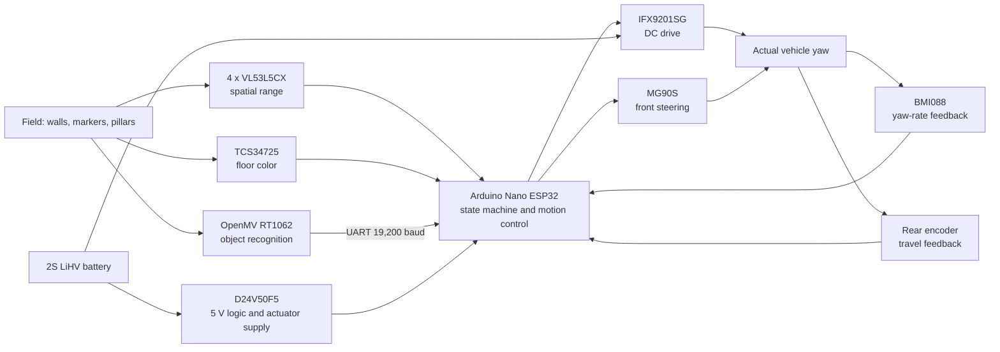
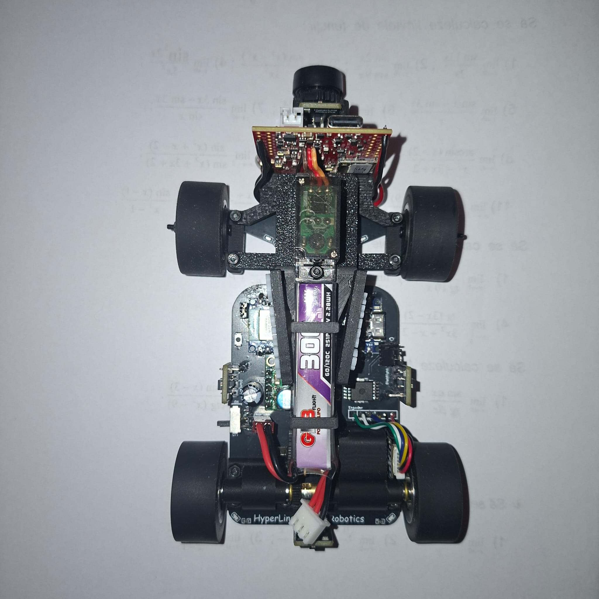
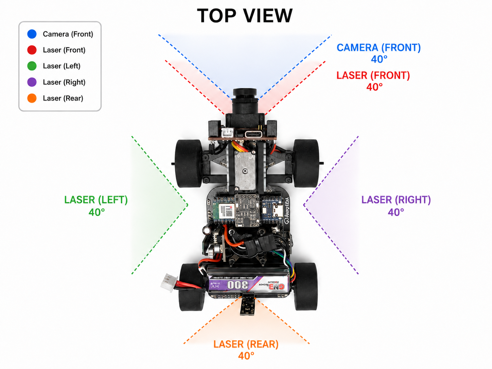
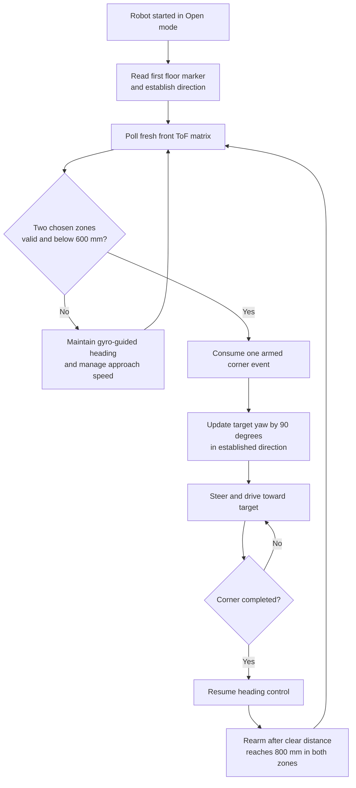

# 05 | Systems thinking, engineering decisions and testing

| Chapter | Topic |
|---|---|
| [01 · Overview](01-overview.md) | Team, robot, challenges, evidence and results |
| [02 · Mobility](02-mobility.md) | Chassis, drivetrain, steering, tires and geometry |
| [03 · Power and sensors](03-power-sensors.md) | Electrical system, PCB, camera, IMU and validation |
| [04 · Software](04-software.md) | Control, perception, state machines and challenge strategy |
| [05 · Systems](05-systems.md) | Engineering trade-offs, iterations, performance and risk |
| [06 · Reproducibility](06-reproducibility.md) | Assembly, firmware, costs and test procedures |

---

## 1. Our engineering approach

Our robot is not a collection of independent mechanisms. It is a compact system in which the mechanical drivetrain, battery, sensors and control software affect one another. An increase in speed reduces the time available for distance sensing and steering. A different gear ratio changes both the acceleration available for a corner and the motor's electrical loading. Moving a sensor may improve its view of a wall while increasing its exposure to wheel occlusion or vibration.

We retained the PCB-based, front-steered, rear-driven car architecture from our national V4 robot and developed V4.1 around the limitations we wanted to address: **more spatial information at corners, greater low-speed drive authority, compact sensor integration and clearer separation of Open and Obstacle Challenge logic**. The central question for each change was not simply whether the new component was better, but whether it made the *complete vehicle* more capable without introducing an unacceptable new failure mode.

The assembled electronics and vehicle can be inspected in the [robot photographs](../v-photos/), [mechanical CAD](../3D-models/) and [PCB manufacturing files](../electrical-schematics/). Our [assembly video](https://youtu.be/HSzWATB6nWQ) shows the physical construction, while the [driving demonstration](https://www.youtube.com/watch?v=bg92ulHXomw) documents autonomous Open and Obstacle Challenge operation. The team identifies Git commit [`de34faf`](https://github.com/andreipopescufilimon/WRO2026_Future_Engineers/commit/de34faf039a70443361197de540879f212e3de81) as the controller source used during filming; the newer modular V4.1 source is discussed separately in Section 8.

### 1.1 What the complete vehicle must achieve

| System objective | Why it is difficult | V4.1 engineering response | Relevant evidence |
|---|---|---|---|
| Navigate three laps in either direction | Wall positions, approach geometry and accumulated heading error change the corner conditions | Front multi-zone ranging, direction recognition, gyro-referenced steering and turn counting | [Open-mode firmware](../src/HLR_FE_Separated/Open.ino), [ToF code](../src/HLR_FE_Separated/tof.ino) |
| Respect red and green obstacles | Image recognition, vehicle clearance and recovery must agree | RT1062 color segmentation, UART commands, steering states and distance-aware movement | [Camera source](../src/camera.py), [Final-mode firmware](../src/HLR_FE_Separated/Final.ino) |
| Start, stop and park predictably | The motor must provide low-speed control, and short movements accumulate odometry and yaw error | 50:1 geared rear drive, encoder, mechanical differential, low-speed states and ToF feedback | [Mobility](02-mobility.md), [motor routines](../src/HLR_FE_Separated/motors.ino) |
| Operate under constrained electrical power | Motor and steering transients share a small 2S battery with sensing electronics | Direct motor supply, regulated logic branch, distributed grounds and dedicated driver | [Power distribution](03-power-sensors.md#3-power-architecture-and-calculations) |
| Fit a compact competition vehicle | Steering, tires, camera and range sensors need clear motion and viewing paths | Structural PCB, custom sensor boards, localized mounts and parallel front steering | [CAD](../3D-models/), [sensor placement](docs-media/v41-sensor-placement-reference.png) |

### 1.2 System-level architecture

*Figure 5.1. Control, perception, actuation and main power paths. The detailed supply connections of individual 3.3 V sensor circuits are documented from their PCB implementations in [Chapter 03](03-power-sensors.md), rather than inferred from this functional diagram.*

The main controller owns the decisions. The camera reports what it sees; the ToFs report where walls are; the BMI088 measures angular motion; the encoder estimates traveled distance. None of these alone determines the car's complete state. The controller combines the information into steering, propulsion and mode transitions, and the mechanical vehicle supplies the real-world feedback.

Figure 5.2. Physical system integration and sensor-viewing geometry. These are references to the assembled hardware, not an idealized sensor-only design.

---

## 2. Constraints that drove our decisions

The 2026 WRO challenges impose a narrow operating envelope: three laps, changing wall or obstacle positions, both travel directions, and parking after the Obstacle Challenge. The car must work without external control during a run. Our design also has constraints that come from the components themselves.

| Constraint | Engineering consequence | Choice and accepted compromise |
|---|---|---|
| **Limited chassis space** | Camera, servo linkage, rear axle, battery and four ToF units compete for space and mounting rigidity | The main PCB serves as chassis and interconnect; custom ToF/IMU boards are more compact but increase PCB revision effort |
| **Finite sensing and processing time** | A wall can approach while the controller waits for fresh data and reacts | Open-mode ranging transfers only the front matrix; target ranging is 30 Hz and frames older than 150 ms are rejected |
| **Motor torque versus maximum speed** | Short parking moves need drive authority, while long straights reward speed | Changed the nominal motor reduction from 30:1 to 50:1, trading theoretical output rpm for torque multiplication |
| **Motor voltage versus thermal risk** | The 6 V rated drive motor sees the 2S LiHV pack through the H-bridge | We intentionally overvolt the motor for short maneuvers; this gains speed potential but increases current and heating risk |
| **Steering accuracy versus linkage complexity** | Ackermann geometry would require more specialized geometry and adjustment | One servo operates a compact parallel linkage; we accept tire scrub and tune its actual left/right response |
| **Camera computation versus deterministic motion** | Image capture and blob detection have variable duration | RT1062 performs image work; Nano ESP32 retains control of motor and steering through short UART commands |
| **I²C address collisions** | All four ToFs begin at the same address | Individual LPn lines permit sequential initialization and unique `0x30` to `0x33` addresses |
| **Changing field direction** | A fixed clockwise or counterclockwise maneuver would fail the alternate configuration | The first floor marker establishes direction, which then controls the sign of heading targets |
| **Electrical noise and supply sag** | Drive and servo transients can disturb low-voltage sensing | Use the 5 V regulator, shared reference ground, separated functional power paths and local PCB integration |

We treat speed as a **system-level** property. Increasing PWM alone does not guarantee a quicker completed run if the robot then turns late, slips, misclassifies a pillar, or needs a corrective maneuver.

### 2.1 A practical sensing-to-steering timing budget

The V4.1 ToF driver requests a 4 × 4 frame rate of **30 Hz**, giving a nominal frame interval of:

$$
T_{\mathrm{frame}}=\frac{1}{30}\approx33.3\ \mathrm{ms}.
$$

The code rejects data older than **150 ms**. That is a *freshness boundary*, not a measured end-to-end reaction time. At a hypothetical speed of $0.8\ \mathrm{m/s}$, the car travels **120 mm in 150 ms**, before including braking distance or mechanical response:

$$
d_{\mathrm{reaction}}=v\tau,\qquad d_{\mathrm{stop}}\gtrsim v\tau+\frac{v^2}{2a_b}.
$$

Here $a_b$ is the actual achievable braking deceleration and $\tau$ includes the complete perception, processing and actuation delay. This explains our combined approach: slow the motor when the wall enters a wider range window, then initiate the turn through a separate and more restrictive corner condition. The numerical travel-distance example is a sensitivity calculation, not a measured V4.1 stopping distance.

---

## 3. Engineering decisions and rejected alternatives

### D01. Retaining the structural PCB chassis

**Alternatives considered:** a separate mechanical base with electronic modules mounted above it, or the existing structural PCB concept.

**Our choice:** retain the PCB as the mechanical reference and electrical distribution platform. This preserves a low, compact arrangement and makes the controller, H-bridge, sensor connectors and mounts part of one documented assembly. The [main-board copper views](03-power-sensors.md#23-electrical-schematic-pcb-traces-and-assembled-board), [production files](../electrical-schematics/Main%20PCB/production-files/) and [assembled photograph](docs-media/v41-assembled-robot-top.png) show how the decision was implemented.

**What we accepted:** high-current copper routing is close to sensing electronics, board flex can stress solder joints, and a connector change can require remanufacturing the board. This is why mechanical support, motor-current return paths and connector placement are treated as system risks, not merely PCB layout details.

### D02. One geared motor with a rear differential and front steering

**Alternative:** independently powered left and right rear wheels for differential steering.

**Our choice:** a single geared motor drives the rear axle through a mechanical differential, while one MG90S servo moves the two front wheels through a parallel linkage. This gives car-like steering without using independent rear-wheel speeds to turn. It also matches the WRO vehicle-drive architecture requirements described in the [official rules](https://wro.hr/wp-content/uploads/2026/01/WRO-2026-Future-Engineers-Self-Driving-Cars-General-Rules.pdf).

The differential lets the inside and outside rear wheels rotate at different speeds through a corner. The parallel steering linkage is deliberately simpler than ideal Ackermann geometry. As a result, its inner and outer wheels are not commanded to the theoretically optimal different angles; tire slip and steering asymmetry remain real limitations. [Chapter 02](02-mobility.md#4-parallel-steering-mechanism) develops the geometry in detail.

### D03. Replacing the 30:1 drivetrain with a 50:1 motor

**Original limitation:** the national V4 configuration prioritized motor output speed. Starts, corner exits and short parking movements place different demands on the drivetrain than full-speed straight running.

**Our choice:** the V4.1 design uses a **50:1 Pololu HPCB gearmotor** rather than the earlier **30:1** version. With an otherwise identical motor core and gearbox efficiency, the internal reduction alone changes the ideal output characteristics by:

$$
\frac{T_{50:1}}{T_{30:1}}\approx\frac{50}{30}=1.67,
\qquad
\frac{\omega_{50:1}}{\omega_{30:1}}\approx\frac{30}{50}=0.60.
$$

That is approximately **67% more ideal torque multiplication**, for **40% less ideal output speed** at equal motor rpm. Real differences also depend on motor winding, external gears, loading and losses. The observed engineering outcome is the **hardware revision itself**, documented by the BOM, CAD and assembled drivetrain; we do not present the ideal ratio as a measured acceleration improvement.

**System cost:** greater available wheel torque can increase loads on gears and mounts. A blocked wheel remains electrically hazardous, especially with our intentionally overvolted motor, so mechanical force and winding temperature must be considered alongside the torque benefit.

### D04. Deliberately operating the 6 V motor above its nominal voltage

The 50:1 drive motor is nominally rated **6 V**. Our 2S LiHV battery is **7.6 V nominal** and can reach **8.7 V fully charged**. The IFX9201SG motor-power input uses the battery path, not a separate regulated 6 V motor supply. We chose this operating arrangement to increase potential motor speed and response during short competition maneuvers.

The drive firmware uses 1 kHz, 8-bit PWM. The Open Cruise request is **250/255 = 98.04%**, so it is close to continuous battery exposure when the motor is driven. PWM changes the applied duty cycle; it is **not** a current limiter or proof of a safe winding temperature. H-bridge overtemperature and overcurrent protection protect the driver under their specified conditions and do not guarantee protection of the 6 V motor. The consequence of this choice is a smaller thermal and electrical margin, especially when the drivetrain is stalled or loaded. [Chapter 03](03-power-sensors.md#intentional-motor-overvoltage) describes that risk and the power-path details.

### D05. Replacing one-dimensional distance decisions with spatial ToF information

**V4 approach:** single-value PWM distance sensing. A scalar measurement can report that something is near without revealing which part of a wall or corner produced the return.

**V4.1 choice:** four VL53L5CX modules, each configured for a **4 × 4 spatial matrix**. The devices share the main I²C bus with the BMI088; individual LPn pins isolate the sensors during startup and assign different addresses. In the Open mode, the firmware limits normal matrix transfer to the front sensor to reduce bus work.

The key design decision is *not* simply to install a higher-resolution sensor. It is to make corner detection depend on **two specific front zones**, row 2/column 3 and row 3/column 3, rather than one unqualified range number. Both must be valid and **below 600 mm** to register a new corner. The detector rearms after both have returned to **at least 800 mm**, giving **200 mm of spatial hysteresis**. A missing or stale measurement is invalid rather than treated as a nearby wall.

| Case from the current logic | System response | Why the distinction matters |
|---|---|---|
| Both selected zones below 600 mm, event armed | Corner request created | Agreement between two regions reduces dependence on a single return |
| Only one zone below 600 mm | No new corner request | Prevents one isolated close zone from immediately causing a 90° maneuver |
| One selected zone invalid or stale | No new corner request | Avoids treating missing information as a confirmed wall |
| Either valid zone below 800 mm during normal approach | Reduce normal PWM to 40% | Creates more response margin as the wall approaches |
| Both selected zones at least 800 mm | Rearm the event | Prevents a continuing wall from being counted repeatedly |

This table is derived from [`tof.ino`](../src/HLR_FE_Separated/tof.ino). It documents the *implemented control behavior*; physical false-trigger rates and range accuracy depend on the installed optical orientation, reflectivity and actual frame delivery.

### D06. Gyroscope-referenced turning instead of fixed turn timing

A timed steering command assumes that the same motor, tire and battery conditions always create the same yaw change. That is difficult to maintain as battery voltage, friction and loading vary.

We use a custom **BMI088** board, estimate stationary gyro bias at startup and integrate corrected yaw rate. A turn is expressed as a heading target rather than only as a duration. This makes turn completion depend on the observed rotation, although the gyro remains vulnerable to bias drift, vibration and long blocked sensor-read intervals.

The software intentionally discards unusually long gyro integration intervals rather than assuming the previous angular rate remained valid indefinitely. The limitation is that motion during such a gap cannot be reconstructed from gyro samples that were never acquired. The steering linkage's actual geometry and the drivetrain's response still determine whether the commanded heading can be achieved without excessive overshoot.

### D07. Separating vision from real-time vehicle control

**Alternative:** perform vision processing and steering control on one processor, or use one general camera output as the only field sensor.

**Our choice:** the **OpenMV RT1062** performs image capture and color-blob processing. The **Nano ESP32** controls the state machine, motor, servo, ToF sensors and gyroscope. The camera sends small messages over **19,200-baud UART**. The TCS34725 independently detects colored floor markers on a separate I²C bus.

The separation lets us use region-of-interest filtering and pixel operations without placing those operations inside the main motion loop. It also introduces possible failures: incorrect camera exposure, false color classification, UART message loss or mismatched control states. The published [RT1062 detection screenshot](docs-media/v41-openmv-RT1062-camera-view.png) shows actual red/green blob segmentation, while [`camera.py`](../src/camera.py) documents the filtering and serial protocol.

An observed camera-development problem was a greenish image and unstable color appearance when starting while facing a nearby wall. The camera script addresses exposure and white-balance dependence by disabling automatic gain, white balance and exposure, then using explicit settings. This is a traceable **response to a reported integration symptom**, not a claim of a measured detection accuracy under every lighting condition.

### D08. Keeping Open and Obstacle control independent

The two challenges have different information priorities. Open-mode cornering relies on front ToF events after direction detection; Obstacle mode additionally uses colored pillars, floor markers, approach/avoid/recovery states and parking. Sharing every decision branch would make tuning one challenge more likely to disturb the other.

The current V4.1 source therefore separates [`Open.ino`](../src/HLR_FE_Separated/Open.ino) and [`Final.ino`](../src/HLR_FE_Separated/Final.ino), while retaining shared low-level motor, IMU, ToF and floor-color functions. At startup, **D11 HIGH** selects Final and **D12 HIGH** selects Open. When both selections are equal, the startup code remains in a non-driving indication loop rather than choosing a mode arbitrarily.

The compromise is that common functions and shared parameters still affect both challenges. Separating source files is an architectural improvement in maintainability, not by itself proof of a higher lap-completion rate.

### D09. Removing the powered downforce system

The earlier robot concept used a fan/ESC system. The V4.1 hardware **does not install it**. Removing that system reduces packaging complexity, wiring, moving parts and battery demand. We instead rely on silicone tire contact and the mechanical load distribution of the chassis, including revised steel wheel rims.

Heavier rims do not automatically increase the coefficient of friction, and removing the fan does not prove unchanged cornering grip. The trade-off is reduced complexity at the potential expense of available downforce. The distinction between the old and current mechanical configurations is documented in the [overview](01-overview.md#national-version-compared-with-the-current-version) and [mobility chapter](02-mobility.md).

---

## 4. Development iterations: problem, decision, outcome

Our V4-to-V4.1 changes began with limitations in the previous design rather than with a requirement to replace every component. The table below separates **physical observations and published artifacts** from theoretical effects. This is important because showing that we installed a component does not, by itself, establish that it improved every performance metric.

| Development problem or observation | Change made | Observable result or evidence | Engineering conclusion |
|---|---|---|---|
| A single distance value did not provide spatial context around a wall edge | Four VL53L5CX matrix boards and two-zone front-corner logic | Current code selects exact matrix zones, checks validity and uses 600/800 mm hysteresis; custom boards and their manufacturing files are published | A corner decision can now be conditioned on *where* the wall is seen, rather than only one scalar distance |
| V4's 30:1 ratio favored theoretical output speed | V4.1 changed to a 50:1 drive motor | Current drivetrain specification and assembly identify the revised ratio | Ideal torque multiplication increases, with reduced nominal output speed; a numerical dynamic gain is not inferred |
| Short distance movements accumulated odometry error during tuning | Encoder travel factor and wheel-distance assumptions were investigated | In a team-reported bench check on **8 November 2026**, a 200 mm requested move produced about **185 mm** of travel | The approximately **15 mm shortfall (7.5%)** showed that a nominal conversion alone was insufficient; it is a calibration observation, not a claimed final error bound |
| Camera color appearance changed when starting close to a wall | Manual camera image settings and dedicated RT1062 processing | The camera script disables automatic gain, exposure and white balance; a real detection screenshot is available | Camera initialization and lighting must be treated as part of the perception system, not left to an uncontrolled startup state |
| Open and Obstacle control shared decision logic and tuning variables | Distinct Open and Final execution modules with common hardware services | The current source contains separate modules and explicit D11/D12 mode selection | Challenge-specific changes can be organized separately; shared utilities remain integration dependencies |
| Additional fan, ESC, connectors and power demand increased system complexity | Omitted the powered downforce assembly in V4.1 | Current V4.1 hardware inventory and assembly records exclude fan/ESC | Removing an actuator eliminates its electrical and failure contributions; no unmeasured traction gain is claimed |

The **200 mm to 185 mm** observation is useful precisely because it exposed a problem rather than demonstrating a perfect result. A wheel encoder reports rotation, not true displacement. Effective tire diameter, pulse interpretation, external gearing and wheel slip all influence the distance conversion:

$$
d_{\mathrm{estimated}}=N_{\mathrm{ticks}}\,k_{\mathrm{mm/tick}}.
$$

Changing the numerical coefficient without confirming the actual tick source can conceal the problem. Chapter 02 explains the drivetrain and geometry; the [motor firmware](../src/HLR_FE_Separated/motors.ino) shows how ticks are used for short moves.

### 4.1 An iteration can improve one subsystem and worsen another

The V4.1 sensor change is an example. A 4 × 4 matrix provides richer geometry than a single scalar sensor, but four modules require sequential I²C address initialization, additional transfers and more failure states. The engineering response includes *both* the new hardware and the changes that make its data usable: one-at-a-time address configuration, valid status checks, frame timestamps, front-only Open polling and two-zone event logic.

Similarly, a 50:1 motor can make low-speed drive authority easier to achieve while creating a higher mechanical load at stall. On a 2S LiHV pack that intentionally overvolts a 6 V motor, increasing speed and torque cannot be treated independently of electrical heating.

---

## 5. Integrated behavior on the field

### 5.1 Open Challenge: a corner is a multi-system event

A correct turn depends on several conditions being true in sequence:

*Figure 5.3. Simplified current Open Challenge control sequence, derived from the separated `Open.ino` and `tof.ino` firmware. The diagram shows decision ownership rather than reproducing every helper call.*

The 600 mm trigger only works if the sensor is correctly mounted, its zones refer to the intended field region, the reading is recent, the motor has slowed sufficiently and the steering system has clearance. The same software threshold may become too late when the car is faster or the sensor mounting angle changes. That is why the **sensor geometry, reaction distance and motor speed must be treated together**.

### 5.2 Obstacle Challenge: perception is only the first step

A red or green pillar must be correctly classified, but successful avoidance also requires choosing the correct passing side, steering around the object, recovering the lane or heading, and continuing the round. The RT1062 sends compact commands; the Nano executes the avoidance and recovery routines, combining camera information with its own heading and distance state. The Obstacle Challenge additionally uses the floor-color sensor and final parking maneuver.

The main system risk is **a mismatch between a valid camera detection and the vehicle's physical position**. A color label arriving after the robot has moved closer can be too late even if the classification is correct. Low-speed approach, sensible regions of interest, state transitions and repeatable steering behavior are therefore more important than claiming a high camera frame rate in isolation.

### 5.3 Parking: one maneuver depends on three error sources

A short parking movement depends on distance feedback, yaw and the physical steering/drivetrain response. The encoder may accumulate displacement error, the gyro may accumulate heading error, and the parallel steering linkage has different tire scrub and clearance characteristics from an ideal bicycle model.

The parking routines therefore use **low motor commands, distance primitives and gyro-based steering**, while side and rear ToF measurements provide geometric context. A robot can stop after the correct *number of encoder ticks* and still be incorrectly parked if it slipped or approached at the wrong angle. That is the reason for considering parking as a full-vehicle pose problem rather than an isolated encoder problem.

---

## 6. Risk and failure-mode analysis

We prioritize failures by their effect on completing a round. The priorities below express engineering consequence and exposure, not invented statistical failure probabilities.

| System risk | Consequence for the robot | Detection or relevant code behavior | Mitigation / remaining physical limit | Priority |
|---|---|---|---|---|
| **6 V motor on a fully charged 8.7 V pack** | High motor current, winding heating, possible drivetrain or driver damage | PWM command and IFX9201SG fault behavior; motor temperature/current require physical assessment | Avoid stalled operation; consider duty and load; driver protections do **not** substitute for motor thermal qualification | **High** |
| **Stale or invalid front ToF matrix** | Delayed or missing Open corner; incorrect wall interpretation | Rejects zones with invalid status and frames older than 150 ms | Correct mounting and optical clearance; confirm delivered update rate at driving speed | **High** |
| **False repeated corner event** | Too many 90-degree turns, loss of course | Two-zone requirement and 600/800 mm arming hysteresis | Correct zone orientation, test wall angles and reflectivity | **High** |
| **Gyro startup movement or bias drift** | Incorrect heading, turn overshoot or failure to face the next straight | Startup stationary bias calibration; integrates corrected Z rate | Keep robot still during calibration; allow for temperature and missed intervals | **High** |
| **Incorrect encoder conversion or wheel slip** | Short moves and parking distances differ from commands | Tick-based movement routines; reported 200 mm vs 185 mm tuning result | Calibrate the physical travel scale and distinguish wheel rotation from ground displacement | **High** |
| **Camera starts with a nearby wall in view** | Color shift or inconsistent red/green detection | Manual exposure, white balance and gain configuration in camera code | Recheck thresholds in actual lighting; avoid assuming one captured frame proves reliability | **High** |
| **UART command missed or stale** | Avoidance starts late or is not triggered | Message framing at 19,200 baud and state-machine dispatch | Keep a common signal ground, review blocking operations and message timing | **High** |
| **Battery or 5 V rail sag** | MCU or camera reset, servo jitter, lost sensor updates | Regulated 5 V branch and supply architecture | Check rail behavior during simultaneous steering, driving and vision | **High** |
| **Parallel steering scrub / asymmetry** | Different left and right trajectories; poor parking alignment | Servo calibration and physical steering geometry | Validate actual wheel angles, tire clearance and mechanical joints | Medium |
| **Wrong mode-selection inputs** | Starts an unintended strategy or drives without a valid configuration | Equal D11/D12 states are rejected at startup | Verify 3.3 V logic and challenge selection before the run | Medium |
| **Long blocking movement routine** | Late sensor response or inability to recover if a target is unreachable | Source contains movement helpers that wait for heading or distance conditions | Bound operations and use a recoverable stop policy where suitable; do not equate blocking code with a hardware watchdog | **High** |

### 6.1 Why failure analysis changed the design

Several mitigations are already present in the architecture rather than being afterthoughts. Unique ToF addresses prevent devices responding to the same default I²C address. Invalid-zone filtering avoids interpreting missing range data as a real wall. Spatial rearming prevents a corner from being counted repeatedly. Gyro bias estimation reduces the initial static offset, and invalid mode combinations do not activate a drive mode.

Other risks are intrinsic to our trade-offs. Overvolting the motor, using a parallel linkage, and depending on vision under changing light all have physical limits that source code alone cannot remove. Recording these limitations is part of the justification for the design, not evidence that the robot failed to operate.

---

## 7. Evidence, metrics and what each result establishes

We separate **observed physical behavior**, **published implementation** and **engineering calculations**. This prevents a calculated gear ratio or a simulated threshold input from being presented as a measured performance result.

| Evidence | Directly demonstrates | Scope of the conclusion |
|---|---|---|
| [Open and Obstacle driving video](https://www.youtube.com/watch?v=bg92ulHXomw) | The physical vehicle performs the recorded autonomous maneuvers | Team identifies the historical filmed software as [`de34faf`](https://github.com/andreipopescufilimon/WRO2026_Future_Engineers/commit/de34faf039a70443361197de540879f212e3de81); it does not independently demonstrate the later modular sketch |
| [Assembly video](https://youtu.be/HSzWATB6nWQ) and [robot photos](../v-photos/) | Hardware was physically assembled, including drivetrain and electronics | Does not measure current, acceleration or reliability |
| [Main PCB and sensor manufacturing files](../electrical-schematics/) | Design and reproducibility of fabricated boards | Physical test data depends on the assembled revision |
| [V4.1 motor and steering CAD](../3D-models/) | Geometry, mounting concept and mechanical relationships | Ideal geometry needs physical calibration for tire contact and steering angles |
| [Current V4.1 firmware](../src/HLR_FE_Separated/) | D11/D12 mode selection, Open/Final modules, ToF addresses, guards and movement routines | Demonstrates implementation, not the exact controller binary used in the earlier video |
| [OpenMV RT1062 frame](docs-media/v41-openmv-RT1062-camera-view.png) | One real camera frame with color-detection output | Does not establish detection accuracy across repeated lighting conditions |
| **200 mm commanded, about 185 mm observed** in a team-reported calibration check | A real-world odometry discrepancy that informed tuning | One development observation, not a full repeated calibration curve |
| **30:1 to 50:1 calculation** | Theoretical gear-ratio trade-off | Not a measured speed or torque result |

### 7.1 Performance metrics with engineering meaning

| Metric | What it helps us decide | Main dependencies |
|---|---|---|
| Completed laps and total valid run time | Whether added speed actually improves the mission outcome | Corner detection, steering, traction, state transitions |
| Wrong-side obstacle count | Whether detection and avoidance work together | Color classification, camera timing, geometry and recovery |
| False / missed corner events | Whether front matrix logic is reliable | Zone orientation, target material, data age and thresholds |
| Heading error after a turn | Whether gyro feedback and steering geometry agree | Gyro bias, loop timing, tire slip and steering response |
| Distance error over fixed travel | Whether encoder conversion predicts physical motion | Wheel circumference, tick scaling, slip and backlash |
| Minimum loaded 5 V voltage | Whether electronics remain powered through motor/servo transients | Battery, regulator, wiring and simultaneous loads |
| Motor current and winding temperature | Whether intentional overvoltage is acceptable for a run | Battery charge, load, commanded PWM and duty history |

A valid completed run is the strongest overall functional demonstration. Subsystem observations explain **why** a run succeeded or failed. For example, a late corner could come from stale ToF data, a turn triggered at an unsuitable approach speed, excessive turning radius or delayed steering. Reporting only the final time would hide those different engineering causes.

---

## 8. Development history and reproducible source context

The engineering process spans multiple revisions. V4 was the national competition configuration; V4.1 retains its broad layout while changing the motor reduction, range-sensing architecture, wheel construction and software organization. The version distinction also matters when using videos as evidence.

| Revision | Source or project reference | What it represents |
|---|---|---|
| **V4 national configuration** | [Historical V4 checkpoint](https://github.com/andreipopescufilimon/WRO2026_Future_Engineers/commit/7e1b0b5b707511563fd0250af08e68c7288d2966) | Earlier mechanical and electrical implementation used as the V4 comparison |
| **Firmware associated with filmed driving** | [Commit `de34faf039a70443361197de540879f212e3de81`](https://github.com/andreipopescufilimon/WRO2026_Future_Engineers/commit/de34faf039a70443361197de540879f212e3de81) | Team-identified revision used for the recorded physical driving; main sketch [`src/HLR_FE/HLR_FE.ino`](https://github.com/andreipopescufilimon/WRO2026_Future_Engineers/blob/de34faf039a70443361197de540879f212e3de81/src/HLR_FE/HLR_FE.ino) |
| **Later modular V4.1 implementation** | [Commit `045c57e7388c08f9281642a864de0ba3b099c0df`](https://github.com/andreipopescufilimon/WRO2026_Future_Engineers/commit/045c57e7388c08f9281642a864de0ba3b099c0df), [source directory](../src/HLR_FE_Separated/) | Separate Open and Final modes, multi-zone ToF processing and current controller architecture |

The filming snapshot and later modular sketch are different implementations. We use the filmed revision to identify the source behind the real-world video, and the later directory to document the present architecture. This keeps the evidence traceable without asserting that a later software change had already been filmed.

### 8.1 What we learned from the complete system

The largest changes were not independent upgrades. More detailed distance sensing only became useful after we selected specific zones, filtered invalid readings and defined rearm behavior. Higher motor reduction only makes sense when considered alongside intentional overvoltage, tire grip and short-distance maneuvers. A separate vision processor only helps when its messages are interpreted by a stable state machine with consistent steering response. Removing the fan simplifies the electrical system, but shifts greater importance onto passive traction and chassis geometry.
