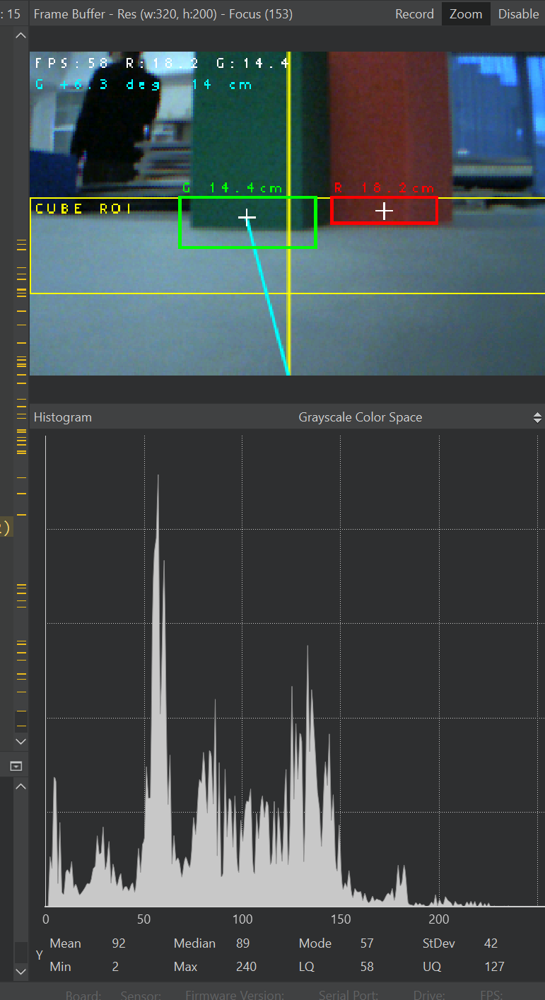

# 06. Reproducibility

| WRO documentation criterion | Where it is covered | Evidence |
| --- | --- | --- |
| Fully reproducible vehicle | [Parts and manufacturing](#parts-and-manufacturing), [Building and flashing](#building-and-flashing) | Components, CAD, PCB production files, assembly demonstration and setup procedures |
| Clear project structure | [Repository structure](#repository-structure) | Separate mechanical, electronic, software, test and documentation directories |
| CAD, code and wiring | [Repository structure](#repository-structure), [Parts and manufacturing](#parts-and-manufacturing) | STEP models, electrical files, Arduino source and OpenMV source |
| Documented testing workflow | [Testing workflow](#testing-workflow) | Isolated tests, live diagnostics, expected behavior and full-field validation |
| Meaningful development history | [Versions and development history](#versions-and-development-history) | V4 and V4.1 differences, older CAD, project-wide Git history and revision matching |

Our [GitHub history](https://github.com/andreipopescufilimon/WRO2026_Future_Engineers/commits/main/) covers the **full WRO 2026 repository**, including software, CAD, electrical design and documentation updates, rather than a V4.1-only series of commits. The project has undergone many iterations throughout the season. Old mechanical revisions are kept in [`3D-models/old-3D-models/`](../3D-models/old-3D-models/) so the evolution of the design can be inspected without mistaking previous components for current ones.
---

## Repository structure

All paths in this chapter are relative to the repository root. The six engineering journal chapters are stored in `docs/`.

| Path | Content |
| --- | --- |
| [`README.md`](../README.md) | Main entry point and project navigation |
| [`docs/`](.) | Six technical chapters |
| [`docs/docs-media/`](docs-media/) | Journal illustrations, camera view and dashboard screenshots |
| [`docs/technical-drawings/`](technical-drawings/) | Component and assembly dimensions |
| [`3D-models/`](../3D-models/) | Mechanical STEP models for the chassis assembly, drivetrain, steering, wheels and mounts |
| [`3D-models/old-3D-models/`](../3D-models/old-3D-models/) | Earlier designs preserved for comparison |
| [`electrical-schematics/`](../electrical-schematics/) | PCB schematics, board documentation and manufacturing outputs |
| [`electrical-schematics/Main PCB/production-files/`](../electrical-schematics/Main%20PCB/production-files/) | Main PCB production files |
| [`electrical-schematics/IMU/production-files/`](../electrical-schematics/IMU/production-files/) | IMU PCB production files |
| [`electrical-schematics/TOF sensors/production-files/`](../electrical-schematics/TOF%20sensors/production-files/) | ToF PCB production files |
| [`src/HLR_FE/`](../src/HLR_FE/) | Arduino Nano ESP32 program and its supporting `.ino` files |
| [`src/camera.py`](../src/camera.py) | Camera-side Python source; ensure the selected revision targets OpenMV RT1062 |
| [`src/libraries/`](../src/libraries/) | Project-supplied library copies, where included |
| [`src/tests/`](../src/tests/) | Motor, steering, IMU, straight-driving and communication tests |
| [`v-photos/`](../v-photos/) | Vehicle photographs from all sides |
| [`t-photos/`](../t-photos/) | Team photograph |
| [`video/`](../video/) | Driving and challenge recordings |
| [`other/`](../other/) | Additional development resources |

The Arduino sketch is divided into multiple tabs, which the Arduino IDE compiles together. Keep them in the same `HLR_FE` directory.

| File | Responsibility |
| --- | --- |
| [`HLR_FE.ino`](../src/HLR_FE/HLR_FE.ino) | Main initialization, vehicle states, configuration and autonomous operation |
| [`functions.ino`](../src/HLR_FE/functions.ino) | Movement sequences, distance handling and shared routines |
| [`gyro-code.ino`](../src/HLR_FE/gyro-code.ino) | IMU acquisition and heading calculations |
| [`motors-code.ino`](../src/HLR_FE/motors-code.ino) | Motor, encoder and steering control |

The separate programs in [`src/tests/`](../src/tests/) are intended for testing one function at a time. They are not replacements for the complete driving program.

## Parts and manufacturing

### Main components

The following table identifies the principal assemblies used by V4.1. Exact part variants, quantities and manufacturing details must agree with the [electrical schematics](../electrical-schematics/), [mechanical CAD](../3D-models/) and [power and sensor documentation](03-power-sensors.md). This is a subsystem-level list, not a claim that every screw and electronic component is listed here.

| Assembly | Component or source | Reproduction reference |
| --- | --- | --- |
| Main controller | Arduino Nano ESP32 | [Controller firmware](../src/HLR_FE/) |
| Vision | OpenMV RT1062 | [Camera script](../src/camera.py) |
| Main structure | Custom PCB chassis | [Main PCB manufacturing files](../electrical-schematics/Main%20PCB/production-files/) |
| Drive | Pololu 50:1 HPCB geared motor, V4.1 configuration | [Mechanical design](02-mobility.md) and motor mounting CAD |
| Rear axle | Geared drivetrain with mechanical differential | [3D models](../3D-models/) |
| Steering | Front steering servo, hubs and parallel linkage | [3D models](../3D-models/) |
| IMU | Custom board based on BMI088 | [IMU manufacturing files](../electrical-schematics/IMU/production-files/) |
| Distance sensing | Custom VL53L5CX ToF sensor boards | [ToF manufacturing files](../electrical-schematics/TOF%20sensors/production-files/) |
| Wheels | Silicone tyres and custom steel rims | [Wheel and mechanical CAD](../3D-models/) |
| Battery | 2S LiPo power system | [Power architecture](03-power-sensors.md) |
| Printed supports | Camera, sensor, steering and battery mounts | [3D models](../3D-models/) |

### Mechanical CAD and assembly reference

The STEP files in [`3D-models/`](../3D-models/) can be inspected in compatible CAD software to understand component geometry and how the assemblies fit together. The [technical drawings](technical-drawings/) provide dimensions, while the vehicle [photographs](../v-photos/) show the assembled orientation and cable routing.

The principal assembly reference is our recorded demonstration:

**[Watch the HyperLine Robotics assembly video](https://youtu.be/HSzWATB6nWQ).**

### PCB fabrication and electrical preparation

The electronics are organized into three manufacturing groups:

1. [Main PCB](../electrical-schematics/Main%20PCB/production-files/), which also serves as the structural chassis.
2. [IMU PCB](../electrical-schematics/IMU/production-files/) for inertial measurements.
3. [ToF sensor PCB](../electrical-schematics/TOF%20sensors/production-files/) for distance sensing.

Fabricate each board using the corresponding production package and populate it according to its schematic and board revision. The electronic files and [chapter 03](03-power-sensors.md) should be consulted together because board fabrication files do not, by themselves, describe every connection between separate modules.

Before applying battery power, inspect solder joints, power polarity, connector orientation and continuity. Check that there is no unintended short between supply rails and ground. Confirm the expected regulated voltages before connecting sensitive modules. Disconnect power before modifying wiring.

---

## Building and flashing

### 1. Obtain one matching project revision

Clone the project or use GitHub's ZIP download:

```bash
git clone https://github.com/andreipopescufilimon/WRO2026_Future_Engineers.git
cd WRO2026_Future_Engineers
```

The [GitHub commit history](https://github.com/andreipopescufilimon/WRO2026_Future_Engineers/commits/main/) records the development of the **whole repository**, not just the V4.1 robot. For a reproduction attempt, use CAD, firmware and PCB files from a **single compatible revision**. Avoid combining old V4 models with V4.1 electronic and software revisions unless the relevant changes have been checked.

To record the exact revision used on a reproduced build, run:

```bash
git rev-parse HEAD
```

Keep this commit identifier with your test results. If the repository contains a dedicated V4.1 tag or release, use its associated files. A tag is not required to clone the project, but a fixed revision makes later results easier to compare.

### 2. Assemble the mechanics

The [assembly video](https://youtu.be/HSzWATB6nWQ) gives the visual sequence. The following checks explain what must be confirmed at each stage:

1. **Main chassis:** Prepare the fabricated structural PCB and attach its mechanical supports using the corresponding [STEP models](../3D-models/) and [drawings](technical-drawings/) for positioning.
2. **Rear drivetrain:** Install the drive motor, its gear transmission and the differential. Rotate the rear axle by hand to confirm that gears mesh and there is no interference or excessive binding.
3. **Rear wheels:** Fit the wheel assemblies and verify that each wheel is secured, aligned and free to rotate as intended by the differential.
4. **Front steering:** Install the hubs and parallel linkage. Center the steering servo using the steering test before fixing the servo horn, then check both steering directions and both mechanical limits.
5. **Battery and supports:** Mount the battery securely so it cannot shift into the drivetrain or steering linkage. Check clearance against the CAD model.
6. **Vision and distance sensing:** Install the OpenMV RT1062 and ToF modules in their designated mounts. Check camera orientation, field of view and unobstructed sensor openings.
7. **Final inspection:** Route and secure cables clear of gears and steering parts. Confirm that all wheel and steering movements remain unobstructed before powering the vehicle.

The servo's calibrated neutral position, linkage geometry, wheelbase and other dimensions are described in [02. Mobility](02-mobility.md) and the [technical drawings](technical-drawings/). Mechanical alignment must be checked before software tuning because assembly errors can appear as control errors on the track.

### 3. Prepare the software environment

The Nano ESP32 and OpenMV RT1062 use different development environments.

| Device | Software | Source |
| --- | --- | --- |
| Arduino Nano ESP32 | [Arduino IDE 2](https://www.arduino.cc/en/software), with the appropriate Nano ESP32 board package | [`src/HLR_FE/`](../src/HLR_FE/) |
| OpenMV RT1062 | [OpenMV IDE](https://openmv.io/pages/download) and compatible camera firmware | [`src/camera.py`](../src/camera.py) |

The following table lists the software dependencies and library versions used to build the robot firmware.

| Dependency | Reproduction instruction | Library version |
| --- | --- | --- |
| Arduino ESP32 board package | Install a version compatible with Arduino Nano ESP32 and record its version | v2.0.18 |
| `ESP32Encoder` | Use the copy supplied with the project, if available, or the matching installed library | v5.0.0 |
| `ESP32Servo` | Use the copy supplied with the project, if available, or the matching installed library | v3.2.1 |
| `SoftwareSerial` | Verify the library supports the selected ESP32 core and matches the source | v2.0.1 |
| `BMI088.h` | Match the exact BMI088 implementation expected by the sketch | v1.0.1 |

### 4. Flash the Arduino Nano ESP32

The Arduino Nano ESP32 executes the vehicle control software. Its entry point is [`src/HLR_FE/HLR_FE.ino`](../src/HLR_FE/HLR_FE.ino).

1. Install Arduino IDE and the **Arduino Nano ESP32** board support package through **Boards Manager**.
2. Connect the controller using a **USB-C data cable**.
3. Open `src/HLR_FE/HLR_FE.ino`. Confirm that `functions.ino`, `gyro-code.ino` and `motors-code.ino` open as tabs in the same sketch.
4. Install the dependencies needed by the selected revision. Use the supplied library copies where appropriate and check for compilation conflicts.
5. Select **Tools → Board → Arduino Nano ESP32**, then choose the correct port in **Tools → Port**.
6. Inspect the source configuration for challenge mode, motor direction, steering limits, encoder parameters, IMU settings, camera communication and driving speeds. These settings must match the assembled hardware.
7. Select **Verify** and resolve compile errors before uploading.
8. Raise the driving wheels off the floor, select **Upload**, then restart the controller.
9. Open **Serial Monitor** at **115200 baud** for the documented sketch and check that startup completes without persistent errors.

### 5. Flash the OpenMV RT1062

The OpenMV RT1062 performs image capture and detection of coloured obstacles. The project camera source is [`src/camera.py`](../src/camera.py).

1. Install **OpenMV IDE** and connect the **OpenMV RT1062** through a USB data cable.
2. Connect to the camera in OpenMV IDE and complete any required camera firmware initialization.
3. Open the RT1062-compatible `camera.py`, select **Run**, and inspect the image in the IDE frame buffer.
4. Present red and green traffic signs within the field of view. Check the image orientation, region of interest, colour classification and detection overlays.
5. Verify the communication link to the Nano ESP32. Camera transmit must reach the appropriate controller receive connection; the controllers must share a common ground and use a matching baud rate and message format. Use the [Arduino/OpenMV communication test](../src/tests/arduino_openmv_serial_communication/) to check the connection independently of driving.
6. When the script runs correctly, use **Tools → Save open script to OpenMV Cam** so that it is saved as the camera's startup program. Restart the RT1062 without the IDE and verify that detection and communication resume.

Camera-to-controller pin assignments and the exact serial protocol are implementation-specific. They should be checked in the selected firmware and [chapter 04](04-software.md), rather than copied from an earlier OpenMV generation.



*Figure 6.1. OpenMV RT1062 frame buffer used to verify image orientation, detection thresholds and the active region of interest.*

---

## Running the vehicle

After programming both devices, disconnect programming cables as appropriate for the power setup, mount and secure the battery, and switch on the robot. Allow the Nano ESP32, IMU, ToF sensors and RT1062 to initialize. Check basic actuator direction and sensor operation before attempting an autonomous run.

### Connect to the local web interface

The V4.1 firmware includes a Wi-Fi access point and a browser-based interface for live measurements and configuration.

1. Power the robot using the Wi-Fi-enabled V4.1 firmware.
2. On a phone or computer, join the Wi-Fi network broadcast by the robot. The network name and credentials are configured in the controller firmware.
3. While connected to this network, open **[http://192.168.4.1](http://192.168.4.1)** in a browser.
4. Use the dashboard to inspect telemetry and change the available driving parameters. No external internet connection is required.

The dashboard allows us to inspect the internal state while testing. It is intended for setup and debugging, not as a substitute for checking what the physical vehicle is doing.

### Live distance sensor checks

The ToF telemetry is used to observe the distances reported by the installed sensors. Place a flat target in front of a sensor, move it to a few known distances and compare the reported measurements with a ruler. Check each sensor separately. If readings do not change, fluctuate unexpectedly or disagree strongly with the target position, inspect the sensor orientation, wiring, configuration and field of view before tuning driving behavior.

### IMU and heading checks

With the vehicle stationary, observe the IMU readings and look for unexpected offset or rapid drift. Rotate the robot manually in a known direction and check that the reported heading changes consistently with the physical rotation. Repeat in the opposite direction to detect an inverted sign or incorrect axis mapping.


*Figure 6.2. Live telemetry used to inspect IMU and sensor behavior before on-track testing.*

### Speed and configuration controls

The settings page provides runtime adjustments for the driving and maneuvering parameters exposed by the firmware. For controlled experiments, we start conservatively, keep the same track setup and change **one parameter at a time**. Each setting should be recorded with the test run so that a performance difference can be associated with a specific change.

<div align="center">
  
  
  
</div>

*Figures 6.3, 6.4 and 6.5. Configuration views for speed, steering and subsystem adjustments.*

---

## Testing workflow

We test the robot in three stages: individual subsystems, integrated stationary operation and full autonomous runs. This prevents a mechanical or electrical fault from being mistaken for a navigation problem.

### 1. Independent subsystem tests

The test code is organized under [`src/tests/`](../src/tests/). Each test isolates a part of the vehicle before it is used together with the other systems.

| Test | Source | What a successful check looks like |
| --- | --- | --- |
| Drive motor | [`motor_test`](../src/tests/motor_test/) | A forward command produces the intended wheel direction; there is no binding or unexpected restart |
| Steering | [`servo_steering`](../src/tests/servo_steering/) | Wheels return to neutral and move in both steering directions without hitting mechanical stops |
| IMU | [`gyro_test`](../src/tests/gyro_test/) | Readings respond to manual rotation with the correct sign and do not show an obvious stationary fault |
| Straight-line controller | [`move_straight_on_gyro`](../src/tests/move_straight_on_gyro/) | The correction acts against a heading deviation rather than increasing it |
| Camera communication | [`arduino_openmv_serial_communication`](../src/tests/arduino_openmv_serial_communication/) | Nano receives valid, correctly formatted messages from the RT1062 |
| ToF sensor checks | [Live web dashboard](#live-distance-sensor-checks) | Each installed sensor responds to a target moving through its field of view |
| Camera classification | [OpenMV frame buffer](#5-flash-the-openmv-RT1062) | Red and green objects in the configured ROI are identified consistently |

Use raised wheels for the first drive and steering tests. The table intentionally describes observable pass/fail behavior rather than unsupported numerical accuracy claims. Numerical tolerances and repeatability results should come from measured tests in [05. Systems and testing](05-systems.md).

### 2. Bench verification with telemetry

Once individual components pass, run the controller and camera together while the robot remains stationary. Use the [web interface](#connect-to-the-local-web-interface) to read ToF and IMU data, and the OpenMV IDE frame buffer to verify visual detection. Also check that the camera's serial messages reach the Nano ESP32 and that the robot initializes without unexpected motion.

A useful bench sequence is to rotate the robot by hand, move targets past the distance sensors and show red and green pillars to the camera. If the physical input changes but the reported state does not, investigate the relevant subsystem before changing the autonomous strategy.

### 3. Full-field verification

With subsystem checks completed, test the robot on a field matching the competition geometry. First use conservative speeds and a repeatable layout. Verify wall following, both travel directions, cornering and stable lap completion. Then test obstacle detection, correct passing side for red and green pillars, recovery and parallel parking as applicable to the selected challenge.

For meaningful comparisons, record the same field layout, battery condition, firmware revision and speed settings. Compare repeated attempts rather than selecting only the fastest result. The recordings are collected under [`video/`](../video/), while measured results and engineering decisions are discussed in [05. Systems and testing](05-systems.md).

### Final verification checklist

- [ ] Mechanical parts match the selected CAD revision and move freely.
- [ ] Battery polarity, regulated voltages and board connections have been checked.
- [ ] Arduino Nano ESP32 sketch compiles and starts correctly.
- [ ] RT1062 script runs independently after the camera is restarted.
- [ ] Camera-to-controller serial communication is working.
- [ ] Drive direction and steering neutral/limits are correct.
- [ ] IMU heading direction and ToF readings respond to known physical inputs.
- [ ] Robot Wi-Fi network appears and `http://192.168.4.1` loads the live dashboard.
- [ ] Driving settings and the project revision are recorded for the test.
- [ ] Autonomous behavior has been checked on the field in both challenge configurations.

---

## Versions and development history

| Version | Role | Main engineering differences |
| --- | --- | --- |
| **V4** | National competition robot | Earlier distance-sensing hardware, drive motor and lighter wheel rims |
| **V4.1** | Current development | Revised ToF sensing, higher-torque 50:1 drive motor and heavier steel wheel rims; fan and ESC removed |


### Version-specific GitHub commits

To make both versions of our robot reproducible, the following table identifies the GitHub revisions corresponding to each major hardware and software configuration. Each commit links to a snapshot of the repository at that stage of development.

| Robot version | GitHub commit | Description |
| --- | --- | --- |
| **V4** | [View V4 commit](https://github.com/andreipopescufilimon/WRO2026_Future_Engineers/commit/7e1b0b5b707511563fd0250af08e68c7288d2966) | National competition configuration, including the original drivetrain, distance sensors and wheel assemblies |
| **V4.1** | [View V4.1 commit](https://github.com/andreipopescufilimon/WRO2026_Future_Engineers/commit/fee1a8440b3251d7454f14fb1ae3a48e173f498c) | Updated configuration with VL53L5CX ToF sensors, a 50:1 geared motor, steel wheel rims and revised software |

These commits provide reference points for reproducing each robot version. CAD models, PCB files and software should be taken from the same corresponding revision to avoid compatibility issues.
