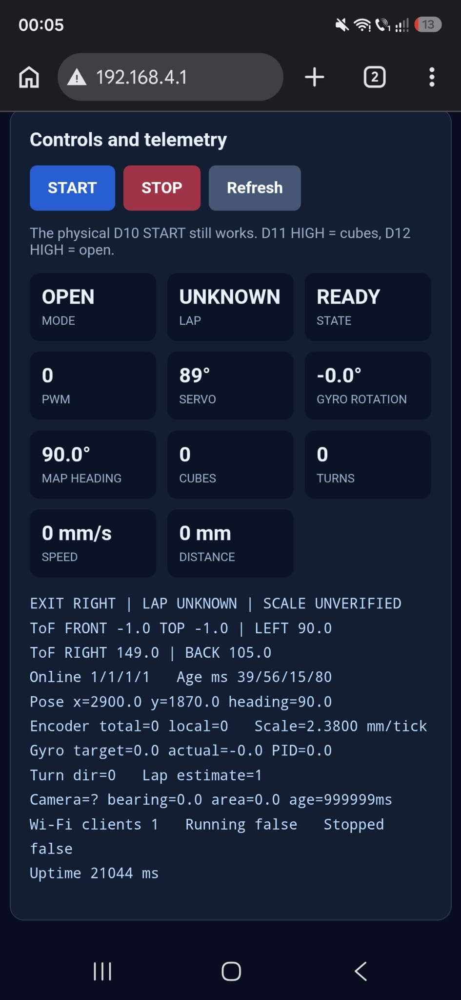
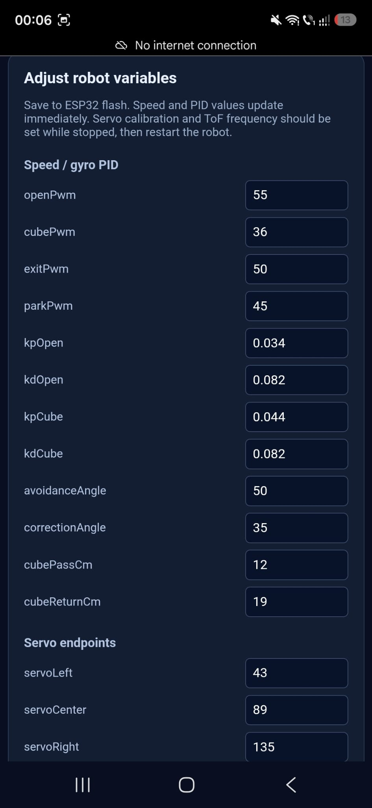
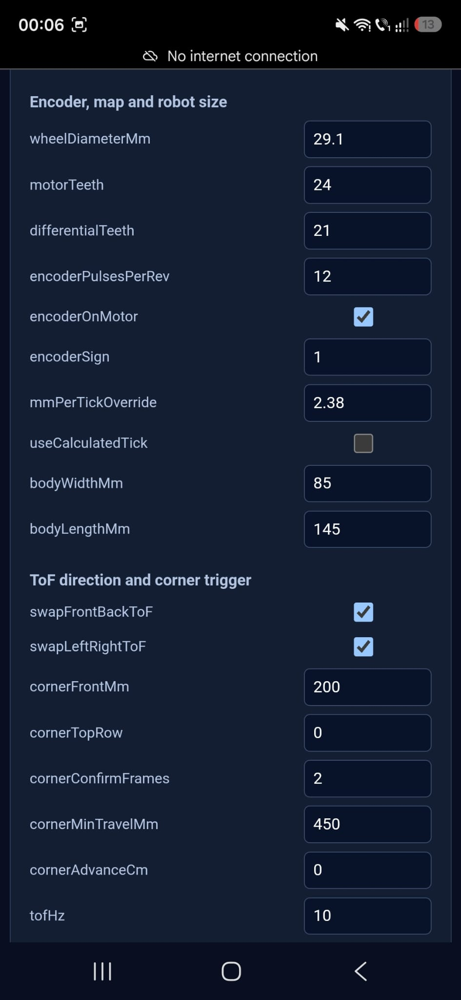
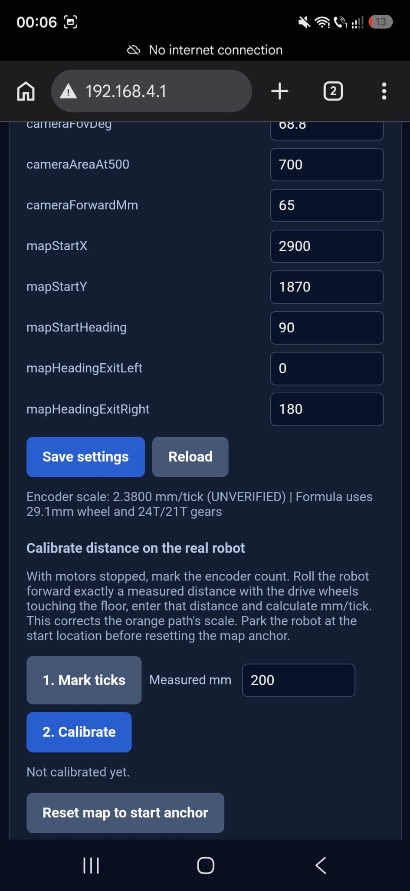

# 06. Reproducibility

| Chapter | Topic |
|---|---|
| [01 · Overview](01-overview.md) | Team, robot, challenges, evidence and results |
| [02 · Mobility](02-mobility.md) | Chassis, drivetrain, steering, tires and geometry |
| [03 · Power and sensors](03-power-sensors.md) | Electrical system, PCB, camera, IMU and validation |
| [04 · Software](04-software.md) | Control, perception, state machines and challenge strategy |
| [05 · Systems](05-systems.md) | Engineering trade-offs, iterations, performance and risk |
| [06 · Reproducibility](06-reproducibility.md) | Assembly, firmware, costs and test procedures |

---

| WRO documentation criterion | Where it is covered | Evidence |
| --- | --- | --- |
| Fully reproducible vehicle | [Parts and manufacturing](#parts-and-manufacturing), [Building and flashing](#building-and-flashing) | Components, CAD, PCB production files, assembly demonstration and setup procedures |
| Clear project structure | [Repository structure](#repository-structure) | Separate mechanical, electronic, software, test and documentation directories |
| CAD, code and wiring | [Repository structure](#repository-structure), [Parts and manufacturing](#parts-and-manufacturing) | STEP models, electrical files, Arduino source and OpenMV source |
| Documented testing workflow | [Testing workflow](#testing-workflow) | Isolated tests, live diagnostics, expected behavior and full-field validation |
| Meaningful development history | [Versions and development history](#versions-and-development-history) | V4 and V4.1 differences, older CAD, project-wide Git history and revision matching |

Our [GitHub history](https://github.com/andreipopescufilimon/WRO2026_Future_Engineers/commits/main/) covers the **full WRO 2026 repository**, including software, CAD, electrical design and documentation updates, rather than a V4.1-only series of commits. The project has undergone many iterations throughout the season. Old mechanical revisions are kept in [`3D-models/old-3D-models/`](../3D-models/old-3D-models/) so the evolution of the design can be inspected without mistaking previous components for current ones.

### Evidence from the assembled vehicle

Our documentation covers the physical vehicle, its custom PCB assemblies, the mechanical construction and autonomous-driving demonstrations. The photographs, assembly recording, source code and manufacturing files show the development of the robot from hardware design to operation on the field.

| Evidence | Recorded result | Reference |
| --- | --- | --- |
| Mechanical and electrical assembly | The built vehicle and its PCB, drivetrain, steering and sensor placement are documented in photographs and an assembly recording | [Assembly video](https://youtu.be/HSzWATB6nWQ) · [Vehicle photographs](../v-photos/) |
| Autonomous driving | Our published video documents the physical robot in both Open and Obstacle challenges; the team identifies the filming software as commit `de34faf` | [Driving video](https://www.youtube.com/watch?v=bg92ulHXomw) · [Filming firmware commit `de34faf`](https://github.com/andreipopescufilimon/WRO2026_Future_Engineers/commit/de34faf039a70443361197de540879f212e3de81) |
| Camera perception | An RT1062 frame captures red and green detections on the actual vision interface | [Captured camera view](docs-media/v41-openmv-RT1062-camera-view.png) |
| Electronic and mechanical release | The source repository includes STEP models, PCB manufacturing files, the Arduino V4.1 sketch and the RT1062 script | [Mechanical CAD](../3D-models/) · [PCB files](../electrical-schematics/) · [Controller source](../src/HLR_FE_Separated/) · [Camera source](../src/camera.py) |

**Firmware used during filming:** according to the team, the driving video was recorded with Git commit [`de34faf039a70443361197de540879f212e3de81`](https://github.com/andreipopescufilimon/WRO2026_Future_Engineers/commit/de34faf039a70443361197de540879f212e3de81). The associated Arduino program is [`src/HLR_FE/HLR_FE.ino`](https://github.com/andreipopescufilimon/WRO2026_Future_Engineers/blob/de34faf039a70443361197de540879f212e3de81/src/HLR_FE/HLR_FE.ino). The newer [`src/HLR_FE_Separated/`](../src/HLR_FE_Separated/) firmware is documented separately because its software architecture differs from the filmed version.

---

## Repository structure

Paths are shown from the repository root, while the Markdown links resolve from this chapter inside `docs/`. The six engineering journal chapters are stored in `docs/`.

| Path | Content |
| --- | --- |
| [`README.md`](../README.md) | Main entry point and project navigation |
| [`docs/`](.) | Six technical chapters |
| [`docs/docs-media/`](docs-media/) | Journal illustrations, camera view and dashboard screenshots |
| [`docs/technical-drawings/`](technical-drawings/) | Component and assembly dimensions |
| [`3D-models/`](../3D-models/) | Mechanical STEP models for the chassis assembly, drivetrain, steering, wheels and mounts |
| [`3D-models/old-3D-models/`](../3D-models/old-3D-models/) | Earlier designs preserved for comparison |
| [`electrical-schematics/`](../electrical-schematics/) | PCB schematics, board documentation and manufacturing outputs |
| [`electrical-schematics/Main PCB/production-files/`](../electrical-schematics/Main%20PCB/production-files/) | Main PCB production files |
| [`electrical-schematics/IMU/production-files/`](../electrical-schematics/IMU/production-files/) | IMU PCB production files |
| [`electrical-schematics/TOF sensors/production-files/`](../electrical-schematics/TOF%20sensors/production-files/) | ToF PCB production files |
| [`src/HLR_FE_Separated/`](../src/HLR_FE_Separated/) | V4.1 Arduino Nano ESP32 Open/Final firmware and supporting `.ino` files |
| [`src/camera.py`](../src/camera.py) | OpenMV RT1062 camera-side Python source |
| [`src/HLR_FE_Separated/README.txt`](../src/HLR_FE_Separated/README.txt) | Firmware setup and mode-selection reference |
| [`src/tests/`](../src/tests/) | Motor, steering, IMU, straight-driving and communication tests |
| [`v-photos/`](../v-photos/) | Vehicle photographs from all sides |
| [`t-photos/`](../t-photos/) | Team photograph |
| [`video/`](../video/) | Driving and challenge recordings |
| [`other/`](../other/) | Additional development resources |

The Arduino sketch is divided into multiple tabs, which the Arduino IDE compiles together. Keep them in the same `HLR_FE_Separated` directory.

| File | Responsibility |
| --- | --- |
| [`HLR_FE_Separated.ino`](../src/HLR_FE_Separated/HLR_FE_Separated.ino) | Main initialization, V4.1 mode selection, hardware pins, startup and dispatch |
| [`functions.ino`](../src/HLR_FE_Separated/functions.ino) | Shared movement and floor-marker routines |
| [`gyro.ino`](../src/HLR_FE_Separated/gyro.ino) | BMI088 acquisition and heading calculations |
| [`motors.ino`](../src/HLR_FE_Separated/motors.ino) | Motor, encoder and steering control |
| [`tof.ino`](../src/HLR_FE_Separated/tof.ino) | Four VL53L5CX devices and address sequencing |
| [`Open.ino`](../src/HLR_FE_Separated/Open.ino) | Open Challenge navigation and transitions |
| [`Final.ino`](../src/HLR_FE_Separated/Final.ino) | Obstacle Challenge navigation, colored pillars and parking |

The independent subsystem examples in [`src/tests/`](../src/tests/) cover individual functions; the complete robot program is in `src/HLR_FE_Separated/`.

## Parts and manufacturing

### Main components

The main V4.1 assemblies are listed below. Component variants and manufacturing details are documented in the [electrical schematics](../electrical-schematics/), [mechanical CAD](../3D-models/) and [power and sensor chapter](03-power-sensors.md).

| Assembly | Component or source | Reproduction reference |
| --- | --- | --- |
| Main controller | Arduino Nano ESP32 | [Controller firmware](../src/HLR_FE_Separated/) |
| Vision | OpenMV RT1062 | [Camera script](../src/camera.py) |
| Main structure | Custom PCB chassis | [Main PCB manufacturing files](../electrical-schematics/Main%20PCB/production-files/) |
| Drive | Pololu 50:1 HPCB geared motor, V4.1 configuration | [Mechanical design](02-mobility.md) and motor mounting CAD |
| Rear axle | Geared drivetrain with mechanical differential | [3D models](../3D-models/) |
| Steering | Front steering servo, hubs and parallel linkage | [3D models](../3D-models/) |
| IMU | Custom board based on BMI088 | [IMU manufacturing files](../electrical-schematics/IMU/production-files/) |
| Distance sensing | Custom VL53L5CX ToF sensor boards | [ToF manufacturing files](../electrical-schematics/TOF%20sensors/production-files/) |
| Wheels | Silicone tyres and custom steel rims | [Wheel and mechanical CAD](../3D-models/) |
| Battery | GNB 2S LiHV, 7.6 V nominal, 300 mAh | [Power architecture](03-power-sensors.md) |
| Printed supports | Camera, sensor, steering and battery mounts | [3D models](../3D-models/) |

### Cost Analysis and Bill of Materials

The cost of reproducing our V4.1 autonomous vehicle depends on the selected components, PCB manufacturing, mechanical fabrication and assembly. We designed the robot around a combination of commercial electronics and custom-manufactured parts, balancing performance, compactness and manufacturing cost.

The following bill of materials covers the components required to reproduce the vehicle. We distinguish between **actual expenditure**, which reflects the amount paid by our team, and **estimated reproduction cost**, which represents the cost of obtaining equivalent components and manufacturing the same assemblies.

#### Electronic and mechanical components

| Component | Quantity | Actual cost paid (USD) |
|---|---:|---:|---:|
| Arduino Nano ESP32 | 1 | 22.43$ |
| OpenMV RT1062 camera | 1 | 165.00$ |
| VL53L5CX custom sensor PCBs, assembled | 4 | 48.00$ |
| BMI088 custom IMU PCB, assembled | 1 | 20.00$ |
| Main PCB chassis, assembled | 1 | 13.00$ |
| Pololu 50:1 HPCB motor with encoder | 1 | 27.00$ |
| MG90S steering servo | 1 | 4.00$ |
| TCS34725 color sensor | 1 | TBD | 2.30& |
| Pololu D24V50F5 voltage regulator | 1 | 32.95$ |
| GNB 2S LiHV 300 mAh battery | 1 | 5.10$ |
| Wheels and tires | 4 | 25.00$ |
| Differential, gears and drivetrain components | 1 set | 17.00$ |
| 3D-printed structural components and mounts | 1 set | 10.00$ |
| Bearings, fasteners, connectors and wiring | 1 set | 10.00$ | 
| **Total robot cost** | | **379.35$** |

The main PCB cost includes its integrated IFX9201SG motor driver and associated electronic components. Custom sensor-board costs include the corresponding PCB fabrication and component assembly. These integrated components are not counted separately to avoid duplication.

#### Manufacturing and cost considerations

Several engineering decisions influenced the overall cost of V4.1.

**Custom PCB integration.** Rather than using separate commercial breakout modules for every subsystem, we designed dedicated PCBs for the main controller assembly, BMI088 IMU and VL53L5CX sensors. This allowed us to control component placement, connector orientation and mechanical dimensions while reducing unnecessary wiring. Custom fabrication also introduces manufacturing and assembly costs, particularly for small production quantities.

**Drivetrain selection.** We selected the Pololu 50:1 HPCB motor to provide greater gearbox torque multiplication than the earlier 30:1 configuration. This decision prioritized low-speed control, acceleration under load and maneuvering performance over maximum theoretical output speed.

**Mechanical manufacturing.** The chassis combines the custom main PCB with manufactured drivetrain components and 3D-printed mounts. Additive manufacturing allows individual mechanical parts to be revised without replacing the complete assembly, reducing the cost of mechanical iterations.

**Sensor architecture.** Four VL53L5CX modules provide multi-zone distance information, while the BMI088, TCS34725 and OpenMV RT1062 handle distinct sensing tasks. The additional electronics increase component cost but provide the spatial and motion information used by the navigation system.

#### Reproduction cost methodology

The estimated reproduction cost is calculated from the quantities required for one complete vehicle:

**Total reproduction cost = Sum of (component quantity × unit replacement cost) + allocated manufacturing and assembly costs.**

For custom PCBs, the calculation uses the cost attributable to the boards installed on one robot, rather than charging the entire production batch to a single assembly. Shipping, taxes and minimum-order quantities should be accounted for consistently when preparing the final estimate. Sponsored or previously owned components are recorded at their actual expenditure in the first cost column, while the reproduction estimate reflects their normal replacement cost. This distinction allows another team to estimate the investment needed to build the same vehicle independently. The analysis covers the robot itself. Competition registration, travel, accommodation, team logistics and development labor are excluded because they are not necessary material purchases for reproducing the vehicle.

The manufacturing files, component specifications and assembly instructions are available in the [electrical schematics](../electrical-schematics/), [mechanical CAD](../3D-models/) and the preceding sections of this chapter.


### Mechanical CAD and assembly reference

The STEP files in [`3D-models/`](../3D-models/) can be inspected in compatible CAD software to understand component geometry and how the assemblies fit together. The [technical drawings](technical-drawings/) provide dimensions, while the vehicle [photographs](../v-photos/) show the assembled orientation and cable routing.

The principal assembly reference is our recorded demonstration:

**[Watch the HyperLine Robotics assembly video](https://youtu.be/HSzWATB6nWQ).**

### PCB fabrication and electrical preparation

The electronics are organized into three manufacturing groups:

1. [Main PCB](../electrical-schematics/Main%20PCB/production-files/), which also serves as the structural chassis.
2. [IMU PCB](../electrical-schematics/IMU/production-files/) for inertial measurements.
3. [ToF sensor PCB](../electrical-schematics/TOF%20sensors/production-files/) for distance sensing.

Fabricate each board using the corresponding production package and populate it according to its schematic and board revision. The electronic files and [chapter 03](03-power-sensors.md) should be consulted together because board fabrication files do not, by themselves, describe every connection between separate modules.

Before applying battery power, inspect solder joints, power polarity, connector orientation and continuity. Check that there is no unintended short between supply rails and ground. Confirm the expected regulated voltages before connecting sensitive modules. Disconnect power before modifying wiring.

---

## Building and flashing

### 1. Obtain one matching project revision

Clone the project or use GitHub's ZIP download:

```bash
git clone https://github.com/andreipopescufilimon/WRO2026_Future_Engineers.git
cd WRO2026_Future_Engineers
```

The [GitHub history](https://github.com/andreipopescufilimon/WRO2026_Future_Engineers/commits/main/) covers the entire project, from the earlier mechanical designs through the later V4.1 hardware and software revisions. The team identifies [`de34faf`](https://github.com/andreipopescufilimon/WRO2026_Future_Engineers/commit/de34faf039a70443361197de540879f212e3de81) as the source revision used in the driving video. The filmed Arduino sketch is `src/HLR_FE/HLR_FE.ino`, which can be retrieved with:

```bash
git checkout de34faf039a70443361197de540879f212e3de81
```

The later V4.1 implementation is available at [`045c57e`](https://github.com/andreipopescufilimon/WRO2026_Future_Engineers/commit/045c57e7388c08f9281642a864de0ba3b099c0df), under `src/HLR_FE_Separated/`. Its Open and Obstacle Challenge routines are organized into separate `.ino` tabs.

### 2. Assemble the mechanics


The [assembly video](https://youtu.be/HSzWATB6nWQ) shows the construction sequence. The corresponding assembly stages are:

1. **Main chassis:** Prepare the fabricated structural PCB and attach its mechanical supports using the corresponding [STEP models](../3D-models/) and [drawings](technical-drawings/) for positioning.
2. **Rear drivetrain:** Install the drive motor, its gear transmission and the differential. Rotate the rear axle by hand to confirm that gears mesh and there is no interference or excessive binding.
3. **Rear wheels:** Fit the wheel assemblies and verify that each wheel is secured, aligned and free to rotate as intended by the differential.
4. **Front steering:** Install the hubs and parallel linkage. Center the steering servo using the steering test before fixing the servo horn, then check both steering directions and both mechanical limits.
5. **Battery and supports:** Mount the battery securely so it cannot shift into the drivetrain or steering linkage. Check clearance against the CAD model.
6. **Vision and distance sensing:** Install the OpenMV RT1062 and ToF modules in their designated mounts. Check camera orientation, field of view and unobstructed sensor openings.
7. **Final inspection:** Route and secure cables clear of gears and steering parts. Confirm that all wheel and steering movements remain unobstructed before powering the vehicle.

The servo neutral position, steering geometry and wheelbase are described in [02. Mobility](02-mobility.md) and the [technical drawings](technical-drawings/). Correct mechanical alignment prevents assembly errors from appearing as steering-control problems.

### 3. Prepare the software environment

The Nano ESP32 and OpenMV RT1062 use different development environments. The Open and Obstacle routines use a common V4.1 hardware layer but separate round implementations.

| Device | Software | Source |
| --- | --- | --- |
| Arduino Nano ESP32 | [Arduino IDE 2](https://www.arduino.cc/en/software), with the appropriate Nano ESP32 board package | [`src/HLR_FE_Separated/`](../src/HLR_FE_Separated/) |
| OpenMV RT1062 | [OpenMV IDE](https://openmv.io/pages/download) and compatible camera firmware | [`src/camera.py`](../src/camera.py) |

The V4.1 controller uses the Arduino Nano ESP32 board package, `ESP32Encoder`, `ESP32Servo`, the SparkFun VL53L5CX Arduino Library and the BMI088 library compatible with the methods in [`gyro.ino`](../src/HLR_FE_Separated/gyro.ino). The board package also provides `Wire` for I²C communication, including the TCS34725 colour sensor. The camera program runs separately on OpenMV RT1062 firmware.

| Software / library | Function in the project |
| --- | --- |
| Arduino IDE and Arduino Nano ESP32 board package | Compile, upload and run the controller firmware |
| `ESP32Encoder` | Wheel-encoder readings |
| `ESP32Servo` | Front-steering servo output |
| SparkFun VL53L5CX Arduino Library | Distance-sensor initialization and ranging |
| `BMI088.h`-compatible library | IMU acquisition and heading estimation |
| OpenMV IDE and RT1062 firmware | Camera programming and vision processing |

The header name `BMI088.h` is shared by more than one library implementation. The compatible API is the one used by the published sketch, so the selected library must expose those same methods.

### Published V4.1 implementation references

The repository contains the assembled vehicle documentation and the separated V4.1 controller source. The following references give builders the files and recordings needed to understand the implementation.

| Item | Verified or documented information | Evidence |
| --- | --- | --- |
| Filmed robot's source revision | de34faf039a70443361197de540879f212e3de81 identified by the team as the code running in the driving recording; original sketch in `src/HLR_FE/` | [Filming firmware commit `de34faf`](https://github.com/andreipopescufilimon/WRO2026_Future_Engineers/commit/de34faf039a70443361197de540879f212e3de81) |
| Current V4.1 source checkpoint | Repository snapshot `045c57e7388c08f9281642a864de0ba3b099c0df` (10 November 2026), containing the newer separated sketch | [Later source snapshot](https://github.com/andreipopescufilimon/WRO2026_Future_Engineers/commit/045c57e7388c08f9281642a864de0ba3b099c0df) |
| V4.1 controller source | `src/HLR_FE_Separated/HLR_FE_Separated.ino` with `Open.ino`, `Final.ino` and the hardware-control tabs | [Controller firmware](../src/HLR_FE_Separated/) |
| RT1062 image-processing demonstration | Captured camera frame shows red and green object detections | [Camera view](docs-media/v41-openmv-RT1062-camera-view.png) |
| Physical autonomous driving | We published our real-world driving demonstration for both Open and Obstacle modes | [Driving video](https://www.youtube.com/watch?v=bg92ulHXomw) |

The separate V4.1 sketch tabs compile together as one Arduino program. The board package and supporting libraries are installed through Arduino IDE before uploading.

### 4. Flash the Arduino Nano ESP32

The Arduino Nano ESP32 executes the vehicle control software. Its entry point is [`src/HLR_FE_Separated/HLR_FE_Separated.ino`](../src/HLR_FE_Separated/HLR_FE_Separated.ino).

1. Install Arduino IDE and the **Arduino Nano ESP32** board support package through **Boards Manager**.
2. Connect the controller using a **USB-C data cable**.
3. Open `src/HLR_FE_Separated/HLR_FE_Separated.ino`. Confirm that `functions.ino`, `gyro.ino`, `motors.ino`, `tof.ino`, `Open.ino` and `Final.ino` open as tabs in the same sketch.
4. Install the dependencies needed by the selected revision. Use the supplied library copies where appropriate and check for compilation conflicts.
5. Select **Tools → Board → Arduino Nano ESP32**, then choose the correct port in **Tools → Port**.
6. Before power-up, select the challenge at the D11/D12 inputs: **D11 HIGH and D12 LOW = Final; D12 HIGH and D11 LOW = Open**. Both HIGH or both LOW activate a safe stop. These inputs accept **3.3 V logic**. Inspect the motor direction, steering limits, encoder parameters, IMU settings, camera communication and driving speeds against the assembled hardware. The unused fan control remains at zero.
7. Select **Verify** and resolve compile errors before uploading.
8. Raise the driving wheels off the floor, select **Upload**, then restart the controller.
9. Open **Serial Monitor** at **115200 baud** for controller diagnostics. The RT1062 UART link uses **19,200 baud** on a separate interface. The four ToF addresses are front `0x30`, left `0x31`, right `0x32` and back `0x33`.

### 5. Flash the OpenMV RT1062

The OpenMV RT1062 performs image capture and detection of coloured obstacles. The project camera source is [`src/camera.py`](../src/camera.py).

1. Install **OpenMV IDE** and connect the **OpenMV RT1062** through a USB data cable.
2. Connect to the camera in OpenMV IDE and complete any required camera firmware initialization.
3. Open the RT1062-compatible `camera.py`, select **Run**, and inspect the image in the IDE frame buffer.
4. Present red and green traffic signs within the field of view. Check the image orientation, region of interest, colour classification and detection overlays.
5. Verify the communication link to the Nano ESP32. Camera transmit must reach the appropriate controller receive connection; the controllers must share a common ground and use a matching baud rate and message format. Use the [Arduino/OpenMV communication test](../src/tests/arduino_openmv_serial_communication/) to check the connection independently of driving.
6. When the script runs correctly, use **Tools → Save open script to OpenMV Cam** so that it is saved as the camera's startup program. Restart the RT1062 without the IDE and verify that detection and communication resume.

On the RT1062, **P4 = UART1 TX** and **P5 = UART1 RX**, at **19,200 baud** in this release. Connect TX to the Nano UART receive and use a common GND. Both devices use 3.3 V logic. Keep the matching camera script and controller revision together. The controller also routes its camera communication over D0/D1 (Serial0).


*Figure 6.1. OpenMV RT1062 frame buffer used to verify image orientation, detection thresholds and the active region of interest.*

---

## Running the vehicle

After programming both devices, disconnect programming cables as appropriate for the power setup, mount and secure the battery, and switch on the robot. Allow the Nano ESP32, IMU, ToF sensors and RT1062 to initialize. Check basic actuator direction and sensor operation before attempting an autonomous run.

### Connect to the local web interface

The **Wi-Fi-enabled diagnostic firmware variant** provides a Wi-Fi access point and browser-based interface for live measurements and configuration. The supplied `HLR_FE_Separated` autonomous firmware does **not** contain this dashboard server. The dashboard steps below apply only after separately flashing and validating a Wi-Fi-capable diagnostic revision.

1. Power the robot using the Wi-Fi-enabled V4.1 firmware.
2. On a phone or computer, join the Wi-Fi network broadcast by the robot. The network name and credentials are configured in the controller firmware.
3. While connected to this network, open **[http://192.168.4.1](http://192.168.4.1)** in a browser.
4. Use the dashboard to inspect telemetry and change the available driving parameters. No external internet connection is required.

The dashboard allows us to inspect the internal state while testing. It is intended for setup and debugging, not as a substitute for checking what the physical vehicle is doing.

### Live distance sensor checks

The ToF telemetry is used to observe the distances reported by the installed sensors. Place a flat target in front of a sensor, move it to a few known distances and compare the reported measurements with a ruler. Check each sensor separately. If readings do not change, fluctuate unexpectedly or disagree strongly with the target position, inspect the sensor orientation, wiring, configuration and field of view before tuning driving behavior.

### IMU and heading checks

With the vehicle stationary, observe the IMU readings and look for unexpected offset or rapid drift. Rotate the robot manually in a known direction and check that the reported heading changes consistently with the physical rotation. Repeat in the opposite direction to detect an inverted sign or incorrect axis mapping.



*Figure 6.2. Live telemetry used to inspect IMU and sensor behavior before on-track testing.*

### Speed and configuration controls

The settings page provides runtime adjustments for the driving and maneuvering parameters exposed by the diagnostic firmware. We use consistent track conditions when changing speed or steering parameters, adjusting one parameter at a time to distinguish its effect.

<div align="center">
  
  
  
</div>

*Figures 6.3, 6.4 and 6.5. Configuration views for speed, steering and subsystem adjustments.*

---

## Testing workflow

We test the robot in three stages: individual subsystems, integrated stationary operation and full autonomous runs. This prevents a mechanical or electrical fault from being mistaken for a navigation problem.

### 1. Independent subsystem tests

The test code is organized under [`src/tests/`](../src/tests/). Each test isolates a part of the vehicle before it is used together with the other systems.

| Test | Source | What a successful check looks like |
| --- | --- | --- |
| Drive motor | [`motor_test`](../src/tests/motor_test/) | A forward command produces the intended wheel direction; there is no binding or unexpected restart |
| Steering | [`servo_steering`](../src/tests/servo_steering/) | Wheels return to neutral and move in both steering directions without hitting mechanical stops |
| IMU | [`gyro_test`](../src/tests/gyro_test/) | Readings respond to manual rotation with the correct sign and do not show an obvious stationary fault |
| Straight-line controller | [`move_straight_on_gyro`](../src/tests/move_straight_on_gyro/) | The correction acts against a heading deviation rather than increasing it |
| Camera communication | [`arduino_openmv_serial_communication`](../src/tests/arduino_openmv_serial_communication/) | Nano receives valid, correctly formatted messages from the RT1062 |
| ToF sensor checks | [`tof.ino`](../src/HLR_FE_Separated/tof.ino) and optional [diagnostic dashboard](#live-distance-sensor-checks) | Each installed sensor responds to a target moving through its field of view |
| Camera classification | [OpenMV frame buffer](#5-flash-the-openmv-rt1062) | Red and green objects in the configured ROI are identified consistently |

Initial motor and steering checks are performed with the driven wheels raised. The table describes the visible and electronic responses of each subsystem.

### 2. Bench verification with telemetry

Once individual components pass, run the controller and camera together while the robot remains stationary. Use the serial diagnostic output or the [optional Wi-Fi diagnostic interface](#connect-to-the-local-web-interface), if installed, to read ToF and IMU data, and use the OpenMV IDE frame buffer to verify visual detection. Also check that the camera's serial messages reach the Nano ESP32 and that the robot initializes without unexpected motion.

A useful bench sequence is to rotate the robot by hand, move targets past the distance sensors and show red and green pillars to the camera. If the physical input changes but the reported state does not, investigate the relevant subsystem before changing the autonomous strategy.

### 3. Full-field verification

With subsystem checks completed, test the robot on a field matching the competition geometry. First use conservative speeds and a repeatable layout. Verify wall following, both travel directions, cornering and stable lap completion. Then test obstacle detection, correct passing side for red and green pillars, recovery and parallel parking as applicable to the selected challenge.

Field runs use the obstacle geometry and driving behavior described in [04. Software](04-software.md). Video evidence is collected under [`video/`](../video/), while design changes and engineering decisions are discussed in [05. Systems and testing](05-systems.md).

### V4.1 functional verification results

Our project includes a recorded assembly, physical driving footage for both challenge configurations and an RT1062 detection frame. The table links those materials to the relevant hardware and firmware documentation.

| Test | Evidence from the robot or repository | Documented result |
| --- | --- | --- |
| Physical vehicle assembly | [Assembly video](https://youtu.be/HSzWATB6nWQ), [vehicle photographs](../v-photos/) | **Documented:** completed robot and assembly process shown |
| Open Challenge operation | [Recorded driving demonstration](https://www.youtube.com/watch?v=bg92ulHXomw), [video index](../video/video.md) | **Recorded:** physical robot driving autonomously in the Open Challenge |
| Obstacle Challenge operation | [Recorded driving demonstration](https://www.youtube.com/watch?v=bg92ulHXomw), [video index](../video/video.md) | **Recorded:** physical robot driving autonomously in the Obstacle Challenge |
| RT1062 red and green perception | [Captured camera screenshot](docs-media/v41-openmv-RT1062-camera-view.png) | **Captured:** detection interface displaying red and green targets |
| Controller firmware and source | [V4.1 sketch](../src/HLR_FE_Separated/) | **Available:** published source modules for the controller and both challenge modes |
| Four VL53L5CX modules | [Sensor implementation](../src/HLR_FE_Separated/tof.ino), [sensor calibration section](03-power-sensors.md#51-distance-sensor-calibration-matrix) | **Implemented in source:** four sensor addresses and 4×4 ranging configuration |
| BMI088 and steering/drive | [Gyro implementation](../src/HLR_FE_Separated/gyro.ino), [motor implementation](../src/HLR_FE_Separated/motors.ino) | **Implemented in source:** IMU acquisition, steering and motor-control routines |
| Battery and regulated-power reliability | [Power and sensor architecture](03-power-sensors.md) | **Documented:** 2S LiHV supply, regulator, power distribution and protection considerations |

The videos and camera frame document the assembled robot and its operation. The controller and camera source provide the implementation details for recreating these systems.

The assembly recording, challenge footage and RT1062 frame buffer provide the practical examples accompanying this reproduction guide. The testing examples above describe how each subsystem is inspected before autonomous field operation.

---

## Versions and development history

| Version | Role | Main engineering differences |
| --- | --- | --- |
| **V4** | National competition robot | Earlier distance-sensing hardware, drive motor and lighter wheel rims |
| **V4.1** | Current development | Revised ToF sensing, higher-torque 50:1 drive motor and heavier steel wheel rims; fan and ESC removed |

### Version-specific GitHub commits

The GitHub history preserves earlier mechanical and software configurations, the source used during filming and the later V4.1 development checkpoints.

| Robot version | GitHub commit | Description |
| --- | --- | --- |
| **V4** | [View V4 commit](https://github.com/andreipopescufilimon/WRO2026_Future_Engineers/commit/7e1b0b5b707511563fd0250af08e68c7288d2966) | National competition configuration, including the original drivetrain, distance sensors and wheel assemblies |
| **Filmed robot software** | [Filming firmware commit `de34faf`](https://github.com/andreipopescufilimon/WRO2026_Future_Engineers/commit/de34faf039a70443361197de540879f212e3de81) | Team-identified source revision used for the real Open and Obstacle Challenge recording; Arduino entry point `src/HLR_FE/HLR_FE.ino` |
| **V4.1 development checkpoint** | [View historical commit](https://github.com/andreipopescufilimon/WRO2026_Future_Engineers/commit/fee1a8440b3251d7454f14fb1ae3a48e173f498c) | Electronics manufacturing-file update from the V4.1 development period |

The filmed robot used the earlier `src/HLR_FE/` sketch. The later V4.1 source separates the Open and Obstacle Challenge routines in `src/HLR_FE_Separated/`, reflecting the changes in sensor handling and program structure.

### Driving demonstration and V4.1 firmware revisions

The original software associated with the real driving video is the team-identified commit [Filming firmware commit `de34faf`](https://github.com/andreipopescufilimon/WRO2026_Future_Engineers/commit/de34faf039a70443361197de540879f212e3de81). That snapshot includes `src/HLR_FE/HLR_FE.ino` and the camera and project files. The newer V4.1 system can be inspected using [`045c57e7388c08f9281642a864de0ba3b099c0df`](https://github.com/andreipopescufilimon/WRO2026_Future_Engineers/commit/045c57e7388c08f9281642a864de0ba3b099c0df) (10 November 2026), which includes the separated `src/HLR_FE_Separated/` controller sketch. These two snapshots have different software architectures and serve different reproduction purposes.

| Release item | Reference |
| --- | --- |
| Filmed source revision (team identification) | [Filming firmware commit `de34faf`](https://github.com/andreipopescufilimon/WRO2026_Future_Engineers/commit/de34faf039a70443361197de540879f212e3de81) |
| Public newer V4.1 source checkpoint | [Commit `045c57e`](https://github.com/andreipopescufilimon/WRO2026_Future_Engineers/commit/045c57e7388c08f9281642a864de0ba3b099c0df) |
| Controller source used for filming | [`src/HLR_FE/HLR_FE.ino` at `de34faf`](https://github.com/andreipopescufilimon/WRO2026_Future_Engineers/blob/de34faf039a70443361197de540879f212e3de81/src/HLR_FE/HLR_FE.ino) |
| Newer V4.1 controller source | [`src/HLR_FE_Separated/`](../src/HLR_FE_Separated/) |
| Camera source | [`src/camera.py`](../src/camera.py), OpenMV RT1062 |
| Mechanical and PCB production files | [CAD](../3D-models/) · [Electrical files](../electrical-schematics/) |
| Real assembly demonstration | [Assembly video](https://youtu.be/HSzWATB6nWQ) |
| Real driving demonstration | [Open and Obstacle footage](https://www.youtube.com/watch?v=bg92ulHXomw) |
| Firmware integrity | [SHA-256 source manifest](validation/evidence/source-sha256.json) |
