# 06. Reproducibility

| Chapter | Topic |
|---|---|
| [01 · Overview](01-overview.md) | Team, robot, challenges, evidence and results |
| [02 · Mobility](02-mobility.md) | Chassis, drivetrain, steering, tires and geometry |
| [03 · Power and sensors](03-power-sensors.md) | Electrical system, PCB, camera, IMU and validation |
| [04 · Software](04-software.md) | Control, perception, state machines and challenge strategy |
| [05 · Systems](05-systems.md) | Engineering trade-offs, iterations, performance and risk |
| [06 · Reproducibility](06-reproducibility.md) | Assembly, firmware, costs and test procedures |

---

This chapter describes how to manufacture, assemble, program and calibrate the V4.1 autonomous vehicle.

Our [GitHub history](https://github.com/andreipopescufilimon/WRO2026_Future_Engineers/commits/main/) covers the **full WRO 2026 repository**, including software, CAD, electrical design and documentation updates, rather than a V4.1-only series of commits. The project has undergone many iterations throughout the season. Old mechanical revisions are kept in [`3D-models/old-3D-models/`](../3D-models/old-3D-models/) so the evolution of the design can be inspected without mistaking previous components for current ones.

### World Final build sequence

Use the [current mechanical models](../3D-models/), matching [PCB production files](../electrical-schematics/), [World Final controller](../src/HLR_FE_World_Final/) and [camera program](../src/camera.py). Manufacture the parts, assemble the vehicle, install the software, calibrate the sensors and steering, and follow the subsystem checks before running the robot on the field.

### Evidence from the assembled vehicle

Our documentation covers the physical vehicle, its custom PCB assemblies, the mechanical construction and autonomous-driving demonstrations. The photographs, assembly recording, source code and manufacturing files show the development of the robot from hardware design to operation on the field.

| Evidence | Recorded result | Reference |
| --- | --- | --- |
| Mechanical and electrical assembly | The built vehicle and its PCB, drivetrain, steering and sensor placement are documented in photographs and an assembly recording | [Assembly video](https://youtu.be/HSzWATB6nWQ) · [Vehicle photographs](../v-photos/) |
| Autonomous driving | Our published video documents the physical robot in both Open and Obstacle challenges; the team identifies the filming software as commit `de34faf` | [Driving video](https://www.youtube.com/watch?v=bg92ulHXomw) · [Filming firmware commit `de34faf`](https://github.com/andreipopescufilimon/WRO2026_Future_Engineers/commit/de34faf039a70443361197de540879f212e3de81) |
| Camera perception | An RT1062 frame captures red and green detections on the actual vision interface | [Captured camera view](docs-media/v41-screenshot-openmv-color-detection.png) |
| Electronic and mechanical release | The source repository includes STEP models, PCB manufacturing files, the Arduino V4.1 sketch and the RT1062 script | [Mechanical CAD](../3D-models/) · [PCB files](../electrical-schematics/) · [Controller source](../src/HLR_FE_World_Final/) · [Camera source](../src/camera.py) |

**Firmware used during filming:** according to the team, the driving video was recorded with Git commit [`de34faf039a70443361197de540879f212e3de81`](https://github.com/andreipopescufilimon/WRO2026_Future_Engineers/commit/de34faf039a70443361197de540879f212e3de81). The associated Arduino program is [`src/HLR_FE/HLR_FE.ino`](https://github.com/andreipopescufilimon/WRO2026_Future_Engineers/blob/de34faf039a70443361197de540879f212e3de81/src/HLR_FE/HLR_FE.ino). The newer [`src/HLR_FE_World_Final/`](../src/HLR_FE_World_Final/) firmware is documented separately because its software architecture differs from the filmed version.

---

## Repository structure

Paths are shown from the repository root, while the Markdown links resolve from this chapter inside `docs/`. The six engineering journal chapters are stored in `docs/`.

| Path | Content |
| --- | --- |
| [`README.md`](../README.md) | Main entry point and project navigation |
| [`docs/`](.) | Six technical chapters |
| [`docs/docs-media/`](docs-media/) | Journal illustrations, camera view and dashboard screenshots |
| [`docs/technical-drawings/`](technical-drawings/) | Component and assembly dimensions |
| [`3D-models/`](../3D-models/) | Mechanical STEP models for the chassis assembly, drivetrain, steering, wheels and mounts |
| [`3D-models/old-3D-models/`](../3D-models/old-3D-models/) | Earlier designs preserved for comparison |
| [`electrical-schematics/`](../electrical-schematics/) | PCB schematics, board documentation and manufacturing outputs |
| [`electrical-schematics/Main PCB/production-files/`](../electrical-schematics/Main%20PCB/production-files/) | Main PCB production files |
| [`electrical-schematics/IMU/production-files/`](../electrical-schematics/IMU/production-files/) | IMU PCB production files |
| [`electrical-schematics/TOF sensors/production-files/`](../electrical-schematics/TOF%20sensors/production-files/) | ToF PCB production files |
| [`src/HLR_FE_World_Final/`](../src/HLR_FE_World_Final/) | V4.1 Arduino Nano ESP32 Open/Final firmware and supporting `.ino` files |
| [`src/camera.py`](../src/camera.py) | OpenMV RT1062 camera-side Python source |
| [`src/README.md`](../src/README.md) | Firmware setup and mode-selection reference |
| [`src/tests/`](../src/tests/) | Motor, steering, IMU, straight-driving and communication tests |
| [`v-photos/`](../v-photos/) | Vehicle photographs from all sides |
| [`t-photos/`](../t-photos/) | Team photograph |
| [`video/`](../video/) | Driving and challenge recordings |
| [`other/`](../other/) | Additional development resources |

The Arduino sketch is divided into multiple tabs, which the Arduino IDE compiles together. Keep them in the same `HLR_FE_World_Final` directory.

| File | Responsibility |
| --- | --- |
| [`HLR_FE_World_Final.ino`](../src/HLR_FE_World_Final/HLR_FE_World_Final.ino) | Main initialization, V4.1 mode selection, hardware pins, startup and dispatch |
| [`functions.ino`](../src/HLR_FE_World_Final/functions.ino) | Shared movement and floor-marker routines |
| [`gyro.ino`](../src/HLR_FE_World_Final/gyro.ino) | BMI088 acquisition and heading calculations |
| [`motors.ino`](../src/HLR_FE_World_Final/motors.ino) | Motor, encoder and steering control |
| [`tof.ino`](../src/HLR_FE_World_Final/tof.ino) | Four VL53L5CX devices and address sequencing |
| [`Open.ino`](../src/HLR_FE_World_Final/Open.ino) | Open Challenge navigation and transitions |
| [`Final.ino`](../src/HLR_FE_World_Final/Final.ino) | Obstacle Challenge navigation, colored pillars and parking |
| [`Telemetry.ino`](../src/HLR_FE_World_Final/Telemetry.ino) | Local dashboard, yaw history and CSV exports |

The independent subsystem examples in [`src/tests/`](../src/tests/) cover individual functions; the complete robot program is in `src/HLR_FE_World_Final/`.

## Parts and manufacturing

### Main components

The main V4.1 assemblies are listed below. Component variants and manufacturing details are documented in the [electrical schematics](../electrical-schematics/), [mechanical CAD](../3D-models/) and [power and sensor chapter](03-power-sensors.md).

| Assembly | Component or source | Reproduction reference |
| --- | --- | --- |
| Main controller | Arduino Nano ESP32 | [Controller firmware](../src/HLR_FE_World_Final/) |
| Vision | OpenMV RT1062 | [Camera script](../src/camera.py) |
| Main structure | Custom PCB chassis | [Main PCB manufacturing files](../electrical-schematics/Main%20PCB/production-files/) |
| Drive | Pololu 50:1 HPCB geared motor, V4.1 configuration | [Mechanical design](02-mobility.md) and motor mounting CAD |
| Rear axle | Geared drivetrain with mechanical differential | [3D models](../3D-models/) |
| Steering | Front steering servo, hubs and parallel linkage | [3D models](../3D-models/) |
| IMU | Custom board based on BMI088 | [IMU manufacturing files](../electrical-schematics/IMU/production-files/) |
| Distance sensing | Custom VL53L5CX ToF sensor boards | [ToF manufacturing files](../electrical-schematics/TOF%20sensors/production-files/) |
| Wheels | Silicone tyres and custom steel rims | [Wheel and mechanical CAD](../3D-models/) |
| Battery | GNB 2S LiHV, 7.6 V nominal, 300 mAh | [Power architecture](03-power-sensors.md) |
| Printed supports | Camera, sensor, steering and battery mounts | [3D models](../3D-models/) |

### Cost analysis and bill of materials

Our robot combines commercial modules, custom PCBs, machined drivetrain parts and printed supports. The table lists the component costs for our build. Custom PCB figures include the assembled board, so the integrated motor driver and board components are not charged again.

| Component or assembly | Quantity | Cost per unit / set (USD) | Extended cost (USD) |
| --- | ---: | ---: | ---: |
| Arduino Nano ESP32 | 1 | $22.43 | $22.43 |
| OpenMV RT1062 camera | 1 | $165.00 | $165.00 |
| Assembled VL53L5CX sensor boards | 4 | $12.00 | $48.00 |
| Assembled BMI088 IMU PCB | 1 | $20.00 | $20.00 |
| Assembled main PCB chassis (including IFX9201SG) | 1 | $13.00 | $13.00 |
| Pololu 50:1 HPCB geared motor with encoder | 1 | $27.00 | $27.00 |
| MG90S steering servo | 1 | $4.00 | $4.00 |
| TCS34725 floor-color sensor | 1 | $2.30* | $2.30* |
| Pololu D24V50F5 5 V regulator | 1 | $32.95 | $32.95 |
| GNB 2S LiHV 300 mAh battery | 1 | $5.10 | $5.10 |
| Wheels and tires | 4 | $6.25 | $25.00 |
| Differential, gears and drivetrain | 1 set | $17.00 | $17.00 |
| 3D-printed components and mounts | 1 set | $10.00 | $10.00 |
| Bearings, fasteners, connectors and wiring | 1 set | $10.00 | $10.00 |
| **Recorded-cost subtotal, excluding provisional item** | | | **$399.48** |
| **Estimated total including TCS34725** | | | **$401.78*** |

*The TCS34725 cost is estimated at $2.30. Shipping, tax, tooling and labor are excluded from the component totals.*

#### Manufacturing and cost considerations

**Custom PCBs.** We combine the controller connectors and IFX9201SG driver on the structural main PCB and manufacture separate BMI088 and VL53L5CX boards. This reduces independent module mounts and wiring, but custom fabrication becomes part of the bill of materials. See the [PCB production packages](../electrical-schematics/).

**Drivetrain and mechanics.** The 50:1 gearbox trades theoretical maximum speed for increased gearbox torque multiplication relative to V4's 30:1 arrangement. Printed supports allow changes without replacing the entire chassis. The [mechanical CAD](../3D-models/) and [Chapter 02](02-mobility.md) document the fits and dimensions.

**Reproduction costing.** The table reflects one robot's installed quantities. For commercial purchases, a second team can substitute current prices for the same part numbers; for custom assemblies, batch manufacturing charges should be allocated across the installed units. Competition travel, accommodation and team administration are outside the vehicle reproduction cost.

### Mechanical CAD and assembly reference

The STEP files in [`3D-models/`](../3D-models/) can be inspected in compatible CAD software to understand component geometry and how the assemblies fit together. The [technical drawings](technical-drawings/) provide dimensions, while the vehicle [photographs](../v-photos/) show the assembled orientation and cable routing.

The recorded assembly sequence provides the visual reference for component orientation and placement:

**[Watch the HyperLine Robotics assembly video](https://youtu.be/HSzWATB6nWQ).**

### PCB fabrication and electrical preparation

The electronics are organized into three manufacturing groups:

1. [Main PCB](../electrical-schematics/Main%20PCB/production-files/), which also serves as the structural chassis.
2. [IMU PCB](../electrical-schematics/IMU/production-files/) for inertial measurements.
3. [ToF sensor PCB](../electrical-schematics/TOF%20sensors/production-files/) for distance sensing.

The released manufacturing packages include Gerber, BOM and pick-and-place files for the main chassis, IMU and ToF boards. Fabricate each board using its matching package and populate it according to the schematic and board revision. The electronic files and [chapter 03](03-power-sensors.md) should be consulted together because board fabrication files do not, by themselves, describe every connection between separate modules.

### Ordering custom PCBs and assembly with JLCPCB

The three PCB manufacturing packages can be ordered through JLCPCB. The following procedure covers fabrication, optional factory assembly and inspection of delivered boards.

#### 1. Download the correct manufacturing files

Three distinct boards are used, with **four identical ToF sensor PCBs** installed on the robot. Manufacture each board type separately. All the available exported packages are dated November 7, 2026.

| Board | Installed quantity | Gerber ZIP | Bill of materials (BOM) | Pick-and-Place (CPL) |
|---|---:|---|---|---|
| **Main PCB / structural chassis** | 1 | [Gerber_MainPCB_2026-11-07.zip](../electrical-schematics/Main%20PCB/production-files/Gerber_MainPCB_2026-11-07.zip) | [BOM_MainPCB_2026-11-07.xlsx](../electrical-schematics/Main%20PCB/production-files/BOM_MainPCB_2026-11-07.xlsx) | [PickAndPlace_MainPCB_2026_11_07.xlsx](../electrical-schematics/Main%20PCB/production-files/PickAndPlace_MainPCB_2026_11_07.xlsx) |
| **BMI088 IMU board** | 1 | [Gerber_IMU_2026-11-07.zip](../electrical-schematics/IMU/production-files/Gerber_IMU_2026-11-07.zip) | [BOM_IMU_2026-11-07.xlsx](../electrical-schematics/IMU/production-files/BOM_IMU_2026-11-07.xlsx) | [PickAndPlace_IMU_2026_11_07.xlsx](../electrical-schematics/IMU/production-files/PickAndPlace_IMU_2026_11_07.xlsx) |
| **VL53L5CX ToF sensor board** | 4 | [Gerber_TOF-sensor_2026-11-07.zip](../electrical-schematics/TOF%20sensors/production-files/Gerber_TOF-sensor_2026-11-07.zip) | [BOM_Fast TOF-sensor_2026-11-07.xlsx](../electrical-schematics/TOF%20sensors/production-files/BOM_Fast%20TOF-sensor_2026-11-07.xlsx) | [PickAndPlace_TOF-sensor_2026_11_07.xlsx](../electrical-schematics/TOF%20sensors/production-files/PickAndPlace_TOF-sensor_2026_11_07.xlsx) |

What the files mean:

- **Gerber ZIP:** board outline, copper layers, mask, silkscreen and drill information used by the PCB factory.
- **BOM:** component types, reference designators, packages and part numbers used for assembly.
- **CPL (component placement list):** the position, rotation and side of each placed component.

Use **all three files from the same board and revision** when ordering assembled PCBs. Do not pair the main-board Gerber with the IMU BOM or use old placement coordinates with a newer Gerber. A bare-board order needs only the Gerber, whereas PCBA needs all three.

For source traceability, first clone the repo and save the current commit ID:

```bash
git clone https://github.com/andreipopescufilimon/WRO2026_Future_Engineers.git
cd WRO2026_Future_Engineers
git rev-parse HEAD
```

The published files are manufacturing exports. Any change to the PCB design requires new, matching Gerber, BOM and CPL exports. Ensure the exported board is electrically and mechanically compatible with the selected firmware and chassis revision.

#### 2. Choose PCB fabrication or factory assembly

##### Option A: Bare PCBs

JLCPCB manufactures empty boards. Components must be purchased and soldered afterward, or assembled by another electronics service. **You do not upload BOM and CPL** for fabrication-only orders. The small BMI088 and VL53L5CX packages may be difficult to solder by hand without appropriate solder paste, microscope and reflow equipment.

##### Option B: Assembled PCBs (PCBA)

JLCPCB manufactures the board and mounts the components selected in its assembly system. Select **PCB Assembly** during the quotation process, before paying for the bare boards. Upload the matching BOM and CPL, match components, and review orientation in the assembly preview. Components that are unsupported, out of stock or not selected may remain unpopulated and need manual soldering.

Factory assembly is preferable for the IMU and ToF sensors if the intended exact packages are offered by the assembly service. Do not substitute a similar-looking sensor package, voltage regulator, connector or motor driver without checking electrical compatibility.

#### 3. Place the PCB order on JLCPCB

Perform these steps **three times**, once for each board design:

1. Go to **[jlcpcb.com](https://jlcpcb.com/)** and sign in. Select **Instant Quote** or the current PCB quotation page.
2. Upload the correct **Gerber ZIP** from the table. Keep the original ZIP intact.
3. Inspect the generated PCB preview: physical outline, drilled and mounting holes, openings, copper, masks, silkscreen, and front/back orientation.
4. **Select the correct copper layer count.** The **Main PCB is four-layer**, as shown by top, inner 1, inner 2 and bottom copper in [Chapter 03](03-power-sensors.md). Do not accept a two-layer default for that board. Determine the IMU and ToF layer counts from their own Gerbers.
5. Check **board thickness, dimensions, copper weight, finish, solder-mask color, panelization and any additional options** against the intended design. Match the fabrication options to the intended board and mechanical design. **Do not assume that JLCPCB's default 1.6 mm thickness or 1 oz copper is necessarily the correct HyperLine specification.**
6. On the **main chassis PCB**, pay particular attention to the structural outline, mounting holes, and interface with 3D-printed parts. The board doubles as the robot's frame, so a mechanically wrong PCB can prevent assembly even if the electrical nets are correct.
7. Select the desired manufacturing quantity. The robot needs **1 main + 1 IMU + 4 ToF boards**, but the minimum PCB order quantity may result in extras.
8. Review the quote and JLCPCB preview before continuing. Correct any Gerber or parameter mismatch before production.
9. For **bare boards**, add the reviewed item to the cart. For **PCBA**, continue to Step 4 before checkout.

**Do not order a main chassis PCB as a two-layer board.** The inner copper routing is part of the electrical design.

#### 4. Optional JLCPCB PCBA procedure

JLCPCB's ordering instructions describe a Gerber upload, PCB Assembly selection, BOM/CPL upload, component matching and placement review. The interface text may change over time.

1. In the PCB quote, enable **PCB Assembly**. Select the assembly side, number of assembled PCBs and available service options. Do this **before payment**.
2. Upload the **matching BOM and Pick-and-Place XLSX files** from Section 1. If the website asks for another supported file format, convert the spreadsheet carefully, preserving its column headers, reference designators, values, positions and rotations. JLCPCB supplies standard BOM/CPL formats in its help center.
3. Select **Process BOM & CPL**.
4. Review every matched component. Check the **designator**, exact value/part number, **footprint**, available stock and assembly side. Check the exact LCSC/JLCPCB catalog part number when listed.
5. Review all **unmatched, unavailable, optional and not-selected** components. Parts not selected in the final matching list will not be mounted automatically. Keep a separate list of components to solder by hand.
6. Inspect the 2D/3D **component placement preview**, not just the green status indicators. Pay close attention to:
   - **BMI088 orientation** and pin-1 marking.
   - **VL53L5CX orientation**, clear optical aperture and sensor package.
   - Polarized capacitors and LEDs.
   - **IFX9201SG** motor driver and thermal/contact orientation.
   - Connectors, 5 V regulator interface and cable direction.
7. If an item appears **rotated or mirrored**, confirm the correct location and rotation against the design. Correct the placement data and re-upload it when necessary.
8. Confirm the assembled side(s), then review final **fabrication costs, assembly fees, parts, shipping and estimated delivery**. These values are not fixed in the repository.
9. Only place the order when the preview and confirmed component list agree with the design. Keep the approved quote and manufacturing exports as evidence.

##### Mistakes worth checking before payment

| Problem | What to check |
|---|---|
| PCB is wrong shape or mounting holes are missing | Review Gerber outline and drill files; compare with CAD |
| Main PCB is quoted as two layers | Select four layers and confirm all copper layers exist |
| A part is absent in PCBA | Confirm it was selected and is available in JLCPCB's component list |
| Sensor is rotated or placed across an opening | Compare placement preview with footprint, pin 1 and optical clearance |
| BOM and CPL do not match | Compare designators, board revision and component coordinates |
| Some connectors or modules are not populated | Plan manual soldering and record the missing parts |

Official JLCPCB references:

- [How to place a PCBA order](https://jlcpcb.com/help/article/how-do-i-place-a-pcba-order)
- [PCB Assembly FAQs](https://jlcpcb.com/help/article/pcb-assembly-faqs)
- [Recommendations for BOM/CPL file preparation](https://jlcpcb.com/help/article/advice-for-bom-and-cpl-files-preparation)
- [Component matching guidelines](https://jlcpcb.com/help/article/component-matching-guidelines-for-pcba-orders)
- [Step-by-step PCB ordering guide](https://jlcpcb.com/help/article/instructions-for-ordering)

#### 5. If the production exports need revision

The three PCB manufacturing file sets are available in this repository as Gerber, BOM and placement exports.

If you change a footprint, connector, circuit trace, outline or mounting hole in EasyEDA, regenerate **all relevant production files**, including Gerbers and the matching BOM/CPL. Preview the new board and component positions again on JLCPCB.

For a more complete reproduction package, the team should also publish:

- Editable **EasyEDA PCB and schematic source exports**, explicitly linked to the production release.
- An actual **PCB stack-up** for each board, including thickness and copper weight.
- A **PCBA assembly map** indicating any components the factory does not place and any parts soldered manually.
- Screenshots or notes from an **approved manufacturing preview**, if available.

#### 6. Assemble and check the delivered boards

**Before applying power:**

1. Inspect the PCB under good lighting or magnification for solder bridges, missing components, damaged pads, polarity and incorrect orientation.
2. Dry-fit the **structural main PCB** against the 3D-printed hardware and compare the mounting positions with the [assembly CAD](../3D-models/).
3. With all power sources disconnected, use a multimeter to check for unintended shorts between supply rails and ground.
4. Check connector polarity and verify that all external controller and sensor modules will see their allowed supply voltage.
5. Where possible, start with a **current-limited bench supply**. Check the regulated supply output before connecting sensitive electronics. Connect the battery after checking polarity and regulator output.
6. Power and test subsystems in stages: regulator, controller, IMU, each ToF module individually, floor color sensor, UART camera, motor driver and steering. Keep motors mechanically unloaded during initial driver tests.
7. The **four VL53L5CX boards** have the same factory I²C address. Follow the documented sequential startup/readdressing procedure in [Chapter 03](03-power-sensors.md) and [firmware](../src/HLR_FE_World_Final/) rather than expecting four identical boards to work immediately on one I²C bus.
8. Only then perform calibration and track testing from [the calibration and testing workflow below](#calibration-and-setup).

If any test fails, turn off power and diagnose the circuit before connecting additional modules.

## Building and flashing

### 1. Obtain the project files

```bash
git clone https://github.com/andreipopescufilimon/WRO2026_Future_Engineers.git
cd WRO2026_Future_Engineers
```

Use the current `src/HLR_FE_World_Final/HLR_FE_World_Final.ino` sketch for the World Final controller. Keep the CAD, PCB files and firmware from the same project revision. Historical configurations are linked in [Versions and development history](#versions-and-development-history).

### 2. Assemble the mechanics and electronics

Use the eight current STEP models, the structural main PCB, the matching IMU and ToF PCBs, and the [assembly video](https://youtu.be/HSzWATB6nWQ). Disconnect the battery throughout assembly. The assembly video shows fastener locations and the order of installation.

#### 2.1 Prepare and 3D-print the parts

Import the current STEP models in millimetres into CAD or a compatible slicer. Export meshes at sufficient resolution to preserve holes and bearing seats. Do not use the archived V3/V4.0 impeller or wheel models for the V4.1 build.

| Slicer parameter | Captured V4.1 process setting |
|---|---|
| Profile | 0.08mm Standard @AC KS1 - High Qual… (visible profile name is truncated) |
| Layer / first layer height | **0.08 / 0.20 mm** |
| Default / outer wall / top surface | 0.42 mm |
| First-layer line width | 0.50 mm |
| Inner wall / sparse infill line width | 0.45 mm |
| Internal solid infill / support line width | 0.42 mm |
| Supports | Enabled; Tree (auto), Tree Slim, threshold 15° |
| Support placement | Build plate only unchecked; critical regions only unchecked; remove small overhangs checked |

The V4.1 slicer profile uses 0.08 mm layers to preserve curved surfaces and small mounting features. Tree supports provide access around overhangs. Check hole and bearing fits after removing supports.

<p align="center">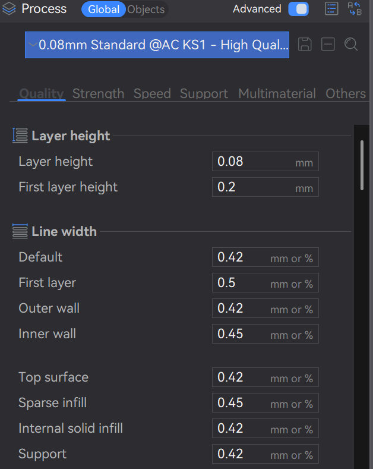</p>
<p align="center"><sub>V4.1 captured quality profile: layer heights and extrusion widths.</sub></p>
<p align="center">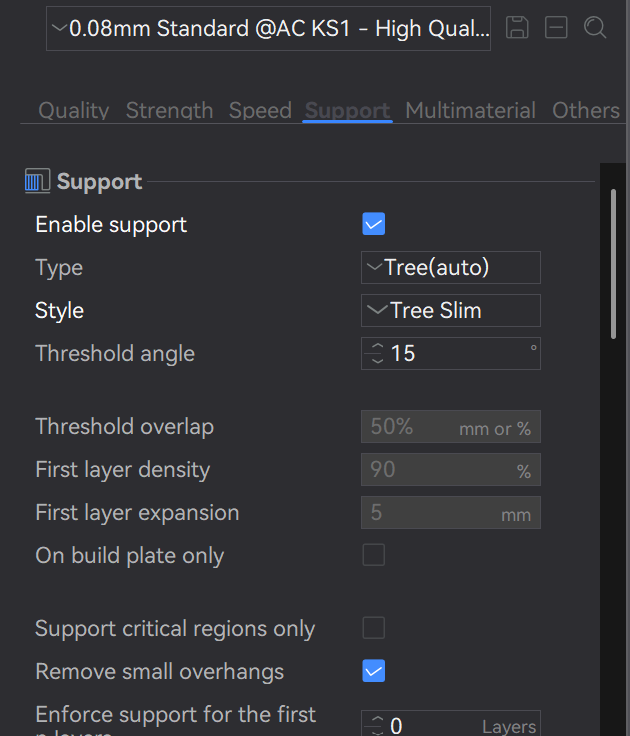</p>
<p align="center"><sub>V4.1 captured support profile: automatic slim tree supports and 15° threshold.</sub></p>

#### 2.2 Hardware assembly sequence

| Step | Procedure | Acceptance check |
|---|---|---|
| 1. Main PCB chassis | Inspect both sides of the manufactured PCB; check connectors, solder joints, mounting holes and isolation before fitting mechanical supports. | No visible bridges, damage or unintended contact with fasteners. |
| 2. Rear drive support | Fit `drive-system-mount.step` hardware onto the chassis. Install motor, transmission, bearings and differential in the orientation shown in the CAD/video. | Rotate by hand; gears mesh freely without rubbing or excessive play. |
| 3. Rear wheels | Fit rear wheel assemblies and silicone contact surfaces. Secure the wheels using the documented mechanical interfaces. | Both wheels turn freely and the differential permits unequal wheel speeds. |
| 4. Front support | Attach the steering/camera mounting structure. Fit left/right hubs in their correct handed positions, front wheels and steering bar. | Free motion throughout the steering travel; wheels approximately parallel at neutral. |
| 5. Servo | With drive disabled, power the servo using the steering test; command neutral before attaching the horn/linkage. Disconnect power before tightening or adjusting linkage. | Both steering directions work without binding or hitting hard stops. |
| 6. Battery mount | Install battery bracket and retention method; keep battery disconnected. | Battery cannot slide into moving mechanisms; connector accessible. |
| 7. Sensors | Mount four ToF boards facing front, left, right and back, install IMU rigidly, place floor-marker sensor toward the track and fit camera on its support. | Optical windows unobstructed, sensor direction and camera ROI checked. |
| 8. Wiring | Connect the motor, servo, encoder, sensors, camera UART and supply connections according to the PCB schematics and controller pin definitions. Secure wiring clear of wheels and linkage. | Verify connector polarity, common ground, continuity and correct supply voltages before connecting devices. |
| 9. First power | With wheels raised and drive disabled, verify power rails and serial initialization. Confirm all four ToF addresses and stationary IMU calibration before starting motors. | No unexpected heating, resets or movement; stop and investigate faults. |
| 10. Calibration | Follow the steering, encoder, camera, ToF and IMU checks below, then perform controlled low-speed driving. | Record measured results with the actual firmware SHA. |

#### 2.3 Assembly photographs from V4.1

The following V4.1 photographs show the subassemblies at different stages of construction.

<p align="center">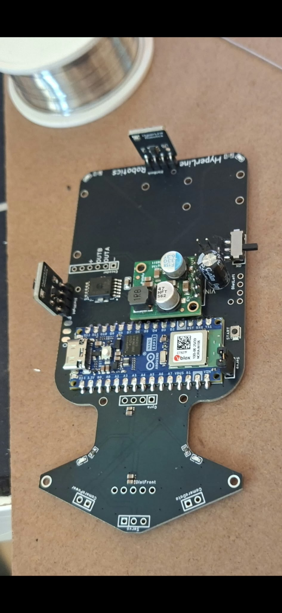</p>
<p align="center"><sub>Structural PCB populated with the Nano ESP32, regulator, drive electronics and sensor boards; remaining headers and mounting holes are accessible.</sub></p>
<p align="center">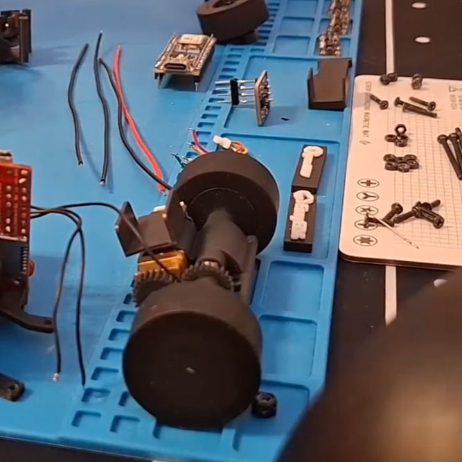</p>
<p align="center"><sub>Rear drivetrain on the workbench: wheels, visible gears, motor and drive support before installation.</sub></p>
<p align="center">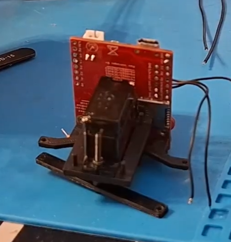</p>
<p align="center"><sub>Front camera/servo mounting subassembly with steering linkage elements; wheels are not yet attached in this view.</sub></p>
<p align="center">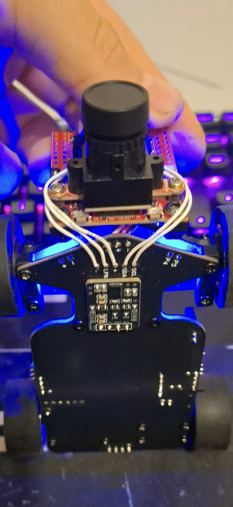</p>
<p align="center"><sub>Installed camera and front sensor wiring on the chassis. Route leads clear of the steering linkage and check polarity against the schematic.</sub></p>
<p align="center">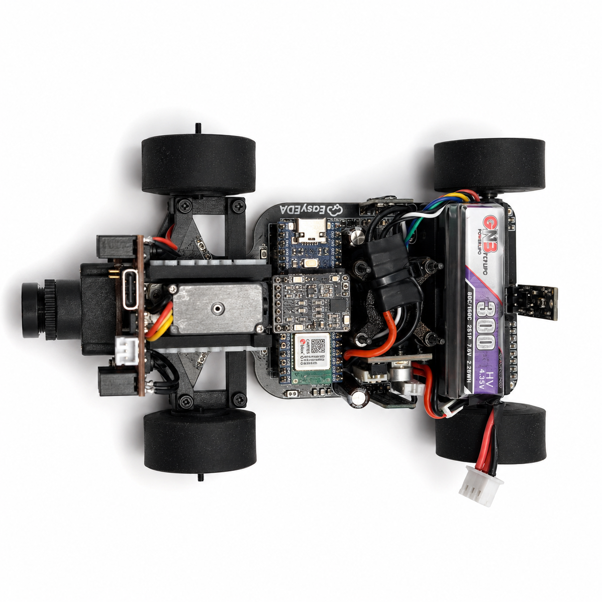</p>
<p align="center"><sub>Existing assembled-vehicle photograph: integrated chassis, drivetrain, electronics and battery.</sub></p>

See the [six vehicle views](../v-photos/) and [assembly video](https://youtu.be/HSzWATB6nWQ) for additional orientation.

### 3. Prepare the software environment

The Arduino Nano ESP32 runs the vehicle controller; the OpenMV RT1062 runs the separate camera script. The source files are part of the selected project snapshot. The later V4.1 controller imports the following libraries and interfaces:

| Device or dependency | Required interface | Installation or source reference |
| --- | --- | --- |
| Arduino Nano ESP32 board package | Nano digital/analog pin names, `Serial0`, `Wire`, GPIO and PWM | Install the **Arduino Nano ESP32** board platform through Arduino IDE Boards Manager |
| `ESP32Encoder` | Encoder library included by the controller | Install through Arduino IDE Library Manager |
| `ESP32Servo` | `Servo.attach()` and `Servo.write()` for front-wheel steering | Install through Arduino IDE Library Manager |
| SparkFun VL53L5CX Arduino Library | `SparkFun_VL53L5CX` methods used by [`tof.ino`](../src/HLR_FE_World_Final/tof.ino) | Install the SparkFun VL53L5CX Arduino Library |
| BMI088 library | `BMI088.h` exposing `setAccScaleRange`, `setAccPoweMode`, `setGyroOutputDataRate` and `getGyroscopeZ` | Use a BMI088 implementation with the **same API as [`gyro.ino`](../src/HLR_FE_World_Final/gyro.ino)**; libraries with the same header name are not necessarily interchangeable |
| OpenMV IDE and RT1062 firmware | `sensor`, `machine.UART` and `machine.LED` in MicroPython | Run [`src/camera.py`](../src/camera.py) on the RT1062 |

`Wire` is supplied by the Arduino board platform. The TCS34725 is accessed directly over its separate I²C bus, rather than through an additional Arduino color-sensor library.

**Included Arduino libraries.** To make the software environment easier to reproduce, we have included the library versions used during development in [`src/libraries/`](../src/libraries/). The folder contains **Seeed Studio BMI088 v1.0.0**, **ESP32Encoder v5.0.0**, **ESP32Servo v3.0.3**, **SparkFun VL53L5CX v1.0.3**, **Adafruit TCS34725 v1.4.4** and **EspSoftwareSerial v8.1.0**. These version numbers come directly from the included `library.properties` files. These copies preserve the library implementations alongside our source code, particularly the BMI088 interface used by the robot's gyroscope routines. To install them, copy each library directory into the Arduino sketchbook's `libraries` folder, restart Arduino IDE, and verify that the compiler selects these copies. The board package is installed separately. The checked-in [build workflow](../.github/workflows/verify-v41.yml) selects `arduino:esp32@2.0.18-arduino.5` and board FQBN `arduino:esp32:nano_nora`. The actual IDE and OpenMV firmware versions are recorded with the build environment.

Use Arduino IDE Boards Manager and Library Manager to select and record the installed dependencies. Arduino CLI provides the same information:

```bash
arduino-cli version
arduino-cli core list
arduino-cli lib list
arduino-cli board list
```

Use the selected Nano ESP32 board and the corresponding sketch revision when verifying the build. In Arduino IDE, **Sketch → Verify/Compile** displays errors, warnings and the actual dependency paths selected by the compiler. If a different BMI088 API is installed, resolve the library mismatch rather than changing the robot's pinout or sensor algorithm to silence errors.

### 4. Flash the Arduino Nano ESP32

The Arduino Nano ESP32 executes the vehicle control software. Its entry point is [`src/HLR_FE_World_Final/HLR_FE_World_Final.ino`](../src/HLR_FE_World_Final/HLR_FE_World_Final.ino).

1. Install Arduino IDE and the **Arduino Nano ESP32** board support package through **Boards Manager**.
2. Connect the controller using a **USB-C data cable**.
3. Open `src/HLR_FE_World_Final/HLR_FE_World_Final.ino`. Confirm that `functions.ino`, `gyro.ino`, `motors.ino`, `tof.ino`, `Open.ino`, `Final.ino` and `Telemetry.ino` open as tabs in the same sketch.
4. Install the dependencies needed by the selected revision. Use the supplied library copies where appropriate and check for compilation conflicts.
5. Select **Tools → Board → Arduino Nano ESP32**, then choose the correct port in **Tools → Port**.
6. Before power-up, select the challenge at the D11/D12 inputs: **D11 HIGH and D12 LOW = Final; D12 HIGH and D11 LOW = Open**. Both HIGH or both LOW activate a safe stop. These inputs accept **3.3 V logic**. Inspect the motor direction, steering limits, encoder parameters, IMU settings, camera communication and driving speeds against the assembled hardware. The unused fan control remains at zero.
7. Select **Verify** and resolve compile errors before uploading.
8. Raise the driving wheels off the floor, select **Upload**, then restart the controller.
9. Open **Serial Monitor** at **115200 baud** for controller diagnostics. The RT1062 UART link uses **19,200 baud** on a separate interface. The four ToF addresses are front `0x30`, left `0x31`, right `0x32` and back `0x33`.

### 5. Flash the OpenMV RT1062

The OpenMV RT1062 performs image capture, red/green detection and Surprise Rule height classification. The project camera source is [`src/camera.py`](../src/camera.py).

1. Install **OpenMV IDE** and connect the **OpenMV RT1062** through a USB data cable.
2. Connect to the camera in OpenMV IDE and complete any required camera firmware initialization.
3. Open the RT1062-compatible `camera.py`, select **Run**, and inspect the image in the IDE frame buffer.
4. Present red and green traffic signs of 50, 100 and 150 mm. Check both regions of interest, the height ratio, visible/effective colour, bottom-Y close trigger (170 px), and the UART command. Move signs across both horizontal edges to check that passing commands are suppressed while clipped. Record the actual observations in [sign_height_trials.csv](validation/physical/sign_height_trials.csv).
5. Verify the communication link to the Nano ESP32. Camera transmit must reach the appropriate controller receive connection; the controllers must share a common ground and use a matching baud rate and message format. Use the [Arduino/OpenMV communication test](../src/tests/arduino_openmv_serial_communication/) to check the connection independently of driving.
6. When the script runs correctly, use **Tools → Save open script to OpenMV Cam** so that it is saved as the camera's startup program. Restart the RT1062 without the IDE and verify that detection and communication resume.

On the RT1062, **P4 = UART1 TX** and **P5 = UART1 RX**, at **19,200 baud** in this release. Connect TX to the Nano UART receive and use a common GND. Both devices use 3.3 V logic. Keep the matching camera script and controller revision together. The controller also routes its camera communication over D0/D1 (Serial0).

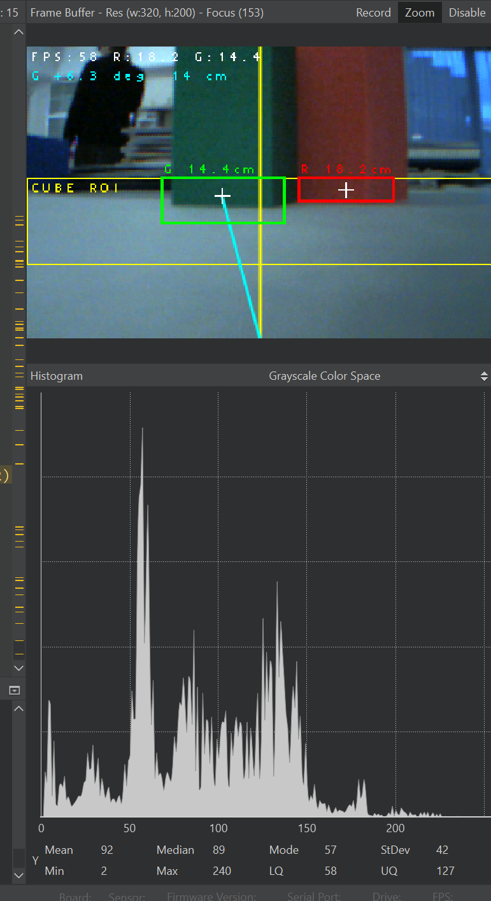

*Figure 6.1. OpenMV RT1062 frame buffer used to verify image orientation, detection thresholds and the active region of interest.*

---

## Calibration and setup

The steps below connect the assembled robot to the values in the **modular V4.1** firmware. The earlier filmed program has a different hardware and software layout and uses the constants in its own commit. This section is a compact index of the settings that affect repeatability; the calculations and full sensing rationale remain in [02. Mobility](02-mobility.md), [03. Power and sensors](03-power-sensors.md) and [04. Software](04-software.md).

### Mechanical, sensor and communications calibration

| Order | Subsystem | V4.1 source setting and procedure | Expected check |
| ---: | --- | --- | --- |
| 1 | **Steering neutral and stops** | [`HLR_FE_World_Final.ino`](../src/HLR_FE_World_Final/HLR_FE_World_Final.ino) sets `STEERING_CENTER = 85`, `STEERING_LEFT = 30`, `STEERING_RIGHT = 140`, and parking endpoints `30` / `140`. Center the linkage before fixing the servo horn; inspect both wheel clearances with the wheels raised. | The wheels are aligned at neutral; commanded travel does not force the links into the chassis or steering stops. |
| 2 | **Motor direction and encoder** | Rear motor PWM on D7, direction on D8; encoder A on D5 (rising-edge interrupt), B on D4 (direction). The source defines `WHEEL_DIAM = 29.0` mm and `MM_PER_TICK = 0.858` mm for its distance helper. Drive a measured straight distance on the actual surface and compare to `read_cm()`. | Positive wheel travel has the expected encoder direction and measured displacement agrees with the selected distance conversion. |
| 3 | **BMI088 heading** | [`gyro.ino`](../src/HLR_FE_World_Final/gyro.ino) estimates Z-axis bias over `DRIFT_TEST_TIME = 10` seconds at boot, with ±2000°/s gyro and ±6 g accelerometer settings. Keep the robot still during this interval, then rotate it manually both ways. | Heading increases/decreases consistently with the sign expected by the steering controller, without visible stationary jumps. |
| 4 | **Four ToF matrices** | [`tof.ino`](../src/HLR_FE_World_Final/tof.ino) releases one LPn pin at a time and assigns front A3=`0x30`, left A2=`0x31`, right A1=`0x32`, rear A0=`0x33`; each is 4×4, configured at 30 Hz. Test all four optical directions with a flat target and check that mount/wheels do not occlude the field of view. | All four sensors initialize with unique addresses and provide valid ranges for targets in their respective directions. |
| 5 | **Front corner zones** | The Open controller uses front ToF zones `(2,3)` and `(3,3)` (1-based row/column) for a corner below 700 mm (current World Final source), with three agreeing fresh pairs and rearming after 600 ms and 25 cm of straight travel. Data older than 150 ms is rejected. Check which physical side corresponds to those zones after mounting. | The correct wall and zones trigger a single turn, without mirrored indexing or repeated corner events. |
| 6 | **Floor colors** | The TCS34725 uses separate I²C pins A6/A7. [`functions.ino`](../src/HLR_FE_World_Final/functions.ino) reads normalized RGB channels; the source selects 16× gain and a short exposure. Present white, blue and red/orange field markings at the installed floor clearance. | White re-arms detection and colored markers set or confirm the intended travel direction. |
| 7 | **RT1062 image and UART** | [`camera.py`](../src/camera.py) configures QVGA 320×240, `vflip=True`, `hmirror=True`, gain/AWB disabled, fixed 40,000 µs exposure, 24 dB gain and RGB gains (60.2, 61.8, 68.2) dB and `UART(1, 19200)`. Connect P4 TX to Nano RX D0, and share ground. Recheck red/green blob thresholds under the actual lighting. | Red and green objects appear in the configured region of interest; the Nano receives correctly formatted UART messages. |
| 8 | **Round selection and start** | D12 HIGH and D11 LOW selects Open; D11 HIGH and D12 LOW selects Final. Both HIGH or both LOW leave the program stopped. Restart after changing mode. D10 is an active-LOW start input. | The requested challenge starts only after initialization and the start action; invalid mode combinations never drive the motor. |

For encoder calibration, with the same counting convention as the selected sketch, a useful correction after measuring one straight run is:

\[
\mathrm{MM\_PER\_TICK}_{\mathrm{new}}=\mathrm{MM\_PER\_TICK}_{\mathrm{old}}\frac{d_{\mathrm{measured}}}{d_{\mathrm{commanded}}}.
\]

The encoder distance factor depends on wheel circumference, interrupt edge counting and the drivetrain ratio.

### Challenge configuration reference

The following table lists the controller configuration used by the World Final source.

| Setting | Open Challenge (`Open.ino`) | Obstacle / Final Challenge (`Final.ino`) |
| --- | ---: | ---: |
| `max_turns` | 12 | 13 |
| Initial `robot_speed` command | 250 (first-marker logic temporarily uses 80) | 50 |
| `kp` | 0.028 | 0.038 |
| `ki` | 0 | 0 |
| `kd` | 0.080 | 0.070 |
| `delayTurns` | 1000 ms | 1500 ms |
| Additional behavior | ToF-driven turns; corner PWM command 80 | Colored-pillar interaction and parking; `park_speed = 32` in main sketch |

Motor speed values are controller PWM commands on an 8-bit scale, **not km/h or motor terminal voltage**. The nominal 6 V motor is intentionally operated from the robot's 2S LiHV drive rail as documented in [Chapter 03](03-power-sensors.md); avoid interpreting the PWM fraction as an electrical or thermal protection guarantee.

---

## Running the vehicle

After flashing both devices, disconnect programming cables as appropriate for the power setup and secure the LiHV battery. Select the mode with **one** 3.3 V HIGH input: D12 for Open or D11 for Final. The sketch latches that selection when powered on. During initialization, keep the vehicle stationary for the BMI088's 10-second bias calibration; the start input is D10 (active LOW). The controller then waits for a start command before driving. The [calibration and setup sequence](#calibration-and-setup) summarizes the checks that connect the code settings to the assembled geometry.

### Connect to the World Final telemetry dashboard

The `src/HLR_FE_World_Final/` firmware integrates a read-only Wi-Fi dashboard in [`Telemetry.ino`](../src/HLR_FE_World_Final/Telemetry.ino). Unlike the historical configuration interface, this dashboard cannot change driving parameters or send motor commands. It starts only in Final mode.

1. Flash the complete `HLR_FE_World_Final` sketch with its matching hardware and camera code. Select Final mode before boot.
2. Keep the wheels raised or the robot securely stationary during connection and initial checks. Allow IMU initialization to complete.
3. Join SSID `HyperLine` using password `HyperLine-FE`, then open [http://192.168.4.1](http://192.168.4.1). Internet access is unnecessary.
4. Check the Live indicator and the robot state. Observe yaw, target, heading error, angular rate, gyro bias, acceleration, pitch/roll, PWM, encoder counts, camera commands and all four cached 4×4 ToF matrices, selected zones and their ages.
5. Capture the actual dashboard during stationary tests, controlled movement and parking. Record the flashed SHA, date and scenario with each image.


#### Captured dashboard views

The dashboard at `192.168.4.1` presents IMU, motor, ToF, camera and navigation data. The screenshots show the layout during connection and the saved yaw history.

<p align="center">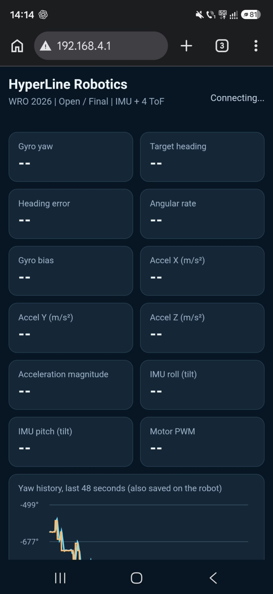</p>
<p align="center"><sub>IMU, heading, acceleration, tilt and PWM cards during dashboard connection.</sub></p>
<p align="center">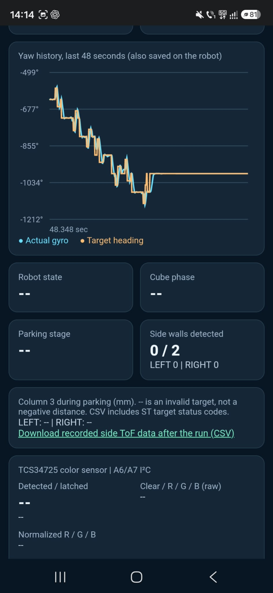</p>
<p align="center"><sub>Stored yaw history, state cards, parking CSV link and floor-color panel. The plot shows actual and target headings converging after transient deviations.</sub></p>
<p align="center">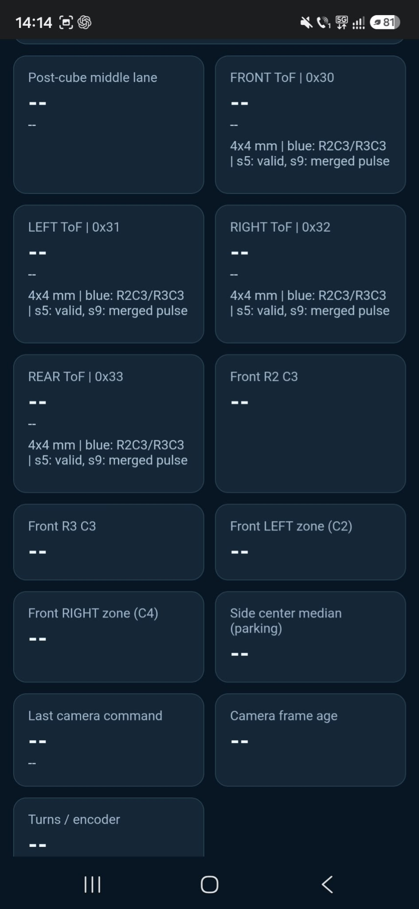</p>
<p align="center"><sub>Front, left, right and rear module panels with their I²C addresses and selected zones; interface layout during connection.</sub></p>

For the JSON matrix format, cached-data freshness and export procedure see [software telemetry](04-software.md#world-final-read-only-telemetry). For the populated 8×8 diagnostic capture see [ToF matrix evidence](03-power-sensors.md#world-final-tof-matrix-evidence). The [media index](media-index.md) lists the journal images.

---

## Testing workflow

Our verification approach has three stages: individual subsystems, integrated stationary operation and full-field autonomous driving. This separates mechanical faults, sensor configuration errors and navigation behavior. Calibration settings are listed in [Calibration and setup](#calibration-and-setup); the [driving video](https://www.youtube.com/watch?v=bg92ulHXomw) documents the physical vehicle running both challenge configurations using the filmed source revision identified above.

### 1. Independent subsystem tests

The test code is organized under [`src/tests/`](../src/tests/). Each test isolates a part of the vehicle before it is used together with the other systems.

| Test | Source | What a successful check looks like |
| --- | --- | --- |
| Drive motor | [`motor_test`](../src/tests/motor_test/) | A forward command produces the intended wheel direction; there is no binding or unexpected restart |
| Steering | [`servo_steering`](../src/tests/servo_steering/) | Wheels return to neutral and move in both steering directions without hitting mechanical stops |
| IMU | [`gyro_test`](../src/tests/gyro_test/) | Readings respond to manual rotation with the correct sign and do not show an obvious stationary fault |
| Straight-line controller | [`move_straight_on_gyro`](../src/tests/move_straight_on_gyro/) | The correction acts against a heading deviation rather than increasing it |
| Camera communication | [`arduino_openmv_serial_communication`](../src/tests/arduino_openmv_serial_communication/) | Nano receives valid, correctly formatted messages from the RT1062 |
| ToF sensor checks | [`tof.ino`](../src/HLR_FE_World_Final/tof.ino) and optional [diagnostic dashboard](#connect-to-the-world-final-telemetry-dashboard) | Each installed sensor responds to a target moving through its field of view |
| Camera classification | [OpenMV frame buffer](#5-flash-the-openmv-rt1062) | Red and green objects in the configured ROI are identified consistently |

Initial motor and steering checks are performed with the driven wheels raised. The table describes the visible and electronic responses of each subsystem.

### 2. Bench verification with telemetry

Once individual components pass, run the controller and camera together while the robot remains stationary. Use the serial diagnostic output or the [World Final telemetry dashboard](#connect-to-the-world-final-telemetry-dashboard) in Final mode, to read ToF and IMU data, and use the OpenMV IDE frame buffer to verify visual detection. Also check that the camera's serial messages reach the Nano ESP32 and that the robot initializes without unexpected motion.

A useful bench sequence is to rotate the robot by hand, move targets past the distance sensors and show red and green pillars to the camera. If the physical input changes but the reported state does not, investigate the relevant subsystem before changing the autonomous strategy.

### 3. Full-field verification

For full-field verification, start from the assembled and calibrated vehicle, then run Open Challenge in both travel directions and Obstacle Challenge with the intended red/green pillar arrangement and parking geometry. Observe turn detection, obstacle pass side, heading recovery and the final stop. The video index and footage below document the robot on the field; the exact filming software revision is [`de34faf`](https://github.com/andreipopescufilimon/WRO2026_Future_Engineers/commit/de34faf039a70443361197de540879f212e3de81).

Field runs use the obstacle geometry and driving behavior described in [04. Software](04-software.md). Video evidence is collected under [`video/`](../video/), while design changes and engineering decisions are discussed in [05. Systems and testing](05-systems.md).

### 4. Development and operation records

The V4.1 assembly photographs show the drivetrain, steering mount, populated PCB and sensor wiring. The [ToF diagnostic capture](03-power-sensors.md#world-final-tof-matrix-evidence) records a populated 8×8 distance matrix, and the [yaw plot](04-software.md#captured-v41-dashboard-and-data-interpretation) records the response of actual heading to the target heading. The [assembly video](https://youtu.be/HSzWATB6nWQ) and [driving video](https://www.youtube.com/watch?v=bg92ulHXomw) show the physical robot and its autonomous operation.

## Versions and development history

| Version | Role | Main engineering differences |
| --- | --- | --- |
| **V4** | National competition robot | Earlier distance-sensing hardware, drive motor and lighter wheel rims |
| **V4.1** | Current development | Revised ToF sensing, higher-torque 50:1 drive motor and heavier steel wheel rims; fan and ESC removed |

### Version-specific GitHub commits

The GitHub history preserves earlier mechanical and software configurations, the source used during filming and the later V4.1 development checkpoints.

| Robot version | GitHub commit | Description |
| --- | --- | --- |
| **V4** | [View V4 commit](https://github.com/andreipopescufilimon/WRO2026_Future_Engineers/commit/7e1b0b5b707511563fd0250af08e68c7288d2966) | National competition configuration, including the original drivetrain, distance sensors and wheel assemblies |
| **Filmed robot software** | [Filming firmware commit `de34faf`](https://github.com/andreipopescufilimon/WRO2026_Future_Engineers/commit/de34faf039a70443361197de540879f212e3de81) | Team-identified source revision used for the real Open and Obstacle Challenge recording; Arduino entry point `src/HLR_FE/HLR_FE.ino` |
| **V4.1 development checkpoint** | [View historical commit](https://github.com/andreipopescufilimon/WRO2026_Future_Engineers/commit/fee1a8440b3251d7454f14fb1ae3a48e173f498c) | Electronics manufacturing-file update from the V4.1 development period |

The filmed robot used the earlier `src/HLR_FE/` sketch. The later V4.1 source separates the Open and Obstacle Challenge routines in `src/HLR_FE_World_Final/`, reflecting the changes in sensor handling and program structure.

### Filming firmware and modular revision

The team identifies [`de34faf039a70443361197de540879f212e3de81`](https://github.com/andreipopescufilimon/WRO2026_Future_Engineers/commit/de34faf039a70443361197de540879f212e3de81) as the code revision running in the [real Open and Obstacle Challenge footage](https://www.youtube.com/watch?v=bg92ulHXomw). That snapshot contains `src/HLR_FE/HLR_FE.ino`. Its source, camera program and mechanical/electrical documentation are accessible as a fixed historical Git state.

The historical source snapshot [`045c57e7388c08f9281642a864de0ba3b099c0df`](https://github.com/andreipopescufilimon/WRO2026_Future_Engineers/commit/045c57e7388c08f9281642a864de0ba3b099c0df) contains `src/HLR_FE_Separated/`, which moves Open and Final behavior into their respective files and uses the four-matrix ToF interface. The current configuration and calibration references in this chapter come from `src/HLR_FE_World_Final/`. This distinction keeps the historical demonstration and newer implementation individually traceable.

| Release resource | Reference |
| --- | --- |
| Filmed source and matching historical files | [Commit `de34faf`](https://github.com/andreipopescufilimon/WRO2026_Future_Engineers/commit/de34faf039a70443361197de540879f212e3de81) |
| Current modular controller | [World Final sketch](../src/HLR_FE_World_Final/) · [Source and dependency manifest](validation/v41_release_manifest.csv) |
| Earlier modular development checkpoint | [Commit `045c57e`](https://github.com/andreipopescufilimon/WRO2026_Future_Engineers/commit/045c57e7388c08f9281642a864de0ba3b099c0df) |
| Assembled vehicle | [Assembly video](https://youtu.be/HSzWATB6nWQ) and [robot photographs](../v-photos/) |
| Real-world autonomous operation | [Open and Obstacle driving video](https://www.youtube.com/watch?v=bg92ulHXomw) |
| Physical sensor and control references | [Power and sensors](03-power-sensors.md), [mobility](02-mobility.md) and [systems](05-systems.md) |


### Reproducing a fixed firmware revision

Build the eight-file sketch and camera program from the same repository revision. The [source manifest](validation/v41_release_manifest.csv) identifies the file hashes and bundled dependency versions. The World Final camera program is the team-supplied 50/100/150 mm implementation in `src/camera.py`, with its SHA-256 in the manifest. In OpenMV IDE, read the installed RT1062 MicroPython firmware version from the connected camera. Record the actual Git commit, installed board package, camera firmware version and compiler outcome in [build_verification.csv](validation/physical/build_verification.csv). The GitHub workflow stores the build log and selected versions as a downloadable artifact. When recording a driving run, use the flashed revision in [challenge_runs.csv](validation/physical/challenge_runs.csv).

The [video index](../video/video.md) provides separate Open Round and Final Round (Obstacle Challenge) entries, with the earlier combined recording and assembly video retained separately. [Recorded engineering observations](validation/physical/SUMMARY.md) link the original diagnostic captures.
